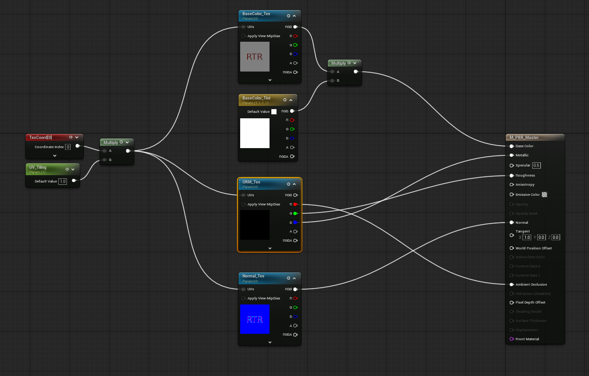
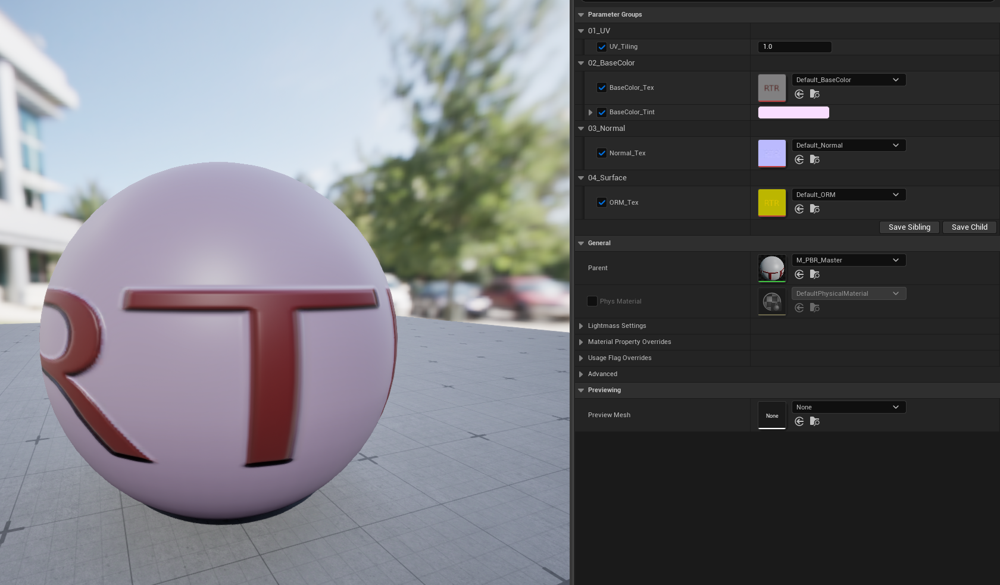
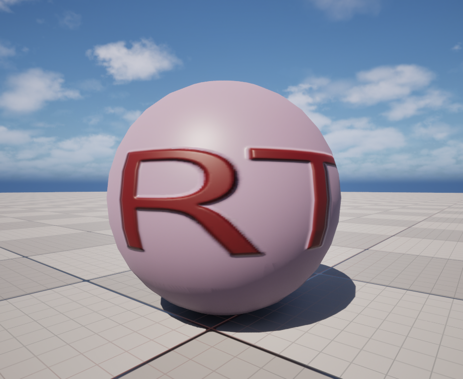
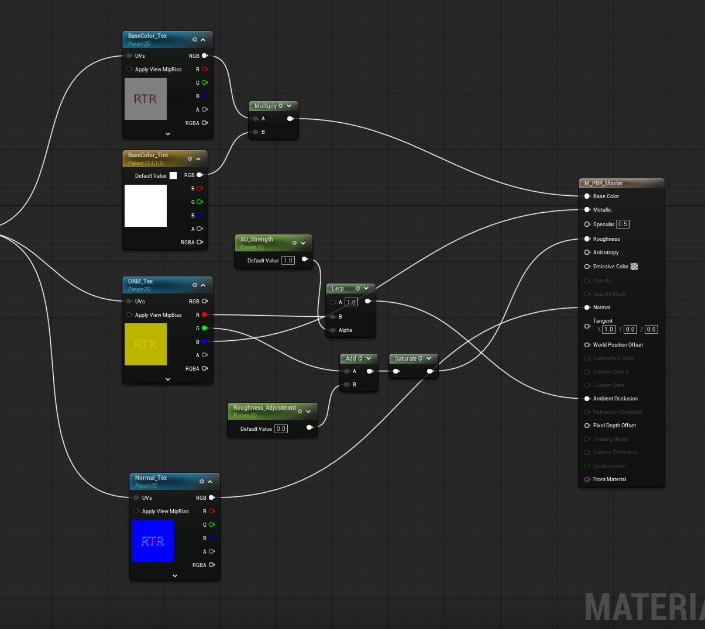
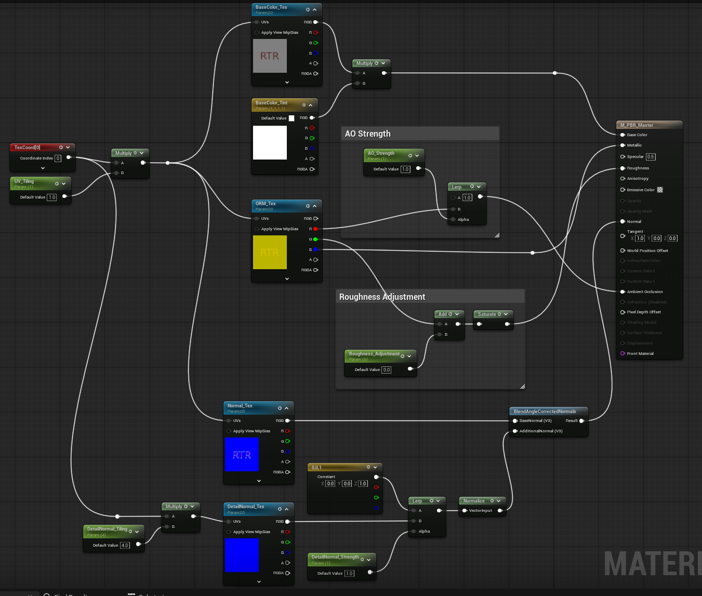
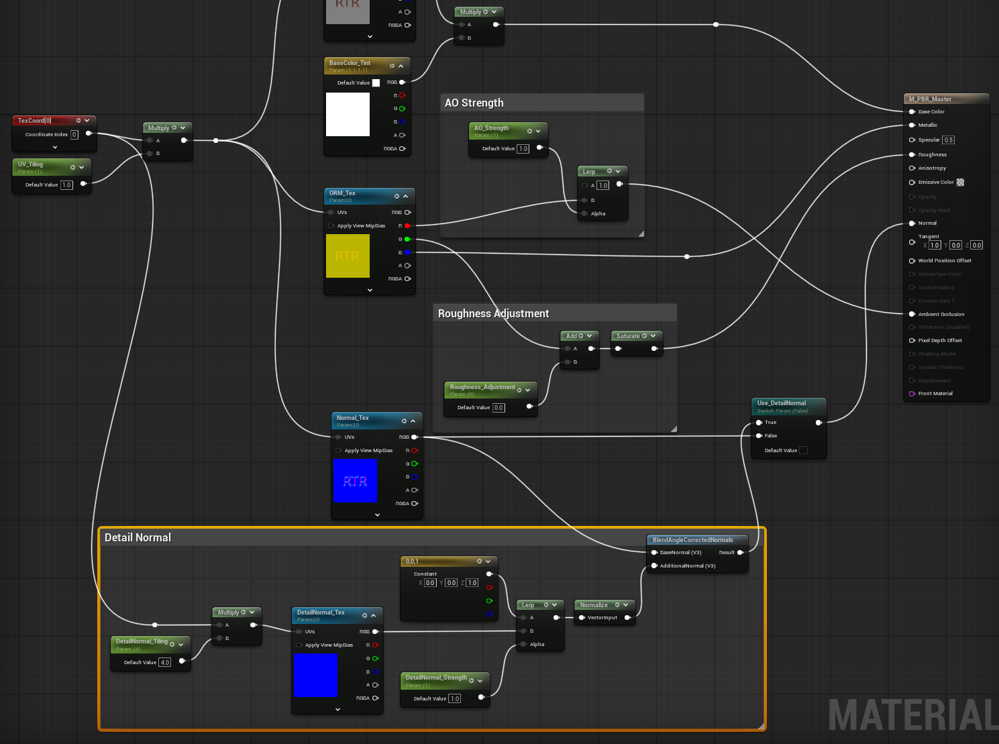
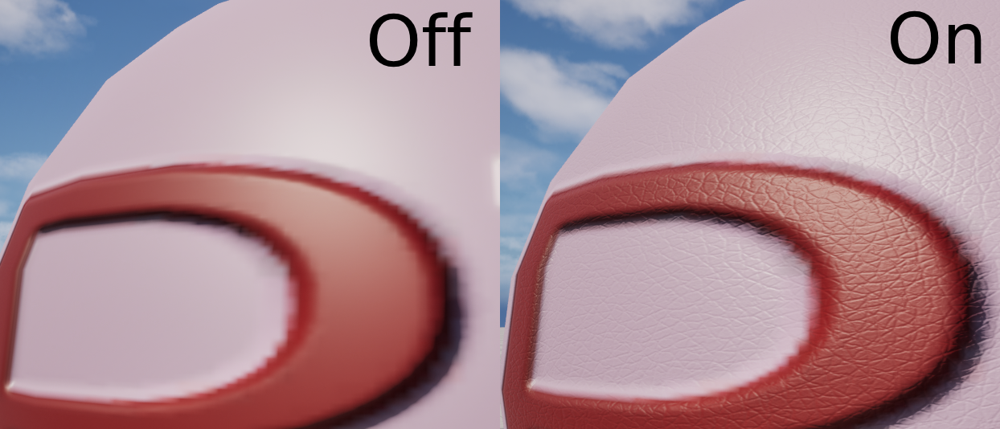
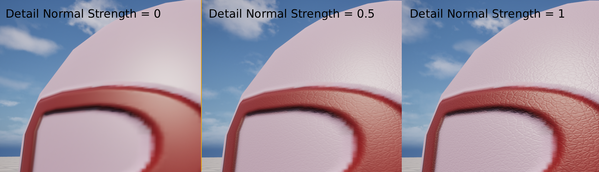
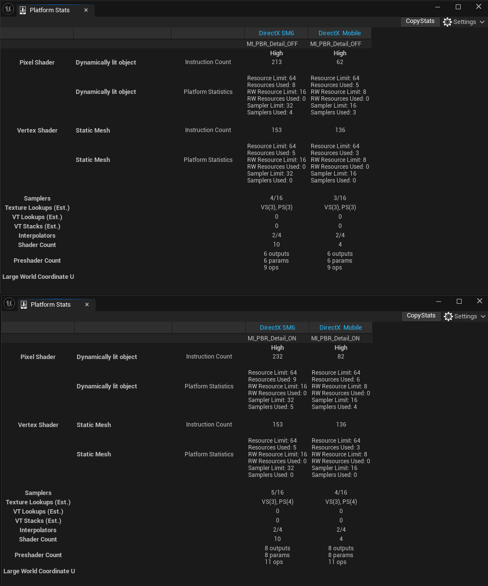

# Chapter 01 — Production PBR Master Material

> Public edition — 공개 검토를 통과한 자료와 기술 기록을 담았다. [Public Release Scope](Public_Release_Scope.md)

> Status : Draft / User Review
> Updated : 2026-10-13 (KST)
> Environment : Unreal Engine 5.8.3 / Deferred / Default Lit
> Validation Hardware : NVIDIA GeForce RTX 5080 (User Reported)
> Scope : `M_PBR_Master`, Material Instance, Surface Controls, Detail Normal, Static Switch, Visual Validation and Shader Statistics

Foundation에서 정리한 Material Input과 Lighting 원리를 실제 제작에 사용할 수 있는 Master Material 구조로 연결한다. 이번 Chapter의 중심은 PBR 이론을 다시 증명하는 데 있지 않다. Texture Data를 일관되게 해석하고, Artist가 Material Instance에서 필요한 값만 조절하며, 선택 기능의 시각적 결과와 Shader Cost를 함께 판단할 수 있게 만드는 데 있다.

작성 기준은 사용자가 검수하고 정상 작동을 확인한 구현과 `Figures/Chapter01/Fig1_01.png`부터 `Fig1_09.png`까지의 실제 Screenshot이다. Graph 연결, Parameter 기본값, Sphere 비교 결과와 Platform Stats를 이 근거에 맞춰 기록한다. 이번 문서 작성 과정에서는 Unreal Engine을 다시 실행하거나 GPU Time을 측정하지 않았다. 문서 자체는 사용자 검토 전 Draft이며, 구현의 확인 범위와 후속 검증은 아래에서 구분한다.

이 파일의 Section 1.1–1.9는 공통 Master의 Default Lit 기준선을 유지한다. 이후 Character Head에 적용한 전용 Skin 구현은 [Chapter 02 — Production Skin Shader](Chapter02_ProductionSkinShader.md)에 이어 기록한다. 현재 Skin은 사용자 보고 기준 1차 구현 완료이며, 최종 Lookdev / Production Ready 검증과 GPU Profiling은 후속이다.

---

## Contents

- [1.1 Overview](#11-overview)
- [1.2 Material Architecture](#12-material-architecture)
- [1.3 Material Instance and Artist Controls](#13-material-instance-and-artist-controls)
- [1.4 Roughness Adjustment and AO Strength](#14-roughness-adjustment-and-ao-strength)
- [1.5 Detail Normal](#15-detail-normal)
- [1.6 Static Switch](#16-static-switch)
- [1.7 Visual Validation](#17-visual-validation)
- [1.8 Shader Cost Analysis](#18-shader-cost-analysis)
- [1.9 Technical Decisions and Open Items](#19-technical-decisions-and-open-items)
- [Chapter 02 — Production Skin Shader](Chapter02_ProductionSkinShader.md)

---

## 1.1 Overview

### Production Goal

Material을 대상마다 새로 만들면 Texture 연결, Parameter 이름과 기본값이 조금씩 달라진다. 같은 Roughness Texture를 사용하더라도 Material마다 조절 방식이 다르면 Artist가 결과를 예측하기 어렵고, 문제가 발생했을 때 어느 단계에서 Data가 달라졌는지 추적하기도 어렵다.

`M_PBR_Master`는 공통 Data Flow를 한곳에 유지한다. Material Instance는 그 구조를 물려받고 Texture와 조절값을 바꾼다. 이 구분을 통해 구조의 수정은 Master에서, 대상별 Appearance 조절은 Instance에서 수행할 수 있다. 여기서 Production은 조절 의도, 기본 상태와 선택 기능의 비용이 설명되는 구조를 뜻한다. Character 전체에 대한 제작·검증 완료를 뜻하지 않는다.

이번 구현은 UE 5.8.3의 Deferred Rendering과 Default Lit을 사용한다. Material은 Base Color, Normal, Ambient Occlusion, Roughness와 Metallic을 준비하고, 해당 입력을 이용한 Shading은 Engine의 Default Lit 경로에 맡긴다. Foundation의 BRDF나 Lighting Equation을 별도의 Custom Lighting Graph로 다시 구현하지 않는다.

### Scope and Validation Boundary

확인된 범위는 기본 PBR 입력, Material Instance의 Parameter 조절, Roughness Adjustment와 AO Strength, Detail Normal의 독립 Tiling과 Strength, Static Switch를 이용한 ON/OFF, Sphere의 시각적 비교와 Shader Statistics다. 사용자는 Screenshot 검수와 정상 작동 확인을 마쳤다.

Sphere는 기본 입력과 추가 기능을 비교하기 위한 대상이다. 이 결과를 Skin, Hair, Eye 등 Character의 모든 Surface에 그대로 적용할 수 있다고 결론 내리지는 않는다. 현재 Character Head의 Skin 전용 구현과 검증은 연결된 Skin 문서에 기록한다. 나머지 Character Surface 적용, 거리별 Detail 유지와 GPU Profiling은 후속 작업이다. POM은 별도 R&D로 관리한다.

---

## 1.2 Material Architecture

### Data Flow

기본 구조는 Mesh UV에서 시작한다. `TexCoord[0]`에 `UV_Tiling`을 곱해 공통 Sampling 좌표를 만들고, 이 좌표를 `BaseColor_Tex`, `Normal_Tex`, `ORM_Tex`에 전달한다. 세 Texture가 같은 좌표를 사용하므로 색, 기본 요철과 Surface Mask의 위치 관계를 함께 유지할 수 있다.

Sampling 이후에는 각 Texture의 의미에 따라 경로가 나뉜다. Base Color는 Tint와 곱해지고, Normal은 방향 Data로 전달되며, ORM은 Channel별로 분리된다. 초기 구조는 다음과 같다. Surface Controls와 Detail Normal은 이 구조 위에 추가한다.

```text
TexCoord[0] × UV_Tiling → Base UV
    ├─ BaseColor_Tex RGB × BaseColor_Tint RGB → Base Color
    ├─ Normal_Tex RGB                         → Base Normal
    └─ ORM_Tex
         ├─ R → Ambient Occlusion
         ├─ G → Roughness
         └─ B → Metallic
```

Figure 1-1에서는 하나의 UV 경로가 세 Texture에 전달되는 지점과 각 출력이 도착하는 Material Input을 확인한다. 이 Capture는 초기 PBR 연결이며, 이후에 추가하는 조절 기능까지 포함한 최종 Graph는 아니다.



**Figure 1-1. Initial PBR Master Material Graph.** Shared UV, Base Color Tint, Base Normal과 ORM Channel의 초기 연결이다. ORM의 R/G/B는 각각 Ambient Occlusion/Roughness/Metallic에 연결된다.

### UV and Base Color Tint

`UV_Tiling`의 Master 기본값은 `1`이다. 이 값에서는 원래 UV Scale을 유지한다. 값이 커지면 UV 범위가 넓어지고, 반복 Sampling이 가능한 Texture에서는 Pattern이 더 자주 반복되어 개별 무늬가 작게 보인다. 실제 반복 방식은 Texture Address 설정에 따르며, Character의 고유 UV와 Bake Texture에는 임의 Tiling이 적합하지 않을 수 있다.

Base Color의 계산은 다음과 같다.

```text
BaseColor = Sample(BaseColor_Tex, BaseUV).RGB × BaseColor_Tint.RGB
```

`BaseColor_Tint`의 Master 기본값은 White `(1, 1, 1)`이다. 이 값은 Multiply의 중립값이므로 원래 Texture Color를 유지한다. Instance에서 Tint를 변경하면 같은 Texture를 유지한 채 Color Variation을 만들 수 있다. Tint는 Texture의 Color에 곱해지는 값이므로, 원본에 없는 Pattern을 만들거나 모든 색을 동일한 방식으로 교체하는 기능은 아니다.

### Normal and ORM Input Contract

`Normal_Tex`는 Tangent Space Normal로 해석되어야 한다. Graph의 RGB 연결은 단순히 색 이미지를 Normal Input에 사용하는 의미가 아니다. Normal Texture가 저장한 방향 정보를 Normal Sampler가 해석한 결과를 사용하는 계약이다. Detail Normal도 같은 Space와 해석을 사용해야 한다.

ORM은 하나의 Texture에 세 Scalar Data를 저장한다. 이 Chapter의 Channel 계약은 다음과 같다.

| Channel | Data | Material Input |
|---|---|---|
| `ORM.R` | Ambient Occlusion | `Ambient Occlusion` |
| `ORM.G` | Roughness | `Roughness` |
| `ORM.B` | Metallic | `Metallic` |

Packing을 사용하면 세 값을 별도 Texture에서 읽는 대신 하나의 Sample에서 얻을 수 있다. 그러나 파일명만으로 Channel 의미가 보장되지는 않는다. 교체하는 Texture도 같은 계약으로 Export되어야 하며, 서로 다른 Packing을 연결하면 의도하지 않은 Surface Response가 만들어진다.

Color Texture와 수치 Data Texture의 해석도 구분한다. 일반적인 Base Color는 sRGB Color 입력으로, ORM은 sRGB를 끈 Linear Data로, Normal은 Normal Compression과 Normal Sampler Type으로 취급한다. 이 내용은 교체 Texture를 확인할 때의 계약이다. 제공된 Graph와 Viewport Capture만으로 모든 Texture Asset의 Import 설정까지 직접 확인했다고 기록하지 않는다. Normal Data와 sRGB 해석에 관한 일반 기준은 Epic의 [Texture Properties](https://dev.epicgames.com/documentation/en-us/unreal-engine/texture-properties?application_version=4.27)를 참고한다.

---

## 1.3 Material Instance and Artist Controls

### Master and Instance Responsibilities

Master는 입력의 의미와 계산 순서를 정의한다. Instance는 그 구조 안에서 Texture를 선택하고 Appearance를 조절한다. 따라서 Artist가 Tint를 바꾸거나 Detail 강도를 줄이기 위해 공통 Graph의 연결을 매번 수정할 필요가 없다.

Parameter Group은 같은 역할의 입력을 가까이 배치한다. Figure 1-2에서 확인되는 초기 Group은 `01_UV`, `02_BaseColor`, `03_Normal`, `04_Surface`다. `UV_Tiling`, Base Color Texture와 Tint, Base Normal Texture, ORM Texture가 각각 자신의 역할에 맞게 정리되어 있다.



**Figure 1-2. Material Instance Parameter Groups and Preview.** `M_PBR_Master`를 Parent로 사용하는 Instance의 입력과 Preview다. Instance의 Tint Override와 Master의 White 기본값은 구분해서 읽는다.

### Parameter Interface

다음 표는 Graph에 나타난 실제 Parameter 이름과 기본값을 기준으로 한다. 조절 범위는 Artist가 비교할 때 사용할 권장 범위이며, 모든 값에 Slider 제한이나 Clamp가 구현되어 있다는 뜻은 아니다. Detail Parameter의 최종 Group 배치는 제공된 Instance Capture만으로 확정하지 않는다.

| Parameter | Type | Master Default / Captured Input | Artist Intent |
|---|---|---|---|
| `UV_Tiling` | Scalar | `1` | 기본 세 Texture의 공통 UV Scale |
| `BaseColor_Tex` | Texture | Instance에서 `Default_BaseColor` 확인 | Base Color Data 교체 |
| `BaseColor_Tint` | Vector | White `(1, 1, 1)` | Base Color의 Multiplicative Tint |
| `Normal_Tex` | Texture | Instance에서 `Default_Normal` 확인 | Base Normal Data 교체 |
| `ORM_Tex` | Texture | Instance에서 `Default_ORM` 확인 | AO/Roughness/Metallic Data 교체 |
| `Roughness_Adjustment` | Scalar | `0` | Roughness에 Signed Offset 적용 |
| `AO_Strength` | Scalar | `1` | 권장 `0–1`에서 Material AO 기여 조절 |
| `DetailNormal_Tex` | Texture | Graph에서 Parameter 확인 | 반복 가능한 Detail Normal 선택 |
| `DetailNormal_Tiling` | Scalar | `4` | Base UV와 독립된 Detail Scale |
| `DetailNormal_Strength` | Scalar | `1` | 권장 `0–1`에서 Detail 방향 변화 조절 |
| `Use_DetailNormal` | Static Switch | `False` | Detail 경로의 Compile Variant 선택 |

Scalar와 Vector 조절은 이미 구성된 계산에 값을 제공한다. `Use_DetailNormal`은 계산에 사용할 경로 자체를 Compile Time에 선택한다. 두 종류를 같은 의미의 ON/OFF 조절로 취급하지 않는다. Parameter Group과 Static Parameter의 동작은 Epic의 [Material Parameter Expressions](https://dev.epicgames.com/documentation/en-us/unreal-engine/material-parameter-expressions-in-unreal-engine)에 설명되어 있다.

### Applied Sphere

Instance Preview에서 입력을 정리한 뒤 Scene의 Sphere에 적용해 외부 Lighting 아래의 결과를 확인한다. Figure 1-3에서는 Texture Pattern과 표면 방향 변화가 함께 나타나는 전체 Appearance를 볼 수 있다.



**Figure 1-3. Applied PBR Material on a Sphere.** Scene에 적용한 기본 PBR 결과다. 입력이 합쳐진 Appearance를 확인하는 근거이며, 각 Channel의 정확성이나 Character 적용 완료를 이 한 장으로 모두 판정하지 않는다.

---

## 1.4 Roughness Adjustment and AO Strength

### Roughness Adjustment

Texture를 다시 Export하지 않고 Surface의 Roughness를 조절할 수 있도록 `ORM.G` 이후에 Offset을 추가한다. 실제 Parameter 이름은 `Roughness_Adjustment`이며, Texture 값과 Parameter를 `Add`로 합친 다음 `Saturate`를 거쳐 Roughness Input에 전달한다.

```text
Roughness = Saturate(ORM.G + Roughness_Adjustment)
Default Roughness_Adjustment = 0
```

기본값 `0`에서는 원래 Roughness를 보존한다. Positive Offset은 값을 높여 Reflection이 더 넓게 퍼지는 방향으로, Negative Offset은 값을 낮춰 더 좁고 선명한 Highlight를 만드는 방향으로 조절한다. 최종 Appearance는 Light와 Reflection 환경의 영향도 함께 받는다.

`Saturate`는 결과를 `0–1`로 제한한다. Offset 때문에 범위를 벗어난 값을 Material Input에 그대로 보내지 않기 위한 단계다. 다만 경계에 도달한 여러 값은 모두 `0` 또는 `1`로 모이므로, 큰 Offset은 Texture 안의 Roughness 차이를 줄일 수 있다. 이 조절은 전체 분포를 이동시키는 기능이며 Roughness Contrast를 별도로 조절하는 기능은 아니다.

예를 들어 입력 Roughness가 `0.6`인 위치에 Offset `0.1`을 더하면 `0.7`이 된다. 입력 `0.95`에 같은 Offset을 더하면 Saturate 이후 `1`이 된다. 이 계산은 수식의 동작을 설명하는 예이며, Figure에서 측정한 Pixel 값은 아니다.

### AO Strength

AO를 약하게 만들 때는 원래 AO 값을 단순히 작게 곱하지 않는다. AO의 Neutral Value는 `1`이므로, AO를 없애려면 출력이 `1`에 가까워져야 한다. 이번 Graph는 `Lerp`의 A에 `1`, B에 `ORM.R`, Alpha에 `AO_Strength`를 연결한다.

```text
AO = Lerp(1, ORM.R, AO_Strength)
   = 1 + AO_Strength × (ORM.R - 1)
Default AO_Strength = 1
```

`AO_Strength = 1`이면 원래 AO를 사용한다. `0`이면 출력은 `1`이 되어 이 Material AO 입력의 Occlusion 기여를 없앤다. `0.5`이면 Neutral AO와 원래 AO 사이의 값을 사용한다. 예를 들어 `ORM.R = 0.4`인 위치에서 Strength `0.5`는 `0.7`을 출력한다. 이 역시 계산 예다.

현재 Graph에는 AO Lerp 이후의 별도 Saturate가 보이지 않는다. 따라서 `0–1`을 권장 조절 범위로 사용한다. 그 밖의 Alpha는 Interpolation이 아니라 Extrapolation이 되어 의도한 AO 범위를 벗어날 수 있다.

AO는 Surface의 간접적인 Occlusion 정보를 전달하는 입력이다. 이 Parameter를 Base Color 전체나 Direct Light를 일괄 어둡게 하는 조절로 해석하지 않는다. 실제 화면의 변화는 Rendering 경로와 Lighting 설정에 따라 달라질 수 있다. Lumen의 사용 여부와 Material AO 활성 조건은 이번 Capture에서 확정되지 않았으며 후속 확인 대상이다.

Figure 1-4에서는 두 조절이 같은 ORM Sample 이후 서로 다른 Channel에 적용되는 점을 확인한다. Metallic은 `ORM.B`에서 그대로 전달되고, Normal과 Base Color 경로도 자신의 역할을 유지한다.



**Figure 1-4. Surface Controls.** `ORM.G → Add → Saturate → Roughness`와 `Lerp(1, ORM.R, AO_Strength) → Ambient Occlusion`의 연결이다. Roughness Offset의 기본값은 `0`, AO Strength의 기본값은 `1`이다.

---

## 1.5 Detail Normal

### Why Detail Uses a Separate UV Scale

Base Normal은 대상의 고유 UV에 맞춘 형태와 요철을 담는다. Detail Normal은 그 위에 더 작은 Scale의 반복 Pattern을 추가한다. 두 Texture가 같은 Tiling 조절에 묶이면 Detail 크기를 바꾸는 작업이 Base Color나 Bake된 Base Normal의 크기까지 바꿀 수 있다.

이번 Graph는 원본 `TexCoord[0]`에서 두 경로를 나눈다. Base 경로는 `UV_Tiling`, Detail 경로는 `DetailNormal_Tiling`을 각각 곱한다.

```text
BaseUV   = TexCoord[0] × UV_Tiling
DetailUV = TexCoord[0] × DetailNormal_Tiling
```

Detail UV는 이미 Tiling된 Base UV에 다시 곱하는 구조가 아니다. 따라서 `UV_Tiling`을 변경해도 Detail Tiling 값이 자동으로 함께 곱해지지 않는다. Capture의 `DetailNormal_Tiling` 기본값은 `4`다. 이 값은 현재 테스트 입력의 시작값이며 모든 Character의 UV에서 같은 World Scale을 보장하지 않는다. UV Density가 다른 Asset에서는 Detail 크기를 다시 판단해야 한다.

### Strength from Flat Normal

Detail Strength를 낮추려면 Normal의 방향 변화를 Neutral Direction 쪽으로 줄여야 한다. Tangent Space의 Flat Normal `(0, 0, 1)`은 표면에서 추가적인 기울기를 만들지 않는 기준이다. 이 값과 Detail Normal Sample을 Lerp한 뒤 Normalize한다.

```text
FlatNormal     = (0, 0, 1)
DetailSample   = NormalSample(DetailNormal_Tex, DetailUV).RGB
DetailAdjusted = Normalize(Lerp(FlatNormal, DetailSample, DetailNormal_Strength))
```

여기서 `DetailSample`은 Normal Sampler가 해석한 방향 벡터다. 원본 이미지에 저장된 Encoded RGB Color를 변환 없이 Flat Normal과 섞는 수식으로 읽지 않는다. Base와 Detail 모두 Tangent Space Normal이라는 계약이 필요하다.

처리 순서는 다음과 같다.

1. `DetailNormal_Tex`를 독립 Detail UV로 Sample한다.
2. `Lerp`의 A에 Flat Normal, B에 Detail RGB를 연결한다.
3. `DetailNormal_Strength`를 Alpha로 사용해 Neutral 방향과 Detail 방향 사이를 조절한다.
4. Lerp 결과의 길이가 달라질 수 있으므로 `Normalize`로 Detail 입력의 방향 벡터 길이를 정리한다.

Strength `0`에서는 Flat Normal, `1`에서는 Sample된 Detail 방향을 Normalize한 값을 사용한다. `0.5`는 두 벡터 사이를 보간한 뒤 Normalize한 방향이다. 각도가 정확히 절반이거나 화면에서 느끼는 강도가 정확히 50%라고 단정하지 않는다. 현재 기본값은 `1`이며, 검증 범위는 `0`, `0.5`, `1`이다.

### Angle-Corrected Blend

DetailAdjusted는 Base Normal을 대체하지 않는다. `BlendAngleCorrectedNormals`의 `BaseNormal`에는 `Normal_Tex`의 RGB를, `AdditionalNormal`에는 DetailAdjusted를 연결해 합성한다.

```text
BaseNormal    = NormalSample(Normal_Tex, BaseUV).RGB
BlendedNormal = BlendAngleCorrectedNormals(BaseNormal, DetailAdjusted)
```

이 구조의 의도는 Base Normal이 표현한 큰 형태의 방향을 기준으로 Detail의 작은 방향 변화를 더하는 데 있다. 두 Normal을 단순 Color처럼 평균 내면 Base의 방향 변화도 함께 약해질 수 있다. Angle-Corrected Blend를 사용해 Base와 Detail의 역할을 나누어 합성한다.

Figure 1-5에서는 Detail UV가 원본 TexCoord에서 분기하는 지점, Strength Lerp 이후의 Normalize, Base와 Additional 입력을 차례로 확인한다. 이 Capture에는 Blend 결과 뒤의 별도 Normalize가 없다. 본문에서도 추가 Node가 있는 것처럼 기록하지 않는다.



**Figure 1-5. Detail Normal Blend and Strength.** Independent Detail UV, Flat Normal과 Detail Sample의 Lerp, Normalize, `BlendAngleCorrectedNormals`의 연결이다. Detail Strength와 Detail Tiling의 기본값은 각각 `1`, `4`다.

---

## 1.6 Static Switch

### Compile-Time Feature Selection

Detail Normal을 사용하지 않는 Material에도 항상 같은 Sample과 Blend를 수행할 필요는 없다. 이를 위해 Normal 출력 앞에 `Use_DetailNormal` Static Switch Parameter를 둔다.

| Switch State | Selected Input | Normal Output |
|---|---|---|
| `False` — Default | Base Normal | `Normal_Tex`의 RGB |
| `True` | Blended Normal | `BlendAngleCorrectedNormals`의 Result |

Default는 `False`다. Detail이 필요한 Instance에서만 True Variant를 선택한다. Figure 1-6에서 Switch의 True 입력에는 Blend Result가, False 입력에는 Base Normal이 직접 연결되고, Switch 출력은 Material의 Normal Input에 전달된다.



**Figure 1-6. Static Switch Graph.** `Use_DetailNormal`의 Default는 False다. True는 Detail을 합성한 Normal, False는 Base Normal을 선택한다.

Static Switch는 Runtime에 매 Pixel마다 두 경로를 계산하고 선택하는 방식이 아니다. Compile Time에 Variant를 선택하므로, 이번처럼 Detail 경로가 다른 출력에서 사용되지 않는 구조에서는 False Variant에서 Detail Sample과 Blend 경로를 제외할 수 있다. 실제 OFF/ON 통계 차이는 Section 1.8에서 확인한다. 이 동작은 Epic의 [Material Parameter Expressions](https://dev.epicgames.com/documentation/en-us/unreal-engine/material-parameter-expressions-in-unreal-engine)에 설명된 Static Switch 계약을 따른다.

### Strength Zero and Feature OFF

`Use_DetailNormal = True` 상태에서 `DetailNormal_Strength = 0`은 Detail의 시각적 기여를 Neutral로 만드는 조절이다. 반면 `Use_DetailNormal = False`는 Detail 경로가 없는 Compile Variant를 선택한다.

두 설정이 비슷한 화면을 만들 수 있어도 비용의 의미는 다르다. Scalar Strength를 `0`으로 바꿨다는 이유만으로 Detail Texture Sample이 Shader에서 제거되었다고 판단하지 않는다. 기능을 사용하지 않는 Instance는 Static Switch를 False로 두고, 기능을 사용하는 Instance 안에서 Strength를 조절한다.

Static Switch를 추가하면 사용되는 Static Parameter 조합별로 Shader Variant가 필요할 수 있다. 따라서 선택 기능마다 무조건 Switch를 늘리는 방식보다, 실제로 사용 여부와 비용을 구분할 필요가 있는 기능에 적용한다. 현재의 `Use_DetailNormal`은 그 구분을 위한 선택이다.

---

## 1.7 Visual Validation

### Detail OFF and ON

Figure 1-7은 Detail 경로의 유무를 비교한다. OFF에서는 Base Normal이 유지되고, ON에서는 Base의 형태 위에 작은 Scale의 표면 Pattern이 추가된다. 붉은 문자 부분과 밝은 배경 부분을 함께 보면 큰 형태가 남아 있는지와 작은 요철이 추가되는지를 나누어 읽을 수 있다.



**Figure 1-7. Detail Normal OFF and ON Comparison.** 왼쪽은 OFF, 오른쪽은 ON이다. ON에서 작은 Scale의 Normal Pattern이 나타나며 Base의 큰 형태와 함께 보인다.

이 비교는 Detail 추가가 Surface의 Lighting Response를 바꾸는지를 확인한다. Normal은 Shading 방향을 바꾸므로 표면에 요철이 있는 것처럼 보일 수 있지만, 이 Graph에는 Geometry를 실제로 밀어내는 Displacement나 POM이 없다. 작은 Pattern이 나타났다는 사실을 Silhouette 변화나 깊이 이동의 증거로 사용하지 않는다.

### Strength Comparison

Figure 1-8은 Detail 기능을 사용하는 경로에서 Strength `0`, `0.5`, `1`을 비교한 결과다. Strength `0`에서는 추가적인 방향 변화가 사라지고, `0.5`에서는 완화된 Detail이, `1`에서는 더 뚜렷한 Detail이 나타난다. 관찰 결과는 Flat Normal에서 Detail Normal로 이동하는 Data Flow와 일치한다.



**Figure 1-8. Detail Normal Strength Comparison.** 왼쪽부터 Strength `0`, `0.5`, `1`이다. 비교의 목적은 Strength 조절 방향과 Base 형태의 유지를 확인하는 데 있다.

Strength를 높였을 때 시각적 정보가 늘어난다고 항상 품질이 좋아지는 것은 아니다. 대상의 Surface 재질, Camera 거리와 UV Density에 비해 Detail이 강하거나 조밀하면 원래 형태를 읽기 어려워지거나 먼 거리에서 불안정한 Pattern으로 보일 수 있다. Figure의 근접 Sphere 결과는 현재 입력의 동작을 확인한 사례이며 최종 Character 설정의 정답은 아니다.

### Evidence and Reproduction Conditions

사용자는 구현과 Screenshot을 검수하고 정상 작동을 확인했다. 이번 문서는 저장된 Graph와 비교 Figure를 직접 확인해 기록했다. 다만 현재 Figure에는 Camera Transform, Light Intensity, Exposure, Render Resolution과 모든 Texture 설정이 함께 기록되어 있지 않다. 동일한 조건을 다시 구성한 별도 실행 검증까지 완료했다고 확대하지 않는다.

추후 비교에서는 같은 Mesh, Camera, Light, Exposure와 Texture 입력을 고정하고 한 번에 하나의 변수만 바꾼다. ON/OFF 비교에서는 Switch만, Strength 비교에서는 True Variant 안의 Strength만 바꾼다. 실제 Character에서 같은 절차를 반복해 UV 경계, Detail 크기, 거리별 읽힘과 원래 형태의 유지를 확인한다.

---

## 1.8 Shader Cost Analysis

### Comparison Setup

시각적 변화가 확인된 뒤에는 Detail 경로가 Shader에 어떤 작업을 추가하는지 살펴본다. Figure 1-9는 `MI_PBR_Detail_OFF`와 `MI_PBR_Detail_ON`의 Platform Stats 비교다. 아래 값은 **DirectX SM6 / High** Column을 기준으로 한다. Capture에 함께 표시된 DirectX Mobile Column은 이 비교에 섞지 않는다.

Pixel Shader Instruction Count는 화면에 표시된 `Dynamically lit object` 항목, Vertex Shader Instruction Count는 `Static Mesh` 항목을 읽는다. 서로 다른 Shader Stage와 지표를 같은 비용 숫자로 합하지 않는다.



**Figure 1-9. Shader Statistics Comparison.** 위는 Detail OFF, 아래는 Detail ON이다. DirectX SM6 / High의 Pixel Instructions, Estimated PS Texture Lookups와 Samplers가 증가하고, 표시된 Vertex Instructions와 Shader Count는 동일하다.

| Metric | Detail OFF | Detail ON | Difference |
|---|---|---|---|
| Pixel Shader Instructions — Dynamically Lit Object | `213` | `232` | `+19` / 약 `+8.9%` |
| Texture Lookups (Est.) — PS | `3` | `4` | `+1` |
| Samplers — Stats Summary | `4/16` | `5/16` | 사용 수 `+1` |
| Vertex Shader Instructions — Static Mesh | `153` | `153` | `0` |
| Shader Count — Displayed | `10` | `10` | `0` |

```text
Instruction Difference = 232 - 213 = 19
Instruction Increase   = 19 / 213 × 100 ≈ 8.9%
```

### Reading the Changes

ON 경로에는 Detail Normal Sample, Strength 처리와 Normal Blend가 추가된다. PS Texture Lookups의 `3 → 4` 변화는 추가 Detail Sample이 포함된 결과와 맞고, Pixel Instructions의 증가는 선택 경로가 추가 작업을 포함한다는 근거다. 다만 `+19`를 Graph의 각 Node에 정확히 배분하지는 않는다. Compiler의 최적화와 Shader 생성 결과가 함께 반영된 통계이기 때문이다.

Sampler 사용 수는 `4 → 5`다. Sampler와 Texture Lookup은 서로 다른 Resource와 작업을 나타내는 지표이므로 같은 값이어야 한다고 기대하지 않는다. Sampler 수를 Graph에 보이는 Texture Node 개수와 동일시하지도 않는다. 여기서는 같은 Stats 조건의 OFF/ON 차이를 기록한다.

Vertex Instructions가 `153 → 153`으로 유지되는 것은 Capture의 Static Mesh Vertex Shader 항목에 표시된 결과다. 이번 기능은 Normal 출력의 Pixel Shading 경로를 바꾸므로 이 항목에서 증가가 관찰되지 않았다. 이를 모든 Mesh, Pass, Platform의 Vertex Cost가 항상 동일하다는 결론으로 확장하지 않는다.

Shader Count `10 → 10`은 해당 Platform Stats 화면에 표시된 값이다. 프로젝트 전체의 Shader 수나 가능한 Static Parameter 조합의 총수를 뜻한다고 해석하지 않는다. 이 값이 같다는 사실은 ON/OFF Variant가 동일한 Shader를 사용한다거나 Static Switch를 늘려도 조합 수가 증가하지 않는다는 근거가 아니다.

### Instruction Count and GPU Time

약 `8.9%`는 **표시된 Pixel Shader Instruction Count의 증가율**이다. 실제 GPU Runtime이 `8.9%` 증가하거나 FPS가 같은 비율로 줄었다는 뜻은 아니다. Instruction의 종류, Texture 접근, Cache, 화면에서 차지하는 면적과 Pass 구성 등이 실제 실행 비용에 영향을 준다. Instruction Count와 실제 비용의 차이는 Epic의 [Viewport Modes](https://dev.epicgames.com/documentation/unreal-engine/viewport-modes-in-unreal-engine)에서도 설명한다.

사용자의 RTX 5080은 현재 검증 환경으로 기록한다. 이 Hardware 이름만으로 Detail 비용이 무시할 만하다거나 특정 Frame Time을 달성했다고 결론 내리지 않는다. 현재 확보한 결과는 Compile Statistics이며, 실제 GPU Time의 단위인 milliseconds는 측정하지 않았다.

따라서 현재의 판단은 Detail Normal이 추가 시각 정보를 제공하며, 선택한 DirectX SM6 / High Variant에서 PS Instructions, Estimated PS Lookups와 Samplers가 증가한다는 범위다. 최종 사용 여부는 실제 Character의 품질 요구와 GPU Profiling을 함께 보고 결정한다.

---

## 1.9 Technical Decisions and Open Items

### Technical Decisions

| Decision | Design Intent | Evidence / Boundary |
|---|---|---|
| Default Lit 기반 공통 PBR Master | Engine의 Shading 경로에 표준 Surface Data 제공 | Custom Lighting의 재구현은 이번 범위에 없음 |
| Base Texture의 Shared UV | Base Color, Normal과 ORM의 위치 관계 유지 | Figure 1-1의 Shared UV 연결 |
| ORM Packing | 한 Sample에서 AO/Roughness/Metallic 확보 | R/G/B 계약을 교체 Texture에서도 유지해야 함 |
| White Tint / Roughness Offset `0` / AO Strength `1` | 조절하지 않은 기본 입력 보존 | Figure 1-1, Figure 1-4의 기본값 |
| 원본 TexCoord에서 독립 Detail UV | Base Texture Scale과 Detail Scale의 분리 | Figure 1-5, Figure 1-6 |
| Flat Normal Lerp → Normalize → Angle-Corrected Blend | Detail 강도를 줄이면서 Base의 방향 역할 유지 | Strength `0/0.5/1` 비교 확인 |
| `Use_DetailNormal = False` 기본 | 필요한 Instance만 Detail Compile Variant 사용 | OFF/ON 연결과 Stats 차이 확인 |
| Visual Validation과 Shader Statistics를 함께 기록 | 품질 변화와 추가 작업을 같은 선택의 근거로 사용 | 실제 GPU Time은 후속 측정 |

### Open Items

**Character Application.** 실제 Character에서 UV Density, Seam, Material Slot별 Scale과 Surface별 Detail 적합성을 계속 확인한다. Skin은 공통 Master를 복제한 `M_PBR_Skin`과 Subsurface Profile 경로로 1차 구현을 마쳤으며, 그 선택과 얼굴 비교는 [Skin Technical Decisions](Chapter02_ProductionSkinShader.md#24-skin-technical-decisions)에 기록한다. Hair / Eye 등 나머지 Surface와 최종 Character 검증은 후속이다. 현재 Sphere 검증을 Character 전체 제작 완료로 전환하지 않는다.

**Texture and Parameter Contract.** Base Color의 Color Space, ORM의 Linear Data 설정, Base/Detail Normal의 Compression과 Sampler Type, Tangent Space 설정을 Asset 화면에서 확인하고 기록한다. 최종 Detail Parameter Group, Slider 범위와 Default Texture도 실제 Instance와 함께 확인한다. 권장 범위와 Graph의 실제 Clamp 동작을 구분한다.

**Rendering Conditions.** 비교에 사용한 Map, Camera, Light, Exposure와 Render Resolution을 기록한다. Lumen을 사용하는 경우 Material AO 활성 조건도 함께 확인한다. 이 조건은 현재 Capture만으로 확정되지 않았으며, Epic의 [Lumen Global Illumination and Reflections](https://dev.epicgames.com/documentation/en-us/unreal-engine/lumen-global-illumination-and-reflections-in-unreal-engine)를 기준으로 점검한다.

**GPU Profiling.** 실제 Character와 목표 화면 조건에서 OFF/ON을 비교한다. 같은 Scene, 해상도, Camera, Quality 설정과 입력을 고정하고 Shader Compilation을 마친 상태에서 GPU Timing을 확보한다. GPU Frame Time과 관련 Pass의 milliseconds를 기록하고, 여러 Sample의 변동을 확인한 뒤 Detail 기능의 비용을 판단한다. 절차의 일반 기준은 Epic의 [Introduction to Performance Profiling and Configuration](https://dev.epicgames.com/documentation/en-us/unreal-engine/introduction-to-performance-profiling-and-configuration-in-unreal-engine)를 따른다. 측정 전에는 수치를 채우지 않는다.

**Separate POM R&D.** POM은 별도 Experiment와 Unreal R&D 프로젝트에서 다룬다. 이번 Master Material의 Detail Normal 기능에 POM, Height Displacement나 추가 Texture 비용을 포함하지 않는다.

### Chapter Summary

이번 Chapter는 기본 PBR 입력을 공통 Master에 모으고, Instance에서 Texture와 Surface 조절값을 선택하는 구조를 기록했다. Roughness와 AO는 원래 입력을 보존하는 기본값을 갖고, Detail Normal은 독립 UV와 Strength 처리 후 Base Normal에 합성된다. Static Switch는 Detail이 필요한 Variant와 기본 Variant를 구분한다.

이 파일의 Figure와 사용자 확인은 Graph의 동작, Sphere의 시각적 변화와 DirectX SM6 / High Shader Statistics를 뒷받침한다. Character Head의 Skin 적용은 [Production Skin Shader](Chapter02_ProductionSkinShader.md)에 이어 기록했다. 다음 단계는 Hair Card Material 완성 후 Skin을 재검증하고, 나머지 Character Surface와 재현 조건, GPU Timing을 확인해 최종 Production 사용 범위를 판단하는 것이다.

---

[PBR Character Contents](README.md) · [Production Skin Shader](Chapter02_ProductionSkinShader.md) · [Earlier Implementation Record](MasterMaterial/Implementation.md) · Separate POM Research
