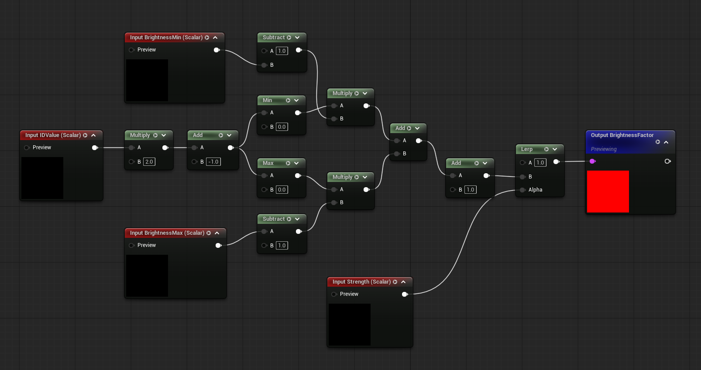
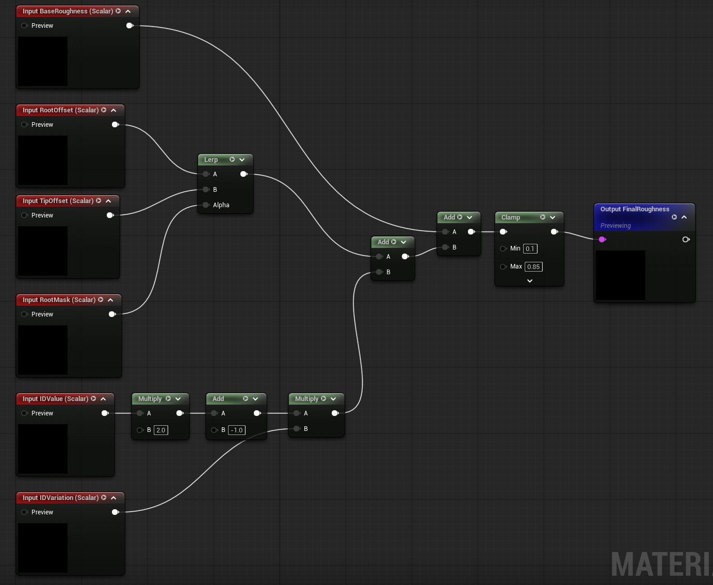
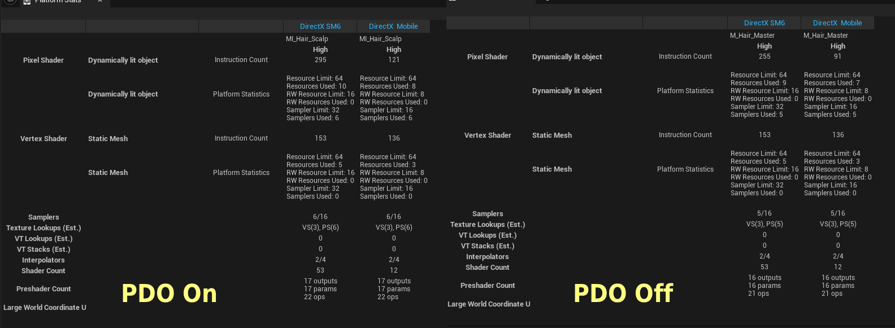
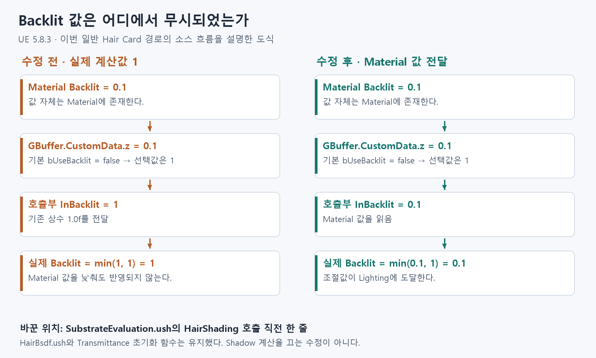
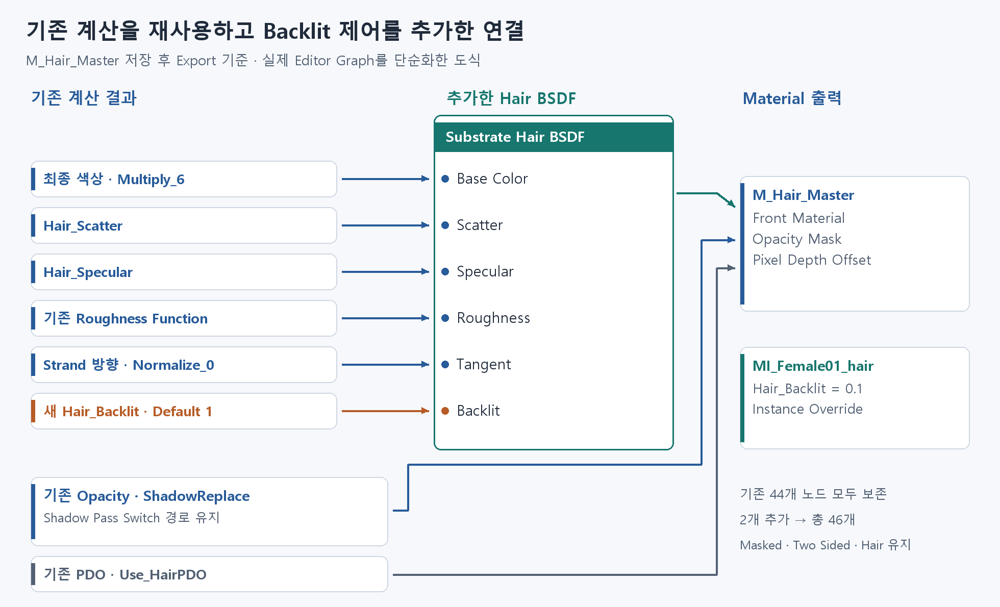

# Chapter 03 — Production Hair Shader

> Public edition — 공개 검토를 통과한 자료와 기술 기록을 담았다. [Public Release Scope](Public_Release_Scope.md)

> Module : Hair Card Material / Strand Variation / Coverage / PDO Evaluation
> Document Status : Draft / User Review
> Implementation Status : Scalp Hair First Implementation / Targeted Triangle and Hair Lighting Validation Recorded / Default Lit Comparison Recorded / Backlit Forwarding Fix Applied and Saved / Texture-free Base Color Applied and Saved / Roughness-based Highlight Decision Recorded
> Updated : 2026-10-28 (KST)
> Environment : Unreal Engine 5.8.3 / Deferred Shading — Initial Record and Targeted Editor Validation
> Scope : `M_Hair_Master`, `MI_Hair_Scalp`, `MI_Female01_hair`, Hair Card Data Flow, Coverage, PDO, Triangle Artifact Validation, Hair Lighting Diagnosis and Default Lit Anisotropy A/B Comparison and Engine Backlit Forwarding Correction, Texture-free Base Color and Roughness-based Highlight Control

[Chapter 02 — Production Skin Shader](Chapter02_ProductionSkinShader.md)에서는 얼굴의 큰 Shadow를 Skin SSS만으로 보정하지 않고, 불투명 Hair Card의 Material 상태와 연결하여 진단했다. 이번 Chapter는 Card에 필요한 Mask와 방향 Data를 연결하고, 색상·반사·깊이 표현을 조절한 뒤 Coverage와 비용을 비교한 기록이다. Hair Card 한 장이 여러 Strand를 표현하므로, Surface의 색상뿐 아니라 어떤 Pixel을 남길지와 Strand가 어느 방향으로 뻗는지를 함께 설계해야 한다.

초기 구현 문서 작성 시 로컬 Capture 19개를 직접 확인했다. 구현 Graph의 보이는 연결, 이미지 안의 비교값, 사용자 관찰과 Engine 일반 원리를 구분한다. 저장된 Unreal Material을 다시 열어 최종 Instance 값과 Texture 설정을 검사하거나, 새 GPU Capture를 실행한 결과는 아니다. Beard / Eyebrow, Eye와 전체 Character의 최종 Lookdev는 이번 Scalp Hair 기록의 완료 범위에 포함되지 않는다.

기존 `Fig3_04.png`는 제외하기로 한 Figure이며 작업 원본에도 없었다. `Fig3_01.png`–`Fig3_03.png`는 유지하고 기존 05–20번을 04–19번으로 정리했다. 아래 Figure 번호와 본문 경로는 정리 후 번호다. 초기 Figure의 미완성 Beard / Eyebrow와 Skin 상태는 당시 구현 순서를 보여주는 기록이다.

2026-10-25에는 Section 3.9에 Hair Shading Artifact 조사 기록을 추가했다. 대화에 첨부된 실제 테스트 Screenshot 두 장을 확인하여 `Fig3_20.png` / `Fig3_21.png`로 추가했으며, 기존 01–19번은 유지한다. 새 조사에서는 이미지로 확인한 패턴과 사용자 보고 설정, 원인 가설 및 미해결 항목을 구분한다.

2026-10-26의 실제 Editor·소스 검증은 Section 3.10에, 2026-10-27의 뒤통수 그림자·하이라이트 후속 진단은 Section 3.11에 이어진다. **뒤통수의 넓은 광택과 검은 끊김의 원인, 테스트 이유, 개선한 설정을 쉽게 따라가려면 Section 3.11부터 읽는다.** 앞의 초기 구현과 미확정 조사 문장은 당시의 상태를 보존한 기록이며, 이후 결과는 뒤의 두 Section을 함께 확인한다.

2026-10-27에는 「헤어 그림자 분석」 대화의 Default Lit + Anisotropy 구현·디버깅·A/B 비교와 실패한 Lumen 진단을 Section 3.12에 추가했다. 실제 접근한 첨부 5장을 Figure 3-28–3-32로 기록하며, 기존 01–27번과 앞선 조사 이력은 유지한다.

2026-10-28에는 2026-10-27의 실제 Backlit 분리 진단과 승인 후 원본 적용 결과를 [Section 3.13](#313-hair-backlit-입력-전달-오류-수정과-원본-적용)에 추가했다. Backlit 적용 당시의 저장 상태와 엔진 Shader 수정 이유는 이 Section을 기준으로 읽는다. Material 값이 Lighting에 전달되지 않던 기존 오류, 추가한 두 노드, Shadow를 유지한 전후 검증을 Figure 3-33–3-38로 설명한다.

2026-10-28의 최신 Color 변경은 [Section 3.14](#314-texture-free-base-color와-roottip-tint-원본-적용)에 기록했다. 원본 Master와 기존 Instance 5개에 Texture-free BaseColor × Root/Tip Tint를 적용·저장했다. 방향성 하이라이트는 기존 Hair 모델과 Roughness 조절로 유지하고 별도의 Anisotropic / Angel Ring 기능은 추가하지 않는다는 사용자 결정도 이 Section을 따른다.

---

## Contents

- [3.1 Hair Card Rendering Contract](#31-hair-card-rendering-contract)
- [3.2 Base Material and Tangent](#32-base-material-and-tangent)
- [3.3 Color and Strand Variation](#33-color-and-strand-variation)
- [3.4 Specular and Roughness Control](#34-specular-and-roughness-control)
- [3.5 Depth and Pixel Depth Offset](#35-depth-and-pixel-depth-offset)
- [3.6 Coverage, Mips and Dither](#36-coverage-mips-and-dither)
- [3.7 Optimization Evidence](#37-optimization-evidence)
- [3.8 Technical Decisions and Remaining Validation](#38-technical-decisions-and-remaining-validation)
- [3.9 Hair Shading Artifact Investigation](#39-hair-shading-artifact-investigation)
- [3.10 Hair 삼각형 음영의 검증 결과와 원인 및 해결](#310-hair-삼각형-음영의-검증-결과와-원인-및-해결)
- [3.11 Hair 그림자와 하이라이트 문제의 원인과 해결 과정](#311-hair-그림자와-하이라이트-문제의-원인과-해결-과정)
- [3.12 Default Lit Anisotropy Hair Material 비교](#312-default-lit-anisotropy-hair-material-비교)
- [3.13 Hair Backlit 입력 전달 오류 수정과 원본 적용](#313-hair-backlit-입력-전달-오류-수정과-원본-적용)
- [3.14 Texture-free Base Color와 Root/Tip Tint 원본 적용](#314-texture-free-base-color와-roottip-tint-원본-적용)

---

## 3.1 Hair Card Rendering Contract

> 이 절의 Texture와 Data Flow는 초기 구현 기록이다. 최신 Color 경로에서는 Base Color Texture와 Strand Brightness를 사용하지 않으며, Root=0 / Tip=1의 Parameter 기반 보간은 [Section 3.14](#314-texture-free-base-color와-roottip-tint-원본-적용)를 따른다.

### From Opaque Planes to Strand Coverage

Hair Card의 Geometry는 머리카락 한 올의 원통 표면이 아니라 여러 Strand를 묶어 놓은 얇은 Surface다. Card 전체를 불투명하게 남기면 Texture의 빈 영역도 Geometry처럼 보이고 Shadow에 영향을 준다. 따라서 먼저 `Opacity Mask`가 Strand 사이의 빈 공간을 제거하도록 해야 한다. 밝기나 SSS를 조절하는 단계보다 앞선 입력 계약이다.

Figure 3-1은 Hair 작업 초기 상태다. Scalp Hair의 가는 Strand와 함께 Beard / Eyebrow의 덩어리 형태가 남아 있어, 부위마다 Material 진행 상태가 다르다는 점을 읽어야 한다.

<p align="center">
*Fig3_01 — 공개 사본에서 이미지 생략.*
</p>

*Figure 3-1. Initial character state. Scalp Hair와 미완성 Beard / Eyebrow의 Card 표현을 구분하여 본다.*

### Material Inputs and Texture Responsibilities

이번 구현은 `M_Hair_Master`와 그 Instance인 `MI_Hair_Scalp`를 중심으로 한다. Capture에는 Hair 전용 `Scatter`, `Tangent`와 `Opacity Mask` 입력이 보인다. Hair Shading Model의 입력 의미는 Epic의 [Material Inputs — Hair](https://dev.epicgames.com/documentation/en-us/unreal-engine/material-inputs-in-unreal-engine#hair)를 기준으로 하며, 이 문서에서는 사용한 연결과 관찰을 설명한다.

| Data | Current Use | Contract |
|---|---|---|
| `T_Hair_BaseColor` / `BaseColor_Tex` | Base Color의 원본이다. | Color Data이며 Root / Tip 색상과 Strand 밝기 변화를 곱한다. |
| `T_Hair_Opacity` / `Opacity_Tex.R` | Strand Coverage를 제공한다. | Figure 3-3에서 R Channel을 `Opacity Mask`에 연결한다. 이름에 Alpha가 있어도 실제 저장 Channel을 A로 추정하지 않는다. |
| `T_Hair_Direction` / `Direction_Tex.RGB` | Strand 방향 Vector를 제공한다. | Normal처럼 보이는 색만으로 Surface Normal Map으로 취급하지 않는다. Decode와 Coordinate Space가 맞아야 한다. |
| `T_Hair_Root` / `Root_Tex` | Root에서 Tip으로 이동하는 Mask다. | Color Lerp와 길이 방향 Roughness 변화에 사용한다. Black / White의 실제 Root / Tip 대응은 결과로 확인한다. |
| `T_Hair_ID` / `ID_Tex` | Strand별 구분값이다. | Strand 밝기와 Roughness에 반복 가능한 변화를 준다. Hair의 물리적 두께나 실제 가닥 수를 뜻하지 않는다. |
| `T_Hair_Depth` / Depth Data | PDO에 사용할 상대적인 깊이 Data다. | 실제 Geometry를 추가하지 않으며 Offset 방향과 Scale을 확인한다. |
| `Hair_Scatter`, Specular, Roughness | Hair의 Lighting 반응을 조절한다. | Coverage, 방향, 색상과 분리하여 비교한다. |

Texture가 Content에 존재하는 것과 최종 Material에서 실제 Sample되는 것은 다르다. 위 표는 Capture로 확인한 경로와 해당 Data의 역할을 연결한 것이다. AO / Flow / RandomColor 등 다른 Texture가 존재한다는 이유로 모든 입력이 사용된 것으로 기록하지 않는다.

Base Color와 Linear Data는 Import 계약도 다르다. Root / ID / Opacity / Depth / Direction을 색상처럼 sRGB 변환하면 Mask나 방향값이 의도와 달라질 수 있다. 다만 이번 Capture에는 각 Texture Editor 설정이 없으므로 sRGB, Compression, Sampler Type을 최종 확인한 상태는 아니다. Normal 전용 Compression / Sampler가 이미 Vector를 Decode하는 경우에는 아래의 수동 `×2−1`을 다시 적용하지 않도록 실제 Sample 출력 범위부터 확인해야 한다.

### Overall Data Flow

```text
BaseColor × Root/Tip Color × Strand Brightness → Base Color
Opacity.R → Coverage / optional Dither → Opacity Mask
Direction.RGB → Decode → Normalize → Tangent
Root + ID + Roughness Controls → Roughness
Hair_Scatter → Scatter
Specular Control → Specular
Depth → PDO Control → optional Static Switch → Pixel Depth Offset
```

이 흐름은 기능별 책임을 묶은 설명이다. 마지막 저장 Graph 전체를 새로 검사한 도식은 아니다. 특히 Opacity / PDO의 후속 Function 내부식과 Static Switch의 정확한 이름은 전체 Graph Capture가 없어 확정하지 않는다.

---

## 3.2 Base Material and Tangent

### Coverage Before Lighting Adjustment

Figure 3-3의 초기 Graph는 `Opacity_Tex.R`을 `Opacity Mask`에 직접 연결한다. Masked 경로는 Threshold를 기준으로 Pixel을 남기거나 버린다. Opacity 값이 중간이라는 이유만으로 그 Pixel이 반투명하게 Blend되는 것은 아니다. 머리카락 사이의 구멍이 먼저 맞아야, 남은 Pixel의 Highlight와 Scatter를 올바르게 평가할 수 있다.

Masked는 화면에서 최종적으로 버려지는 영역의 모든 GPU 연산이 무료라는 뜻도 아니다. Mask를 평가할 Texture Sample과 Pass별 처리, 겹치는 Card, 작은 Triangle은 별도 비용을 만들 수 있다. 이 문제는 Section 3.7에서 화면 진단과 실제 시간 관찰로 나누어 다룬다.

### Direction Decode and Coordinate Space

Hair의 반사 방향은 Strand의 방향에 민감하다. Figure 3-2의 Direction Texture는 보라색 계열이지만, 색상만으로 연결 대상을 결정할 수 없다. Capture에서 이 Data는 Material의 `Tangent`로 향한다.

<p align="center">
*Fig3_02 — 공개 사본에서 이미지 생략.*
</p>

*Figure 3-2. Direction texture reference. RGB를 색상 Appearance가 아닌 Strand 방향 Data로 읽는다.*

초기 Graph의 변환은 다음과 같다.

```text
C = Direction_Tex.RGB
V = C × 2 − 1
T = Normalize(V)
T → Hair Tangent
```

Unsigned Texture의 `0–1` 범위로 저장한 Vector를 Signed `−1–1` 범위로 되돌린 뒤 길이를 1로 맞춘다. 예를 들어 `(0.5, 0.5, 1)`은 Decode 후 `(0, 0, 1)`이 된다. 이 연산은 Vector의 성분 범위와 길이를 복원하며, Texture의 축이 실제 Strand와 맞는지까지 자동으로 보장하지 않는다. 거의 Zero인 Vector에는 안정적인 Normalize도 기대할 수 없으므로 Bake Data 자체를 확인해야 한다.

Figure 3-3에서 `Multiply 2.0 → Add −1.0 → Normalize`와 Tangent 연결을 확인할 수 있다. 같은 화면의 `Roughness = 0.35`, `Specular = 0.5`, `Scatter = 0`은 이 초기 Capture의 기준값이며 최종 Instance 전체값으로 일반화하지 않는다.

<p align="center">
*Fig3_03 — 공개 사본에서 이미지 생략.*
</p>

*Figure 3-3. Initial material connections. Opacity R Channel과 Direction Decode 경로를 확인한다.*

실제 검증에서는 Texture의 Root / Tip 방향, UV 배치와 Material이 기대하는 Tangent Space를 함께 확인한다. 현재 화면만으로 `Tangent Space Normal` 관련 최종 설정과 Two Sided Checkbox를 확정할 수 없다. Light와 Camera를 움직여 Highlight가 Strand 흐름과 자연스럽게 이어지는지, Card의 앞뒤에서 방향이 뒤집혀 보이지 않는지를 확인하는 것이 후속 검사다. Coordinate Space 문제를 Roughness나 Base Color 조절로 덮지 않는다.

---

## 3.3 Color and Strand Variation

> 아래 Color / Strand Function과 Figure는 초기 Texture 기반 구현을 보존한 기록이다. 현재 저장된 BaseColor / RootTint / TipTint와 Function의 사용 범위는 [Section 3.14](#314-texture-free-base-color와-roottip-tint-원본-적용)에서 구분한다.

### Scatter and Base Color

Coverage와 Tangent를 연결한 뒤 Hair Lighting의 밝기 분포를 조절한다. `Scatter`는 Hair를 통과하고 주변으로 퍼지는 Light의 기여를 제어한다. Base Color를 단순히 밝게 하는 것과 같은 조절값이 아니며, 이번 비교는 현재 조명에서 그 차이를 확인한 것이다. 물리적인 가닥별 Light Transport를 직접 측정한 결과는 아니다.

Figure 3-4는 `Scatter = 0 / 0.5 / 1`을 비교한다. `0`에서는 짙은 검정 덩어리가 두드러지고, `0.5 / 1`에서는 윗머리와 앞머리의 갈색·밝은 가닥 반응이 더 드러난다. 이 변화는 선형적인 밝기 배율이 아니므로 원하는 Hair Color를 고른 뒤 Scatter를 함께 확인해야 한다. Figure 3-5에 보이는 `Hair_Scatter = 0.3`은 이후 색상 진단 시점의 값이며, 1이 항상 적절하다는 결론을 내리지 않는다.

<p align="center">
*Fig3_04 — 공개 사본에서 이미지 생략.*
</p>

*Figure 3-4. Scatter comparison at 0, 0.5 and 1. Root / Tip 색상 변화와 구분하여 전체 Lighting 반응을 본다.*

### Root and Tip Color

Root에서 Tip으로 변하는 색상은 길이 방향 Mask를 통해 제어한다. `Root_Tex`를 조절한 Lerp Alpha로 사용하면, 동일한 Base Color Texture를 유지하면서 Root와 Tip의 Tint를 따로 바꿀 수 있다.

```text
M = Saturate((Root_Tex.R − 0.5) × RootTip_Contrast + 0.5 + RootTip_Bias)
RootTipColor = Lerp(Root_Color, Tip_Color, M)
VariationTint = Lerp(1, RootTipColor, RootTip_Strength)
BaseColor = BaseColor_Tex.RGB × BaseColor_Tint × VariationTint
```

Contrast는 `0.5`를 중심으로 Mask를 펼치거나 좁히고, Bias는 그 결과를 이동시킨다. Saturate는 Lerp Alpha를 `0–1`로 제한한다. Figure 3-6에서는 Root Mask `0`이 Root Color, `1`이 Tip Color를 선택하며 반전 경로는 보이지 않는다. Contrast `1`, Bias `0`이면 원래 Mask를 유지한다.

Figure 3-5는 Root를 Magenta, Tip을 Blue로 강하게 분리하여 Mask가 적용되는 위치를 확인한 진단이다. 자연스러운 Hair Color를 만드는 최종 Lookdev가 아니다. UI에는 `RootTip_Bias = 0`, `RootTip_Contrast = 1`, `RootTip_Strength = 1`이 보인다. 이 상태에서 색이 뒤바뀌거나 특정 구간이 좁게 몰리면 Tint를 약하게 하기 전에 Mask 방향과 Remap을 확인해야 한다.

<p align="center">
*Fig3_05 — 공개 사본에서 이미지 생략.*
</p>

*Figure 3-5. Root / Tip diagnostic colors. 강한 대비로 Mask 위치와 Instance Override를 확인한다.*

Figure 3-6의 왼쪽은 `MF_Hair_ColorVariation`을 호출하는 Material 경로, 오른쪽은 Color Variation Function의 내부 연결이다. Root / Tip 색상을 먼저 계산한 뒤 Base Color에 반영하므로, Texture 원본과 재사용 가능한 색상 제어를 분리할 수 있다.

<p align="center">
*Fig3_06 — 공개 사본에서 이미지 생략.*
</p>

*Figure 3-6. Color variation data flow. Function의 Mask 조절과 Material의 Base Color 곱셈을 구분한다.*

`RootTip_Strength = 0`의 중립값은 White Factor다. 곱셈 경로에서 Black을 중립값으로 쓰면 Hair가 검게 사라지기 때문이다. 같은 이유로 색상 변화량을 조절할 때는 Function이 최종 색을 출력하는지, 원본에 곱할 Factor를 출력하는지를 명확히 해야 한다.

### Per-strand Brightness

길이 방향 변화만으로는 같은 색과 반사가 반복되는 Card가 눈에 띌 수 있다. `ID_Tex`는 Strand별로 다른 값을 주어 가닥 사이의 밝기를 분리한다. 이 값은 고정 Texture Data이므로 프레임마다 난수를 새로 만드는 Noise와 다르다.

Figure 3-7은 `Strand_BrightnessVariation = 0 / 1` 비교다. 변화량을 올리면 가닥 사이의 밝기 차이가 커지지만, 방향이 잘못된 Highlight나 빈 공간의 Mask 오류까지 해결하지는 않는다.

<p align="center">
*Fig3_07 — 공개 사본에서 이미지 생략.*
</p>

*Figure 3-7. Strand brightness variation. 같은 Card 안에서 가닥 간 명암이 분리되는 정도를 비교한다.*

Figure 3-8은 Strand Variation의 내부 Graph다. 입력은 `IDValue`, `BrightnessMin`, `BrightnessMax`, `Strength`이며 출력은 `BrightnessFactor`다. ID를 중심값 주위로 옮긴 뒤 어두운 가닥과 밝은 가닥의 Scale을 따로 계산하고, 최종 Strength로 White와 Blend한다.

```text
X = IDValue × 2 − 1
Dark = Min(X, 0) × (1 − BrightnessMin)
Bright = Max(X, 0) × (BrightnessMax − 1)
B = 1 + Dark + Bright
BrightnessFactor = Lerp(1, B, Strength)
ColorWithVariation = BaseColor × BrightnessFactor
```

ID `0 / 0.5 / 1`에서 Strength 적용 전 Factor는 각각 `BrightnessMin / 1 / BrightnessMax`다. 즉 `Lerp(Min, Max, ID)` 하나와 달리 가운데 값 `1`을 고정한다. Strength `0`도 중립값 `1`로 돌아간다. Graph에는 별도 Clamp가 보이지 않으므로 ID를 `0–1`로 공급하고 Min / Max를 의도에 맞게 설정해야 한다. ID의 분포가 바뀌면 같은 Parameter로도 결과가 달라질 수 있다.

<p align="center">

</p>

*Figure 3-8. Strand variation function. Dark / Bright 제어와 중립값 1로 돌아가는 Strength 경로를 읽는다.*

---

## 3.4 Specular and Roughness Control

### Separate Highlight Width from Strength

Hair가 플라스틱처럼 보이거나 흰 줄이 강하게 반복될 때 Roughness와 Specular를 동시에 바꾸면 원인을 구분하기 어렵다. 먼저 하나를 고정하고 다른 하나를 비교한다. Roughness는 반사의 퍼짐과 날카로움에, Specular는 반사 기여에 영향을 주므로 두 입력은 같은 역할의 밝기 Slider가 아니다.

Figure 3-9는 `Specular = 0.5`를 유지하고 `Roughness = 0.15 / 0.35 / 0.5`를 비교한다. 낮은 값에서는 강하고 날카로운 Highlight가 두드러지고, 높은 값에서는 반사가 더 완만하게 보인다. 가운데 `0.35`는 이 비교의 작업 기준이며 모든 Hair Texture에 대한 정답은 아니다.

<p align="center">
*Fig3_09 — 공개 사본에서 이미지 생략.*
</p>

*Figure 3-9. Roughness sweep with fixed Specular 0.5. Highlight의 폭과 가닥 구분을 함께 본다.*

Figure 3-10은 `Roughness = 0.35`에서 `Specular = 0.2 / 0.5 / 0.8`을 비교한다. Reflection이 강해진 결과를 Base Color가 밝아졌거나 Scatter가 증가한 결과와 구분하여 읽는다.

<p align="center">
*Fig3_10 — 공개 사본에서 이미지 생략.*
</p>

*Figure 3-10. Specular sweep with fixed Roughness 0.35. 같은 반사 폭 조건에서 기여의 변화를 비교한다.*

### Root, Tip and ID Roughness Variation

균일한 Roughness에서 Lighting 기준을 확인한 뒤, Root와 Tip의 길이 방향 변화와 ID 기반 Strand 변화를 추가했다. 둘은 서로 다른 축이다. Root / Tip은 한 가닥을 따라 변하고, ID는 서로 다른 가닥 사이의 차이를 만든다.

Figure 3-11은 Base Roughness에 Root / Tip Offset과 ID 변화를 더한 뒤 최종 범위를 제한하는 Graph다. Offset은 최종 Roughness 자체가 아니라 기준값에 더하는 상대값이다.

```text
LengthOffset = Lerp(RootOffset, TipOffset, RootMask)
StrandOffset = (IDValue × 2 − 1) × IDVariation
FinalRoughness = Clamp(BaseRoughness + LengthOffset + StrandOffset, 0.1, 0.85)
```

ID `0.5`에서는 Strand Offset이 0이고, ID `0 / 1`에서는 각각 `−IDVariation / +IDVariation`이다. RootMask `0 / 1`은 Root / Tip Offset을 선택한다. 최종 `0.1–0.85`는 이번 Graph가 선택한 조절 범위이며, Engine Roughness의 보편적인 입력 범위를 정의하는 수치는 아니다. RootMask와 ID 입력 자체를 Clamp하는 경로는 이 Graph에 보이지 않는다.

<p align="center">

</p>

*Figure 3-11. Roughness variation function. Base 값, 길이 방향 Offset과 Strand별 Variation의 합산 순서를 확인한다.*

Figure 3-12의 왼쪽은 `Root Offset = 0`, `Tip Offset = 0`, `ID Variation = 0`이고, 오른쪽은 `0.2 / −0.2 / 0.3`이다. 두 화면의 Base Roughness는 `0.35`다. 오른쪽은 세 변수가 함께 바뀐 기능 확인이므로 각각의 독립적인 효과 크기를 측정한 비교로 사용하지 않는다.

<p align="center">
*Fig3_12 — 공개 사본에서 이미지 생략.*
</p>

*Figure 3-12. Combined roughness variation. 길이 방향과 가닥 사이 변화가 함께 적용되는 예다.*

Base 값에 큰 음수 Offset을 더하면 Clamp 하한으로, 큰 양수 Offset을 더하면 상한으로 값이 몰릴 수 있다. 예를 들어 Base `0.35`, Root Offset `0.2`, Tip Offset `−0.2`, ID Variation `0.3`이면 Clamp 전 Root 범위는 `0.25–0.85`, Tip 범위는 `−0.15–0.45`다. Tip의 일부는 `0.1`에 모이므로 Variation이 클수록 실제 구분 가능한 Roughness 분포도 함께 확인해야 한다. Parameter의 수가 늘어난 것 자체가 더 자연스러운 결과를 보장하지 않는다.

---

## 3.5 Depth and Pixel Depth Offset

### What PDO Adds

Hair Card는 평면이 겹친 구조여서, Strand별 Color와 Roughness를 넣어도 표면이 한 장으로 이어져 보일 수 있다. Depth Texture를 `Pixel Depth Offset`에 반영하면 Pixel의 깊이 표현에 차이를 주어 Card 사이와 가닥 주변의 깊이감을 조절할 수 있다. Epic의 [Material Inputs — Pixel Depth Offset](https://dev.epicgames.com/documentation/en-us/unreal-engine/material-inputs-in-unreal-engine#pixeldepthoffset)도 이 입력을 Pixel Depth를 제어하는 경로로 설명한다.

PDO는 Vertex나 외곽 Geometry를 새로 만드는 기능이 아니다. 따라서 큰 Silhouette, 잘못 배치된 Card, 빈 Scalp와 모든 Shadow 문제를 한 번에 해결하지 않는다. 이번 Capture에는 `MF_Hair_DepthPDO`의 최종 내부 Graph가 없어 Depth의 반전·Bias·Scale 수식을 확정하지 않는다.

Figure 3-13은 `PDO Strength = 0 / 0.1` 비교다. 사용자는 PDO가 있는 편이 깊이감이 있어 더 좋다고 판단했다. 이 선택은 현재 Hair와 Camera에서의 시각적 판단이며 이후 비용 비교의 품질 기준이다.

<p align="center">
*Fig3_13 — 공개 사본에서 이미지 생략.*
</p>

*Figure 3-13. PDO visual comparison. Strength 0과 0.1에서 가닥 주변과 Card 층의 깊이감을 비교한다.*

### Zero Strength and Compiled-off Paths

연속 Scalar를 0으로 만드는 것은 화면상 Offset을 없애는 비교에 유용하다. 그러나 Instance의 Runtime Scalar가 0이라는 이유만으로 Depth Texture Sample과 관련 Shader 경로가 Compile 결과에서 제거된다고 보장할 수 없다.

비용을 비교하기 위한 Off 경로는 Static Switch로 PDO 입력을 0으로 분기하고, 해당 Instance의 Compile이 완료된 뒤 확인한다. 이때 Depth Texture가 다른 입력에서도 사용되면 PDO를 끄더라도 Sample이 남을 수 있다. 실제 경로가 제거되었는지는 Platform Stats와 생성된 Shader 결과에서 확인해야 한다. 현재 사용자는 Static Switch 연결과 작동을 보고했으나, 정확한 Parameter 이름과 최종 전체 Graph는 별도 확인 대상이다.

---

## 3.6 Coverage, Mips and Dither

### Coverage Across Distance

가까운 Camera에서 맞춘 Opacity가 멀리서도 같은 밀도를 유지하는 것은 아니다. Mip이 작아지며 가는 Strand와 빈 공간이 평균화되면 Threshold를 넘는 Pixel의 비율이 달라질 수 있다. 이는 Camera 거리, Texture Mip과 Mask Clip의 관계이므로 Base Color나 Roughness만으로 해결하기 어렵다.

`Do Scale Mips for Alpha Coverage`는 Mip의 Channel 값을 조절하여 `Alpha Coverage Thresholds` 이상인 Pixel 수를 보존하려는 Texture 설정이다. Channel별 Threshold라는 점이 중요하다. 이번 초기 Graph는 Opacity의 **R**을 읽으므로, Coverage 설정도 실제 읽는 Channel에 맞춰 확인해야 한다. [UTexture API](https://dev.epicgames.com/documentation/en-us/unreal-engine/API/Runtime/Engine/UTexture)

Figure 3-14는 위에서부터 Coverage 보정 Off, On / `0.3333`, On / `0.5`이며, 각 행은 가까운 화면에서 먼 화면으로 이어진다. 이미지 안의 Label은 비교한 설정을 나타내며 실제 Texture Editor의 R / G / B / A 전체값은 포함하지 않는다. 따라서 이 Capture만으로 Channel별 설정과 최종 채택값까지 확인한 것으로 표시하지 않는다.

<p align="center">
*Fig3_14 — 공개 사본에서 이미지 생략.*
</p>

*Figure 3-14. Coverage-preserving mip comparison. 각 행의 설정 차이와 각 열의 거리별 Strand 밀도를 함께 읽는다.*

이 비교는 Mip 보정에 따른 Appearance를 보는 자료다. 해상도·Mip Level·Camera Transform이 숫자로 고정된 자동 비교는 아니므로 어느 설정이 모든 거리에서 최선이라고 단정하지 않는다. 최종 선택에서는 가까운 Hair의 과밀화와 먼 Hair의 소실을 함께 확인한다.

### Alpha Cutoff

Figure 3-15는 `Alpha Cutoff = 0.2 / 0.3333 / 0.5`를 비교한다. Threshold가 높아지면 남는 Strand 영역이 달라져 가닥이 가늘어지거나 빈 공간이 커질 수 있다. 반대로 낮추면 Card의 빈 영역까지 남아 밀도와 겹침이 증가할 수 있다.

<p align="center">
*Fig3_15 — 공개 사본에서 이미지 생략.*
</p>

*Figure 3-15. Alpha cutoff comparison. Strand 두께, 빈 공간과 전체 Hair 밀도를 함께 평가한다.*

Coverage Mip의 Threshold와 Material의 Cutoff는 모두 같은 Data 분포에 영향을 주지만 적용 위치가 다르다. Texture Mip 생성 설정과 Material의 최종 Mask 판정을 구분하여 기록한다. 후속 Opacity Function이 Remap을 포함하면 Texture의 원본 Threshold와 최종 Cutoff가 단순히 같은 숫자만으로 일치하지 않을 수 있다.

### Dither and Temporal Stability

Masked의 이진 경계를 Dither Pattern으로 분산하면 Temporal 누적을 통해 부드러운 Coverage로 보이게 할 수 있다. 그 결과는 Anti-Aliasing 방법과 Motion에 영향을 받는다. Epic의 [Photorealistic Character — Hair and Transparency](https://dev.epicgames.com/documentation/en-us/unreal-engine/photorealistic-character?application_version=4.27#hairandtransparency)는 TemporalAA를 사용하는 기존 Hair Card 예제와 움직임의 Artifact를 설명한다. 이는 구버전 예제이므로 현재 UE 5.8.3의 AA / TSR 설정과 동작을 새로 검증한 근거로 사용하지 않는다.

Figure 3-16은 Dither On / Off의 정지 화면 비교다. 현재 화면에서 경계와 Hair 밀도의 차이를 읽을 수 있지만, Camera 이동 시 깜박임·잔상·History 수렴을 한 장으로 판단할 수는 없다. 실제 사용한 AA 방식과 Dither Function 내부 연결은 기록에 없어 최종 기본값을 확정하지 않는다.

<p align="center">
*Fig3_16 — 공개 사본에서 이미지 생략.*
</p>

*Figure 3-16. Dither On / Off. 정지 화면의 경계 비교이며 시간적 안정성 검증과 구분한다.*

---

## 3.7 Optimization Evidence

### Measurement Scope

최적화는 기능을 무조건 제거하는 순서가 아니라, 현재 품질을 기준으로 비용을 확인하고 필요한 차이를 다시 측정하는 과정이다. 이번에는 PDO의 시각적 선호, Compile Statistics와 사용자가 관찰한 표시 시간을 함께 기록했다. 각각은 다른 질문에 답하므로 같은 성능 숫자로 합치지 않는다.

| Evidence | Question | Current Boundary |
|---|---|---|
| Lit comparisons | 기능이 Appearance에 어떤 차이를 만드는가? | 같은 Character의 Capture와 사용자 판단이다. |
| Platform Stats | 선택한 Shader Target에서 어떤 Compile 결과가 나오는가? | PDO On / Off로 Label된 두 화면의 Material 이름이 다르다. |
| Reported timing | 현재 화면에서 표시 시간이 얼마나 달라졌는가? | 소수의 대략적인 관찰값이며 Timing 항목과 환경 Metadata가 불완전하다. |
| Shader Complexity / Quad Overdraw | 어느 화면 영역을 추가로 조사할 것인가? | Debug View의 상대적인 진단이며 GPU ms 측정이 아니다. |

### Card Layout Reference

Figure 3-17은 Card와 모발 윤곽에 색상 선이 겹쳐 표시된 보조 Capture다. 정확한 View Mode와 Selection 상태의 기록이 없으므로 이 색을 Tangent 오차, Overdraw 횟수나 GPU 비용으로 해석하지 않는다.

<p align="center">
*Fig3_17 — 공개 사본에서 이미지 생략.*
</p>

*Figure 3-17. Card overlay reference. 화면에 보이는 배치와 경계를 참고하며 색상의 정량적 의미는 부여하지 않는다.*

### PDO Platform Statistics

Figure 3-18은 왼쪽이 `PDO On`, 오른쪽이 `PDO Off`로 Label된 Platform Stats다. Desktop의 `DirectX SM6 / High`와 별도 `DirectX Mobile / High` 열을 구분하여 같은 열끼리 읽는다. 이 자료는 Mobile 기기에서 실행한 성능 측정도 아니다. Platform Stats는 Target별 Material 통계를 표시한다. [Material Editor UI](https://dev.epicgames.com/documentation/en-us/unreal-engine/unreal-engine-material-editor-ui)

<p align="center">

</p>

*Figure 3-18. PDO-labelled platform statistics. Shader Target, Material 이름과 동일한 통계 행을 먼저 확인한다.*

| Metric | PDO On Capture | PDO Off Capture | Observed Difference |
|---|---:|---:|---|
| Pixel Shader / Dynamically lit object / DirectX SM6 High | 295 | 255 | 40 감소다. |
| Pixel Shader / Dynamically lit object / DirectX Mobile High | 121 | 91 | 30 감소다. |
| Vertex Shader / Static Mesh / DirectX SM6 High | 153 | 153 | 표시값이 같다. |
| Vertex Shader / Static Mesh / DirectX Mobile High | 136 | 136 | 표시값이 같다. |
| Samplers | 6/16 | 5/16 | 두 Target 열에서 1 감소다. |
| Estimated Texture Lookups | VS(3), PS(6) | VS(3), PS(5) | PS 추정 Lookup이 1 감소다. |

왼쪽 Material 이름은 `MI_Hair_Scalp`, 오른쪽은 `M_Hair_Master`다. 따라서 두 화면의 다른 Override와 Compile 설정이 모두 같다는 확인 없이, 표의 차이를 엄밀하게 PDO 하나의 인과 효과로 확정할 수 없다. 이 표는 **Capture에 표시된 결과**를 보존한 것이다. Instruction 감소율을 같은 비율의 GPU 시간 단축으로 환산하지 않는다.

후속 비교는 동일한 Instance에서 PDO Static Switch만 바꾸고, 같은 Target / Quality / Usage와 다른 Override를 유지한 상태로 다시 Capture해야 한다. Vertex Shader 행의 `Static Mesh` 통계가 실제 Character의 모든 Skinning Pass 비용을 뜻하는 것도 아니다.

### Reported Timing and Quality Decision

사용자는 PDO 비교에서 다음 값을 대략적으로 보고했다. 소수점 한 자리의 표시 시간 관찰로 보존하며, 당시 표시 항목이 `GPU`, `Frame`, 특정 Pass 중 무엇이었는지는 남아 있는 기록만으로 확정하지 않는다.

| State | Reported Displayed Timing | Arithmetic Mean |
|---|---|---:|
| PDO On | 8.5 / 8.6 / 8.6 | 약 8.57 |
| PDO Off | 8.5 / 8.5 / 8.5 | 8.50 |

표시값을 단순 평균하면 차이는 약 `0.07`이다. 단위와 Timing 항목을 포함한 원본 표시를 후속 Capture에서 확인해야 하며, 이 차이는 입력값의 표시 간격 `0.1`보다도 작다. Sample 수, 변동 폭, Warm-up과 측정 환경을 확보하지 않았으므로 유의미한 GPU 절감량으로 판정하지 않는다. 이전의 `10.4 / 10 / 10.4 / 10.1` 보고는 각 값의 설정 대응이 남아 있지 않아 기능별 비교표에 배정하지 않았다.

현재 선택은 PDO의 깊이감을 유지하는 것이다. 사용자가 시각적으로 PDO On을 선호했고, 현재 시간 관찰만으로 그 이득을 포기할 정도의 비용 차이를 확정하지 못했기 때문이다. 이는 PDO가 무료라는 결론이 아니라, 추가 측정 전의 Lookdev 선택이다. `PDO Strength = 0.1`은 Figure 3-13의 On 예시이며 저장된 최종 Instance의 전체값 목록을 뜻하지 않는다.

### Shader Complexity and Quad Overdraw

Figure 3-19는 왼쪽 `Shader Complexity`, 오른쪽 `Quad Overdraw`로 구분된 최종 진단 Capture다. 두 View의 색은 서로 다른 의미와 Legend를 가지므로 직접 같은 척도로 비교하지 않는다. Shader Complexity는 Shader 연산 복잡도에 따른 화면 분포를, Quad Overdraw는 Quad Coverage에 따른 분포를 조사하는 용도다. [EViewModeIndex](https://dev.epicgames.com/documentation/en-us/unreal-engine/API/Runtime/Engine/EViewModeIndex)

<p align="center">
*Fig3_19 — 공개 사본에서 이미지 생략.*
</p>

*Figure 3-19. Shader Complexity and Quad Overdraw. 각 화면의 Label과 하단 Legend를 기준으로 관심 영역을 찾는다.*

현재 Shader Complexity 화면은 Hair 주변이 주로 Green 계열이고, Quad Overdraw는 주로 Blue 계열이다. 화면 일부의 다른 색만으로 최악의 Hair 비용이나 병목을 단정할 수 없다. 최종 Capture의 관심 영역을 동일 Camera의 Lit 결과, Material ID, Geometry와 연결한 뒤 실제 Pass 시간으로 확인해야 한다.

이 Capture는 PDO On / Off의 동일 Debug View A/B 쌍이 아니므로 PDO로 인한 차이를 직접 보여주지 않는다. 또한 Quad 수치가 낮아 보인다고 모든 거리에서 Card 겹침이 해결되었거나, Shader Complexity가 Green이라고 Hair의 전체 GPU 비용이 충분히 낮다는 뜻은 아니다. Selection Outline, Stats Overlay와 서로 다른 Camera가 섞이지 않도록 후속 Capture 조건도 기록한다.

### Reproducible Follow-up Measurement

다음 측정은 우선 동일 `MI_Hair_Scalp`에서 PDO On / Off 한 변수만 비교한다. Project / Map, Camera Transform, Render Resolution / Screen Percentage, AA, Scalability, RHI / Shader Model, GPU와 Driver, VSync / Frame Limit, Active Viewport 수를 기록한다. 현재 자료에서 빠진 Metadata를 임의로 채우지 않는다.

Shader Compile과 Streaming이 안정된 뒤 두 상태를 번갈아 같은 길이로 측정하고, 평균뿐 아니라 변동 범위와 충분한 Frame Sample을 보존한다. Frame Time, GPU Time과 관련 GPU Pass 시간을 각각 구분한다. 최종 비용 판정은 목표 환경의 실행 결과로 하며, 측정을 수행하기 전까지 숫자나 Pass / Fail을 추가하지 않는다.

---

## 3.8 Technical Decisions and Remaining Validation

> 아래 표와 완료 범위는 초기 구현 시점의 판단이다. 이후 Backlit 수정은 Section 3.13, 최신 Texture-free Color와 Roughness 기반 하이라이트 유지 결정은 [Section 3.14](#314-texture-free-base-color와-roottip-tint-원본-적용)를 따른다.

### Current Decisions

| Decision | Reason | Evidence / Limit |
|---|---|---|
| Scalp Hair 전용 Material과 Instance | Hair 입력과 조절을 Skin 공통 Surface에서 분리한다. | `M_Hair_Master`, `MI_Hair_Scalp` Capture와 저장 파일이 존재한다. |
| Opacity R Channel을 Mask 입력으로 사용 | Card의 빈 영역과 Strand Coverage를 분리한다. | 초기 Graph를 확인했다. 최종 Opacity Function과 Texture 설정은 추가 검사 대상이다. |
| Direction Decode 후 Normalize | Signed 방향과 Unit Vector 계약을 명시한다. | Figure 3-3의 실제 연결이다. Space / Bake Convention은 최종 Asset에서 재확인한다. |
| Root / Tip과 ID 변화 분리 | 길이 방향 변화와 가닥 사이 변화를 독립적으로 제어한다. | 색상·Strand·Roughness Function과 비교 Capture를 확인했다. |
| Roughness / Specular 단일 변수 비교 | 반사 폭과 기여를 구분하여 조절한다. | Figure 3-9와 3-10에서 다른 입력을 고정한 Label을 확인했다. |
| PDO를 현재 Lookdev에 유지 | 사용자가 깊이감을 선호하며 현재 시간 차이는 확정하기 어렵다. | 시각 비교와 대략적인 시간 보고에 한정한다. |
| Coverage / Cutoff / Dither를 별도 검증 | Mip, Mask 판정과 Temporal 표현의 책임이 다르다. | 정지 화면 비교를 확보했다. 최종값과 Motion 검증은 후속이다. |
| 통계·Debug View·Timing을 구분 | Compile 결과와 화면 진단을 실제 GPU 시간으로 오인하지 않는다. | 이름이 다른 Stats Capture의 비교 한계를 유지한다. |

### Completion Boundary

현재 Scalp Hair는 Mask, Tangent, 색상과 Strand 변화, 반사 변화, PDO 및 Coverage 비교를 갖춘 1차 구현 기록으로 정리했다. 초기 구현의 Figure 19개와 추가 조사 Figure 2개의 본문 연결을 확인한 상태이며 전체 Character의 Production Ready 판정은 아니다. Section 3.9의 Artifact 조사는 재현 관찰과 가설을 정리한 범위이며 원인 확정이나 해결 완료를 뜻하지 않는다. 최종 Texture 설정과 Instance Parameter 전체값을 저장 Asset에서 재확인하고, 같은 조건으로 재현할 수 있어야 다음 검증 단계가 닫힌다.

1. **Final Material Contract.** Blend Mode / Hair Shading Model, Two Sided, Tangent Space, Texture Channel / sRGB / Compression / Sampler, 실제 Parent와 최종 Override를 기록한다. Opacity / PDO Function 내부와 Static Switch 연결도 함께 확인한다.
2. **Coverage and Motion.** 최종 Cutoff와 Coverage Threshold의 Channel 대응을 확인하고, 목표 거리·Camera Motion·AA에서 깜박임, 잔상, Strand 소실과 밀도 변화를 검증한다. Dither의 최종 On / Off는 이 결과와 비용을 근거로 결정한다.
3. **Beard / Eyebrow.** Scalp의 결과를 해당 부위의 완료로 확대하지 않는다. 각 부위의 Texture, UV, Coverage, 색상과 Shadow를 따로 확인한다.
4. **Skin Revalidation.** Hair / Beard / Eyebrow 적용 후 Chapter 02의 같은 Skin 기준값으로 큰 Cast Shadow와 SSS 경계를 다시 비교한다. 초기 Figure에 남은 문제를 이번 문서 작성만으로 해결 처리하지 않는다.
5. **Performance.** 동일 Instance에서 PDO만 바꾼 Stats와 실제 GPU Timing을 확보한다. 목표 거리와 여러 Character가 보이는 조건에서 Card Coverage / 겹침 / Pass 비용도 확인한다.

### Chapter Summary

Hair Card의 결과는 Coverage, Strand 방향, Color Variation과 Lighting 반응이 연결되어 만들어진다. Opacity가 남길 Pixel을 결정하고, Tangent가 그 Pixel의 방향성 반사에 관여하며, Root / Tip과 ID가 반복되는 색상·Roughness를 분리한다. PDO와 Dither는 각각 깊이와 경계 표현에 기여하므로, 시각적 이득과 비용을 기능별로 비교해야 한다.

이번 기록에서 PDO는 깊이감을 위해 유지하는 현재 선택이다. Platform Stats의 감소와 작은 표시 시간 차이는 별도의 증거이며, 이를 동일한 성능 개선률로 합치지 않았다. 다음 단계는 이미 확보한 Scalp Hair 기준을 고정하고 다른 Facial Hair, Skin Shadow, 시간적 안정성과 재현 가능한 GPU 측정을 연결하는 것이다.

---

## 3.9 Hair Shading Artifact Investigation

### Problem

Hair Shading Model을 적용한 테스트 Surface에서 Triangle 형태로 명암이 나뉘는 Artifact가 관찰되었다. 이번 조사는 Hair가 전체적으로 어둡거나 뻣뻣해 보이는 인상을 바로 보정하는 작업이 아니라, 이 Triangle 패턴이 어떤 입력과 조건에서 유지되는지 분리한 기록이다.

테스트 환경은 프로젝트와 사용자 기록의 **Unreal Engine 5.8.3 / Hair Shading Model**이다. 아래 설정별 결과는 대화에서 보고한 관찰이며, Figure 3-20과 3-21은 해당 대화에 첨부한 원본 Screenshot을 직접 확인한 자료다. 이번 문서 갱신에서 Unreal을 실행하거나 Material Asset, Mesh Build Data와 Engine Source를 새로 검사하지는 않았다.

Figure 3-20의 Plane에는 완만한 밝기 변화와 함께 대각선으로 나뉘는 영역이 보인다. 사용자는 이 Capture 시점에 `Specular = 0`, `Roughness = 1`, `Scatter = 0`이라고 보고했다. Screenshot에는 Parameter UI가 없으므로 세 값은 사용자 보고로 구분한다.

<p align="center">
*Fig3_20 — 공개 사본에서 이미지 생략.*
</p>

*Figure 3-20. Plane artifact reference. Surface의 대각선 음영 차이를 기록한다. Specular 0 / Roughness 1 / Scatter 0은 첨부 시점의 사용자 보고이며 이미지 안에서 수치를 확인한 것은 아니다.*

---

### Reproduction

기록된 재현 흐름은 다음과 같다. 저장된 최소 재현 Project나 모든 설정의 Snapshot을 확보한 절차는 아니므로, 누락된 값을 임의로 채우지 않는다.

1. **Baseline.** Hair Shading Model의 테스트 Material을 Plane에 적용하고 Lit View에서 Triangle 형태의 명암 차이를 확인한다. 실제 Hair Card의 방향 입력과 분리하기 위해 Direction Map을 제거한 상태도 비교한다.
2. **Input Isolation.** Tangent에 Constant `(1,0,0)` 또는 `(0,1,0)`을 연결하고, Default Lit, Recompute Normals / Tangents, Triangulate / Reimport와 Rect Light의 Cast Shadows를 각각 비교한다. World Normal Visualization도 별도로 확인한다.
3. **Coordinate Space.** `Tangent Space Normal`을 OFF로 전환하고 World Space 고정 Tangent `(0,0,1)`을 사용한 상태를 확인한다. 이어 `TransformVector`의 Source를 Tangent, Destination을 World로 설정하여 Mesh TBN을 거친 방향을 Tangent에 공급한 상태와 비교한다.
4. **Direction Debug.** Unlit Material에서 변환한 Tangent를 색으로 시각화해 전체 흐름과 국소 차이를 살핀다. 당시 Debug Graph의 전체식과 출력 범위는 별도 저장된 설정으로 확인하지 못했다.
5. **Mesh Control.** Unreal 기본 Sphere Mesh에도 Hair 테스트 Material을 적용하여 패턴의 재현 여부를 확인한다. 사용자 Mesh에서만 발생하는지 분리하기 위한 대조군이다.

대화에서 **같은 조명 조건을 유지하며 비교한 테스트 결과**와, Light 방향 또는 Camera 구도를 바꾸어 가시성을 확인한 테스트를 구분한다. 아래 표는 보고된 결과를 보존하지만, 모든 항목이 하나의 고정된 Camera / Light Transform과 노출값으로 Capture된 연속 A/B Set이라는 뜻은 아니다. 재실행 시에는 동일 Mesh와 Camera에서 Light Transform / Intensity, Exposure, Render Resolution / Screen Percentage, AA, Two Sided, Tangent Space 설정과 나머지 Material 입력을 기록하고 한 변수씩 바꾼다. Shading Model을 바꾸면 입력 의미도 달라지므로 같은 숫자만으로 동일한 Lighting 계산이 된다고 가정하지 않는다.

---

### Controlled Tests

표의 관찰은 사용자 보고를 기준으로 한다. Figure가 있는 행도 해당 Screenshot에 보이지 않는 Checkbox, Graph와 수치까지 검증한 것으로 확대하지 않는다.

| Test | Observation | Interpretation Boundary |
|---|---|---|
| Hair / Default Lit | Hair에서 Triangle 패턴이 두드러지고, Default Lit에서도 더 약하게 관찰되었다. | Shading Model에 따라 가시성이 달랐다. Hair에서만 발생하는 현상이라고 단정하지 않는다. |
| Direction Map removed | Direction Texture를 제거해도 패턴이 유지되었다. | Texture 자체만을 유일한 원인으로 보는 설명은 약해진다. Coordinate Space와 Mesh Basis까지 제거한 테스트는 아니다. |
| Constant Tangent `(1,0,0)` / `(0,1,0)` | 두 Constant 입력에서도 관찰되었다. | 당시 Material의 Space 설정을 함께 읽어야 한다. Tangent Space 상수는 Mesh TBN을 거친 뒤 World 방향까지 일정하다는 뜻이 아니다. |
| World Normal Visualization | 전체적으로 매끄럽게 보였다. | 눈에 띄는 큰 Normal 단절의 근거는 약하다. 미세한 수치 차이나 Tangent / Bitangent 문제까지 배제하지 않는다. |
| Recompute Normals / Tangents ON / OFF | 설정 변경에 따른 차이가 거의 없었다. | 시험한 Recompute 선택만으로 해소되지 않았다. 모든 Import / Build 조합의 정상 여부를 증명하지 않는다. |
| Blender Triangulate / Re-export / UV review | Triangulate 후 재익스포트·재임포트와 UV 검토에서도 변화가 없었다. | 해당 수정으로 개선되지 않았다. 사용자 Mesh / Export 결함을 확정하거나 완전히 배제할 수 없다. |
| Rect Light Cast Shadows OFF | 해당 Rect Light의 Cast Shadows를 꺼도 유지되었다. | 이 Light의 Cast Shadow만으로 패턴을 설명하기 어렵다. 다른 Light, 간접광이나 모든 Shadow 경로를 끈 결과로 일반화하지 않는다. |
| Tangent Space Normal OFF + fixed World Tangent `(0,0,1)` | 패턴이 크게 완화되었다. | Mesh Basis에 따른 방향 변화의 관여를 의심할 근거다. Space 설정과 방향 입력을 함께 바꾼 결과이므로 둘 중 하나만의 인과 효과로 확정하지 않는다. |
| `TransformVector(Tangent → World)` | Mesh TBN을 이용한 방향을 다시 공급하면 패턴이 관찰되었다. | 좌표 변환과 Mesh Basis 경로가 유력한 조사 대상이다. 변환 Node 자체의 오류를 증명한 결과는 아니다. |
| Unlit Debug Tangent Visualization | 전체적으로 부드럽지만 일부 미세한 차이가 보였다. | Debug Color에서 작은 차이가 약하게 보일 수 있다. Lit 반응의 연속성까지 보장하지 않는다. |
| Hair test Material: Specular 0 / Roughness 1 / Scatter 0 | 해당 값에서도 발생했다. Figure 3-20의 첨부 시점 보고다. | 단순히 강한 Specular나 Scatter 값을 낮추면 해결된다는 설명은 부족하다. Hair Lighting의 모든 기여가 비활성화되었다는 뜻은 아니다. |
| Unreal default Sphere Mesh | 기본 Sphere에서도 패턴을 재현했다고 보고했다. Figure 3-21에서 면 단위 명암 차이를 확인했다. | 특정 사용자 Mesh / Export에만 한정된 원인이라는 가설은 약해진다. 기본 Mesh의 조건과 Engine Bug 여부는 별도 검증이 필요하다. |

---

### Findings

Figure 3-21은 사용자가 Unreal 기본 Sphere 재현 결과로 첨부한 화면이다. Sphere 표면에 띠와 면 단위의 명암 변화가 보인다. Selection Outline과 Transform Gizmo는 Editor 표시이므로 Artifact의 증거에 포함하지 않는다. 화면만으로 Mesh Asset 경로, Tangent 연결과 모든 Material 설정을 확인할 수는 없다.

<p align="center">
*Fig3_21 — 공개 사본에서 이미지 생략.*
</p>

*Figure 3-21. Reported default Sphere reproduction. 기본 Sphere 테스트로 보고된 화면의 면 단위 명암 패턴이다. Figure 3-20과 조명·구도가 달라 두 이미지로 Artifact 강도의 증감은 비교하지 않는다.*

**Observation.** Direction Map 제거, Constant Tangent, Mesh 재처리와 해당 Rect Light의 Shadow 비활성화 후에도 패턴이 남았다. World Space 고정 Tangent에서는 크게 완화되었고, Mesh TBN을 통해 변환한 방향을 쓰면 다시 관찰되었다. 기본 Sphere 재현은 사용자 Hair Mesh만의 문제로 범위를 좁히기 어렵게 한다.

**Working Hypothesis.** 현재 가장 유력한 설명은 **Mesh Tangent Basis에 따른 방향 변화가 Hair Lighting에서 강조될 가능성**이다. Tangent Space에서 같은 Vector를 입력해도 Mesh의 TBN이 위치별로 다르면 변환된 World 방향은 달라질 수 있다. 이 변화와 Hair Lighting의 방향 반응이 결합하여 면 단위 패턴을 더 잘 드러내는지 후속 검증한다. 이는 관찰을 연결한 추론이며, 실제 수치와 Shading 계산을 추적해 원인을 입증한 결과는 아니다.

**Unresolved Result.** 사용자 Mesh / Export 결함과 Hair Shading의 Engine 결함 중 어느 쪽도 확정하지 않는다. Engine Bug로 판정하려면 입력·설정의 타당성과 최소 재현 조건을 고정하고, 다른 Engine Version 또는 관련 Rendering 경로와 비교하는 추가 근거가 필요하다. 이번 기록은 재현 조건의 범위를 좁혔으며, 실제 Strand 방향을 유지하면서 Artifact를 없애는 Production 해결책은 아직 검증하지 못했다.

---

### Limitations

| Limit | Consequence |
|---|---|
| 같은 조명 조건에서의 비교는 대화의 관찰 기록이며 모든 Transform / Exposure Metadata와 짝지은 원본 Capture가 남아 있지는 않다. | 해당 비교 결과는 보존하되 정량적인 오차 크기나 완전한 단일 변수 검증으로 확대하지 않는다. |
| Light 방향과 Camera 구도가 다른 탐색 테스트가 함께 있다. | Artifact의 가시성은 참고할 수 있지만 서로 다른 화면의 밝기 차이를 한 설정의 효과로 환산하지 않는다. Figure 3-20 / 3-21도 동일 조건 A/B가 아니다. |
| Smooth World Normal / Tangent Debug는 화면상의 정성 관찰이다. | 작은 Basis 차이, 정규화와 보간 결과를 수치적으로 배제하지 못한다. |
| `Tangent Space Normal OFF`와 World 고정 방향은 결합된 조건이다. | Space 설정과 방향 입력을 나누어 재검증하기 전에는 단일 원인을 확정하지 않는다. |
| 기본 Sphere의 정확한 Asset / Build 설정, Material 전체 Graph와 Import / Rendering Metadata가 불완전하다. | 기본 Mesh의 정상성이나 Engine 결함을 기준 사실로 가정하지 않는다. |
| 새 Unreal 실행, Engine Source 추적, Version 비교와 목표 환경의 Motion / GPU 측정을 수행하지 않았다. | 원인 확정, 해결 여부, 시간적 안정성과 성능 개선을 완료로 표시하지 않는다. |

---

### Production Decision

현재 선택은 원인 가설을 문서화하고, 실제 Hair에서의 가시성을 확인한 뒤 대응을 결정하는 것이다. 테스트 Plane / Sphere에서 재현되었다는 이유만으로 실제 Character에서 허용 가능하거나 치명적이라고 판정하지 않는다.

| Decision | Application / Remaining Check |
|---|---|
| World Space 고정 Tangent는 Debug에 한정 | `(0,0,1)`은 실제 Strand 흐름을 반영하지 않는다. 완화 관찰을 원인 분리에 사용하며 최종 Hair Tangent로 채택하지 않는다. |
| Scalp Hair의 Hair Shading 유지 여부를 실제 Asset에서 평가 | 목표 Camera 거리, Light 각도와 Motion에서 패턴이 보이는지 확인한다. 기존 PDO 유지 선택과 별개의 품질 검증이다. |
| Beard / Eyebrow는 부위별로 평가 | 필요한 Strand 반응, Coverage와 근접 화면을 기준으로 Hair / Default Lit 또는 단순화한 Material을 비교한다. Default Lit 전환을 검증된 완전 해결책으로 기록하지 않는다. |
| Lighting과 Material 조정은 완화 후보로만 취급 | Key / Fill, Roughness와 Scatter를 조절할 때 실제 Hair Color와 방향성 표현을 함께 본다. 현재 자료로 특정 조합의 Artifact 해소나 비용 절감을 보장하지 않는다. |

---

### Follow-up Tasks

1. **Minimal Reproduction.** Plane과 Unreal 기본 Sphere의 정확한 Asset 경로, Mesh Build 설정, Material Graph와 전체 입력값을 저장한다. 같은 Light / Camera / Exposure에서 Hair / Default Lit, Direction Map / Constant, World 고정 / TBN 변환을 짝지어 Capture한다. Tangent Space 설정 변경과 방향값 변경도 분리한다.
2. **Basis Validation.** 실제 Material이 기대하는 Coordinate Space, 변환 횟수, Normalize 위치와 Two Sided 조건을 확인한다. World Normal, Tangent와 Bitangent의 연속성을 같은 위치에서 비교하고, Debug Color의 매끄러움만으로 수치 차이를 배제하지 않는다.
3. **Engine Comparison.** 동일한 최소 재현 조건을 보존한 뒤 가능한 다른 Engine Version / Rendering 조건과 비교한다. 입력 계약 확인과 재현 자료 없이 특정 Version의 Engine Bug로 확정하지 않는다.
4. **Production Visibility.** 실제 Scalp / Beard / Eyebrow에서 목표 거리와 Motion의 품질을 확인한다. 대응안을 바꾸면 Appearance와 GPU 비용을 별도로 검증한다.
5. **Hair Shadows / Hair Stiffness.** ‘Hair Shadows가 너무 어둡다’와 ‘Hair가 뻣뻣해 보인다’는 이번 문서 수정 이후 사용자와 다시 진단할 별도 항목으로 남긴다. Triangle Artifact의 원인과 같다고 가정하지 않으며, 이번 조사에서 해결 또는 원인 확정 처리하지 않는다.

---

[PBR Character Contents](README.md) · [Production Skin Shader](Chapter02_ProductionSkinShader.md) · [Production PBR Master Material](Chapter01_ProductionPBRMasterMaterial.md) · RTR Advanced Validation


---

## 3.10 Hair 삼각형 음영의 검증 결과와 원인 및 해결

2026-10-26 KST — Unreal Editor와 설치된 UE 5.8.3 소스를 직접 확인한 후속 기록.

**이번에 재현한 테스트 패널에서는 해결 방법을 검증했다. Nanite를 켠 상태에서 `Explicit Tangents`를 활성화하고 메시를 다시 빌드하자, 같은 Hair Material에서 보이던 삼각형 경계가 사라졌다.** 원래 설정의 메시로 되돌리면 경계도 다시 나타났다.

앞의 Section 3.9는 2026-10-25까지의 미확정 조사 기록이다. 그 안의 ‘Editor·Engine Source를 새로 검사하지 않았다’, ‘해결책을 검증하지 못했다’는 문장은 당시의 상태를 뜻한다. 아래는 그 뒤에 실제 Editor와 소스를 확인하여 추가한 결과다. 패널에서 해결된 범위와 실제 Character에서 더 확인해야 할 범위를 구분해서 읽는다.

### 3.10.1 무엇을 바꾸었더니 문제가 사라졌는가

검증한 프로젝트는 `RTR_Advanced`, 원래 Level은 `/Game/ASF/test_scene`이다. 테스트 Mesh는 `/Game/ASF/Characters/Female01/hair_test`, Material은 같은 폴더의 `Materials/test`였다. 실제 설치 버전은 **UE 5.8.3, CL 58210709**이며 Substrate의 blendable GBuffer 경로를 사용하고 있었다.

이 Material은 Hair / Opaque / Two Sided ON이었다. `Tangent Space Normal`은 OFF이고, **Tangent Space의 `(0,1,0)`을 `TransformVector(Tangent → World)`로 변환한 결과**가 Hair의 Tangent에 연결되어 있었다. Material Graph의 기준값은 Specular 0, Roughness 1, Scatter 0이다. 즉, 이미 관찰하던 조건을 출발점으로 삼았다.

원본을 수정하지 않도록 `/Game/_HairRCI_20261026`에 테스트 Level·Material·Mesh 복제본을 만들었다. 같은 카메라·조명·Material 입력을 유지하고, 패널 Mesh의 Nanite 설정을 비교했다.

| 순서 | 패널 Mesh의 상태 | 화면에서 확인한 결과 |
|---|---|---|
| A | Nanite ON / Explicit Tangents OFF | 위쪽에 대각선으로 나뉘는 삼각형 음영이 보인다. |
| B | Nanite ON / Explicit Tangents ON 후 재빌드 | A에서 보이던 국소적인 대각선 경계가 사라진다. 넓은 밝기 변화는 남는다. |
| A로 복귀 | 처음의 Explicit Tangents OFF Mesh를 다시 적용 | 같은 위치에 삼각형 경계가 다시 나타난다. |
| 별도 대조 | Nanite OFF인 복제 Mesh | 해당 경계가 사라진다. |
| 그림자 대조 | Explicit Tangents OFF를 유지하고 `r.ContactShadows=0` | 경계가 남는다. Contact Shadows가 이 경계의 필수 원인은 아니다. |

단순히 화면이 달라진 것보다 **설정에 따라 문제가 사라지고, 원래 설정으로 돌아가면 다시 나타난다**는 점이 중요하다. 이것이 이번 해결 판단의 직접적인 근거다. 넓고 자연스러운 밝기 변화까지 없애는 것이 목표는 아니다. 문제로 삼은 것은 그 안에 드러나던 삼각형 경계다.

<p align="center">
*Fig3_22 — 공개 사본에서 이미지 생략.*
</p>

*Figure 3-22. 같은 Hair Material의 변경 전후. 왼쪽은 Nanite의 암시적 탄젠트, 오른쪽은 Explicit Tangents ON이다. 왼쪽 위에서 안쪽으로 내려오는 국소적인 대각선 경계를 비교한다. 실제 렌더링 캡처의 같은 영역을 잘라 같은 비율로 확대했다.*

<p align="center">
*Fig3_23 — 공개 사본에서 이미지 생략.*
</p>

*Figure 3-23. 왼쪽부터 A, B, A 복귀, Nanite OFF, A에서 Contact Shadows OFF. A 복귀와 Contact Shadows OFF에도 경계가 남는다는 점을 확인한다. 배경 구름은 시간에 따라 움직이므로 배경 변화로 설정의 효과를 판단하지 않는다.*

### 3.10.2 Normal과 Tangent를 먼저 구분하기

이 문제는 ‘방향’이라는 단어가 서로 다른 대상을 가리켜 이해하기 어려웠다. 메시 표면의 방향과, 그 표면에 붙인 머리카락의 길이 방향을 나누어 보면 흐름이 명확해진다.

| 이름 | 쉽게 풀어 쓴 의미 | 이번 문제에서의 역할 |
|---|---|---|
| 표면 Normal, N | 표면에서 바깥으로 서 있는 화살표다. | 메시가 어느 쪽을 향하는 표면인지 나타낸다. |
| Mesh Tangent, T와 Bitangent, B | 표면 위에 누워 있는 두 기준축이다. UV의 방향과 연결된다. | Tangent Space의 방향을 World Space 방향으로 바꾸는 기준이다. |
| Hair Material의 Tangent 입력 | 머리카락이 길게 뻗은 축 방향이다. | Hair Lighting이 어느 방향으로 반응할지 정한다. Mesh의 T축과 항상 같은 방향이라는 뜻은 아니다. |

메시 표면마다 **작은 좌표자**가 붙어 있다고 생각할 수 있다. 자의 X축이 T, Y축이 B, 표면 밖으로 향한 Z축이 N이다. 이 세 축을 묶어 `TBN`, 또는 Tangent Basis라고 부른다. `Basis`는 여기서 방향을 해석할 기준축이라는 뜻이다.

Tangent Space에서 `(0,1,0)`을 입력하는 것은 ‘모든 픽셀에서 같은 World 방향을 사용하라’가 아니라, **각 위치의 작은 좌표자에서 Y축 방향을 사용하라**는 뜻이다. 표면에 붙은 자가 회전하면 같은 `(0,1,0)`도 서로 다른 World 방향이 된다.

```text
Tangent Space의 상수 (0,1,0)
        ↓ 해당 위치의 Mesh TBN으로 해석
World Space의 모발 축 방향
        ↓ Hair Material의 Tangent 입력
빛·시선·모발 축의 관계로 계산한 밝기와 광택
```

따라서 Direction Map을 제거하고 Constant Vector를 넣어도 Mesh TBN을 거치는 경로는 남을 수 있다. **Texture를 제거한 테스트와 Mesh의 방향 기준을 제거한 테스트는 다르다.** 이것이 기존 Constant Tangent 테스트에서도 문제가 남았던 이유를 이해하는 핵심이다.

### 3.10.3 Nanite가 방향을 다시 계산하면서 삼각형이 드러나는 과정

Nanite의 `Explicit Tangents`는 탄젠트를 어떤 방식으로 공급할지 정하는 설정이다.

| 설정 | 탄젠트를 준비하는 방식 |
|---|---|
| OFF — implicit, 암시적 | 저장된 vertex tangent를 사용하는 대신, 런타임에 삼각형의 위치·UV·vertex normal로 탄젠트를 재구성한다. |
| ON — explicit, 명시적 | 가져오거나 Mesh Build에서 계산한 vertex tangent를 Nanite 데이터에 저장하고, 렌더링할 때 복원하여 사용한다. |

여기서 ‘명시적’은 Shader에 고정 World Vector를 입력한다는 뜻이 아니다. **메시의 탄젠트 데이터를 저장하여 사용한다**는 뜻이다. 따라서 원래 Direction Map과 모발 흐름을 유지하면서 적용할 수 있다.

설명을 위해 휘어진 표면 위에, 한 변을 공유하는 삼각형 두 개가 있다고 생각한다. 두 삼각형은 공유 지점의 Normal이 같아서 표면의 바깥 방향은 부드럽게 이어질 수 있다. 하지만 암시적 탄젠트 계산은 Normal만 보지 않는다. **각 삼각형을 이루는 다른 두 점의 위치와 UV 차이도 함께 사용한다.** 같은 지점을 계산하더라도 어느 삼각형에서 계산했는지에 따라 탄젠트가 조금 달라질 수 있다.

그 뒤에는 각 삼각형 내부에서 세 꼭짓점의 방향을 보간한다. 보간은 꼭짓점 사이의 값을 부드럽게 이어 주는 처리다. 각 삼각형 안쪽은 부드러워도, 맞닿은 변에서 서로 다른 방향 값을 사용하면 두 삼각형 사이의 연결까지 부드러워진다는 보장은 없다. 이 차이가 조명 계산에 들어가면 삼각형 윤곽이 명암으로 드러날 수 있다.

```text
삼각형마다 위치·UV로 Tangent를 재구성
        ↓
인접 삼각형 사이에서 방향 기준이 조금 달라질 수 있음
        ↓
같은 Tangent Space 입력을 World로 바꾼 결과도 달라질 수 있음
        ↓
Hair의 방향성 Lighting이 서로 다른 밝기를 계산
        ↓
삼각형 경계가 명암으로 보임
```

이 설명은 UV가 깨져 있어야만 성립하는 이야기가 아니다. 정상적인 UV와 부드러운 Normal을 가진 곡면에서도, 삼각형별 재구성 방식 때문에 방향 차이가 생길 수 있다. 반대로 모든 Nanite Mesh에서 반드시 눈에 띄는 문제가 생긴다는 뜻도 아니다. 메시의 형태·UV·조명·Material의 방향 민감도에 따라 가시성이 달라진다.

이번 패널에서는 Explicit Tangents ON으로 **암시적 재구성 경로를 피하고 저장된 vertex tangent를 사용했을 때** 경계가 사라졌다. 이것이 설정 변경과 해결 결과를 연결하는 소스상의 설명이다. 다만 Explicit Tangents를 포함한 Nanite 재빌드는 내부 단순화 결과에도 영향을 줄 수 있다. 최종 화면의 모든 삼각형을 똑같이 고정한 채 계산 한 줄만 교체한 실험은 아니므로, 특정 픽셀의 오차량까지 측정한 결과로 확대하지 않는다.

### 3.10.4 Hair에서 유독 심하게 보였던 이유

Hair Lighting은 모발 축 방향을 기준으로 빛과 시선의 관계를 계산한다. 실제 머리카락도 빗질 방향이나 바라보는 각도에 따라 광택이 크게 달라지는 것처럼, Shader에서도 모발 축은 중요한 입력이다. 표면 Normal이 크게 달라 보이지 않아도 모발 축이 조금 달라지면 반응이 눈에 띄게 바뀔 수 있다.

이번 로컬 소스에서 Hair의 TRT 성분에는 `exp(17 × CosPhi − 16.78)`라는 방향 의존 항이 있었다. 식을 외울 필요는 없다. `CosPhi`는 모발 축을 기준으로 해석한 빛·시선의 각도 관계이고, `exp`는 그 값을 그대로 밝기에 더하는 대신 **작은 입력 차이도 크게 강조할 수 있는 곡선으로 바꾸는 함수**다. Mesh Basis의 미세한 차이가 최종 Hair 밝기에서는 훨씬 잘 보일 수 있다는 뜻이다.

또한 **Hair의 `Specular=0`은 모든 광택·투과 성분을 끄는 전체 스위치가 아니었다.** 이 버전의 Hair 함수는 다음 성분을 따로 계산한다.

| 성분 | 머리카락 한 올에서 빛이 지나가는 경로의 개념 | 기존 테스트를 해석할 때의 의미 |
|---|---|---|
| R | 표면에서 반사되는 경로다. | Material의 Specular 값이 이 성분에 곱해진다. |
| TT | 모발 안으로 들어가 반대편으로 나오는 투과 경로다. | Specular 0만으로 함께 꺼지지 않는다. |
| TRT | 모발 안으로 들어가 내부에서 한 번 반사된 뒤 나오는 경로다. | Specular 0과 Scatter 0에서도 방향 의존 성분이 남을 수 있다. |

Roughness 1도 이 성분들을 모두 0으로 만드는 설정은 아니다. 반응의 일부 폭을 넓히더라도 위 TRT 방향 항 자체가 없어지는 것은 아니다. 그러므로 **Specular 0 / Roughness 1 / Scatter 0에서도 삼각형이 보였다는 사실은 Tangent 문제를 배제하는 근거가 아니었다.** 앞의 Section 3.4에서 관찰한 Roughness·Specular 조절 효과는 유지되지만, Hair Specular를 모든 방향성 반사의 공통 강도로 해석해서는 안 된다.

### 3.10.5 기존 테스트로 해결되지 않았던 이유

이전 테스트가 틀렸다기보다, 테스트가 제거한 요소와 계속 남긴 요소가 달랐다. 특히 ‘벡터의 길이’, ‘벡터의 방향’, ‘방향을 해석하는 기준축’을 나누어 보아야 한다.

| 기존 테스트 | 왜 문제가 남거나 판단이 어려웠는가 |
|---|---|
| Direction Map 제거 후 Constant Tangent | Texture 변화는 없어졌지만 Tangent Space 입력을 해석하는 Mesh Basis는 남았다. |
| Recompute Tangents 변경 | 이는 주로 메시의 탄젠트 데이터를 준비하는 단계다. Explicit Tangents OFF인 Nanite가 그 저장 데이터를 사용하도록 바뀌는 설정은 아니다. 따라서 재계산만 반복해도 암시적 경로를 벗어나지 못할 수 있다. |
| Recompute Normals / Triangulate / Reimport | 시도한 변경만으로 이번 경로의 가시적인 문제를 해소하지 못했다. Normal과 Geometry를 바꾸는 것만으로 저장된 탄젠트의 사용 여부까지 바뀌지는 않는다. |
| Normalize 추가 | 화살표의 **길이**를 1로 맞춘다. 서로 다른 방향의 화살표 두 개를 같은 방향으로 만들거나, 삼각형 사이를 평균내는 처리가 아니다. |
| `Tangent Space Normal=OFF` 후 Tangent→World 변환 | 입력을 World Space로 받도록 해도, 앞의 TransformVector가 이미 Mesh TBN을 사용했다. 기준축의 차이가 앞단에서 들어오는 경로는 남는다. |
| 고정 World Tangent `(0,0,1)` | Mesh Basis를 따라 변하는 모발 방향을 사용하지 않아 차이가 줄 수 있다. 하지만 실제 Strand 흐름도 함께 바뀌므로 이 결과만으로 TransformVector 버그를 확정할 수는 없다. |
| World Normal Buffer가 부드러움 | 현재 Substrate Hair 경로에서 그 버퍼는 원래 표면 Normal 대신 모발 축 방향을 담는다. 표면 Normal의 정상 여부를 확인한 화면으로 해석하면 안 된다. |
| Unlit Tangent 색상이 부드러움 | 방향을 RGB 색상으로 바꿔 눈으로 본 정성 검사다. 색상에서 잘 안 보이는 작은 차이가 방향에 민감한 Hair Lighting에서도 작다는 보장은 없다. |
| Rect Light Cast Shadows OFF | Hair에는 조건에 따라 남는 Contact Shadow 경로도 있다. 이번에는 별도로 전역 Contact Shadows OFF를 비교했고, 그 상태에서도 삼각형 경계가 남았다. |

새로 만든 Unlit Material로 `Normalize(TransformVector(Tangent→World,(0,1,0))) × 0.5 + 0.5`도 확인했다. 이 기본 RGB Debug는 이번에도 대체로 부드럽게 보였다. 따라서 과거 Debug 관찰과 이번 해결 결과는 모순되지 않는다. 초기 증폭 Debug의 검정 출력은 유효한 방향 검증으로 사용하지 않았고, 해결 판단은 정상적인 Hair Material의 A → B → A 결과를 기준으로 했다.

### 3.10.6 적용할 해결 방법

이번에 검증한 해결책은 **개별 Hair Mesh의 Nanite Settings에서 Explicit Tangents를 켜고 메시를 재빌드하는 것**이다. Hair Master에 고정 World Vector를 넣거나 Shader 코드를 패치하는 방법이 아니다.

1. 원본 Hair Mesh를 복제하여 비교할 에셋을 준비한다.
2. 복제 Mesh를 Static Mesh Editor에서 열고 `Nanite Settings`의 `Explicit Tangents`를 활성화한다. `Enable Nanite Support`는 켠 상태로 유지한다.
3. 변경 사항을 적용하여 Nanite 데이터를 다시 빌드한 뒤 저장한다. Checkbox만 바뀌고 기존 빌드 데이터가 남은 상태로 비교하지 않는다.
4. 복제 테스트 Level에서 해당 Mesh를 적용한다. 기존 Hair Material과 Direction Map, Tangent 연결, Camera·Light는 유지한다.
5. 원래 Mesh → Explicit Mesh → 원래 Mesh를 번갈아 적용하여 문제 경계의 소멸·복귀를 확인한다. 실제 에셋의 검증이 끝난 뒤 원본 적용 여부를 정한다.

`Recompute Tangents`와 `Explicit Tangents`는 서로 대체하는 옵션이 아니다. **앞의 설정은 사용할 방향 데이터를 만드는 단계, 뒤의 설정은 Nanite가 그 데이터를 저장하고 사용하는 방식**으로 이해하면 된다. 명시적으로 저장하더라도 원래 탄젠트나 UV 데이터가 잘못됐다면 별도 수정이 필요하다.

Nanite OFF도 이번 패널에서는 해당 경계를 없앤 우회책이다. 다만 이 선택은 Geometry 처리와 LOD 경로까지 바꾸므로 성능·거리별 품질을 함께 평가해야 한다. 프로젝트 전체의 Nanite를 끄기보다 대상 Hair Mesh별로 판단한다.

Explicit Tangents에는 저장 비용이 따른다. Epic의 일반 설명은 약 10% 저장량 증가이며, 이 수치를 이번 프로젝트의 실제 증가량이나 GPU 시간으로 측정한 것은 아니다. 관련 설정의 의미는 [Nanite Technical Details](https://dev.epicgames.com/documentation/en-us/unreal-engine/nanite-technical-details)의 Explicit Tangents 항목에서도 확인할 수 있다.

### 3.10.7 실제 Character에 적용해 확인한 범위

Female01의 실제 Hair Mesh도 복제하여 Explicit Tangents를 켰다. 이때 `MI_Female01_hair`와 Parent인 `M_Hair_Master`, 기존 Texture를 유지했다. Production Master는 Hair Shading Model / Tangent Space Normal ON이다. 패널 진단용 Material의 OFF 설정을 Production Master에 그대로 옮긴 것이 아니다.

<p align="center">
*Fig3_24 — 공개 사본에서 이미지 생략.*
</p>

*Figure 3-24. 실제 Female01 Hair의 암시적 → 명시적 → 암시적 복귀 비교. 기존 Hair Master와 Texture를 유지했다. 이 시점의 Camera·Light에서는 패널처럼 뚜렷한 삼각형 경계가 원래부터 보이지 않아, 모든 실제 Hair Artifact의 해결을 증명하는 이미지로 사용하지 않는다.*

이 비교에서는 Explicit Mesh로 바꾸어도 기존의 모발 흐름과 렌더링이 유지되는 것을 확인했다. 그러나 문제가 선명하지 않은 각도에서 정상적으로 보이는 것만으로, 모든 조명·거리에서 해결됐다고 할 수는 없다. 이번 조사에서 직접 구분할 수 있는 범위는 다음과 같다.

| 상태 | 판단 |
|---|---|
| 검증된 결과 | 재현 패널에서 Nanite의 암시적 경로와 문제 경계가 연결된다. Explicit Tangents ON과 Nanite OFF가 해당 경계를 없앴고, 원래 경로로 복귀하면 다시 나타났다. |
| 소스와 결과를 연결하는 가장 강한 설명 | 삼각형별 탄젠트 재구성에서 생길 수 있는 방향 차이를 Hair의 방향성 Lighting이 강조한다. |
| 실제 Character에서 확인한 것 | Female01의 기존 Hair Material과 흐름을 유지한 채 Explicit 복제 Mesh를 렌더링했다. |
| 남은 확인 | 실제 문제 각도·거리·Motion에서의 해결 범위, Musa 등 다른 Hair Asset, 기본 Sphere의 새 조건 재검증과 성능 비용이다. |

이 증거는 **Nanite의 탄젠트 재구성 방식과 Material의 방향 민감도가 결합한 문제**를 지지한다. 특정 UE 5.8.3 회귀 버그나 Hair Shading Model 자체의 잘못된 수식으로 확정한 것은 아니다. 다른 버전과의 동일 조건 비교도 이번에는 하지 않았다.

따라서 현재 판단은 Hair Shading Model을 유지하고, 각 Hair Mesh의 Explicit Tangents 적용을 우선 검증하는 것이다. Default Lit 전환은 이 문제 때문에 즉시 필요한 선택이 되지 않았다. 이후에도 필요한 미술적 제어가 부족하거나 목표 환경의 품질·비용을 충족하지 못할 때 별도로 판단한다. 너무 어둡고 딱딱한 전체 Shadow의 인상은 삼각형 경계와 다른 과제로 남는다.

### 3.10.8 남겨 둔 검증 장면과 최소 후속 확인

Editor에는 `/Game/_HairRCI_20261026/TestScene`을 저장했다. 패널은 `SM_Test_Explicit`와 `M_Baseline`, Female01은 `SM_Female01_Hair_Explicit`를 사용한다. `SM_Test_Classic`은 Nanite OFF 대조군이다. 다른 테스트 없이 이 Level에서 원래 Mesh와 복제 Mesh를 교체하여 결과를 다시 볼 수 있다.

최초 화면의 미저장 `hair_test` Actor는 저장된 템플릿에 없었으므로, 기록한 Mesh·Material·위치 `(0,20,151)`·회전 `(pitch=0,yaw=90,roll=0)`·단위 Scale로 복제 Level에 재구성하여 비교했다. 원본 Level은 저장하지 않았다. 조사를 마칠 때 원래 카메라와 전역 Nanite·Contact Shadows·Virtual Shadow 설정을 복원했다. 원본 에셋과 기존 문서는 조사 중 수정하지 않았으며, 이번 문서 갱신에서는 이 후속 설명과 Figure만 추가한다.

다음 확인은 실제 Hair 복제본에서 범위를 작게 잡으면 된다. **Directional Light 하나를 사용하여 문제가 잘 보이던 각도와 그 전후 두 각도, 가까운 거리와 먼 거리 두 지점에서 원래 Mesh와 Explicit Mesh를 비교한다.** 이후 짧은 Camera Motion으로 경계가 다시 드러나거나 깜박이지 않는지 본다. 이 결과를 통과하면 해당 Hair Asset에 해결책을 적용할 근거가 더 강해진다.

### 3.10.9 직접 확인한 엔진 코드 위치

아래 경로는 설치된 `local path withheld`을 기준으로 한다. 먼저 위의 원인 흐름을 이해하고, 함수의 실제 위치를 확인할 때 참고한다.

| 엔진 내부 경로와 위치 | 이번 설명과 연결되는 처리 |
|---|---|
| `Source/Developer/NaniteBuilder/Private/NaniteBuilder.cpp:644` | Explicit Tangents 설정을 탄젠트 저장 여부인 `bHasTangents`에 연결한다. |
| `Shaders/Private/Nanite/NaniteAttributeDecode.ush:670–721`, `DecodeImplicitTangents` | 탄젠트가 저장되지 않은 삼각형에서 위치·UV0·Normal로 방향을 재구성한다. |
| 같은 파일 `823–831` | 저장된 explicit vertex tangent와 부호를 복원한다. |
| `Shaders/Private/Nanite/NaniteVertexFactory.ush:743–750` | 삼각형 안에서 Normal·Tangent를 보간하고 World 방향의 기준을 만든다. |
| `Shaders/Private/Substrate/SubstrateEvaluation.ush:1148–1178` | 현재 Substrate Hair 경로에서 `HairShading`을 호출한다. |
| `Shaders/Private/HairBsdf.ush:277–405`, `HairShading` | 모발 축·빛·시선으로 Hair 반응을 계산한다. 335행의 R 성분에 Specular를 적용하고, TT·TRT는 375·393행에서 따로 더한다. |
| `Shaders/Private/Substrate/SubstrateExport.ush:1121` | 현재 경로의 Hair 모발 축을 World Normal 버퍼로 내보낸다. |
| `Shaders/Private/DeferredLightingCommon.ush:172–217` | Hair에 남을 수 있는 Contact Shadow 경로를 계산한다. 이번에는 OFF 대조 실험으로 주원인에서 분리했다. |

엔진 소스 패치와 전체 Shader 재빌드는 하지 않았다. 이번 해결은 설치된 엔진이 제공하는 Mesh 설정을 사용한 결과다.

---

## 3.11 Hair 그림자와 하이라이트 문제의 원인과 해결 과정

2026-10-27 KST — `RTR_Advanced`의 실제 Female01 Character, `M_Hair_Master`, `MI_Female01_hair`와 UE 5.8.3 소스를 직접 확인한 후속 기록이다.

**이번에 표시한 뒤통수 위쪽의 길고 검은 끊김은 실제로 줄였다. 외부 물체가 만드는 그림자도 계속 작동한다. 다만 머리카락의 넓은 광택과 작은 잔무늬까지 모두 없앤 결과는 아니다.** 해결 과정을 이해하려면 밝은 띠 자체와, 그 밝은 띠를 중간에서 잘라내는 검은 부분을 나누어 보아야 한다.

최종적으로는 실제 Character가 사용하던 Hair Mesh의 경로와 Nanite를 유지하고, 그림자에 사용할 형상 설정과 기존 Directional Light의 그림자 계산 방식을 바꿨다. 모발 방향 데이터도 앞선 검증에서 바로잡은 선형 데이터를 유지했다. 각 테스트가 무엇을 확인했고, 그 결과가 다음 판단으로 어떻게 이어졌는지를 순서대로 살펴본다.

### 먼저 세 가지 현상을 구분하기

겉으로 모두 ‘Hair가 이상하게 밝고 얼룩진다’고 보였지만, 조사한 현상은 세 가지였다.

첫째는 **넓은 하이라이트**다. 하이라이트는 빛이 시선 쪽으로 모여 밝게 보이는 영역이다. 이번에는 광원 반대편에서도 넓은 띠가 보여, 도달하면 안 되는 빛이 새고 있는지와 Hair 고유의 방향성 반응인지를 구분해야 했다.

둘째는 **그 밝은 면을 길게 끊는 검은 파임**이다. 뒤통수 위쪽에서 밝은 면이 이어지다가 카드 모양으로 깊게 잘리는 부분이다. 이번 후반 조사에서 뚜렷한 개선을 확인한 대상은 이 큰 끊김이다.

셋째는 앞의 Section 3.10에서 다룬 **삼각형 면 단위 음영**이다. 그 재현 패널은 Nanite의 `Explicit Tangents`를 켰을 때 개선되고 원래 상태로 돌아가면 다시 나타났다. 이번 Character는 이미 Nanite와 Explicit Tangents가 켜진 상태였고, 같은 전체 형상을 쓰는 Nanite OFF 대조에서도 큰 검은 파임이 남았다. 따라서 이전 삼각형 문제의 해결 결과를 이번 그림자 문제 전체의 설명으로 가져올 수는 없다.

<p align="center">
*Fig3_25 — 공개 사본에서 이미지 생략.*
</p>

*Figure 3-25. 실제 Character가 사용하던 원본 Hair Asset의 변경 전후. 왼쪽은 기존 VSM 그림자, 오른쪽은 전체 폴백 설정과 RT 그림자 8샘플을 적용한 결과다. 양쪽 모두 수정한 방향 데이터와 ShadowDensity 1.5를 사용하며 카메라·광원·노출을 맞췄다. 위쪽의 큰 검은 끊김은 줄지만 밝은 광택 자체는 남는다.*

### 빛이 도착하는 문제와 도착한 빛이 보이는 문제

Hair의 최종 밝기를 이해할 때는 두 질문을 순서대로 나누면 된다. **‘이 위치까지 빛이 도착했는가?’와 ‘도착한 빛을 이 모발이 어느 방향으로 보내는가?’**다.

첫 질문은 그림자와 차폐의 문제다. 차폐는 광원과 표면 사이를 다른 물체가 가리는 것이다. 두피, 위에 겹친 Hair Card, 별도의 물체가 빛을 막으면 아래쪽이 어두워져야 한다. 이 판단이 달라지면 머티리얼의 색이나 거칠기가 같아도 밝은 부분과 어두운 부분의 배치가 달라진다.

둘째 질문은 Hair의 빛 반응이다. BSDF는 표면에 들어온 빛이 어느 방향으로 나가는지 정하는 규칙이다. 일반적인 둥근 표면의 광택과 달리 Hair는 길게 뻗은 가닥을 기준으로 계산한다. 가닥 표면에서 반사되는 빛뿐 아니라 가닥 안을 통과하거나 내부에서 반사된 뒤 나오는 성분도 있다. 앞 절의 R·TT·TRT가 이 구분과 연결된다. 그래서 광원의 정반대 방향에도 밝은 반응이 생길 수 있다.

여기에 **모발 방향과 카드의 실제 모양**이 함께 들어간다. Hair Material의 Tangent는 모발이 길게 뻗는 방향이고, 카드의 겹침과 굴곡은 어느 위치가 가려지는지에 영향을 준다. 방향 데이터가 잘못 해석되어도 광택이 어긋날 수 있고, 방향이 올바르더라도 그림자 판단이 거칠면 그 위에 검은 끊김이 생길 수 있다. 한쪽을 확인했다고 다른 쪽까지 정상이라고 판정하지 않은 이유다.

### Specular를 0으로 해도 남았다는 관찰의 의미

사용자는 이미 Specular를 0, 0.5, 1로 비교했고 밝은 띠가 계속 남는 것을 확인했다. 이 관찰을 존중하면서 입력이 실제로 무엇을 제어하는지 확인했다.

Hair의 Specular 입력은 Hair 반응 전체를 끄는 스위치가 아니다. 설치된 엔진의 Hair 계산에서는 Specular가 직접 곱해지는 반사 성분과, 따로 더해지는 투과·내부 반사 성분이 구분되어 있다. 따라서 Specular를 0으로 바꾸어 흰 반짝임이 줄더라도 다른 밝은 반응은 남을 수 있다. ‘0에서도 남으니 반사나 투과와 관계없다’고 해석하면 원인을 너무 빨리 좁히게 된다.

Scatter를 낮춘 비교에서도 전체 모발은 어두워졌지만 문제 부위가 일관되게 사라지지는 않았다. Backlit을 0으로 바꾼 대표 시점도 큰 끊김의 해결로 이어지지 않았다. 입력 이름이 후면 조명을 뜻한다고 해서, 현재 Hair Cards의 모든 밝은 후면 반응을 한 번에 제어한다고 가정하지 않았다.

Roughness를 올리면 광택이 더 넓고 부드럽게 퍼졌다. Roughness는 미세한 표면 거칠기를 나타내는 값이므로, 좁은 하이라이트를 넓힐 수는 있다. 그러나 빛이 가려진 영역으로 들어가게 만드는 제어는 아니다. 실제로 밝은 면적이 커지거나 정수리가 더 넓게 뜨는 경우가 있었고, 검은 파임은 남았다. 전체를 어둡게 하거나 넓은 광택으로 덮는 변화와, 끊김의 원인을 수정하는 변화를 구분해야 했다.

### 색 무늬인지 조명 무늬인지 먼저 확인하기

Hair에는 Root·Tip 색, ID Variation, 거칠기 변화처럼 여러 무늬가 겹쳐 있다. Root는 가닥의 뿌리 쪽, Tip은 끝 쪽이다. ID Variation은 가닥마다 조금씩 다른 값을 주어 반복을 줄이는 기능이다. 화면에 밝은 덩어리가 있다고 해서 바로 조명 문제라고 할 수 없으므로, 색과 빛을 나누어 확인했다.

먼저 Base Color를 일정하게 만든 대조에서도 문제로 삼은 광택 무늬가 남았다. 이것은 단순히 밝은 색으로 칠해진 부분을 보고 있었다는 설명에 맞지 않았다. 다만 Hair에서 Base Color가 빛의 흡수와 투과에도 관여할 수 있으므로, 색이 최종 밝기에 전혀 영향을 주지 않는다는 뜻으로 확대하지 않는다.

다음으로 직접광과 간접광을 나누었다. 직접광은 Directional Light처럼 광원에서 바로 오는 빛이고, 간접광은 주변 표면이나 환경을 거쳐 오는 빛이다. 직접광만 남겼을 때 강한 띠가 유지되었고, 간접광만 또는 조명을 계산하지 않는 Unlit 상태에서는 같은 강한 띠가 나타나지 않았다. 따라서 이 현상의 주된 조사 대상은 직접광이 Hair에 도달하고 반응하는 과정으로 좁혀졌다. 환경광이 조금도 기여하지 않는다는 판정은 아니다.

이 비교에서는 카메라, 빛의 방향, 노출을 맞췄다. 노출은 화면 전체를 얼마나 밝게 보여 줄지 정하는 카메라 설정이다. 자동 노출이 비교 도중 바뀌면 머티리얼을 한 가지만 바꿨어도 화면 밝기는 두 원인의 영향을 받는다. 최종 적용 후에는 원래 노출과 환경광으로 돌아가 실제 작업 화면에서도 개선이 유지되는지 확인했다.

### 방향맵은 색 그림이 아니라 방향을 저장한 데이터다

방향맵을 확인하면서 실제 입력의 오류도 찾았다. 방향맵은 각 위치의 머리카락이 어느 쪽으로 뻗는지 RGB의 세 숫자로 저장한 이미지다. 보라색으로 보이더라도 염색 결과를 저장한 그림이 아니다. 이 숫자를 방향 벡터, 즉 여기서는 모발 축을 가리키는 화살표로 풀어 Hair 계산에 넣는다.

이때 파일을 만드는 쪽과 읽는 쪽의 약속이 맞아야 한다. 색을 저장하고 표시할 때 쓰는 밝기 변환을 거친 숫자를 원래 방향 숫자처럼 읽으면 화살표가 돌아갈 수 있다. 예를 들어 방향 성분 0.5를 색 변환으로 약 0.73에 해당하는 값으로 저장한 뒤, 변환을 되돌리지 않고 방향으로 풀면 처음과 다른 결과가 된다. Unreal의 sRGB 체크만 껐다고, 파일 안에 이미 바뀌어 저장된 숫자까지 원래대로 돌아오는 것은 아니다.

오류는 텍스처의 보라색 모양만 보고 판단하지 않았다. 같은 모발 배치가 남아 있는 Blender 복구 장면에서 방향 숫자를 색 변환 없이 다시 만들고, 모발 영역도 현재 Opacity와 대응하는지 비교했다. 기존 파일을 당시 Graph의 방식으로 읽은 방향이 이 원시 참조와 달랐다. **현재 파일에 기록된 숫자와 이를 방향으로 읽는 약속이 맞지 않는 문제**를 확인한 것이다.

수정할 때는 모든 모발을 한 방향으로 고정하지 않았다. 실제 가닥 흐름과 경계의 방향을 보존해 선형 방향 텍스처를 다시 만들었다. 선형은 여기서 색 표시를 위한 변환을 끼우지 않고 방향 숫자를 다룬다는 뜻이다. Unreal에서는 `T_Female01_HairDirection_Linear`를 사용하고 sRGB를 끈 뒤, 기존의 `RGB × 2 − 1 → Normalize` 연결을 유지했다. Normalize는 화살표의 방향을 유지하면서 길이를 1로 맞추는 계산이다.

이 수정으로 방향 입력의 의미는 바로잡았지만 모든 시점이 더 어두워지거나 균일해진 것은 아니다. 광택이 모이는 방향도 달라지므로 어떤 각도에서는 넓고 밝게 보일 수 있다. 뒤통수의 일부 끊김은 줄어도 큰 검은 파임이 남았기 때문에, 다음에는 빛이 실제로 어디에서 가려지는지를 별도로 확인했다.

### ShadowDensity는 그림자의 덮임을 조절한다

`HairShadowDensity`를 낮췄을 때 모발 전체가 밝아졌던 이유도 확인했다. 이 머티리얼은 카메라에서 보이는 마스크와 그림자용 마스크를 `Shadow Pass Switch`로 나누고 있었다. ShadowDensity는 이 그림자용 마스크의 덮임에 영향을 주므로, 값을 낮추면 모발 사이를 더 많이 빛이 통과한 것처럼 보일 수 있다. 값이 1.5라고 해서 실제 모발의 물리 밀도를 정확히 1.5배로 측정했다는 뜻은 아니다.

1로 되돌리면 일부 과조명이 줄었지만 비정상적인 큰 끊김은 남았다. 이후 1.5에서는 실제 차폐 범위가 늘고 문제 영역이 더 어두워지는 것을 확인해 제한적인 보강으로 유지했다. 더 높은 값은 전체가 어두워지는 부작용을 동반했고, 그것만으로 모든 문제를 해결하지 못했다. 최종 RT 비교도 새 방향 데이터와 밀도 1.5를 기준으로 진행했다.

값을 바꾸었을 때 화면이 정말 갱신되는지도 별도로 확인했다. 캐시는 이전 계산을 다시 쓰는 기능이다. 초기에 캐시가 켜진 상태에서는 변경이 화면에 안정적으로 반영되지 않는 관찰이 있어, 진단 중에는 캐시를 꺼 차이를 확인했다. 바뀐 숫자와 화면이 일치해야 그 테스트의 결과를 해석할 수 있기 때문이다. 최종 RT 설정에서는 캐시 ON과 원래 AUTO 상태로 복원한 뒤에도 개선이 유지되었다. 캐시를 영구적으로 끄는 것을 해결책으로 삼거나, 기존 VSM의 파라미터 갱신 문제가 모두 고쳐졌다고 판정하지 않았다.

### 검은 파임이 실제 그림자와 대응하는지 확인하기

다음에는 밝은 면 안의 검은 파임을 집중해서 보았다. 그림자 차폐 시각화에서 가려진 부분으로 표시되는 위치가 화면의 큰 파임과 대응했다. 동적 그림자를 끄자 여러 검은 단절이 사라지고 광택이 더 연속적으로 이어졌다. 이 결과는 큰 끊김에 그림자가 강하게 관여한다는 근거다. 시각화 색이 일치한다는 이유만으로 그 차폐가 물리적으로 모두 정확하다고 증명한 것은 아니다.

Root·Tip과 ID에 의한 거칠기 변화를 없애도 큰 파임은 남았다. 방향맵 대신 카드 기준의 일정한 모발 방향을 넣어도 거의 같은 끊김이 보였다. 반면 World Space의 한 방향으로 전부 고정하면 광택 덩어리 전체가 바뀌었다. World Space는 장면 전체를 기준으로 한 좌표다. 이 방식은 실제 모발 흐름도 함께 바꾸므로, 어두워진 결과를 경계가 정상적으로 고쳐진 것으로 채택할 수 없었다.

그림자에만 카드를 완전 불투명하게 만든 대조에서는 가는 마스크 무늬가 더 큰 카드 윤곽의 검은 가려짐으로 바뀌었다. Hair Cards는 여러 가닥을 그린 얇은 면을 겹쳐 모발 볼륨을 만드는 방식이다. 이 결과는 텍스처의 가는 잔무늬뿐 아니라 카드층의 모양과 겹침도 그림자에 관여한다는 뜻이다. 다만 이후 같은 형상에서 그림자 계산 방식을 바꿨을 때 개선되었으므로, 카드 배치만의 피할 수 없는 결과라고 결론내리지 않았다.

그림자 샘플 수와 해상도를 높이거나 광원을 더 크게 만들어도 대표 파임을 안정적으로 없애지는 못했다. 같은 전체 LOD0 형상의 Classic 메시, 법선·탄젠트 빌드 선택, 높은 정밀도의 UV와 방향 텍스처 저장 형식도 대조했다. 이때 핵심은 ‘어떤 변화도 없었다’가 아니다. 밝기와 세부 모양은 달라졌지만, 채택할 만큼 큰 끊김을 일관되게 개선하지 못했다는 것이다.

### 같은 형상에서 VSM과 RT 그림자를 비교하기

여기서 그림자를 계산하는 경로 자체를 비교했다. **VSM은 빛 쪽에서 본 깊이 정보를 지도처럼 저장해 가려짐을 판단하는 방식이고, RT 그림자는 광선과 장면 형상의 교차를 이용해 판단하는 방식**이다. 둘 다 실제 렌더링을 위한 여러 근사와 조절값을 가진다. VSM은 항상 틀리고 RT는 언제나 정답이라는 뜻으로 이해하면 안 된다.

이번처럼 얇고 여러 겹인 모발 카드에서는 어느 형상을 그림자 계산에 쓰는지도 확인해야 한다. Nanite로 화면에 보이는 형상과, 다른 렌더링 경로가 참조하는 폴백·프록시 형상이 다를 수 있기 때문이다. 폴백과 프록시는 여기서 해당 계산에 사용할 대체 형상이라는 뜻이다. 화면의 머리 외곽이 온전하더라도 그림자용 형상이 거칠게 줄어 있으면, 계산 방식의 차이와 형상의 차이가 한꺼번에 섞일 수 있다.

처음에는 Error 값을 0으로 바꾸었지만 Target이 Auto인 상태에서 렌더 폴백 정점 수가 3,690개로 남았다. 이번 환경에서는 숫자 하나를 바꿨다는 사실만으로 전체 형상이 반영되었다고 할 수 없었다. Nanite fallback과 RT proxy의 Target을 모두 Relative Error로 명시하고 Error를 0으로 설정한 뒤 다시 빌드했다. 이때 확인한 렌더 폴백은 18,587정점이었다. 이것은 렌더 폴백의 실측값이며 전용 RT 프록시의 정점 수를 직접 센 수치는 아니다.

이렇게 전체 형상 설정을 맞춘 진단 복제본에서 VSM과 RT 그림자만 바꾸어 비교하자, RT에서 위쪽의 큰 검은 파임이 메워지고 광택이 훨씬 연속적으로 이어졌다. 화면용 Nanite와 Explicit Tangents는 유지했다. 같은 형상 설정에서도 경로에 따라 결과가 달라졌다는 점이, 단순히 거친 메시를 다른 메시로 바꿔 좋아진 것과 구별되는 근거다.

같은 설정의 진단 복제본에서 옆·정면·반대쪽, 먼 거리, 광원을 회전한 조건도 비교했다. 큰 끊김은 완화되었지만 광원을 -60도 회전한 조건의 오른쪽 정수리에는 작은 무늬가 남았다. 넓은 Hair 광택 전체가 사라진 것도 아니다. 아래의 외부 차폐와 부작용 대조도 이 복제본에서 진행한 뒤, 실제 Character가 사용하던 원래 Mesh 경로에 같은 설정을 적용하여 대표 직접광 화면과 원래 전체 조명 화면에서 개선을 다시 확인했다.

여기서 원인의 확실한 범위를 구분해야 한다. **방향 데이터가 기존 해석과 맞지 않던 문제는 원시 데이터 비교로 확인했고, 큰 검은 끊김은 그림자 계산 경로에 따라 크게 달라지는 것을 확인했다.** 카드층의 모양과 그림자 계산이 결합해 끊김을 강조한다는 설명이 가장 유력하다. 다만 VSM 내부의 어느 처리 하나가 잘못됐는지나 특정 엔진 버그인지는 확정하지 않았다.

### 밝아진 이유가 그림자를 무시했기 때문은 아닌가

RT로 바꾸어 밝은 면이 이어졌다는 것만으로 좋은 해결이라고 판단할 수는 없다. 그림자가 약해져서 빛이 새는 결과라면 사용자가 원한 차폐 일관성과 맞지 않는다. 그래서 동일 설정의 진단 복제본에서 광원과 머리 사이에 실제 불투명 큐브를 두고 차폐를 확인했다.

큐브의 위치와 형상을 그대로 유지한 채, 큐브가 그림자를 만들도록 하는 `Cast Shadow`만 OFF → ON → OFF로 바꿨다. ON에서는 머리 위쪽의 밝은 면과 목이 가려져 어두워졌고, OFF로 돌아가면 다시 밝아졌다. 큐브의 그림자가 덮지 않는 아래쪽 띠는 남았다. 따라서 남은 띠를 보고 차폐 실패라고 판단하지 않고, 차폐물이 실제로 덮은 범위를 기준으로 확인했다.

<p align="center">
*Fig3_26 — 공개 사본에서 이미지 생략.*
</p>

*Figure 3-26. 진단 복제본에서 같은 불투명 큐브의 Cast Shadow OFF → ON → OFF. RT 상태에서도 외부 물체의 그림자를 수신하고, 그림자 생성을 끄면 원래 반응이 복귀한다. 큐브가 덮지 않는 아래쪽 밝은 띠는 이 대조의 실패 근거가 아니다.*

RT가 마스크나 뒷면을 무시하고 있었는지도 설치된 소스와 실행 값을 확인했다. 현재 RT 경로에도 그림자 광선에 맞는 Shadow Pass Switch 분기가 있었고, Masked 마스크를 평가하는 처리도 있었다. 머티리얼 평가와 양면 형상 처리가 활성화된 상태였다. 외부 차폐 대조와 이 확인을 함께 사용하여, 그림자를 통째로 끈 결과를 개선으로 잘못 채택하는 일을 피했다. 이 검증이 모든 픽셀의 물리 정확성을 보장하는 것은 아니다.

### 바이어스를 줄였더니 목에 문제가 생긴 이유

바이어스는 광선을 계산할 때 표면의 자기 자신을 다시 때리는 오류를 피하도록 두는 작은 여유와 연결된다. 이 여유가 너무 크면 가까운 가려짐을 놓칠 수 있으므로, RT의 개선이 큰 바이어스로 그림자를 빠뜨린 결과인지도 대조했다.

매우 작은 바이어스와 자기 교차 회피를 줄인 조건에서도 상단 모발의 파임 감소는 유지되었다. 그러나 목에는 표면을 따라 찢어진 듯한 자기 그림자 결함이 생겼다. Hair만 보고 그 설정을 채택하면 같은 광원을 받는 피부의 품질을 망가뜨릴 수 있었다. 따라서 강한 대조 설정은 제외하고 원래 바이어스와 자기 교차 회피 값으로 복원했다.

<p align="center">
*Fig3_27 — 공개 사본에서 이미지 생략.*
</p>

*Figure 3-27. RT의 원래 바이어스와 매우 작은 바이어스 조건에서의 목 비교. 상단 Hair의 개선 여부와 목에 새로 생긴 결함을 함께 판단했다. 오른쪽의 강한 대조 설정은 채택하지 않았다.*

이 과정은 한 부위의 화면만 좋아지면 끝나는 문제가 아님을 보여 준다. 이번 선택은 Hair에만 적용되는 별도 조명을 추가하는 방식이 아니다. 기존 Directional Light가 사용하는 그림자 방식이 바뀌므로, 같은 빛을 받는 얼굴·목·주변 물체도 함께 확인해야 한다.

### 실제로 유지한 설정과 저장 상태

2026-10-27 검증 종료 시점에 유지한 상태는 다음과 같다. 긴 테스트 값 목록을 그대로 적용하기보다, 각 변경이 어떤 역할을 맡는지 연결해서 읽는다.

| 대상 | 유지한 상태와 목적 |
|---|---|
| 현재 Character의 Hair Mesh | `SM_Female01_Hair_Explicit`의 원래 경로를 유지했다. 화면용 Nanite와 Explicit Tangents는 ON이다. |
| 그림자용 형상 설정 | Nanite fallback과 RT proxy Target을 Relative Error, Error를 0으로 명시했다. 그림자 경로 비교에 거친 대체 형상이 섞이지 않도록 검증했다. |
| 기존 Directional Light | `Cast Ray Traced Shadows`를 Enabled로, `Samples Per Pixel`을 8로 유지했다. 광원 방향·강도·크기는 원래 상태다. |
| Hair 방향과 밀도 | 새 선형 방향 텍스처와 `HairShadowDensity = 1.5`를 유지했다. 방향 정확성과 제한적인 차폐 보강을 맡는다. |
| 기존 Master와 나머지 머티리얼 값 | 후반 RT 적용 과정에서는 Master 44노드와 속성, 14개 Scalar와 6개 Texture 구성이 그대로였다. 엔진 HLSL 소스는 수정하지 않았다. |

샘플은 한 픽셀의 그림자를 판단할 때 사용하는 계산 횟수와 연결된다. 8은 이번에 품질과 실제 적용을 확인한 값이다. 모든 장면과 플랫폼의 최적값이라는 뜻은 아니다. 더 적은 샘플의 품질과 시간적 안정성을 판단하려면 그 조건에서 별도로 비교해야 한다.

진단 중 바꾼 전역 설정은 복원했다. 그림자 캐시는 ON / AUTO이며, 실제 활성 뷰포트의 카메라와 시야각, 원래 노출과 환경광으로 돌아왔다. 임시 차폐 큐브도 제거했다. Directional Light 하나의 그림자 설정을 선택한 것이며 프로젝트 전체의 모든 광원을 RT 그림자로 강제한 것은 아니다.

**이 시점의 채택 변경은 Editor 안의 미저장 상태다.** 원본 자산의 명시적 Save는 실행하지 않았고 Editor 자동 저장본이 있을 수 있다. 따라서 문서에 결과가 기록되었다는 사실과 프로젝트 자산이 저장되었다는 사실을 구분해야 한다. 다음 세션에서 이어갈 때는 현재 Mesh·Light·Instance의 실제 값을 다시 확인한다.

**후속 적용 기록:** 위 표의 Explicit Tangents Mesh·선형 Direction, 미저장 상태와 “엔진 HLSL 수정 없음”은 Section 3.11 종료 시점의 이력이다. 이후 실제 할당 상태를 다시 확인한 Backlit 진단, 엔진 Shader 한 줄 수정과 원본 Material 저장 결과는 [Section 3.13](#313-hair-backlit-입력-전달-오류-수정과-원본-적용)을 따른다.

### Default Lit와 Anisotropy로 바꾸면 해결되는가

Default Lit의 Anisotropy도 길게 늘어나는 광택을 표현할 수 있다. Anisotropy는 방향에 따라 광택이 다르게 퍼지는 성질이다. Default Lit에서는 표면 반사의 모양을 늘려 표현하며, Hair의 가닥 투과·내부 반사를 그대로 제공하는 것은 아니다. 따라서 넓은 띠가 줄어들 가능성은 있지만 모발의 역광 표현도 함께 달라진다.

같은 카드를 계속 사용한다면 카드의 구멍과 겹침도 계속 존재한다. 또한 모델을 바꾸면 그림자를 받는 계산의 일부도 달라지므로, 그림자 결과가 반드시 같다고 가정할 수도 없다. **더 매끈해 보이는 결과가 나올 수는 있어도, 그것만으로 카드의 차폐 문제가 해결됐다고 판단할 수는 없다.**

이번의 넓은 띠와 검은 끊김을 대상으로, 같은 형상·카메라·광원과 외부 차폐 대조까지 맞춘 Default Lit + Anisotropy 비교는 검증하지 않았다. 따라서 이것을 검증된 해결책이나 반드시 해야 할 전환으로 기록하지 않는다. 앞 절의 삼각형 패널에서 Default Lit를 비교한 기록도 이번 Character의 그림자 문제를 그대로 대신하지 못한다.

**추가 기록:** 위 문단은 Section 3.11 진단이 끝났을 당시의 범위다. 이후 대화에서 진행한 같은 Hair Mesh·조명의 구현 및 시각 A/B 비교는 [Section 3.12](#312-default-lit-anisotropy-hair-material-비교)에 기록한다. 이 비교를 Section 3.11의 별도 외부 차폐 대조까지 반복한 결과로 해석하지 않는다.

광택의 모양을 더 직접 조절하려 하거나 RT 사용이 어려운 목표 환경을 검토할 때는 비교할 가치가 있는 선택지다. 그때도 현재 Hair 결과를 기준으로 가닥 흐름, 역광, 두피 차폐와 피부 그림자, 실제 GPU 비용을 함께 비교해야 한다. 현재 확인된 개선은 기존 Hair Shading Model을 유지한 상태에서 얻었다.

### 품질 개선에 따라 증가한 비용과 남은 범위

RT 그림자와 전체 그림자 형상은 비용이 따른다. RTX 5080 / D3D12 환경에서 VSM → RT 8샘플 → VSM 복귀 순서로 각 3회, 총 9개의 GPU Frame 표본을 측정했다. GPU Frame은 GPU가 해당 프레임의 일을 처리하는 데 걸린 시간이다. 짧을수록 다른 렌더링 작업에 쓸 여유가 많다.

두 VSM 묶음의 합산 평균은 약 10.47ms, RT 8샘플 평균은 약 14.49ms였다. 이번 Editor에서는 **약 4.02ms, 38.4%의 GPU 시간 증가**가 있었다. 단절이 줄어든 화질 이득과 함께 고려해야 할 실제 비용이다. 측정에는 두 개의 활성 Editor 뷰포트와 UI가 포함되어 있으므로, 이 숫자를 최종 게임의 프레임 시간이나 다른 GPU의 비용으로 그대로 옮기지 않는다.

전체 폴백·프록시 형상을 사용하면 메모리 비용도 늘어날 수 있으며, 이 그림자 경로에는 하드웨어 RT 지원이 필요하다. 이번에는 메모리 증가량을 따로 측정하지 않았다. 움직이는 Character, 가닥이나 카드의 변형, Camera Motion에서의 깜박임, 목표 해상도와 목표 플랫폼의 비용은 추가 검증이 남아 있다. 이번 정지 화면의 개선만으로 모든 플랫폼의 Production 완료를 선언할 수는 없다.

앞으로의 색상 확장은 이 기준 상태에서 진행한다. Base Color Texture 없이 Root·Tip 색을 만들거나 구역별 투톤 염색을 제어하는 기능은 후속 과제다. 이번에는 구현하지 않았다. 먼저 같은 빛과 같은 모발 흐름에서 차폐와 반응이 일관되는 기준을 유지하고, 그 위에 색상 기능을 추가한다.

### 보고서와 검증 자료를 찾아보는 순서

원리와 해결 과정은 이 Section에서 읽고, 정확한 설정과 증거를 다시 확인할 때 아래 자료를 사용한다.

- 조사 보고서 원문: 앞 4쪽은 최신 개선 결과이며, 뒤 14쪽은 그 이전 조사 기록이다.
- 방향 데이터와 밀도의 적용 기록, RT 설정의 최종 적용 기록: 서로 다른 단계에서 남긴 변경을 구분한다.
- 동일 형상에서의 그림자 경로 비교, 불투명 큐브의 차폐 비교, GPU 측정값: 조건과 관찰의 상세 기록이다.
- Figure 원본과 구성 기록: Figure 3-25부터 3-27까지의 원본 캡처, 자른 영역과 배치를 추적할 수 있다. 밝기나 색을 보정하지 않았다.
- [Epic의 Anisotropy와 Tangent 설명](https://dev.epicgames.com/documentation/en-us/unreal-engine/material-inputs-in-unreal-engine#anisotropy-and-tangent): Default Lit 대안을 이해할 때 참고한다.

---

## 3.12 Default Lit Anisotropy Hair Material 비교

2026-10-27 KST — 「헤어 그림자 분석」 대화에서 제작한 **Default Lit + Anisotropy Hair Master Material**의 설계·구현·디버깅과 기존 Hair Shading Model의 A/B 비교를 기록한다. 목적은 기존 Hair의 모발 표현을 기준으로 다른 Shading Model의 장단점을 확인하는 것이다.

구현값과 작업 순서는 대화의 사용자 구현 기록을 기준으로 정리했다. 이 문서 작업에서는 실제 접근 가능한 첨부 Screenshot 5장을 직접 확인했다. 아래의 Graph 흐름은 구현 기록을 설명한 것이며, 새로 촬영한 Graph나 저장 Asset 전체를 재검사한 결과는 아니다. Section 3.10 / 3.11의 별도 진단 이력은 그대로 보존하며, 그때 확인한 설정과 이번 비교의 상태를 동일한 것으로 간주하지 않는다.

### Concept — 모발의 부드러움과 명확한 반사 띠를 함께 비교하기

Anisotropy는 방향에 따라 반사가 퍼지는 모양이 달라지는 성질이다. Default Lit의 `Anisotropy`는 반사 분포의 방향성을 조절하고, `Tangent`는 그 방향을 지정한다. 반사 띠의 선명도는 방향뿐 아니라 Surface Normal과 Roughness의 영향도 받으므로, 방향맵 하나만 연결한 결과로 판단하지 않는다. 입력의 일반적인 의미는 Epic의 [Anisotropy and Tangent](https://dev.epicgames.com/documentation/en-us/unreal-engine/material-inputs-in-unreal-engine#anisotropy-and-tangent) 설명을 따른다.

Hair Shading Model의 Tangent는 모발 축을 표현하며, Hair 고유의 반사·투과 반응과 연결된다. Default Lit의 방향성 Surface Reflection과 같은 입력 이름을 사용하더라도, 두 모델의 모발 표현이 같아지는 것은 아니다. 이 비교에서는 머리 위를 가로지르는 띠 모양의 하이라이트를 **Angel Ring**이라고 부른다. 선명한 Angel Ring과 머리카락처럼 부드럽게 이어지는 섬유·볼륨 표현을 함께 평가한다.

### Implementation — Bake Texture와 재사용 Function의 Data Flow

Texture는 **Blender Hair Tool의 Bake Scene에서 생성한 텍스처**를 사용했다. Direction Map과 Normal Map은 역할을 구분한다. Direction은 반사가 향하는 기준 방향이고, Normal은 카드 표면의 미세한 방향 변화를 제공한다. Root Mask는 Root / Tip Tint를 섞는 기준이며, Base Color Texture는 그 위에 곱할 모발의 색상·결 정보를 제공한다.

```text
Root Mask → Lerp(Root Tint, Tip Tint) ─┐
Base Color Texture ────────────────── Multiply → Base Color

Direction Map의 Texture Sample RGB → Tangent
Normal Map → FlattenNormal 조절값 0.5 → Normal
기존 MF_Hair_Opacity의 Coverage 경로 → Opacity Mask
Roughness 단일값 0.35 → Roughness
Anisotropy 제어 → Anisotropy
```

| 입력 / 기능 | 이번 Default Lit 구현 | 기록 범위 |
|---|---|---|
| Shading Model | Default Lit에 Anisotropy를 사용한다. | 기존 Hair Shading Model과 비교할 별도 Hair Master Material이다. 새 Master의 정확한 Asset 이름은 확인 자료에 없으므로 임의로 지정하지 않는다. |
| Base Color | Root / Tip Tint를 Root Mask로 보간하고 Base Color Texture와 곱한다. | `Lerp(Root Tint, Tip Tint, Root Mask) × Base Color`의 흐름이다. Base Color Texture를 제거한 색상 구현이 아니다. |
| Tangent | Direction Map의 Texture Sample **raw RGB 출력을 직접 연결**한다. | 이 비교에서 채택한 연결이다. 아래의 `RGB × 2 − 1` 실패 기록과 함께 읽는다. |
| Normal | Hair Tool Bake Scene의 Normal Map을 사용하고 `FlattenNormal` 조절값은 **0.5**로 두었다. | Normal의 세부 요철을 완화한 구현값이다. 최종 Node Parameter의 표시 이름이나 다른 강도식을 추정하여 추가하지 않는다. |
| Coverage | 기존 **`MF_Hair_Opacity`**를 재사용하여 Opacity Mask 경로를 구성했다. | Function 내부를 새로 작성한 것으로 기록하지 않으며, 내부 Dither / Threshold 수식은 이번 기록만으로 확정하지 않는다. |
| Roughness | **0.35 단일값**을 사용했다. | 이번 비교에는 Root / ID 기반 Roughness Variation을 추가하지 않았다. |
| Anisotropy | Sphere와 Hair Card에서 방향성 반사 표현을 확인했다. | 최종 Scalar 수치는 확인 자료에 없으므로 임의의 값을 기본값으로 기록하지 않는다. |
| ID / Depth | 이번 비교 구현에 ID / Depth Variation을 추가하지 않았다. | 기존 Hair Master의 해당 기능을 삭제하거나 완료 처리한 것은 아니다. |

Root / Tip Tint만으로 색을 교체하면 Base Color Texture의 모발 결이 빠질 수 있다. 이번 구현은 Tint와 원본 Texture를 곱하여 색 조절과 기존의 결 정보를 함께 유지했다. Roughness는 0.35로 고정하여, 이 결과를 ID나 Depth를 추가한 복합 Variation의 결과로 해석하지 않는다.

### Debugging — Sphere 검증으로 Nanite 경로와 Graph를 구분하기

초기에는 Anisotropy를 연결해도 기대한 방향성 하이라이트가 표현되지 않았다. 대화의 디버깅에서는 **Nanite를 사용하는 경로에서 Anisotropy가 미표현되는 상태**를 확인했다. Graph의 연결 오류와 렌더링 경로의 차이를 구분하기 위해 Sphere에서 방향성 반사가 나타나는지 먼저 검증하고, 이후 Hair Card에 적용하여 모발 형태에서도 결과를 확인했다.

Sphere 검증은 단순한 곡면에서 반사가 방향에 따라 달라지는지를 확인하는 단계다. 반면 Hair Card 테스트는 카드의 UV·모발 방향·Normal·Coverage가 함께 작동하는지를 보는 단계다. Sphere에서 나타난다는 사실만으로 실제 Hair의 품질까지 확인한 것은 아니며, Hair Card 결과를 이어서 비교한 이유가 여기에 있다.

| 단계 | 관찰 / 결과 | 이 기록에서의 판단 |
|---|---|---|
| 초기 적용 | Nanite 경로에서 Anisotropy가 기대대로 드러나지 않았다. | 당시 테스트 경로의 미표현 문제로 기록한다. |
| Sphere 검증 | 방향성 반사 표현을 확인했다. | Material의 Anisotropy 반응과 원래 Hair Mesh 경로를 나누어 보았다. |
| Hair Card 테스트 | 실제 카드에서도 방향성 하이라이트를 확인하고 Hair 모델과 비교했다. | Sphere 검증과 실제 모발 외형 평가를 구분한다. |

이 결과는 대화에서 사용한 환경의 구현·디버깅 기록이다. 모든 Nanite 조합이나 다른 엔진 버전에서의 지원 여부를 일반화하지 않는다. Section 3.10의 `Explicit Tangents`로 개선한 삼각형 음영 문제와도 구별한다. **Explicit Tangents의 개선 결과와 Default Lit Anisotropy의 미표현은 같은 판정 항목이 아니다.**

### Debugging — raw RGB 직접 연결과 RGB × 2 − 1의 실패

Direction Map에는 반사 방향을 결정할 데이터가 들어 있다. 하지만 Texture Sample이 출력하는 값을 어떻게 읽어야 하는지는 Bake 방식·Texture Import·Sampler·사용하는 Graph의 조합에 따라 확인해야 한다. 색이 Normal Map처럼 보인다는 이유만으로 같은 변환식을 적용하지 않는다.

이번 Default Lit 테스트에서는 **Direction Map의 raw RGB를 Tangent에 직접 연결했을 때 의도한 반사 방향이 나타났고, `RGB × 2 − 1`을 적용한 연결은 실패했다.** 여기서 raw RGB는 이 Graph에서 Texture Sample이 내보낸 RGB를 추가 리맵 없이 연결했다는 뜻이다. 디스크 파일의 모든 Channel이 어떤 범위로 인코딩되었는지까지 입증한 표현은 아니다.

| 연결 | 이번 비교의 결과 | 채택 여부 |
|---|---|---|
| `Direction Sample RGB → Tangent` | 방향성 반사와 Angel Ring을 평가할 수 있었다. | 이번 Default Lit 비교의 기준으로 사용했다. |
| `Direction Sample RGB × 2 − 1 → Tangent` | 기대한 방향성 반사 표현을 얻지 못했다. | 채택하지 않았다. |

따라서 이 테스트의 구현 설명에 관습적인 Decode를 덧붙이지 않는다. 동시에 raw RGB 직접 연결을 모든 Direction Map의 보편적 정답으로 확대하지 않는다. 앞 절의 기존 Hair Material은 별도로 검증한 선형 Direction Texture와 `RGB × 2 − 1 → Normalize` 경로를 기록한다. 그 기록과 이번 Default Lit 결과는 입력 Texture와 해석 조건을 구분해 읽어야 하며, 이번 비교만으로 기존 Hair Graph를 변경한 것으로 간주하지 않는다.

### Validation — 같은 조명·같은 Hair Mesh의 A/B 이미지

대화에서는 같은 조명과 동일한 Hair Mesh를 사용하여 기존 **Hair Shading Model**과 **Default Lit + Anisotropy**를 병렬 비교했다. 아래 Figure는 그때 공유한 원본 Screenshot이다. Sphere와 Graph의 별도 Capture는 현재 접근 가능한 첨부에 없어 Figure로 만들지 않았다.

이미지에는 Material 이름이 표시되어 있지 않으므로, 왼쪽·오른쪽이나 위·아래의 외형만으로 Material 할당을 새로 판정하지 않는다. Figure의 Caption은 직접 보이는 차이를 설명하고, 아래 모델별 평가는 사용자가 대화에서 내린 A/B 판단을 따른다. 두 대상의 화면 위치와 시선 방향에도 차이가 있어 정량적인 Pixel 비교나 물리적 정확도 측정으로 취급하지 않는다.

<p align="center">
*Fig3_28 — 공개 사본에서 이미지 생략.*
</p>

*Figure 3-28. Rear A/B comparison. 같은 조명·Hair Mesh를 사용한 대화의 후면 병렬 비교다. 왼쪽 정수리에는 넓은 밝은 영역과 불규칙한 어두운 무늬가 함께 보이고, 오른쪽에는 비교적 좁고 명확한 반사 띠가 보인다. Material별 장단점은 본문의 사용자 평가와 함께 읽는다.*

<p align="center">
*Fig3_29 — 공개 사본에서 이미지 생략.*
</p>

*Figure 3-29. Elevated A/B comparison. 위쪽 대상에는 모발을 가로지르는 선명한 Angel Ring이 보이고, 아래쪽 대상에는 더 넓고 부드러운 광택이 이어진다. 띠의 선명도와 섬유·볼륨의 자연스러움을 서로 다른 평가 기준으로 읽는다.*

<p align="center">
*Fig3_30 — 공개 사본에서 이미지 생략.*
</p>

*Figure 3-30. Side and front A/B comparison. 뒤쪽 왼편 대상의 비교적 좁은 반사 띠와 앞쪽 오른편 대상의 부드럽게 이어지는 모발 결·볼륨을 함께 확인한다. 카드 외형과 전체적인 모발 인상도 비교한 원본 화면이다.*

| 평가 항목 | 기존 Hair Shading Model | Default Lit + Anisotropy |
|---|---|---|
| 섬유 / 볼륨 | 부드러운 Shading과 자연스러운 모발 결·볼륨 표현이 더 우수하다는 사용자 평가다. | 반사 띠는 명확하지만 표면이 날카롭고 카드처럼 느껴지는 경향이 있다. |
| Angel Ring | 상대적으로 부드럽고 넓게 이어진다. | 선명하고 명확한 반사 띠를 만드는 장점이 있다. |
| Backlighting / Self-Shadow | 비정상적으로 밝거나 얼룩져 보이는 부분이 남았다. | 비교 화면에서 상대적으로 일관된 차폐 표현이 장점으로 관찰되었다. |
| 전체 판단 | 모발처럼 보이는 품질의 기준으로 유지한다. | 반사 띠와 차폐 인상을 비교할 유용한 기준이다. |

이 비교에서 ‘Default Lit의 차폐가 더 일관돼 보인다’는 평가는 화면의 상대적 장점이다. Hair 모델의 이상 밝기·얼룩이 정확히 어떤 처리에서 발생했는지, 어느 모델이 모든 조건에서 물리적으로 정확한지까지 판정한 것은 아니다. 또한 Default Lit의 Anisotropy를 기존 Hair 모델에 그대로 더한 Hybrid 구현을 완료한 결과도 아니다.

### Failed Diagnosis — Lumen DiffuseIndirect.Allow 0

대화에서 `r.Lumen.DiffuseIndirect.Allow 0`을 적용해 본 결과는 **실패한 진단 / 미해결**로 기록한다. 사용자 보고에 따르면 기존 문제가 유지되었고, 다른 화면 아티팩트도 관찰되었다. 이 명령을 해결 설정으로 채택하거나, 간접광을 끄면 Backlighting 문제가 해결된 것으로 기록하지 않는다.

<p align="center">
*Fig3_31 — 공개 사본에서 이미지 생략.*
</p>

*Figure 3-31. Rear observation after the Lumen diagnostic. 테스트 뒤 공유된 후면 Screenshot에서도 정수리의 밝은 영역과 불규칙한 어두운 무늬가 남아 있다. 문제가 유지되었다는 사용자 보고를 보완하는 관찰 자료다.*

<p align="center">
*Fig3_32 — 공개 사본에서 이미지 생략.*
</p>

*Figure 3-32. Screen artifacts observed after the diagnostic. 테스트 뒤 공유된 근접 화면에서 눈가와 입술 주변에 녹색·자홍색의 화면 아티팩트가 보인다. 관찰 시점의 기록이며, 이 이미지 자체로 아티팩트의 발생 원인이나 엔진 버그를 판정하지 않는다.*

| 진단 | 관찰된 결과 | 상태 |
|---|---|---|
| `r.Lumen.DiffuseIndirect.Allow 0` | Hair의 기존 이상 밝기·얼룩 문제가 해결되지 않았다. | **실패한 진단 / 미해결** |
| 테스트 뒤 화면 | 별도의 색상 아티팩트가 관찰되었다. | 현상만 기록하며 원인을 확정하지 않는다. |

현재 자료만으로 Lumen, Shadow, Hair 반사·투과 중 하나를 단독 원인으로 지정하지 않는다. Screenshot에는 해당 명령과 전체 설정이 표시되어 있지 않으므로, 명령 적용 사실은 대화 기록에 근거한다. 다른 화면 아티팩트가 같은 시점에 관찰되었다는 사실과 그 발생 원인을 구분한다.

### Conclusion — Hair 모델을 기반으로 한 품질 목표

이번 Default Lit + Anisotropy Master는 Sphere에서 반응을 확인한 뒤 Hair Card에 적용하여, 기존 Hair 모델과 비교할 수 있는 구현 기준을 만들었다. Bake Scene의 Direction / Normal / Root / Base Color를 역할에 맞게 연결하고, `MF_Hair_Opacity`를 재사용했으며, Normal의 FlattenNormal 조절값 0.5와 Roughness 0.35 단일값을 사용했다. Direction은 raw RGB 직접 연결을 채택했고 `RGB × 2 − 1` 시도는 실패로 남겼다.

**전체 모발의 부드러운 섬유·볼륨 표현은 기존 Hair Shading Model이 더 우수하고, Default Lit은 선명한 Angel Ring과 상대적으로 일관된 차폐 인상이 장점이다.** 기존 Hair의 Backlighting / Self-Shadow 이상 밝기·얼룩은 이 비교와 Lumen 진단으로 해결되지 않았다. Section 3.11에서 특정 검은 끊김을 줄인 기록을 이 비교의 모든 Backlighting 문제가 해결된 것으로 확대하지 않는다.

최종 품질 목표는 **Hair Shading Model을 기반으로 Backlight 문제의 원인을 규명하고 Angel Ring 표현을 개선하는 것**이다. 이번 문서의 완료 범위는 Default Lit 구현·디버깅·A/B 분석의 기록이며, 두 모델을 합친 구현이나 Hair Lighting 문제의 해결 완료를 뜻하지 않는다.

**후속 해결 기록:** 이 결론은 Default Lit 비교와 실패한 Lumen 진단 당시의 상태다. 이후 기존 Hair 경로의 Backlit 전달 오류를 재현·수정하고 원본에 저장한 결과는 [Section 3.13](#313-hair-backlit-입력-전달-오류-수정과-원본-적용)에 이어진다. Angel Ring 개선 기능을 추가한 결과는 아니다.

**현재 하이라이트 결정 (2026-10-28):** 별도의 Anisotropic / Angel Ring 기능을 구현하는 대신 기존 Hair 모델의 방향성 반사를 유지하며 Roughness로 조절하기로 했다. 최신 Color 원본 적용과 결정의 정확한 범위는 [Section 3.14](#314-texture-free-base-color와-roottip-tint-원본-적용)에 기록한다.

원본 5장의 파일명·Figure 대응·SHA256은 Figure provenance에 기록했다. 원본 Capture를 그대로 복사했으며 Crop, 합성, 색상·밝기 보정은 하지 않았다.

---

## 3.13 Hair Backlit 입력 전달 오류 수정과 원본 적용

2026-10-27 KST — `RTR_Advanced`의 같은 Female01 Hair Mesh와 조명에서 Shadow, Scatter, Backlit을 분리하고, UE 5.8.3의 실제 Shader 호출 경로를 추적한 결과다. 검증한 수정은 사용자 승인 후 엔진 Shader와 원본 `M_Hair_Master`, `MI_Female01_hair`에 적용·저장했다. 설명과 Figure는 2026-10-28 KST에 추가했다.

> 이 절의 46개 노드와 저장 대상은 Backlit 적용 당시의 기록이다. 이후 Color 경로 변경, 53개 표현식과 Instance 5개 저장은 [Section 3.14](#314-texture-free-base-color와-roottip-tint-원본-적용)를 따른다.


**이번에 고친 기존 버그는 Material의 Backlit 값을 바꾸어도 실제 Hair Lighting 계산에 전달되지 않던 오류다.** 이 전달 경로를 바로잡은 뒤 Female01의 Backlit을 0.1로 조절하자, 역광에서 정수리가 과도하게 뜨는 밝기와 밝고 어두운 영역의 강한 대비가 줄었다. 기존 Hair의 부드러운 섬유·볼륨 표현과 실제 Shadow는 유지했다. 모든 Self-Shadow 얼룩을 하나의 버그로 설명하거나, Hair의 모든 반사 문제를 해결했다는 의미는 아니다.

### Concept — Shadow, Scatter와 Backlit은 서로 다른 일을 한다

역광에서 모발이 얼룩져 보일 때는 빛이 가려지는 문제와, 도착한 빛에 모발이 반응하는 문제를 나누어야 한다. 그림자가 정상이어도 밝은 부분의 반응이 지나치면 어두운 부분과의 차이가 과장되어 얼룩처럼 보인다.

| 제어 | 쉽게 읽는 역할 | 이번 비교에서 확인한 결과 |
|---|---|---|
| `Cast Shadow` | Hair Card와 머리 형상이 빛을 어디에서 가리는지 결정한다. | Hair와 Head를 따로 꺼서 큰 어두운 영역의 차폐 원인을 구분했다. 최종 상태는 둘 다 ON이다. |
| `Hair_Scatter` | 이번 Hair 계산에서 모발 몸통의 Diffuse 기여를 조절한다. | 0으로 낮추면 몸통이 어두워졌지만 강한 밝은 반응은 남았다. 최종값 0.1을 유지했다. |
| `Hair_Backlit` | Hair BSDF의 일부 반사·투과 성분을 조절한다. | 엔진 수정 전에는 0으로 내려도 기대한 변화가 없었고, 수정 후에는 역광 반응을 조절할 수 있었다. |

BSDF는 들어오는 빛이 어떤 방향으로 반사되거나 통과하는지 계산하는 모델이다. Hair는 모발을 가느다란 섬유로 다루므로, 표면에서 반사되는 `R`, 모발을 통과하는 `TT`, 내부에서 한 번 반사한 뒤 나오는 `TRT` 같은 성분을 구분한다. 이번 코드에서 Backlit은 **TT와 빛·시선이 반대 방향에 가까울 때의 R 일부**에 작용한다. TRT에는 직접 곱해지지 않으므로, Backlit 0이 모발 전체의 반사와 밝기를 없애는 값은 아니다.

따라서 이번 해결은 그림자를 지우거나 Base Color를 어둡게 칠한 것이 아니다. **사용자가 조절할 수 없던 Backlit 입력을 복구하고, 그 입력으로 지나친 역광 반응을 조절한 것**이다.

### Diagnosis — 입력을 낮춰도 반응하지 않아 엔진 호출부를 확인했다

처음에는 원본 Master를 복제한 임시 Material에 `Substrate Hair BSDF`와 Backlit Parameter를 연결했다. 기존 색상·방향·Roughness·Coverage 계산을 그대로 사용하여, Backlit 1의 대조 화면이 원래 Hair 화면과 반복 Capture의 변동 범위 안에서 대응하는지 먼저 확인했다. 새 노드로 바꾸는 일 자체가 외형을 크게 바꾸면 Backlit의 효과를 분리할 수 없기 때문이다.

이 상태에서 Shadow와 Scatter를 따로 바꾸면 화면이 달라졌지만, **Backlit 1 → 0은 수정 전 Shader에서 기대한 변화를 만들지 못했다.** Parameter가 Graph에 연결되어 있다는 사실과, 그 값이 최종 Lighting에서 실제 사용된다는 사실이 다름을 확인한 것이다. 이후 Material 값이 어느 코드로 전달되고 어디에서 선택되는지 따라갔다.

### Engine — Backlit 값은 존재했지만 실제 계산에서 선택되지 않았다

현재 프로젝트는 Substrate가 활성화된 UE 5.8.3 환경이다. 이번 일반 Hair Card 경로에서는 다음 세 파일이 연결된다. 아래 경로는 설치된 엔진의 `Engine/Shaders/Private/`를 기준으로 하며, 줄 번호는 검증한 버전의 위치다.

| 파일과 위치 | 이 문제와 연결되는 내용 |
|---|---|
| `Substrate/SubstrateEvaluation.ush`, 약 1155줄 | Hair Material의 Backlit을 `GBuffer.CustomData.z`에 넣는다. |
| `HairShadingCommon.ush`, 약 34–45줄 | 기본 `InitHairTransmittanceData()`가 `bUseBacklit = false`로 시작한다. |
| `Substrate/SubstrateEvaluation.ush`, 약 1171–1174줄 | 기존 코드는 `HairShading(...)`의 별도 Backlit 인자에 상수 1을 전달했다. |
| `HairBsdf.ush`, 약 285줄 | 전달받은 값과 조건에 따라 최종 Backlit을 선택한다. |

`GBuffer`는 Shading에 필요한 표면 데이터를 담는 구조이며, 여기서는 Hair 계산을 호출하기 위해 구성된다. Backlit 값이 이 구조에 기록되어 있다고 해서 반드시 읽히는 것은 아니다. 실제 선택식은 다음과 같다.

> 이 코드 블록은 공개 범위 검토에서 제외했다. 본문의 구현 설명과 자료를 참조한다.

`InBacklit`은 호출한 쪽이 따로 넘겨준 값이다. 물음표 식은 조건이 참이면 앞의 값, 거짓이면 뒤의 값을 고른다. 이번 기본 경로는 `bUseBacklit = false`이므로 Material 값을 담은 `GBuffer.CustomData.z` 대신 **1**을 선택한다. 여기에 호출부가 넘긴 `InBacklit`도 **1**이었다.

```text
수정 전의 이번 경로
Material Backlit = 0.1 또는 0
GBuffer.CustomData.z에는 그 값이 들어 있음
그러나 bUseBacklit = false이므로 선택되는 값은 1
호출부의 InBacklit도 상수 1
실제 Backlit = min(1, 1) = 1
```

즉, Material의 숫자가 없는 문제가 아니라 **숫자가 있어도 사용되는 경로에서 빠지는 전달 오류**였다. Backlit을 0으로 바꾸어도 변화가 없었던 관찰과 이 코드 흐름이 대응한다.

<p align="center">

</p>

*Figure 3-33. Backlit forwarding before and after the correction. 실제 소스의 값 전달을 설명한 도식이다. 왼쪽은 Material 값이 있어도 상수 1로 계산되는 기존 경로, 오른쪽은 Material 값을 별도 인자로 전달하여 0.1이 실제 계산에 도달하는 수정 경로다. 모든 Hair 경로가 이 조건을 사용한다는 뜻은 아니다.*

### Engine — 실제로 수정한 한 줄과 그 의미

수정한 파일은 프로젝트의 `Content` 안이 아니라 설치된 엔진의 다음 Shader 파일이다.

```text
local path withheld
```

이 파일의 `case SUBSTRATE_BSDF_TYPE_HAIR` 안에서 `HairShading(...)`을 호출하기 직전의 한 줄을 바꾸었다.

> 이 코드 블록은 공개 범위 검토에서 제외했다. 본문의 구현 설명과 자료를 참조한다.

`HAIR_BACKLIT(BSDFContext.BSDF)`는 **현재 Shading 중인 Hair Material의 Backlit 값**을 읽는다. `saturate`는 그 값을 0–1 범위로 제한한다. 변수 이름은 `Enabled`이지만, 이번 사용에서는 켜짐·꺼짐만 표현하는 Boolean이 아니라 0.1 같은 강도값을 전달한다. 바로 아래의 기존 `HairShading(...)` 호출은 이 변수를 `InBacklit` 인자로 받으므로, 호출식 자체를 다시 바꿀 필요는 없었다.

```text
수정 후 Material Backlit = 0.1
InBacklit = saturate(0.1) = 0.1
기본 경로의 실제 Backlit = min(0.1, 1) = 0.1
```

기존 Hair의 반사·투과 모델을 다른 모델로 교체한 수정은 아니다. `HairBsdf.ush`의 계산식과 `HairShadingCommon.ush`의 초기화 함수는 그대로 두고, **이번 Substrate Hair 호출부가 전달하는 값만 복구했다.** Shader를 다시 컴파일한 뒤 동일 조건의 Backlit 비교에서 실제 반응이 생겼는지 확인했다. 이번에는 Engine C++ 전체 Build가 아니라 변경 Shader의 재컴파일을 사용했다.

이를 ‘기존 엔진 버그 수정’이라고 설명한 범위는 **검증한 UE 5.8.3 Substrate Hair 경로의 Backlit 입력 전달 결함**이다. Epic이 모든 버전에서 같은 결함을 공식 확인했다는 주장이나, 모든 밝은 Hair·Self-Shadow 문제의 단일 원인이라는 뜻은 아니다. [Epic Developer Community의 UE 5.4 사용자 사례](https://forums.unrealengine.com/t/hair-glowing-under-point-lights/470061/4)에도 Backlit 미작동과 과도한 밝기, `HairBsdf.ush`의 선택식 수정이 보고되어 있다. 이번에는 그 수정식을 그대로 적용하지 않고, 현재 엔진의 실제 Substrate 호출부를 확인하여 위 한 줄만 변경했다.

### Implementation — 추가한 두 노드와 기존 계산의 연결

엔진 수정은 Material의 Backlit 값을 읽을 수 있게 한다. Material 쪽에는 그 값을 Instance에서 지정할 수 있는 입력도 필요하다. 그래서 공용 `M_Hair_Master`에 다음 두 노드를 추가했다.

| 추가 노드 | 설정과 역할 |
|---|---|
| Scalar Parameter `Hair_Backlit` | Group은 `04_Lighting`, Master Default는 **1**이다. Instance에서 역광 반응을 조절한다. |
| `Substrate Hair BSDF` | 기존 Hair 계산 결과와 새 Backlit을 받아, Hair 표면의 BSDF를 명시적으로 구성한다. 출력은 Material의 **Front Material**에 연결한다. |

기존 44개 노드를 모두 보존했고 최종 노드는 46개다. 색상·Strand 방향·Roughness를 새로 만드는 대신, 기존 노드가 계산한 결과를 새 Hair BSDF의 해당 입력에 다시 연결했다.

| 기존 Graph의 계산 결과 | 새 `Substrate Hair BSDF` 입력 | 연결 이유 |
|---|---|---|
| 최종 Base Color `Multiply_6` | `Base Color` | Base Color × Root/Tip Tint와 기존 밝기 변화를 유지한다. |
| `Hair_Scatter` | `Scatter` | 기존 Scatter 값을 유지한다. |
| `Hair_Specular` | `Specular` | 기존 Specular 값을 유지한다. |
| `MF_Hair_RoughnessVarition` 출력 | `Roughness` | 기존 기초값과 Root/Tip/ID 변화를 유지한다. Function 이름은 실제 Asset 표기를 따른다. |
| Strand 방향의 `Normalize_0` 출력 | `Tangent` | 기존 모발 방향을 그대로 전달한다. |
| 새 `Hair_Backlit` | `Backlit` | Instance에서 조절한 값을 엔진의 Hair 계산으로 보낸다. |
| Hair BSDF 출력 | Material의 `Front Material` | 실제 표면 Shading을 새 Hair BSDF에서 공급한다. |

<p align="center">

</p>

*Figure 3-34. Saved Hair Material connection schematic. 저장 후 Export한 `M_Hair_Master`의 연결을 정리한 도식이며 실제 Editor Graph Screenshot은 아니다. 기존 계산 결과를 재사용하고, 새 `Hair_Backlit`과 `Substrate Hair BSDF`만 추가했다. Opacity Mask와 PDO는 기존 Material 입력 경로를 유지한다.*

여기서 `Tangent`는 모발이 뻗는 방향이다. 기존 Legacy Hair 출력에서 `MP_NORMAL`로 관리되던 `Normalize_0` 결과를 가져왔으며, 일반 표면용 Normal Map을 새 Hair Tangent에 연결한 것이 아니다. Legacy 출력 연결도 남아 있지만, 현재 표면 BSDF의 출력은 **Front Material에 연결한 Hair BSDF**가 담당한다.

`Opacity Mask`는 기존 Shadow Pass Switch / `ShadowReplace` 경로를 유지하고, `Pixel Depth Offset`도 기존 `Use_HairPDO` Static Switch를 유지한다. Material의 `Masked`, `Two Sided`, `MSM_HAIR`, `Tangent Space Normal` 상태도 유지했다. 따라서 Default Lit으로 바꾸거나 불투명한 Card 전체를 보이게 한 수정이 아니다.

### Implementation — Master는 1이고 Female01만 0.1인 이유

이 Master는 Female01 Hair 외에 Musa Scalp Hair, Beard, Eyebrow와 Female01 Eyebrow / Lashes에도 공유되어 있었다. Master 기본값을 곧바로 0.1로 두면 다른 Instance도 한꺼번에 영향을 받는다. **Master의 기본값 1은 수정 전 실제 계산에 들어가던 유효값 1을 유지하기 위한 호환 기준**으로 정했다. Female01의 `MI_Female01_hair`에만 `Hair_Backlit = 0.1` Override를 추가했다.

| 최종 대상 | 값 / 유지한 상태 |
|---|---|
| 공용 `M_Hair_Master` | `Hair_Backlit` Default **1** |
| `MI_Female01_hair` | `Hair_Backlit` Override **0.1** |
| Female01의 Scatter / Specular | 각각 **0.1 / 0.5**, 기존값 유지 |
| Female01의 Roughness | 기초 `Hair_Roughness = 0.35`, 기존 Function의 Root / Tip / ID 변화 유지 |
| Hair Shadow Density | **1.5**, 기존값 유지 |
| Hair / Head `Cast Shadow` | 둘 다 **ON** |
| Directional Light | 기존 방향·강도 유지, `Cast Ray Traced Shadows = Enabled`, Samples Per Pixel **8** |

Backlit 0, 0.05, 0.1, 0.25, 0.5, 1을 비교했다. 0은 강한 밝기를 억제하지만 가장자리의 따뜻한 역광도 약해졌고, 0.25 이상은 더 강한 밝은 반응을 남겼다. 0.1은 이번 메시·색상·조명에서 모발의 몸통과 결을 유지하며 과도한 밝기를 줄인 선택이다. 모발 전체 밝기를 정확히 10%로 만든다는 뜻이나 모든 Hair의 공통 정답은 아니다.

**Section 3.12의 Default Lit 비교는 Roughness 0.35 단일값을 사용했지만, 이번 원본 Hair Master는 기존 Roughness Function을 유지한다.** 두 구현의 설정을 혼동하지 않는다. 이번에는 Direction Texture를 교체하거나 raw RGB 연결로 바꾸지 않았다. 비교 시작 시 실제 할당되어 있던 원본 `hair_bake_dir`과 기존 Graph를 유지했다.

### Validation — 저장한 원본에서 역광과 모발의 부드러움을 확인했다

검증은 UE 5.8.3, `RTR_Advanced`, `/Game/_HairRCI_20261026/TestScene`의 실제 Female01에서 진행했다. 사용한 Mesh는 `/Game/ASF/Characters/Female01/hair`이며 이때 Nanite는 OFF였다. Section 3.11의 미저장 Explicit Tangents Mesh·선형 Direction 상태를 이번 테스트의 입력으로 가정하지 않고, 시작 시점의 실제 할당을 확인했다.

각 A/B 쌍은 같은 메시·카메라·조명·고정 노출을 사용했다. 전체 진단에서 73장의 번호 Capture를 확보했고, 임시 대조 Material로 원인을 분리한 후 원본 저장 상태에서도 다시 촬영했다. 아래 역광 비교의 양쪽은 **수정된 엔진과 저장된 원본 Material**을 사용한다. 왼쪽은 Backlit 1로 이전 유효 반응을 재현한 대조, 오른쪽은 최종 Override 0.1이다. 따라서 왼쪽 이미지를 엔진 수정 전의 별도 Capture로 오해하지 않는다.

<p align="center">
*Fig3_35 — 공개 사본에서 이미지 생략.*
</p>

*Figure 3-35. Saved-original Backlit 1 versus 0.1. 정수리와 외곽의 과도하게 밝은 반응이 줄고, 몸통의 섬유 흐름과 볼륨은 유지된다. 두 화면 모두 Hair / Head Shadow가 켜져 있다. 원본 402 / 403 Capture를 자르거나 색상·밝기를 보정하지 않고 나란히 배치했다.*

Shadow와 Scatter의 분리 비교는 무엇을 해결책에서 제외했는지도 보여 준다.

| 실제 비교 | 관찰과 판단 |
|---|---|
| 수정 전 Backlit 1 → 0 | 연결한 값이 기대대로 반영되지 않았다. 입력 전달 경로를 확인한 근거다. |
| Shader 수정 후 Backlit 변경 | 역광의 강한 정수리·외곽 반응을 조절할 수 있었다. 0.1을 채택했다. |
| Scatter 0 | 몸통이 어두워져도 강한 밝은 반응은 남았다. 단독 해결책으로 채택하지 않았다. |
| Hair Shadow OFF, Head Shadow ON | 밝은 영역과 큰 어두운 초승달 형태가 남았다. Hair 자신의 그림자만으로 설명할 수 없었다. |
| 이어서 Head Shadow도 OFF, 다시 ON | 큰 어두운 영역이 사라졌다가 돌아왔다. 해당 영역에 Head 형상의 실제 차폐가 관여함을 확인했다. 그림자 OFF는 채택하지 않았다. |
| 기존 RT와 VSM 비교 | 이 장면의 VSM에서는 어두운 끊김이 더 거칠게 보였다. 기존 RT 설정을 유지했다. |
| Light의 Transmission ON / OFF | 이번 비교에서 뚜렷한 해결 효과를 얻지 못해 기존 OFF 상태를 유지했다. 이 스위치를 Material Backlit과 동일시하지 않는다. |
| Direction / Density 대조 | 방향 변화는 하이라이트 위치를 바꾸었지만 단독 해결을 입증하지 못했다. 원래 Texture·Graph와 Density 1.5를 유지했다. |

### Validation — 외부 물체가 빛을 가리면 여전히 반응하는가

밝기가 줄어든 결과만으로는 실제 차폐가 유지되는지 알 수 없다. 임시 불투명 Cube를 같은 위치에 둔 채 Cube의 `Cast Shadow`만 **OFF → ON → OFF**로 바꾸었다. Backlit은 세 화면 모두 0.1이며 Hair와 Head의 Shadow는 유지했다.

<p align="center">
*Fig3_36 — 공개 사본에서 이미지 생략.*
</p>

*Figure 3-36. External blocker Cast Shadow OFF → ON → OFF. 가운데에서 정수리의 따뜻한 역광이 차폐되고 오른쪽에서 다시 나타난다. 세 화면 모두 Cube 자체는 보이므로, Cube의 존재가 아니라 그림자 생성 여부만 비교한 것이다. 원본 303 / 304 / 305를 같은 비율로 축소·배치했으며 Crop이나 색상·밝기 보정은 하지 않았다.*

이 결과는 Backlit 수정이 외부 Shadow를 무시하도록 만든 해결이 아님을 보여 준다. 광원 Yaw를 기준에서 각각 −45° / +45°로 바꾼 별도 A/B에서도 Backlit 1과 0.1을 비교했고, 밝은 반응을 줄이면서 섬유 흐름이 유지되는지 확인했다. 테스트 뒤 Cube를 제거하고 카메라·광원·노출·전역 설정을 복원했다.

### Validation — 정면의 기존 외형과 남아 있는 반사를 함께 읽기

<p align="center">
*Fig3_37 — 공개 사본에서 이미지 생략.*
</p>

*Figure 3-37. Rear comparison at Backlit 1 and 0.1. 저장된 원본의 400 / 401 Capture다. 모발 몸통의 부드러운 결은 유지되며, 뒤통수의 넓은 반사는 여전히 남는다. Backlit 전달 오류 수정이 모든 반사 성분을 제거하거나 Angel Ring을 새로 만든 결과는 아니다.*

<p align="center">
*Fig3_38 — 공개 사본에서 이미지 생략.*
</p>

*Figure 3-38. Original front versus saved correction. 수정 전 원본 000과 저장 후 404를 비교한다. 정면의 모발 결·볼륨과 피부를 함께 확인했으며, 이 Capture에서는 새 녹색·자홍색 눈가·입술 아티팩트가 관찰되지 않았다. 원본 화면을 자르거나 색상·밝기를 보정하지 않았다.*

현재 확인한 결과는 이 엔진·장면의 정지 Capture와 원본 저장 상태까지다. 뒤통수의 넓은 반사와 일부 외곽 가닥의 밝기 불균일은 남으며, Angel Ring을 더 선명하게 만드는 별도 기능은 추가하지 않았다. Editor 재시작, 움직임·거리 변화와 다른 플랫폼의 검증 결과는 이번 기록에 포함되지 않는다.

### Conclusion — 고친 것과 저장한 것의 범위

이번 수정은 **기존 Hair 표현을 유지하면서 Backlit 제어가 작동하도록 엔진의 값 전달 오류를 고친 작업**이다. 그 뒤 Female01의 Backlit을 0.1로 조절하여 역광의 과도한 밝기와 얼룩 대비를 줄였다. Head와 Hair의 실제 차폐는 별도로 확인하고 유지했으며, 모든 어두운 영역을 지우는 방향으로 처리하지 않았다.

저장한 범위는 엔진 Shader 한 줄, 공용 `M_Hair_Master`의 두 노드와 연결, `MI_Female01_hair`의 Backlit Override다. 기존 44개 Master 노드, 나머지 Scalar·Vector·Texture Override를 보존했다. Level, Mesh, Texture와 다른 Instance는 이번 원본 적용 대상으로 저장하지 않았다. 원본 `.uasset`과 수정 전 Shader의 백업도 별도로 확보했다.

이 수정은 **해당 엔진 설치에 대한 의존성**이다. 같은 설치를 사용하는 다른 프로젝트의 동일 Hair 경로에도 영향을 줄 수 있으며, 공용 Master의 Default 1은 이번 프로젝트의 공유 Instance가 이전 유효 반응을 유지하도록 정한 값이다. 모든 다른 Material의 호환성을 보증하는 엔진 전체 검증은 아니다. 엔진 업데이트·복구로 Shader 파일이 덮어써지거나 프로젝트를 다른 PC로 옮기면 Material Asset만으로는 이번 수정이 전달되지 않는다. 적용 여부는 줄 번호만이 아니라 해당 Hair 분기와 호출식을 함께 확인해야 한다.

Section 3.12의 `r.Lumen.DiffuseIndirect.Allow 0`은 **실패한 진단 / 미해결** 기록으로 그대로 남긴다. 이번에 별도로 재현·수정한 Backlit 전달 결함을 당시 색상 아티팩트의 원인으로 연결하지 않는다.

- 적용 및 검증 요약, 저장 후 Material 값과 연결 확인
- 한 줄 Shader 변경 Patch, 소스 경로와 값 전달 근거
- 수정 전 Master, 저장 후 Master, 저장 후 Instance
- 분리 테스트의 조건, Figure 원본과 도식 구성 기록

---

## 3.14 Texture-free Base Color와 Root/Tip Tint 원본 적용

2026-10-28 KST — UE 5.8.3의 `RTR_Advanced`에서 공용 원본 `M_Hair_Master`의 Color 경로를 변경하고, 직접 연결된 기존 Instance 5개에 새 색상 값을 적용·저장했다. 새로운 Master / Instance Asset은 만들지 않았다. Section 3.13의 Backlit 수정과 Hair Shading Model은 유지한다.

### Concept — 색상 값과 길이 방향 Mask의 역할을 분리하기

기존 Color 경로는 `BaseColor_Tex`의 색상·명암에 Tint와 Strand 밝기 변화를 곱했다. 이번 변경은 **모발의 기본색을 Vector Parameter로 직접 지정하고, Root / Tip Tint로 길이 방향의 색 변화를 조절하기 위한 것**이다. Color Texture를 곱하지 않으므로, Parameter에서 고른 색에 Texture의 기존 색이 다시 섞이지 않는다.

`Root_Tex.R`은 색상이 아니라 두 Tint를 섞는 비율이다. **검정 0은 Root, 흰색 1은 Tip**이며, 중간값은 두 색을 보간한다.

```text
RootTint.RGB ───── Lerp A ─┐
TipTint.RGB ────── Lerp B ─┼─ Lerp ─┐
Root_Tex.R ─── Lerp Alpha ─┘        Multiply → Final Base Color
BaseColor.RGB ──────────────────────┘

Final Base Color = BaseColor.RGB × Lerp(RootTint.RGB, TipTint.RGB, Root_Tex.R)
```

두 Tint가 모두 `(1,1,1)`이면 Mask 값에 관계없이 Lerp 결과가 흰색이므로 최종 색은 **BaseColor 자체**가 된다. 이 관계를 유지하기 위해 새 Color 출력 뒤에 기존 Desaturation, `MF_Hair_ColorVariation`, Strand Brightness를 다시 곱하지 않는다. 관련 노드와 Function Asset은 보존하되 최종 Color 경로에서는 사용하지 않는다. `ID_Tex`가 기존 Roughness 경로에 주는 변화는 유지한다.

### Implementation — 기존 Hair BSDF의 Color 입력까지 연결하기

새 결과는 기존 **`Substrate Hair BSDF`의 `BaseColor`**와 Legacy Material의 Base Color 입력에 연결했다. 실제 표면을 공급하는 **Hair BSDF → Front Material** 연결은 그대로다. Legacy Base Color만 바꾸고 실제 Substrate Color를 이전 계산에 남겨 둔 구조가 아니다.

| Parameter | Master Default — Linear RGB | `MI_Female01_hair` 저장 Override — Linear RGB |
|---|---|---|
| `BaseColor` | `(0.5, 0.5, 0.5)` | `(0.169191, 0.097718, 0.085204)` |
| `RootTint` | `(0.85, 0.85, 0.85)` | `(0.067708, 0.026456, 0.004937)` |
| `TipTint` | `(1, 1, 1)` | `(1, 0.877837, 0.5)` |

세 Vector Parameter는 **`01_BaseColor`** 그룹에 노출하며 Alpha는 1이다. Master Default와 실제 Instance Override를 구분한다. 기존 외형을 불필요하게 바꾸지 않도록 Female01의 `Root_Color` / `Tip_Color` 값은 새 Tint로 이관하고 이전 값도 보관했다. `BaseColor`는 이전 Texture·Tint·Strand 밝기를 고려해 기존 갈색에 가까운 값으로 맞췄다. Texture의 공간적인 명암을 일정한 Vector 하나와 두 끝점으로 완전히 복원할 수는 없다.

공용 Master가 연결된 다른 Instance도 새 Color 경로를 사용한다. 각 Instance에 저장한 BaseColor는 다음과 같으며, 모든 이전 Scalar / Texture / Vector Override, Parent, Static Switch와 Base Property Override는 보존했다.

| 원본 Instance | 새 `BaseColor` — Linear RGB | Tint 이관 |
|---|---|---|
| `MI_Female01_hair` | `(0.169191, 0.097718, 0.085204)` | 기존 Root / Tip 색 유지 |
| `MI_Female01_EyeBrowLashes` | `(0.051079, 0.043796, 0.040980)` | 기존 Root / Tip 색 유지 |
| `MI_Hair_Scalp` | `(0.106926, 0.023636, 0.010581)` | 기존 Strength 0.35를 반영한 유효 RootTint `(0.93,0.93,0.93)`, TipTint `(1,1,1)` |
| Musa `eyebrow` | `(0.004322, 0.001779, 0.001472)` | 기존 Root / Tip 색 유지 |
| Musa `beard` | `(0.112644, 0.063024, 0.026084)` | 기존 Root / Tip 색 유지 |

`MI_Hair_Scalp`의 기존 Root 색은 0.8이지만, 이전 Color Function의 Strength 0.35가 흰색과 이 색을 섞고 있었다. 새 식에 같은 Strength 입력을 추가하지 않고 `Lerp(1, 0.8, 0.35) = 0.93`을 새 Tint에 반영했다. 이전 Root 색과 Strength Override 자체를 덮어쓴 것은 아니다.

### Implementation — 기능별 그룹과 비색상 경로 보존

새 Vector 3개, Lerp, Multiply와 Reroute 2개를 **기존 `Base Color` Comment Box 내부**에 정리했다. 이전 Color 노드 7개는 우측의 **`Base Color (Legacy Reference - Unused)`** 그룹에 묶었다. 기존 46개 표현식과 Comment Box 7개를 모두 보존했으며, 현재 표현식은 53개다. 기존 Material Function Asset은 수정하지 않았다.

`Root_Tex` 노드는 기존 Roughness 연결을 유지하면서 R Channel을 새 Lerp Alpha에도 전달한다. Shadow / Opacity / Normal / Tangent / Scatter / Specular / Roughness / PDO 연결과 기존 설정은 바꾸지 않았다. Female01의 **`Hair_Backlit = 0.1`**, Master의 Backlit Default 1, Section 3.13의 `SubstrateEvaluation.ush` 수정도 유지했다.

### Validation — 원본 저장, Root/Tip 방향과 흰색 Tint 확인

검증은 실제 `MI_Female01_hair`를 사용하는 Female01 Hair Mesh와 기존 TestScene에서 진행했다. Figure 3-39는 복구된 같은 장면에서 이전 Color 경로와 새 경로를 비교한 정면 Capture다. 이전 계산 경로를 대조에 사용했으며, Section 3.13의 Backlit 엔진 수정은 양쪽 모두 유지했다.

<p align="center">
*Fig3_39 — 공개 사본에서 이미지 생략.*
</p>

*Figure 3-39. Texture-based versus parameter-based Hair Color. 같은 장면의 정면 비교다. 갈색 계열, 모발 외곽과 섬유 반응은 유사하게 유지되며 새 Color 경로에서는 Texture에 담긴 세부 명암이 줄어든다. 원본 Capture를 Crop·색상·밝기 보정 없이 같은 크기로 나란히 배치하고 Label만 바깥에 추가했다.*

| 검증 | 결과와 범위 |
|---|---|
| Instance Parameter 노출 | `01_BaseColor`의 BaseColor / RootTint / TipTint와 저장 Override를 실제 Instance Editor에서 확인했다. |
| Root 빨강 / Tip 파랑 | BaseColor `(0.2,0.2,0.2)`, RootTint `(1,0,0)`, TipTint `(0,0,1)`에서 뿌리부터 끝까지의 보간 방향을 확인했다. |
| RootTint / TipTint 모두 흰색 | 새 식의 출력과 BaseColor 직접 연결을 별도로 Capture했다. 선택 헤어 영역의 차이는 약 1/255 수준이었으며 시간적 렌더 차이를 포함한다. 정확한 항등 관계는 Graph의 식과 연결로도 확인했다. |
| 정면 / 후면 비교 | 새 색상 블록, Coverage 구멍과 기하 Artifact는 관찰되지 않았다. 갈색 계열과 외곽선은 유사하지만 이전 세부 Albedo와 완전히 같은 결과는 아니다. |
| 테스트 복원 및 저장 | 시험 색과 직접 연결을 최종 Override 및 요청된 식으로 복원했다. 원본 Master와 Instance 5개의 저장 성공, 실제 디스크 해시 변경과 엔진 Shader 해시 유지를 확인했다. |

Figure 3-40의 왼쪽은 Mask 방향을 확인한 시험색이고, 가운데와 오른쪽은 흰색 Tint와 BaseColor 직접 출력의 비교다. 시험색은 최종 저장값이 아니다.

<p align="center">
*Fig3_40 — 공개 사본에서 이미지 생략.*
</p>

*Figure 3-40. Root/Tip orientation and neutral-tint check. 왼쪽은 Root 빨강 / Tip 파랑, 가운데는 양쪽 Tint가 흰색인 새 식, 오른쪽은 같은 BaseColor의 직접 출력이다. 원본 세 장을 Crop·색상·밝기 보정 없이 같은 크기로 배치했다. 배경 구름과 시간적 렌더 상태가 달라 이미지 전체의 Pixel 일치를 주장하지 않는다.*

Color Texture와 Strand Brightness를 제거했으므로 기존의 모든 세부 명암을 유지한 것은 아니다. 정면의 선택 영역은 약 8–13% 밝아졌고, 후면의 선택 영역은 평균 약 2–3/255의 Channel 차이를 보였다. 이는 해당 Capture의 국소 비교이며 전체 모발의 밝기·색 변화율이나 성능 개선 수치가 아니다. 후면 이전 경로와 복원된 새 경로, 상세 시각 비교에서 범위를 확인한다.

Instance 미리보기에는 `Root_Tex`의 Masks Sampler 경고가 표시되었다. 해당 노드와 Texture 설정을 임의로 변경하지 않았으며, 이번 색상 검증을 모든 Import / Sampler 경고의 해소나 Motion·거리·AA·다른 플랫폼 검증으로 확대하지 않는다. 기존 Instance 5개의 값 이관·저장이 각 Facial Hair의 최종 Lookdev 완료를 뜻하지도 않는다.

### Decision — 방향성 하이라이트는 기존 Hair와 Roughness 조절로 유지

**사용자 결정에 따라 기존 Hair Shading Model의 방향성 하이라이트를 유지하고, Roughness 값을 조절하여 반사 폭과 선명도를 맞추기로 했다. 별도의 Anisotropic / Angel Ring Highlight 기능은 추가하지 않는다.** Section 3.12의 Default Lit + Anisotropy는 비교 기록으로 남기며 현재 Hair 모델에 Anisotropy 입력을 더하거나 두 모델을 섞은 구현으로 취급하지 않는다.

현재 Female01의 Roughness 기준은 **`Hair_Roughness = 0.35`**, `Root_RoughnessOffset = 0.1`, `Tip_RoughnessOffset = 0`, `ID_RoughnessVariation = 0.1`이다. 기존 `MF_Hair_RoughnessVarition` 경로를 유지하며 필요한 하이라이트 조절은 이 Roughness 제어 안에서 진행한다. 이는 새 Highlight Lobe나 Ring Mask를 만든다는 뜻이 아니다.

이 결정은 향후 조절 방식에 관한 기록이다. **이번 문서 갱신으로 Unreal의 Roughness 값을 새로 바꾸거나 추가 Roughness 비교를 수행하지 않았다.** 새 값의 채택이나 모든 조명에서 하이라이트 품질을 확정한 것으로 표시하지 않는다.

### Saved Record and Validation Boundary

초기 자동 검증 중 에디터 종료가 한 차례 있었으며, 당시 이번 Color 변경은 미저장 상태였다. 원본 파일 보존을 확인하고 사용자가 승인한 기존 미저장 작업 9개의 자동 저장본을 복구한 뒤, 단계별 명령으로 재검증·저장했다. 이 절의 저장 판정은 마지막 세션의 Export, 디스크 파일과 검증 기록에 근거한다. 새 Material Asset 없이 진행했으며 롤백용 에셋 백업은 문서의 테스트 Material로 배치하지 않았다.

- 최종 저장값과 Parameter 기본값, 원본 대비 최종 Graph·Override 비교
- 이전 Master, 저장 후 Master, 저장 후 Female01 Instance
- 색상 이관 산출과 근사 오차, Figure 원본·배치 기록

---

[PBR Character Contents](README.md) · [Production Skin Shader](Chapter02_ProductionSkinShader.md) · [Production PBR Master Material](Chapter01_ProductionPBRMasterMaterial.md) · RTR Advanced Validation
