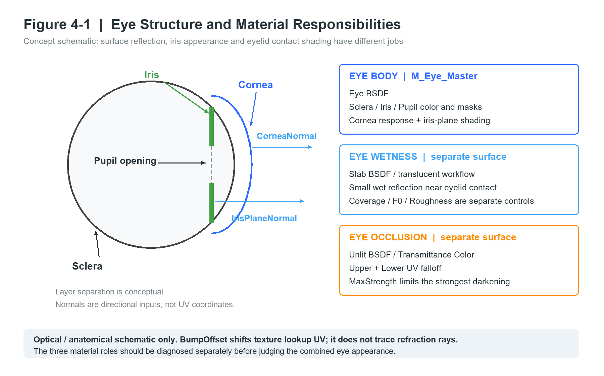
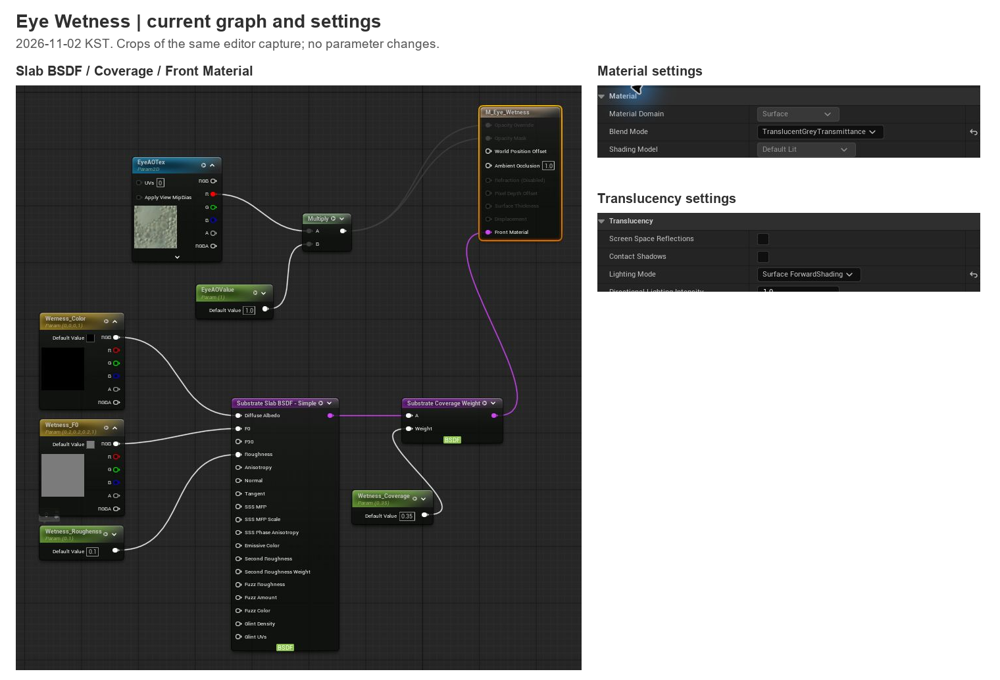
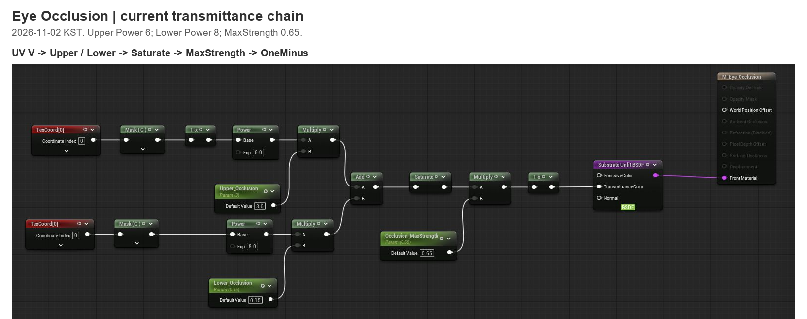
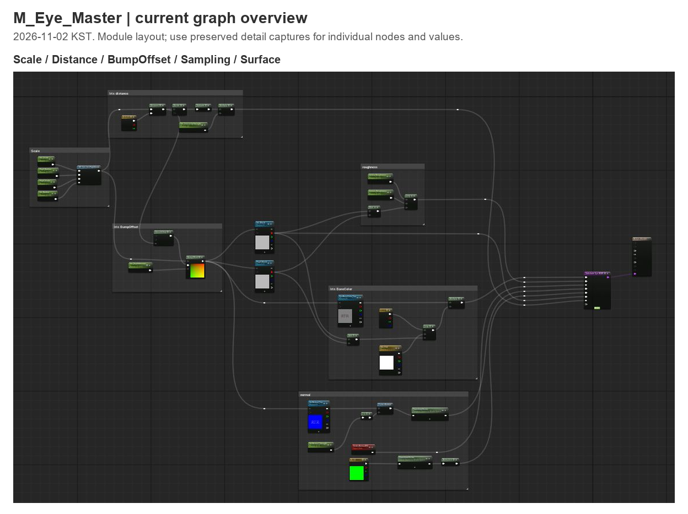
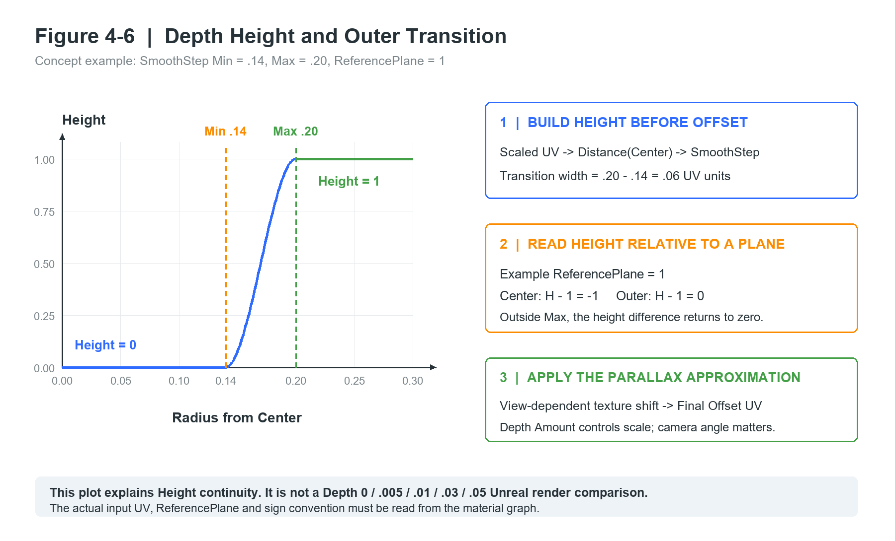
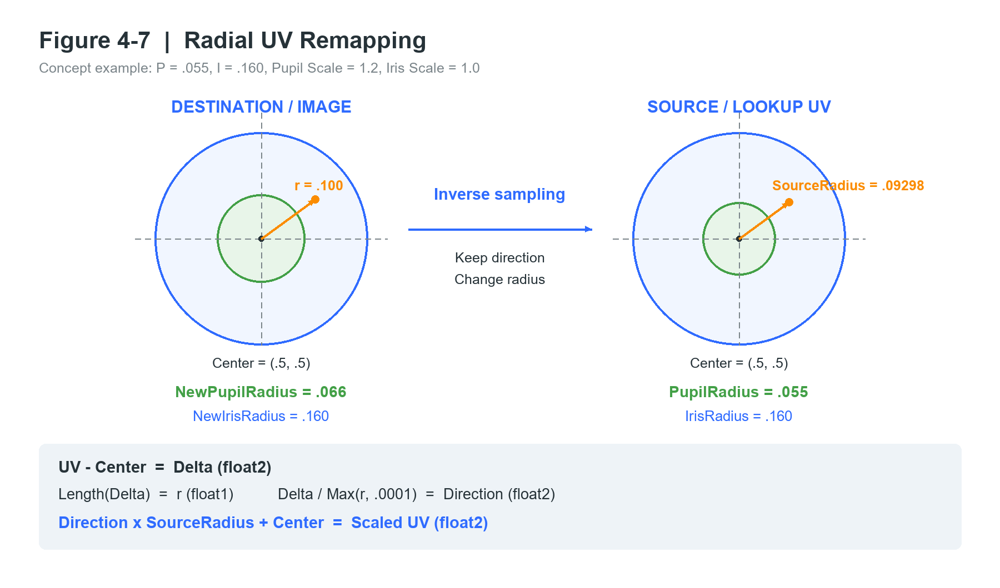
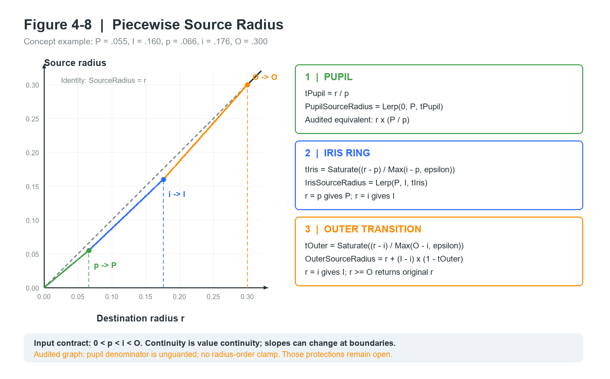
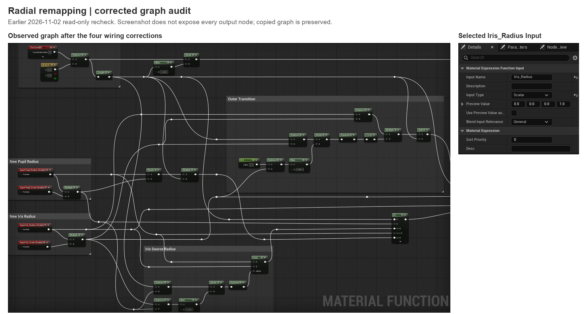
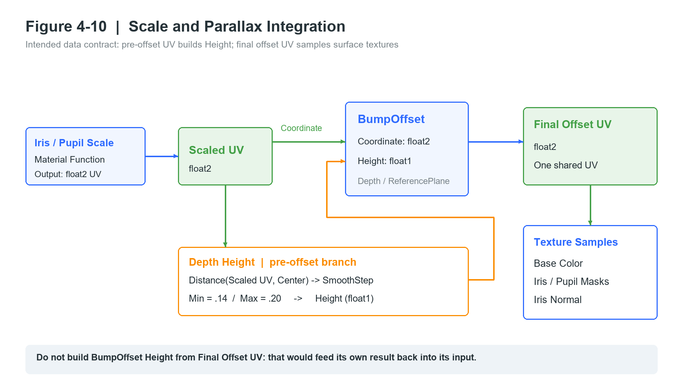

# Chapter 04 — Production Eye Material

> Public edition — 공개 검토를 통과한 자료와 기술 기록을 담았다. [Public Release Scope](Public_Release_Scope.md)

> Module : Production Eye Material / Substrate Eye BSDF / Radial UV Remapping
> Document Status : Draft / User Review
> Implementation Status : First Implementation Record — User Confirmed / Partial Direct Verification
> Updated : 2026-11-02 (KST)
> Environment : Unreal Engine 5.8.3 / RTR_Advanced / Windows Editor — historical build and current UI evidence
> Scope : M_Eye_Master / MI_Eye, Eye Wetness, Eye Occlusion, Iris / Pupil Scale, Parallax Approximation and Validation

이 Chapter는 2026-10-28~2026-11-02에 진행한 Production Eye의 원리, 실제 구현, 실패한 연결과 수정 이유, 수치 실험 및 최종 선택을 기록한다. [Chapter 01](Chapter01_ProductionPBRMasterMaterial.md)의 공통 Material Architecture, [Chapter 02](Chapter02_ProductionSkinShader.md)의 얼굴 Skin, [Chapter 03](Chapter03_ProductionHairShader.md)의 Hair와 같은 Character Rendering 문맥에서 읽는다. 새 문서와 Figure는 기존 Chapter01~03, Topic README와 ASF Figure 규칙을 직접 확인한 구조를 따른다.

눈의 반사·홍채 음영·Texture 시차·크기·눈꺼풀 차폐는 서로 다른 문제다. 한 Parameter가 눈을 그럴듯하게 만든다는 설명으로 합치지 않고, 왜 입력을 분리했는지부터 UV와 Normal의 Data Flow, 실제 Node 배선, 관찰한 오류, 남은 한계 순으로 설명한다. 특히 Section 4.7은 Radial UV Remapping을 다시 구성할 수 있도록 공간과 타입, 구간별 숫자 예시를 충분히 다룬다.

근거는 **현재 Editor에서 직접 읽은 Graph / Instance / Texture**, **기존 로컬 감사 Export·검증 기록**, **사용자가 확인한 대화 결과**, **설명용 계산·개념도**로 구분한다. 최신 UI 값은 과거 Default나 제안값보다 우선하되, 열린 Editor 상태와 디스크 저장 상태는 구별한다. 이번 작업은 문서·Figure 작성이며 Unreal의 Material / Function / Engine Shader / 프로젝트 설정을 수정·Apply·저장하지 않았다. 시작과 종료의 `4 Unsaved` 상태도 저장하지 않았다.

문서 기록은 완성했지만 Implementation Status를 Production Ready로 올리지는 않는다. 반지름 역전 보호, 중심·경계의 엄밀한 항등성, Iris Normal 효과 분리 검증, 실제 입력의 좌표공간과 Eye Geometry 의존성은 Section 4.11의 Open Issues다. Performance Profiling은 Skin / Hair / Eye의 별도 통합 검증 단계로 남긴다.

---

## Contents

- [4.1 Production Eye Architecture](#41-production-eye-architecture)
- [4.2 Eye Wetness Layer](#42-eye-wetness-layer)
- [4.3 Eye Occlusion and Maximum Strength](#43-eye-occlusion-and-maximum-strength)
- [4.4 Texture Preparation and Mask Contracts](#44-texture-preparation-and-mask-contracts)
- [4.5 Surface Color Roughness and Normal](#45-surface-color-roughness-and-normal)
- [4.6 Iris Depth Approximation and Debugging](#46-iris-depth-approximation-and-debugging)
- [4.7 Radial UV Remapping in Detail](#47-radial-uv-remapping-in-detail)
- [4.8 Material Function Implementation and Wiring Audit](#48-material-function-implementation-and-wiring-audit)
- [4.9 Scale and Parallax Integration](#49-scale-and-parallax-integration)
- [4.10 Parameter Record and Experiment Matrix](#410-parameter-record-and-experiment-matrix)
- [4.11 Visual Validation, Decisions and Open Issues](#411-visual-validation-decisions-and-open-issues)
- [4.12 Figure Register and References](#412-figure-register-and-references)

---

## 4.1 Production Eye Architecture

### Why the Eye Needs More Than One Surface Control

눈의 Base Color만 잘 준비해도 정면에서는 그럴듯한 결과를 얻을 수 있다. 그러나 시선이 비스듬해지면 홍채가 표면에 붙은 인쇄처럼 보이거나, 반사 Highlight를 선명하게 만들기 위해 낮춘 Roughness가 공막 전체를 유리처럼 보이게 하는 문제가 드러난다. 눈꺼풀 경계의 어두운 부분까지 Base Color에 넣으면 눈을 움직이거나 조명을 바꾸어도 같은 위치에 검은 띠가 남는다. 이번 설계는 이 세 문제를 하나의 색상 보정으로 해결하지 않고, 서로 다른 공간과 역할을 가진 입력으로 분리한다.

| Structure | Visual Responsibility | Material Representation |
|---|---|---|
| `Sclera` | 공막의 밝은 바탕, 혈관과 비교적 넓은 반사 반응이다. | Eye Base Color의 바깥 영역과 Sclera Roughness를 사용한다. |
| `Iris` | 홍채의 색, 방사형 무늬와 각막 아래의 깊이 단서를 만든다. | Iris Mask, Iris Tint, Iris Normal과 깊이 근사를 사용한다. |
| `Pupil` | 홍채 중심의 어두운 개구부로 읽힌다. | Base Color의 동공 영역과 Pupil Mask를 사용한다. 검은색 영역 자체가 실제 구멍 Geometry를 만든 것은 아니다. |
| `Cornea` | 눈 앞쪽의 매끄러운 반사 Surface를 제공한다. | Eye BSDF의 CorneaNormal과 Cornea Roughness를 사용한다. |
| `Eye Wetness` | 눈 주변의 얇고 젖은 경계에서 작은 Highlight를 만든다. | 별도의 Wetness Mesh / Material을 사용한다. |
| `Eye Occlusion` | 눈꺼풀과 안구의 접촉부를 시각적으로 연결한다. | 별도 Occlusion Surface의 투과율 Gradient를 사용한다. |

여기서 Cornea와 Eye Wetness는 모두 젖은 반사를 보이지만 같은 영역을 뜻하지 않는다. Cornea는 안구 앞면의 반사 방향을 설명하고, 별도 Wetness는 눈 주변의 좁은 경계를 보완한다. Occlusion은 이 반사를 만드는 기능이 아니라 뒤에 있는 안구가 얼마나 보일지를 줄이는 기능이다. 세 기능을 구분해야 검은 경계를 밝게 만들다가 Highlight까지 잃거나, Highlight를 강하게 만들다가 공막의 밝기를 바꾸는 식의 잘못된 보정을 피할 수 있다.

### Eye BSDF, Default Lit and Substrate

`Default Lit`, `Eye BSDF`, `Substrate`를 세 개의 동등한 Shading Model 후보로 나열하면 선택 이유를 잘못 이해하기 쉽다. Default Lit은 기존 Material 시스템에서 사용하는 범용 Shading Model이며, Substrate는 BSDF를 연결하는 Material 작성 체계다. `Substrate Eye BSDF`는 그 체계 안에서 눈에 필요한 입력을 제공하는 전용 Node다. 따라서 이번 선택은 단순히 “Substrate가 Eye보다 좋다”가 아니라, 현재 프로젝트의 Substrate 경로에서 눈 전용 BSDF와 보조 Surface를 어떤 계약으로 사용할지 정한 것이다. [Epic — Substrate Materials Overview](https://dev.epicgames.com/documentation/en-us/unreal-engine/overview-of-substrate-materials-in-unreal-engine)

Default Lit 기반 근사도 Base Color, Roughness와 Normal을 사용해 눈처럼 보이는 Surface를 만들 수 있다. 다만 홍채와 각막의 Normal 역할, Iris Mask와 IrisDistance를 전용 입력으로 전달하려는 이번 구조에서는 `Substrate Eye BSDF`가 의도를 더 직접적으로 표현한다. 이 선택은 모든 Mesh와 플랫폼에서 자동으로 올바른 눈을 보장한다는 뜻이 아니다. Eye 전용 경로가 기대하는 Geometry, UV와 Normal 방향이 실제 Asset에 맞는지 확인해야 한다.

이번 기록의 본체는 `M_Eye_Master`와 그 Instance다. Wetness와 Occlusion은 본체 Graph 안에 Eye BSDF와 Slab을 임의로 Layer한 구조로 설명하지 않는다. 실제로 따로 제작한 보조 Material과 Mesh의 책임으로 다룬다. 전용 Eye BSDF를 범용 Slab처럼 자유롭게 혼합할 수 있다고 가정하지 않는다.

### Data Flow and Evidence Boundary

```text
Eye Texture Set + Radius / Scale Parameters
    → Iris / Pupil Radial UV Remapping
    → Depth Height + BumpOffset
    → Shared Final UV
    → Base Color / Masks / Iris Normal Sampling
    → Tint / Roughness / Normal / IrisDistance
    → Substrate Eye BSDF → Front Material

Wetness Mesh → Slab BSDF → Coverage Weight → Front Material
Occlusion Mesh → Upper / Lower Gradient → Transmittance → Unlit BSDF
```

이 흐름에서 UV 변형은 Texture를 읽을 위치를 결정하고, BSDF 입력은 읽어 온 Data를 Surface 반응으로 해석한다. 따라서 눈이 납작해 보인다는 같은 증상도 UV 깊이 근사의 문제인지, Normal과 IrisDistance 입력의 문제인지 분리해 진단해야 한다. UV를 바꾸는 것만으로 Geometry가 오목해지거나 실제 광선 굴절이 계산되는 것은 아니다.

2026-10-28의 조사 기록은 UE `5.8.3`, CL `58210709`를 기준으로 한다. 당시 GBuffer 경로 `0 → 1` 변경과 `r.IrisNormal=0`의 읽기 전용 상태가 기록되었다. 이는 당시의 진단 이력이며 이번 문서 작성에서 전역 Rendering 설정을 다시 변경하거나 현재 설정 전체를 재검증한 결과가 아니다. 실제 최신 Graph / Instance에서 확인한 값은 해당 절에 따로 표기하고, 보이지 않는 연결과 실행하지 않은 비교는 확인 완료로 바꾸지 않는다.

<p align="center">

</p>

*Figure 4-1. Eye structure and material responsibilities. Sclera / Iris / Pupil / Cornea와 Eye Body·Wetness·Occlusion의 책임을 분리한 개념도다. Normal 화살표는 역할 구분을 위한 도식이며 실제 Mesh 형상·좌표공간·굴절 경로의 검증 결과가 아니다.*

---

## 4.2 Eye Wetness Layer

### Why Wetness Is Separated from the Eye Body

눈 주변의 좁은 젖은 경계는 작지만 시선이 움직일 때 강한 깊이 단서를 제공한다. 이를 Eye Base Color에 밝은 선으로 그리면 Light와 무관한 고정 무늬가 된다. 반대로 안구 전체의 Roughness를 낮춰 같은 효과를 얻으려 하면 공막과 각막의 넓은 반사까지 함께 바뀐다. 별도의 Wetness Surface는 젖은 영역의 위치를 Geometry로 정하고, 그 위의 Highlight 폭과 존재감을 Roughness와 Coverage로 조절하기 위해 사용한다.

테스트 Sphere는 Slab의 반사와 Coverage가 동작하는지 확인하기에 편리하다. 곡면에 Highlight가 나타나는지, Roughness를 바꾸면 반사가 어떻게 달라지는지를 빠르게 읽을 수 있기 때문이다. 그러나 Sphere의 정상 반응은 눈가에 배치된 실제 Wetness Mesh의 두께, 뒤집힌 Normal, 안구와의 겹침 또는 투명 Surface의 정렬까지 입증하지 않는다. 최종 판단은 Eye Mesh와 함께 읽어야 한다.

### Recorded Graph and Parameter Roles

2026-11-02에 열린 Material Editor에서 직접 확인한 Master Graph는 다음과 같다. `Substrate Slab BSDF - Simple`이 `Substrate Coverage Weight`를 거쳐 활성 `Front Material`로 이어진다. 실제 Parameter의 철자 `Werness_Color`, `Wetness_Roughenss`는 Asset의 기록을 추적하기 위해 그대로 적는다. 문서 작성 과정에서 이름을 정리하기 위해 Asset을 Rename하지 않는다.

```text
Werness_Color RGB = black → Substrate Slab BSDF / Diffuse Albedo
F0 = (0.2, 0.2, 0.2)      → Substrate Slab BSDF / F0
Wetness_Roughenss ≈ 0.1   → Substrate Slab BSDF / Roughness
Slab BSDF                → Substrate Coverage Weight / BSDF
Wetness_Coverage = 0.35   → Substrate Coverage Weight / Weight
Coverage Weight          → Front Material
```

| Input | Recorded Value | Reading |
|---|---|---|
| `Werness_Color` | Black | 넓은 Diffuse 색보다 반사 Highlight를 중심으로 보이게 한 당시 설정이다. 검은 Diffuse가 투명도를 뜻하는 것은 아니다. |
| `F0` | `(0.2, 0.2, 0.2)` | 정면 입사 부근의 반사율 제어다. 현재 Lookdev 기록이며 물의 측정 F0를 채택했다는 뜻이 아니다. |
| `Wetness_Roughenss` | 약 `0.1` | 작은 Highlight를 비교적 선명하게 유지하기 위한 기준이다. |
| `Wetness_Coverage` | `0.35` | Slab이 얼마나 존재하는지를 조절한다. Roughness나 F0와 역할이 다르다. |
| Blend Mode | 최신 UI의 `TranslucentGreyTransmittance` | 기존 Export의 `BLEND_Translucent`와 현재 UI 표기를 시점별로 구분한다. |
| Lighting Mode | 최신 UI의 `Surface ForwardShading` | 기존 조사 설정을 현재 값으로 대신 적지 않는다. |

Coverage를 줄이면 Surface 전체의 기여가 약해지며 반사도 함께 약해질 수 있다. Roughness는 반사 분포의 폭을, F0는 반사 반응의 크기를 바꾸므로 “더 투명하게” 보이게 하려는 목적을 Roughness 조절만으로 해결하지 않는다. 같은 이유로 Coverage `0.35`를 “빛의 65%가 물을 통과한다”라는 물리적 흡수 측정값으로 해석하지 않는다.

현재 선택한 Substrate의 Grey Transmittance 경로는 색을 가진 흡수까지 정교하게 다루는 별도 유리 실험을 목표로 하지 않는다. 이 Wetness Graph에서는 실제 연결된 Slab / Coverage를 기준으로 읽는다. 존재하지 않는 MFP Texture나 Refraction 연결을 문서에 추가해 완성된 물 모델로 설명하지 않는다.

### Validation and Capture Reading

Figure 4-2는 현재 Wetness Graph와 설정을 보여 준다. 별도 Sphere/실제 Eye Mesh의 고정 조건 비교는 Section 4.11의 To Capture에 남긴다.

<p align="center">

</p>

*Figure 4-2. Current Wetness graph and material settings. Slab의 black Diffuse / F0 0.2 / Roughness 0.1과 Coverage 0.35, Grey Transmittance / Surface ForwardShading을 직접 읽은 Capture다. 원본에서 Graph와 설정을 Crop해 배치했으며 실제 Wetness Instance 배정이나 Sphere A/B의 증거는 아니다.*

Graph Capture에서는 Slab의 출력이 Coverage Weight를 거쳐 실제 `Front Material`로 이어지는지, Roughness가 약 `0.1`인지 확인한다. Sphere Capture에서는 Highlight의 반응을, Eye Mesh Capture에서는 눈 주변에 얇은 반사 경계가 남는지를 확인한다. 세 화면의 역할이 다르므로 Sphere 하나로 실제 적용 완료를 판정하지 않는다.

최신 Capture에는 `EyeAOTex.R × EyeAOValue(1)`가 기존 Opacity 입력 쪽으로 이어진 경로도 남아 있다. 해당 Root Pin은 현재 회색의 비활성 입력이므로 이를 활성 Substrate 투명도 제어로 설명하지 않는다. 실제 Surface 출력은 Slab → Coverage Weight → Front Material을 따른다.

현재 Capture로 확인한 숫자는 Master Node의 값이다. 실제 Eye Mesh에 배정된 Wetness Instance와 Override까지 확인했다는 뜻은 아니다. Two Sided, 별도 Refraction과 보이지 않는 설정도 실제 UI에서 읽은 범위만 확정한다. 이번 작업에서는 Wetness 값을 비교하기 위해 변경하거나 Material을 저장하지 않는다.

---

## 4.3 Eye Occlusion and Maximum Strength

### Why Contact Shading Needs a Separate Maximum

안구가 눈꺼풀에 닿는 부분이 같은 밝기로 끝나면 두 Surface가 떠 있는 것처럼 보인다. Eye Occlusion은 이 경계를 Gradient로 어둡게 연결한다. 그러나 “그림자가 어디까지 내려오는가”와 “가장 어두운 곳에서 눈이 얼마나 보이는가”를 하나의 Strength로 조절하면, 원하는 범위를 만들기 위해 높인 값이 완전한 검정까지 함께 만든다. 이번 수정의 핵심은 Gradient의 형태와 최대 차폐량을 분리하는 데 있다.

Occlusion은 `Substrate Unlit BSDF`의 `Transmittance Color`로 뒤의 안구를 얼마나 보여줄지 제어한다. Unlit의 Emissive를 검게 만드는 것만으로 같은 작동을 설명할 수 없다. 여기서 `Transmittance = 1`은 뒤쪽을 보존하고 `0`은 이 경로에서 뒤쪽의 빛을 완전히 차단하는 방향이다. 일반적인 흰색 Opacity Mask와 값의 읽는 방향이 반대이므로 Node 이름과 최종 의미를 함께 확인해야 한다.

### Upper and Lower UV Gradients

기록된 Graph는 UV의 `V`를 위아래 Gradient로 사용한다. 이 UV 배치에서는 `V=0` 쪽을 Upper로 읽는 계약이다. Mesh의 UV가 뒤집혔다면 같은 식의 위아래도 뒤집히므로, 월드의 위쪽이라는 이유만으로 UV V 방향을 가정하지 않는다.

```text
TexCoord.V
    ├─ OneMinus → Power(Upper_Falloff) × Upper_Occlusion → Upper
    └─            Power(Lower_Falloff) × Lower_Occlusion → Lower

Upper + Lower → Add → Saturate → OneMinus → Unlit BSDF / Transmittance Color
```

`Power`는 끝점 근처에 진한 영역을 모으는 형태 제어다. 입력이 0과 1 사이라면 지수가 커질수록 중간값은 더 작아진다. `Strength`는 그 곡선을 위로 늘리는 제어다. 두 값을 올리는 것이 같은 결과를 만들지 않으며, Saturate에 도달한 영역에서는 더 큰 값의 차이가 사라진다.

| Parameter | Recorded Baseline | Role |
|---|---|---|
| `Upper_Occlusion` | `3.0` | 위쪽 Gradient의 크기다. 최종 투과율의 하한을 직접 보장하지 않는다. |
| `Upper_Falloff` | 초기 대화 `4.0`; 최신 Master의 Power literal `6` | 위쪽 끝점에서 내려오는 Gradient의 형태다. 현재 Graph는 Parameter가 아닌 Power의 상수 `6`을 사용한다. |
| `Lower_Occlusion` | `0.15` | 아래쪽 Gradient의 크기다. |
| `Lower_Falloff` | `8.0` | 아래쪽 끝점 근처에 효과를 모은다. |

예를 들어 Upper 끝점에서 `(1−V)^4 = 1`이면 Upper는 `3`이 된다. 최신 Graph의 지수 `6`도 이 끝점에서는 같은 `1`이다. Add의 결과를 Saturate하면 `1`, 기존 OneMinus 직결에서는 `0`이다. 값 `3`이 검정보다 세 배 어두운 출력을 만드는 것이 아니라, 넓은 구간을 상한 `1`에 붙여 투과율 `0`으로 만드는 것이다. 사용자가 “윗부분이 완전 검은색”이라고 관찰한 현상은 이 구조로 설명할 수 있다. 다만 실제 화면의 모든 어두운 부분이 Occlusion 하나에서 왔다고 단정하지 않는다. 속눈썹과 눈꺼풀의 실제 Shadow도 함께 보일 수 있다.

### Maximum Occlusion Strength

개선안은 Saturate 뒤에 별도의 Multiply를 추가하는 것이다. 순서가 중요하다. `Saturate` 전에 Strength를 곱하면 기존 Upper의 큰 값 때문에 다시 `1`로 잘릴 수 있다. Saturate 이후의 0–1 Mask를 제한해야 최대 차폐를 예측할 수 있다.

```text
Upper + Lower
    → Saturate
    → Multiply(Occlusion_MaxStrength)
    → OneMinus
    → Substrate Unlit BSDF / Transmittance Color
```

| `Occlusion_MaxStrength` | Minimum Transmittance when saturated | Interpretation |
|---|---|---|
| `1.0` | `0` | 완전 차폐가 가능하다. |
| `0.8` | `0.2` | 최대 차폐 영역에서도 일부 안구가 남는다. |
| `0.65` | `0.35` | 초기 개선 제안의 기준이다. |
| `0.5` | `0.5` | 접촉부를 더 옅게 남긴다. |
| `0` | `1` | 이 Gradient 경로의 차폐 기여를 없앤다. |

위 표는 최대 Mask가 `1`이고 MaxStrength가 0–1에 있을 때의 계산 관계다. 렌더 이미지의 최종 밝기나 물리적 투과율을 측정한 값이 아니다. 실제로는 뒤의 안구 색, 다른 Shadow와 합성 조건이 함께 작용한다.

### Current Master Graph and Instance Verification Boundary

대화에서는 먼저 기존 Upper `3`을 유지하고 `Occlusion_MaxStrength=0.65`만 추가해 비교하는 방법을 제안했다. 이어서 진한 영역 자체가 넓게 남으면 `Upper_Occlusion=0.8`, `Occlusion_MaxStrength=0.8`을 별도 시작점으로 시험하는 대안도 설명했다. 사용자는 이후 “잘 수정됐어”라고 결과 개선을 확인했다.

2026-11-02의 열린 Material Editor에서는 **`Occlusion_MaxStrength=0.65`가 최신 Master의 기본값으로 직접 확인되었다.** 활성 출력은 `Add → Saturate → Multiply(0.65) → OneMinus → Substrate Unlit BSDF / Transmittance Color → Front Material`이다. Blend Mode는 `TranslucentGreyTransmittance`이며, Upper는 `(1−V)^6 × 3`, Lower는 `V^8 × 0.15`다. 초기 대화의 Upper Power `4`와 최신 Graph의 literal `6`을 같은 값으로 기록하지 않는다. `0.8 / 0.8` 대안은 최종 Master의 확인값이 아니다.

Figure 4-3에서 현재 Upper Power 6, Lower Power 8과 Saturate 뒤의 MaxStrength 경로를 함께 읽는다.

<p align="center">

</p>

*Figure 4-3. Current Occlusion falloff and maximum strength. Upper 3 / Power 6, Lower 0.15 / Power 8과 Occlusion_MaxStrength 0.65가 Unlit Transmittance로 이어진다. 현재 Master Graph의 Crop이며 같은 카메라의 OFF/ON 비교가 아니다.*

이 직접 확인은 Master의 구조와 기본값에 관한 것이다. 실제 Eye Occlusion Mesh의 Material 배정과 Instance Override는 아직 확인하지 않았으므로 현재 렌더가 반드시 Master 기본값 `0.65`를 사용한다고 확대하지 않는다. 후속 비교는 같은 Camera와 Light에서 Occlusion OFF / ON을 확인하고, 위쪽 홍채가 검정으로 막히지 않으면서 눈꺼풀 바로 아래의 접촉감과 Wetness Highlight가 남는지를 읽는 방식이다. 이번 문서 작업에서는 이 비교를 위해 Material이나 Visibility를 변경하지 않는다.

---

## 4.4 Texture Preparation and Mask Contracts

### Why Texture Meaning Must Be Agreed Before Wiring

흑백 Texture는 모양이 비슷해 보여도 같은 의미를 가지지 않는다. 홍채 무늬만 선택하는 링 Mask, 동공을 포함한 전체 홍채 원판 Mask, 동공만 선택하는 Mask는 서로 다른 질문에 답한다. 이들을 모두 `Iris Mask`라고 부르면 Tint에서는 자연스럽지만 Roughness나 Eye BSDF 경계에서는 구멍이 생기는 식의 오류가 발생한다. 연결 전에 “흰색이 어떤 Surface를 뜻하는가”와 “어느 UV에서 읽는가”를 계약으로 정해야 한다.

| Texture / Signal | Data Type | White / Visible Region | Intended Use |
|---|---|---|---|
| Eye Base Color | RGB Color | 공막·홍채·동공의 색상과 무늬다. | Eye BSDF의 Diffuse Color를 준비한다. |
| Iris Mask | Scalar | 제공된 원본은 홍채 무늬 영역의 링이다. | Iris Tint 등 홍채 부분 선택에 사용한다. |
| Pupil Mask | Scalar | 동공 중심의 디스크다. | 동공 영역 선택, 필요시 홍채 전체 영역의 결합에 사용한다. |
| Iris Normal | float3 Direction after normal decoding | 흰색 / 검정 선택 Mask가 아니다. | 홍채의 세부 방향 Data를 공급한다. |
| Combined Iris Region | Scalar derived signal | Iris ring와 Pupil disk를 합친 영역이다. | 공막과 눈 앞쪽 전체를 구분해야 하는 경로에서 검토한다. |

Figure 4-4에서 실제 Texture의 선택 영역을 비교한다. Mask의 흰색을 눈의 밝은 색상으로 해석하지 않는다.

<p align="center">
*Fig4_04 — 공개 사본에서 이미지 생략.*
</p>

*Figure 4-4. Actual Eye texture set. Base Color 원본과 Texture Editor에서 촬영한 Iris 링 / Pupil 디스크 / Iris Normal을 같은 UV 영역으로 배치했다. 화면용 비례 축소와 외부 Label만 적용했으며 디스크 결합 결과를 새로 그려 실제 Texture처럼 제시하지 않았다.*

Figure에서는 Iris Mask의 중앙이 비어 있고 Pupil Mask는 중앙이 채워져 있다는 차이를 먼저 읽는다. 검은 동공이 Base Color에 이미 있다는 이유만으로 Pupil Mask가 불필요한 것은 아니다. Color는 화면에 보일 색을, Mask는 다른 Surface 제어가 적용될 범위를 결정하기 때문이다.

### Ring and Disk Are Not Interchangeable

링형 Iris Mask를 Eye BSDF의 IrisMask로 직접 넣으면 동공 중심은 `0`이 된다. 해당 입력을 “홍채 조직만”으로 해석할지 “홍채와 동공을 포함한 눈 앞면”으로 해석할지는 사용 중인 Eye 경로와 실제 결과를 함께 확인해야 한다. 단순히 Texture 이름이 Iris Mask라는 이유만으로 정답을 정하지 않는다. 필요하다면 `Saturate(IrisMask + PupilMask)` 또는 `Max(IrisMask, PupilMask)`로 디스크형 영역을 만든다.

두 연산도 완전히 같지는 않다. 서로 겹치지 않는 0/1 Mask라면 같은 결과를 얻을 수 있지만, Antialiasing으로 회색 경계가 겹치면 Add는 두 값을 더하고 Max는 큰 값만 남긴다. 예를 들어 경계 두 Mask가 각각 `0.4`라면 Saturate(Add)는 `0.8`, Max는 `0.4`다. 최종 경계의 밝기와 폭이 달라질 수 있으므로 기존 Graph가 어느 경로에 Add 또는 Max를 사용했는지 구분해서 기록한다.

### Import and Sampling Contracts

색상 Texture는 Color로, Mask는 수치 Data로, Normal은 방향 Data로 해석되어야 한다. 일반적인 준비 기준은 Base Color의 색 공간, Mask의 Linear Sampling, Normal Compression과 Normal Sampler를 구분하는 것이다. 2026-11-02에는 `T_Eye_IrisMask`, `T_Eye_PupilMask`, `T_Eye_IrisNormal`의 Texture Editor를 열어 다음 현재 UI 설정을 직접 확인했다. Base Color도 별도 Texture Editor에서 아래 설정을 확인했다.

| Texture | Resolution / Format | Compression / Color Space | Other Direct UI Readback |
|---|---|---|---|
| `T_Eye_BaseColor` | `1024 × 1024`, `DXT1` | Default (BC1 or BC3 with A), sRGB ON | Texture Group World, Wrap X/Y, 11 Mips다. |
| `T_Eye_IrisMask` | `1024 × 1024`, `DXT1` | `Masks (no sRGB)`, sRGB unchecked | Address X / Y `Wrap`, Mip 수 `11`이다. |
| `T_Eye_PupilMask` | `1024 × 1024`, `DXT1` | `Masks (no sRGB)`, sRGB unchecked | Address X / Y `Wrap`, Mip 수 `11`이다. |
| `T_Eye_IrisNormal` | `1024 × 1024`, `BC5` | `Normalmap (BC5)`, sRGB OFF | Texture Group `WorldNormalMap`, `Flip Green Channel` OFF다. |

Mask 두 Asset Tab은 열었을 때 `*`를 표시했고, Editor의 전역 `4 Unsaved` 표시도 이번 열람 전후 유지되었다. Normal Tab에는 `*`가 보이지 않았다. 위 표는 열린 Editor의 현재 상태를 읽은 것이며, 디스크에 저장된 Asset 설정을 별도로 확인한 결과가 아니다. 이번 작업에서는 Thumbnail을 열어 읽기만 했고 Texture 설정을 바꾸거나 저장하지 않았다. 기존 미저장 표시를 이번 문서 작업이 새로 만든 변경으로 기록하지 않는다.

| Check | Reason | Current Documentation Rule |
|---|---|---|
| Base Color sRGB / Sampler | 표시 색과 Shader 내부 Color 해석을 일관되게 한다. | 실제 Asset 화면에서 읽은 값만 확정한다. |
| Iris / Pupil Mask sRGB OFF 여부 | 회색값을 색상 Gamma가 아니라 선택 비율로 읽는다. | 두 Mask의 현재 UI에서 OFF를 확인했다. 미저장 표시가 있으므로 별도의 디스크 저장 검증과 구분한다. |
| Mask Channel | RGB와 특정 R Channel을 섞어 사용하면 출력 타입과 값의 의미가 달라질 수 있다. | 실제 Node의 출력 Pin을 기록한다. |
| Normal Compression / Sampler | Normal Map은 일반 Color Texture처럼 곱하지 않는다. | Texture UI에서 BC5 Normalmap, sRGB OFF, Flip Green OFF를 확인했다. Graph의 실제 Sampler 출력 Pin과 강도 적용 경로는 별도 연결 근거로 읽는다. |
| UV Channel / Center | Radial Remapping은 홍채 중심과 반지름의 실제 배치를 전제로 한다. | `TexCoord[0]`, Center `(0.5,0.5)`가 대상 Texture와 Mesh에 맞는지 확인한다. |
| Resolution / Mips / Filtering | 얇은 링 경계가 거리와 Mip에서 달라질 수 있다. | 정지 근접 Capture를 거리 안정성 검증으로 확대하지 않는다. |

### Shared UV Is Part of the Texture Contract

Base Color를 변형된 UV로 읽고 Mask를 원본 UV로 읽으면 같은 Pixel에서 서로 다른 위치의 Data를 결합한다. 예를 들어 색상에서는 홍채인 점이 Mask에서는 공막으로 분류될 수 있다. 경계의 이중 링, Tint의 어긋남과 Roughness 띠는 이 불일치만으로도 생길 수 있다. 따라서 최종 Shading용 Base Color, Iris / Pupil Mask와 Iris Normal은 같은 `Final Offset UV`를 공유한다. BumpOffset의 Height를 만드는 Data만 그 이전의 `Scaled UV`에서 계산한다. 이 구분은 뒤의 Integration 절에서 실제 연결 순서로 다시 설명한다.

---

## 4.5 Surface Color Roughness and Normal

이 절은 Figure 4-5의 최신 Master 전체 배치를 먼저 보고 Color / Roughness / Normal 경로를 각각 읽는다. Overview는 기능의 연결 관계를 보여 주며 모든 Pin을 읽기 위한 확대 화면은 Surface 상세 Capture와 기존 감사 Export를 함께 사용한다.

<p align="center">

</p>

*Figure 4-5. Current M_Eye_Master overview. Scale, IrisDistance, BumpOffset, Masks, Tint, Roughness와 Normal이 Eye BSDF / Front Material로 이어지는 최신 Graph다. 전체 배치를 보존한 Crop이며 Master의 기본 Preview Texture를 실제 MI_Eye 외형으로 오해하지 않는다.*

### Iris Tint and the Neutral Multiplier

Iris Tint는 홍채의 색을 바꾸되 공막을 원래 색으로 보존하려는 제어다. 이를 Multiply 방식으로 만들 때 Lerp의 결과는 최종 Color가 아니라 Base Color에 곱할 **배율**이다. 선택되지 않은 영역의 배율은 원본 Color가 아니라 곱셈의 중립값인 흰색 `(1,1,1)`이어야 한다.

```text
White (1,1,1) ── Lerp A
Iris_Tint RGB ── Lerp B
Iris Selection ─ Lerp Alpha
                    ↓
Base Color RGB × Tint Multiplier → Eye BSDF / Diffuse Color
```

문제의 Graph에서는 Lerp A에 Base Color가 들어간 상태에서 Lerp 출력을 Base Color와 다시 Multiply했다. 공막처럼 Alpha가 `0`인 영역에서 Lerp는 A, 즉 Base Color를 그대로 내보내므로 최종 결과는 `BaseColor × BaseColor`가 된다. 0과 1 사이의 색을 제곱하면 더 어두워진다. 개념 예시로 Linear Channel `0.8`은 `0.64`, `0.5`는 `0.25`가 된다. 이는 노출이나 Shadow가 부족해서 생긴 어두움이 아니라 색상 Data를 두 번 곱한 문제다.

Lerp A를 `(1,1,1)`로 바꾸면 Alpha `0`에서 `BaseColor × 1`이 되어 공막이 복원된다. Alpha `1`에서는 `BaseColor × Iris_Tint`가 되어 홍채만 조절된다. 중간 Mask에서는 원본 배율과 Tint 배율을 보간한다. 같은 원리로 Tint를 모두 흰색으로 두면 Mask 모양과 관계없이 원본 Base Color가 보존된다. 이는 Graph의 대수적 관계이며, 현재 화면의 Pixel이 시간적 렌더 차이까지 완전히 일치했다는 실측 주장은 아니다.

기존 조사 Graph는 Tint 선택에 Iris / Pupil Mask의 Add 결과를 사용했다. 이때 선택 범위가 홍채 링인지 동공 포함 디스크인지, Add 뒤의 범위 제한이 있는지 실제 연결을 함께 읽어야 한다. Tint의 중립값 수정과 선택 범위의 설계는 서로 다른 문제다.

### Cornea and Sclera Roughness

공막과 눈 앞쪽의 반사 폭을 따로 조절하기 위해 Mask로 두 Roughness를 보간한다. 기존 Graph의 Roughness 선택에는 Iris / Pupil Mask를 `Max`로 결합한 경로가 기록되어 있다. 그 목적은 동공을 포함한 앞쪽 영역에 Cornea 기준을 적용하고 바깥 공막에는 Sclera 기준을 적용하는 것이다.

```text
Iris Mask ──┐
            Max → Surface Region → Lerp Alpha
Pupil Mask ─┘
Sclera_Roughness ────────────────→ Lerp A
Cornea_Roughness ────────────────→ Lerp B
Lerp → Eye BSDF / Roughness
```

| Parameter | Historical Master Default | Latest UI Readback, 2026-11-02 | Interpretation |
|---|---|---|---|
| Cornea Roughness | `0.05` | `0.1` | 현재 Instance의 값과 초기 Master 기준을 구분한다. |
| Sclera Roughness | `0.25` | `0.3` | 공막의 반사 폭을 따로 제어한다. |
| Iris Normal Strength | `0.3` | `1` | 강도 값이 존재하는 것과 효과를 분리 검증한 것은 다르다. |
| Iris Concavity | 당시 Graph의 입력 계약 참조 | `0.1` | BumpOffset Depth와 별도의 BSDF 제어다. |

이 값들은 다른 Eye Asset에 복사하면 같은 외형을 보장하는 물성 상수가 아니다. Mask 경계, Mesh 곡률, 광원 크기와 노출이 함께 외형을 결정한다. 특히 Cornea Roughness를 낮췄을 때 생기는 작은 Highlight를 Iris Normal 효과라고 해석하지 않도록 두 제어를 분리한다.

### Three Normal Responsibilities

`CorneaNormal`, `IrisNormal`, `IrisPlaneNormal`은 모두 float3 방향 입력이지만 서로 대신할 수 없다. CorneaNormal은 공막·각막 Surface의 방향, IrisNormal은 홍채의 세부 방향, IrisPlaneNormal은 홍채 Plane의 기준 방향을 전달한다. Mask와 IrisDistance는 Scalar 입력이다. API가 이 입력들의 타입과 역할을 별도로 정의하므로, 색상처럼 단순히 곱하는 Data와 구분한다. [Epic — UMaterialExpressionSubstrateEyeBSDF](https://dev.epicgames.com/documentation/en-us/unreal-engine/API/Runtime/Engine/UMaterialExpressionSubstrateEyeB-)

```text
VertexNormalWS → Eye BSDF / CorneaNormal

Iris Normal Texture
    → FlattenNormal, Flatness = 1 − IrisNormalStrength
    → TransformVector, Tangent → World
    → Eye BSDF / IrisNormal

Local direction (0,1,0)
    → TransformVector, Local → World
    → Normalize
    → Eye BSDF / IrisPlaneNormal
```

위 구조는 기존 Graph 조사에 남은 연결이다. Tangent Space Normal Texture를 World 방향 입력과 함께 사용하기 위해 공간을 맞춘 의도가 드러난다. 그러나 “Normalize가 있으니 모든 방향 문제가 해결된다”고 판단할 수 없다. Normalize는 길이를 1로 만들 뿐, 잘못 선택한 Local 축이나 뒤집힌 Tangent Basis를 올바르게 바꾸지 않는다. `(0,1,0)`이 실제 Eye Mesh의 앞 방향인지, Mesh 회전과 Mirrored UV가 같은 계약을 유지하는지는 대상 Geometry에서 확인해야 한다.

`FlattenNormal`의 Flatness는 이름과 달리 Strength를 그대로 넣는 입력이 아니다. 기록된 경로는 `1−Strength`를 넣으므로 Strength `0`일 때 평평한 방향으로, `1`일 때 원본 Normal 쪽으로 간다. 이 관계를 설명하는 것과 최신 렌더에서 0 / 1의 차이를 직접 입증하는 것은 구분한다. `r.IrisNormal`은 당시 읽기 전용이었고 기능 분리 시험이 보류되어, 현재 Strength `1`이라는 UI 값만으로 Iris Normal의 시각적 기여가 검증되었다고 쓰지 않는다.

### IrisDistance Is Not the UV Radius

Radial Remapping에서 말하는 Radius는 UV Center에서 Texture를 읽을 위치까지의 거리다. 반면 Eye BSDF의 `IrisDistance`는 Eye 경로가 홍채 반응을 해석하기 위해 받는 별도 Scalar다. UI의 `Iris_ConcavityStrength`도 그 연결 목적을 Graph로 확인해야 하며, 같은 이름의 “깊이”라는 이유로 `Iris_DepthAmount`나 UV Radius와 교체하지 않는다.

최신 화면에서는 pre-offset Scaled UV의 Distance를 0.16으로 나눈 뒤 Saturate하고 Iris_ConcavityStrength를 곱하는 경로를 읽었다. 세부 분기는 Section 4.9를 참조한다. Coordinate Space와 최종 Scale / Depth 이후의 정렬이 확인되지 않은 부분은 Open Issues다. “눈 중심까지의 cm 거리” 또는 “각막의 실제 두께”라고 임의 해석하지 않는다. 이번 문서에서는 연결을 보존하고 최신 Capture로 읽을 수 있는 부분만 기록한다.

### Case Study — Native Eye Inputs and GBuffer Diagnosis

10월 28일에는 IrisDistance를 바꾸어도 예상한 홍채 반응이 나타나지 않는 문제를 조사했다. 먼저 Mask가 선택하는 영역, Pupil의 어두운 Albedo, Direct Light의 유무를 구분했다. IrisDistance는 UI상의 이름 때문에 실제 깊이 또는 시차로 오해하기 쉽지만, 당시 로컬 Shader 분석에서는 IrisNormal과 Light의 관계 및 Caustic 방향의 가중치에 관여하는 별도 입력으로 추적되었다. 환경광·정면 Texture의 크기 변화만으로 이 입력의 작동을 판단할 수 없었다.

당시 UE 5.8.3의 Blendable GBuffer 경로에서는 native Eye의 Normal/Distance가 Export, legacy Shading Model 변환과 최종 Encode를 지나며 어떻게 보존되는지 조사했다. 소스와 생성 HLSL을 따라간 분석은 입력값을 노드에 연결하는 것과 최종 Lighting 단계까지 전달하는 것이 별개임을 보여 주었다. GPU Pixel의 저장값 자체를 읽은 실측은 아니므로 특정 값이 모든 Pixel에서 손실되었다는 확정 주장과는 구분한다.

이후 기존 작업에서 Adaptive GBuffer 전환과 재시작을 거친 결과를 확인한 기록이 있다. 당시 Source 경로 분석, 재시작 후 상태, 당시 고정 조명 비교를 보존했다. 마지막 비교는 **Concavity Strength 0/1의 당시 조사**이며 BumpOffset Depth 0/0.03 비교가 아니다. 이 기록으로 현재 Normal 효과, 최신 설정 전체와 모든 플랫폼의 Eye 입력 보존까지 완료했다고 판단하지 않는다. 이번 작성 중에는 설정·Shader를 변경하거나 재시작하지 않았다.

---

## 4.6 Iris Depth Approximation and Debugging

### Why BumpOffset Was Added

홍채가 각막 바로 위에 붙은 무늬처럼 보이면 Normal의 세기를 올리는 것만으로는 충분하지 않다. Normal은 반사와 Lighting에 쓰는 방향을 바꾸지만 Texture 무늬가 시점에 따라 이동할 위치 자체를 바꾸지는 않기 때문이다. 이번 구현은 홍채가 각막 아래에 있는 것처럼 읽히는 시차 단서를 보완하기 위해 `BumpOffset`을 사용한다.

BumpOffset은 시선 방향과 Height 입력을 이용해 Texture Coordinate를 이동시키는 Parallax Mapping 근사다. Geometry나 실루엣을 실제로 변형하지 않으며, 큰 사선에서 근사가 드러날 수 있다. 따라서 이 결과를 각막 안에서 광선이 실제로 굴절해 홍채에 도달한 물리적 Refraction으로 부르지 않는다. [Epic — Using Bump Offset](https://dev.epicgames.com/documentation/en-us/unreal-engine/using-bump-offset-in-unreal-engine)

Eye BSDF의 IrisDistance / Concavity와 이 UV 이동도 같은 기능이 아니다. 전자는 Eye 전용 Shading 입력의 문제이며, 후자는 어떤 Texel을 읽을지를 바꾸는 근사다. 두 기능이 함께 외형에 영향을 줄 수 있으므로 한쪽이 다른 쪽을 완전히 대체한다고 가정하지 않는다.

### Coordinate, Height, Amount and Reference Plane

```text
UV before depth ──────────────────────→ BumpOffset / Coordinate
UV before depth → Radial Height ──────→ BumpOffset / Height
Iris_DepthAmount ─────────────────────→ Height Ratio control
ReferencePlane = 1, recorded setting

BumpOffset Output → Final Offset UV → Texture Samples
```

Coordinate는 이동시키기 전의 float2 위치다. Height는 이 위치에서 어느 정도의 상대 높이를 사용할지 나타내는 Scalar다. `Iris_DepthAmount`는 UV 이동 효과의 크기를 제어하며, `ReferencePlane`은 Height의 어느 값을 기준면으로 볼지 정한다. 셋을 혼동하면 DepthAmount를 늘렸는데 기대와 반대로 홍채가 튀어나오거나, 공막까지 함께 움직이는 결과를 얻을 수 있다.

기록된 설정은 `ReferencePlane=1`이다. 이 기준에서는 Height가 `1`에 가까운 바깥쪽을 기준면에 놓고, 더 낮은 안쪽을 아래에 있는 영역처럼 읽도록 Height를 설계한다. 정확한 이동 방향과 크기는 실제 Node의 구현, View 방향과 대상 Mesh의 UV / Tangent 조건에 함께 의존한다. 문서의 단면도는 이 설계 의도를 설명하는 개념도이며 실제 굴절 경로를 표시하지 않는다.

### Depth Amount Experiments

| `Iris_DepthAmount` | Status in the Record | What the Comparison Can Tell |
|---|---|---|
| `0` | 후속 분리 비교의 기준값 | UV 깊이 근사를 끄고 Scale / Mask 정렬을 먼저 확인한다. |
| `0.005` | 초기 Master 기준 및 실험값 | 작은 Offset 기준이다. |
| `0.01` | 대화의 비교값 | Depth 증가에 따른 외형 변화를 확인하는 단계다. |
| `0.03` | 대화의 비교값; 최신 Instance UI에서 읽은 값 | 현재 화면의 설정값이며 전체 조건의 최적값을 뜻하지 않는다. |
| `0.05` | 대화의 비교값 | 큰 Offset에서 경계와 시점 변화의 문제를 찾는 진단값이다. |

사용자는 Depth를 시험하는 과정에서 동공이 작아 보이거나 이중 링이 드러나는 문제를 확인했다. 다만 각 숫자에 대응하는 동일 조건 원본 Capture가 모두 확보된 것은 아니다. 따라서 “0.005는 변화 없음, 0.01은 성공, 0.05는 실패”처럼 개별 값을 임의의 관찰 결과에 배정하지 않는다. 위 표는 실험 범위와 현재 설정을 구분한 기록이다.

동공의 겉보기 크기 변화도 PupilScale 변경과 구분한다. Radial Scale이 `1/1`이어도 BumpOffset이 켜져 있으면 읽는 위치가 View에 따라 달라져 동공이 달라 보일 수 있다. 기본 UV Identity를 검증하려면 먼저 Depth `0`에서 Scale만 확인한 뒤, 같은 Scale에 Depth를 다시 결합해야 한다. 이번 문서 작업에서 이 값을 변경해 재시험한 것은 아니다.

### Double Rings and UV / Mask Misalignment

경계의 이중 링은 단순히 “깊이가 너무 세다”는 한 문장으로 끝낼 수 없다. Color의 홍채 경계와 Height가 바뀌는 경계가 다른 좌표에 있거나, Pupil / Iris Mask 중 일부만 원본 UV를 사용하면 한 경계가 두 위치에서 읽힐 수 있다. 반대로 모든 Texture UV가 같아도 Height 변화가 너무 급하면 경계 주변의 Offset 차이가 커져 띠처럼 보일 수 있다.

진단 순서는 Color / Mask / Normal의 UV가 같은지, Height가 BumpOffset 이전 좌표를 쓰는지, Height의 안팎 값과 ReferencePlane의 관계가 맞는지, 마지막으로 DepthAmount가 현재 경계 전이 폭에 비해 큰지를 확인하는 것이다. 원인이 다른 문제를 모두 DepthAmount 감소로 덮으면, 띠는 줄어도 깊이 단서를 함께 잃을 수 있다.

### SmoothStep Height and the Outer Transition

경계를 완만하게 만들기 위해 UV Center에서의 거리를 계산하고 `SmoothStep`으로 안쪽과 바깥쪽을 연결했다. 안쪽은 같은 낮은 Height, 바깥쪽은 같은 높은 Height를 사용하고 그 사이 구간만 부드럽게 변하게 하는 구조다. 여기서는 Mask Texture의 회색 경계를 그대로 Height로 쓰는 대신, 어느 반지름부터 어느 반지름까지 깊이를 복귀시킬지 명시할 수 있다.

```text
UV before depth
    → Distance from Center (0.5,0.5)
    → SmoothStep
         Min = 0.14
         Max = 0.20
    → BumpOffset / Height
```

이 예에서 Radius가 `0.14`보다 작으면 SmoothStep 출력은 `0`, `0.20`보다 크면 `1`이다. 그 사이에서 출력이 부드럽게 바뀐다. Min / Max는 DepthAmount와 다른 값이며 UV 공간에서 전이할 범위를 나타낸다. 원본 IrisRadius가 약 `0.16`이므로 Max를 `0.20`까지 열어 둔 것은 무늬의 날카로운 외곽에 깊이의 복귀를 정확히 겹치게 강요하지 않으려는 조절로 읽을 수 있다.

사용자는 SmoothStep의 Max를 `0.20`으로 조절한 뒤 외곽 띠가 개선되었다고 확인했다. 이는 해당 Texture / Eye Mesh / View에서의 관찰이며, 모든 IrisScale과 사선에서 경계가 사라졌다는 검증은 아니다. Scale을 결합한 이후에는 같은 거리 계산을 원본 TexCoord가 아니라 `Scaled UV`에서 수행해 Color와 Height의 기준이 함께 움직이도록 해야 한다.

Figure 4-6은 바깥에서 Height가 기준면으로 돌아오면 Offset이 없어지는 관계를 보여 준다.

<p align="center">

</p>

*Figure 4-6. Depth height and outer transition. Min 0.14 / Max 0.20의 SmoothStep Height와 예시 ReferencePlane 1의 관계를 보여 준다. 외곽에서 Height와 기준면의 차이가 0으로 돌아오는 원리이며, Depth별 Unreal 렌더 비교나 최종 저장값의 증거를 대신하지 않는다.*

`OuterTransition`은 뒤의 Radial Remapping에서도 쓰이는 말이지만 두 역할을 구분한다. 이 절의 전이는 BumpOffset Height가 바깥 기준면으로 복귀하는 범위다. Scale Function의 OuterTransition은 변경된 홍채 바깥 UV가 원본 Sampling 위치로 복귀하는 범위다. 두 전이를 조화롭게 설계할 필요는 있지만 같은 계산으로 간주해 Node를 교체하지 않는다.

### Current Decision and Remaining Checks

현재 선택은 큰 Depth 값을 정답으로 고정하는 방식이 아니라, 완만한 Height 전이와 일관된 UV를 먼저 확보한 뒤 필요한 시차만 더하는 것이다. 최신 Instance UI의 `Iris_DepthAmount=0.03`, SmoothStep `Min=0.14 / Max=0.20`은 그 연결을 읽을 때의 기준이다. 초기 Master Default `0.005`와 구분하며, 문서 작업에서 값을 새로 채택하거나 저장한 것으로 표시하지 않는다.

남은 비교는 Depth `0`과 현재 값의 같은 Camera A/B, 정면 / 사선, Iris / Pupil Scale 변화 이후의 경계 정렬이다. 실제 Capture를 확보하지 못한 A/B는 Missing Figure / To Capture로 남긴다. BumpOffset의 결과를 실제 굴절의 정확성, 오목한 Geometry 또는 Iris Normal 효과의 분리 검증으로 확대하지 않는다.

---

## 4.7 Radial UV Remapping in Detail

### Why Uniform UV Scaling Is Not Enough

홍채와 동공은 같은 Texture에 있지만 조절 목적은 다르다. `UV−Center` 전체를 배율로 나누면 홍채와 동공이 함께 커지며 공막 무늬까지 이동한다. 동공만 크게 만들고 홍채 바깥 경계는 유지하려면 동공 안쪽, 홍채의 고리, 홍채 바깥쪽이 각각 다른 규칙으로 원본 Texture를 찾아야 한다. 이 함수는 원본 이미지를 새로 그리는 대신 **현재 픽셀이 원본의 어느 반지름을 읽을지** 계산한다.

이 방향을 먼저 이해해야 Scale을 곱하는지 나누는지 헷갈리지 않는다. 화면에서 동공 경계를 `0.055 → 0.066`으로 넓히려면, 새 경계 `0.066`에 도착한 픽셀이 원본 경계 `0.055`를 읽어야 한다. 새 UV를 바깥으로 밀어서 동공을 키우는 순방향 변형이 아니라, 커진 결과의 픽셀에서 작은 원본으로 되돌아가는 **inverse sampling / backward mapping**이다. 함수 출력은 화면상의 새 위치가 아니라 Texture Sample의 조회 좌표다.

Figure 4-7의 왼쪽은 원하는 이미지의 픽셀 위치, 오른쪽은 그 픽셀이 읽을 원본 위치다. 오른쪽 `SOURCE / LOOKUP UV`가 Material Function의 실제 출력에 해당한다. 반지름이 작아지는 조회가 화면에서는 동공을 크게 보이게 한다.

<p align="center">

</p>

*Figure 4-7. Destination radius to source sampling UV. 원본 PupilRadius 0.055, IrisRadius 0.16과 PupilScale 1.2를 사용한 계산 예시다. 왼쪽은 원하는 이미지 좌표이며 오른쪽이 Function Output으로 전달할 조회 UV다. 실제 Unreal 렌더 비교가 아니다.*

### Coordinate, Center, Delta and Radius

`TexCoord[0]`는 `(U,V)` 두 성분을 가진 `float2`다. 눈의 원형 무늬 중심을 `Center=(0.5,0.5)`라고 두고 `Subtract(UV, Center)`를 만들면, Texture 왼쪽 위에서 재던 위치가 눈 중심에서 출발하는 화살표로 바뀐다. 이 화살표가 `Delta`다. 예를 들어 `UV=(0.6,0.5)`라면 `Delta=(0.1,0)`으로, 중심 오른쪽 0.1 지점이라는 뜻이다.

`Length(Delta)`는 방향을 버리고 중심에서 얼마나 떨어져 있는지 하나의 수치로 만든다. 이 Scalar를 `r`로 부른다. UV가 `(0.56,0.58)`이면 `Delta=(0.06,0.08)`, `Length=0.10`이다. 서로 다른 방향의 픽셀이라도 같은 원 위에 있으면 같은 `r`을 갖는다. 원 전체에 같은 크기 조절을 적용할 수 있는 이유다.

두 성분의 Delta를 같은 거리 `r`로 나누면 길이는 1이고 방향만 남는 `Direction`이 된다. 앞 예시는 `(0.6,0.8)`이다. `Normalize(Delta)`도 중심 이외에서는 같은 개념이지만, 실제 감사 그래프는 `Divide(Delta, Max(r,0.0001))`를 사용한다. 중심에서 `r=0`으로 나누는 것을 피하기 위한 구현이다. **이 보호가 들어간 결과는 중심에 가까운 모든 점에서 정확한 unit vector가 아니다.** Section 4.8의 오차와 연결해 읽는다.

| Node / Data | Input Type | Output Type | Meaning |
|---|---|---|---|
| `TexCoord[0]` | 내부 UV Channel 0 | `float2` | 현재 결과 이미지에서 평가하는 UV다. |
| `Center` | Constant2Vector | `float2` | 이번 함수의 고정 중심 `(0.5,0.5)`이다. |
| `Subtract` | UV `float2`, Center `float2` | `float2` | `Delta`다. 방향과 거리 정보가 함께 들어 있다. |
| `Length` | Delta `float2` | `float1` | 현재 픽셀 반지름 `r`이다. |
| `Max` | r `float1`, epsilon `float1` | `float1` | Direction 계산의 분모를 보호한다. |
| `Divide` | Delta `float2`, 보호된 r `float1` | `float2` | 동일 Scalar로 U/V 성분을 나눈 Direction이다. |
| `FinalSourceRadius` | 영역별 Scalar | `float1` | 원본에서 읽을 거리다. UV 자체가 아니다. |
| `Multiply → Add` | Direction × Radius + Center | `float2` | Texture Sample로 전달할 UV다. |

여기서 UV 반지름 `0.16`은 16 cm나 각막 두께가 아니다. Texture 가로·세로를 각각 1로 본 공간의 거리다. 원형 무늬를 전제로 하므로 U/V의 비율, 중심, 타일링이 달라지거나 Mesh의 UV가 비대칭이면 같은 원형 계산이 같은 외형을 보장하지 않는다. 눈의 왼쪽·오른쪽 UV가 뒤집혔는지, Texture 중심이 실제로 정확히 `.5/.5`인지도 별도로 확인한다. 현재는 두 Center Constant가 `.5/.5`로 같다는 그래프 사실과, 실제 무늬·Mesh가 이 가정에 얼마나 일치하는지의 검증을 구분한다.

### Original Radius and New Radius

원본의 경계를 설명하는 `Iris_Radius`, `Pupil_Radius`는 Texture를 읽는 기준이다. `Iris_Scale`, `Pupil_Scale`은 화면에서 보이고 싶은 경계를 만든다. 소문자/대문자는 아래 설명에서 역할을 구분하는 기호이며 실제 Parameter 이름을 바꾸는 규칙이 아니다.

| Role | Symbol | Example |
|---|---|---|
| Original Pupil Radius | `P` | `0.055` |
| Original Iris Radius | `I` | `0.16` |
| New Pupil Radius | `p = P × Pupil_Scale` | `0.055 × 1.2 = 0.066` |
| New Iris Radius | `i = I × Iris_Scale` | `0.16 × 1 = 0.16` |
| Outer Transition End Radius | `O` | 감사 그래프의 내부 Constant `0.30` |

실제 Radius는 경계의 안티앨리어싱과 Texture 준비 방식에 따라 근사 기준이다. 모든 검은/흰 픽셀 경계가 수학적으로 `.055/.16`에 일치한다고 측정한 값으로 확대하지 않는다. Scale 1/1의 항등성은 해당 반지름으로 구간을 나누더라도 같은 원본 좌표를 돌려줘야 한다는 설계 조건이다.

### PupilSourceRadius — Fill the New Pupil from the Original Pupil

동공 영역은 중심부터 새 동공 경계까지다. `r=0`은 원본 중심을, `r=p`는 원본 동공 경계 `P`를 읽어야 한다. 먼저 `r/p`를 구하면 이 구간에서 어디쯤인지 `0 → 1`로 표현할 수 있다. 이 값은 UV도 색상도 아니라 **구간 안의 진행 비율 normalized t**다. 여기에 원본 반지름 `P`를 곱하면 SourceRadius가 된다.

```text
Concept:
tPupil = r / NewPupilRadius
PupilSourceRadius = tPupil × OriginalPupilRadius

Observed Node ordering:
Divide(OriginalPupilRadius, NewPupilRadius)
    → Multiply(r)
    → PupilSourceRadius
```

예를 들어 새 동공의 절반 지점 `r=.033`이면 `.033/.066=.5`다. 원본에서도 절반 지점인 `.5×.055=.0275`를 읽는다. 새 동공 경계 `.066`은 원본 경계 `.055`로 정확히 대응한다. 원본의 동공 내용이 더 넓은 결과 영역에 펼쳐지는 것이다. 실제 노드는 `r×(P/p)` 순서이며, 안전한 양수 분모에서는 같은 계산이다.

감사 그래프의 이 Divide에는 `Max(p,epsilon)` 보호가 없다. 함수 미리보기 Input 네 개가 0인 상태, Scale 0, 원본 PupilRadius 0을 안전한 사용 사례로 표시하지 않는다. 본문은 원리를 설명하며, 분모 보호 노드를 이미 추가했다고 주장하지 않는다.

### IrisSourceRadius — Remap the Ring Between Two Boundaries

홍채의 고리는 중심부터 시작하지 않는다. 새 동공 경계 `p`에서 시작해 새 홍채 경계 `i`에서 끝난다. 그래서 `r/i`만으로 비율을 만들면 동공 크기를 바꾸었을 때 고리의 시작점이 맞지 않는다. **현재 위치에서 새 동공 반지름을 먼저 빼고, 새 고리의 폭으로 나눈다.**

`Subtract(r,p)`는 새 동공 경계를 출발점 0으로 옮긴다. `Subtract(i,p)`는 새 홍채 고리의 전체 폭이다. 두 값을 나누면 동공 바로 옆이 0, 홍채 바깥이 1인 `tIris`가 된다. 이 비율을 `Lerp`의 Alpha에 넣고 A에는 원본 동공 경계 `P`, B에는 원본 홍채 경계 `I`를 넣는다. Lerp는 새 고리 안의 상대 위치를 원본 고리의 같은 상대 위치로 돌려준다.

```text
Subtract(r, NewPupilRadius) ────────────────── Divide A
Subtract(NewIrisRadius, NewPupilRadius)
    → Max(0.0001) ─────────────────────────── Divide B
Divide → Saturate → Lerp Alpha
OriginalPupilRadius ───────────────────────── Lerp A
OriginalIrisRadius ────────────────────────── Lerp B
Lerp → IrisSourceRadius (float1)
```

이번 예시에서 새 고리 폭은 `.16−.066=.094`다. `r=.10`이면 시작점부터 `.034`만큼 이동했으므로 `tIris=.034/.094≈.361702`다. 원본 고리의 같은 위치는 `.055 + (.16−.055)×.361702 ≈ .0929787`이다. 중심 오른쪽의 `UV=(.6,.5)`는 `SourceUV≈(.5929787,.5)`를 읽는다. 방향이 `(0.6,0.8)`인 앞 예시는 `SourceUV≈(.5557872,.5743830)`가 된다. 동공 경계는 커졌지만 홍채 바깥 `.16`은 제자리에 있는 결과다.

`Saturate`는 Alpha를 0~1로 제한한다. 모든 분기가 계산되는 Graph에서 구간 밖의 값이 끝점 밖으로 보간되는 것을 줄이지만, 이것만으로 잘못된 반지름을 고치는 것은 아니다. `i≤p`이면 고리의 폭 자체가 잘못되었으며 `Max(i−p,.0001)`는 그 오류를 정상적인 고리로 복구하지 않는다.

### OuterTransition — Return to the Original Sclera UV

홍채 Scale을 바꿨을 때 새 홍채 경계 `i`를 원본 경계 `I`로 연결하려면 바깥쪽 UV도 경계 근처에서는 함께 움직여야 한다. 여기서 곧바로 원본 `r`을 반환하면 안쪽의 `I`와 바깥쪽의 `i`가 맞지 않아 선이 끊길 수 있다. 반대로 바깥 전체에 일정 보정량을 더하면 공막의 혈관까지 끝없이 이동한다.

감사 그래프는 `O=.30`에서 보정이 없어지도록 했다. `r−i`는 새 홍채 바깥에서 이동한 거리, `O−i`는 원래 공막 UV로 복귀할 때까지의 폭이다. 두 값의 비율 `tOuter`가 0이면 경계 보정량 `I−i`를 전부 적용하고, 1이면 보정량을 0으로 만든다.

```text
tOuter = Saturate((r − NewIrisRadius) / Max(0.30 − NewIrisRadius, .0001))
Correction = (OriginalIrisRadius − NewIrisRadius) × OneMinus(tOuter)
OuterSourceRadius = r + Correction
```

예를 들어 홍채도 1.1배인 `i=.176`, 원본 `I=.16`이라면 새 경계에서 `.016`만큼 안쪽 원본을 읽어야 한다. `r=.176`에서는 보정 `−.016`이 전부 적용되어 `.16`을 읽는다. 바깥 전이의 절반 `r=.238`에서는 `tOuter=.5`, 보정 `−.008`이므로 `.230`을 읽는다. `r=.30`부터는 보정이 0이라 `.30`을 그대로 읽는다. 이 예시는 Figure 4-7의 IrisScale 1과 달리 **IrisScale 1.1**을 사용해 바깥 보정이 보이도록 한 별도 계산이다.

이 `OuterTransition`은 Section 4.6의 Depth용 `SmoothStep(.14,.20)`과 다른 계산이다. 전자는 Scale Function에서 원본 공막 조회 UV로 복귀시키는 반지름 구간이며 현재 감사 그래프는 선형 Saturate를 사용한다. 후자는 BumpOffset의 Height를 기준면으로 돌려 깊이 Offset을 부드럽게 없애는 값이다. 두 기능의 외곽 경계를 함께 조절할 수는 있지만 같은 노드·같은 `.20/.30` 값으로 설명하지 않는다.

### If — Select the Source Radius for the Current Pixel

세 경로는 모두 Scalar 거리 후보를 계산한다. `If`가 RGB나 UV를 섞는 단계가 아니라, **현재 픽셀이 어느 영역에 있는지 보고 후보 반지름 하나를 선택하는 단계**라는 점이 중요하다. 두 If의 A는 같은 `r`이며 B가 서로 다르다.

| Node Pin | First If — Pupil Boundary | Second If — Iris Boundary |
|---|---|---|
| `A` | `r` | `r` |
| `B` | `NewPupilRadius (p)` | `NewIrisRadius (i)` |
| `A > B` | `IrisSourceRadius` | `OuterSourceRadius` |
| `A == B` | Original `PupilRadius (P)` | Original `IrisRadius (I)` |
| `A < B` | `PupilSourceRadius` | First If output |
| Output | Pupil 또는 Iris의 SourceRadius | 최종 `FinalSourceRadius` |

첫 If는 동공 안쪽이면 Pupil 계산, 바깥이면 Iris 계산을 선택한다. 둘째 If는 홍채 바깥에서 Outer 계산을 선택하고, 홍채 안쪽에서는 첫 If의 결과를 통과시킨다. Equality Pin에도 경계에서 읽어야 할 **원본** 반지름을 연결한다. 새 반지름은 영역을 판단할 때 쓰고 원본 반지름은 읽을 위치를 결정할 때 쓴다는 구분을 유지한다.

Figure 4-8은 원하는 픽셀 반지름 `r`에 따라 원본에서 읽는 반지름이 어떻게 달라지는지 보여 준다. 눈 Texture를 그린 그림이 아니라 함수의 수치 관계다.

<p align="center">

</p>

*Figure 4-8. Piecewise source radius, continuity and identity. PupilScale 1.2, IrisScale 1.1과 Outer end 0.30을 사용한 구간별 계산 예시다. 경계의 값이 이어지는 C0 연속성과 배율 1/1의 이상적 항등선을 설명한다. 실제 If tolerance·중심 보호 구간의 오차나 GPU 검증을 생략해 완료 판정을 내리는 그림이 아니다.*

### Rebuild the UV — Direction × SourceRadius + Center

처음에 방향과 거리를 분리했으므로, 선택한 원본 반지름을 같은 방향에 곱하면 원본에서 조회할 Delta를 얻는다. 마지막에 Center를 더해야 다시 Texture의 0~1 기준 좌표로 돌아온다.

```text
Direction (float2) × FinalSourceRadius (float1)
    → SourceDelta (float2)
SourceDelta + Center (float2)
    → Function Output / Scaled UV (float2)
```

Center를 마지막에 더하지 않으면 원본 Texture 중앙이 아니라 `(0,0)` 부근을 조회하게 된다. 반대로 이미 중심을 더한 UV에 Radius를 다시 곱하면 중심 자체도 이동한다. `Multiply → Add`의 순서를 유지하는 이유다. 이 출력은 색상 RGB `float3`가 아니며, 후속 Texture Sample의 `UVs` 또는 BumpOffset `Coordinate`에 들어가는 `float2`다.

### Identity and Boundary Continuity

기본 Scale 1/1은 “비슷하게 보임”이 아니라 UV 변형이 사라지는 기준이어야 한다. 이상적인 양수 반지름에서 `p=P`, `i=I`이면 동공 경로는 `r×P/P=r`, 홍채 경로는 원본 고리의 비율을 같은 고리에 돌려주므로 `r`, 바깥 경로는 `I−i=0`이므로 `r`이 된다. Direction이 정확한 unit vector이면 `Direction×r+Center=UV`다. 예를 들어 `r=.10→.10`, `.23→.23`으로 돌아간다. HeightRatio가 0인 BumpOffset까지 포함해야 전체 텍스처 경로도 이 기준으로 비교할 수 있다. Depth `.03`을 켠 상태의 겉보기 동공 크기를 Scale 항등성의 증거로 사용하지 않는다.

안전한 구간의 경계에서는 양쪽 후보가 같은 값을 내야 한다. `r=p`에서 Pupil과 Iris는 모두 `P`, `r=i`에서 Iris와 Outer는 모두 `I`, `r=O`에서 Outer와 원본 `r`은 모두 `O`다. 이것이 값의 연속성인 C0 조건이다. **기울기까지 같은 C1 연속성이나 텍스처 Mip/미분의 시각적 안정성까지 보장하지 않는다.** 구간별 기울기가 바뀌므로 극단적 Scale, 사선 시점과 미세 패턴에서 경계가 읽히는지는 별도 검증 대상이다.

실제 그래프는 Direction의 epsilon과 If의 equality tolerance 때문에 이 이상적 항등식을 문자 그대로 전 영역에서 만족하지 않는다. `.0001`보다 작은 중심 원판과 경계의 얇은 equality 구간은 다음 절의 Open Issues를 따른다. 따라서 “Scale 1이면 원본을 복구하도록 설계·수식 확인했다”와 “모든 UV에서 bit-exact하게 복원했다”를 구분한다.

### Denominator Protection and Radius Ordering

유효한 원본은 `0<P<I<O`, 원하는 새 경계는 `0<p<i<O`여야 한다. 경계의 폭 `i−p`, `O−i`가 보호 epsilon보다 충분히 커야 위에서 설명한 endpoint 대응을 그대로 사용할 수 있다. PupilScale만 올려 새 동공이 새 홍채보다 커지면 홍채 고리가 뒤집힌다. Divide 분모를 작은 양수로 바꾸는 것만으로 올바른 순서나 양의 기울기가 되돌아오지는 않는다.

| Condition | Observed Graph | Follow-up Design — Not Implemented Here |
|---|---|---|
| Direction center `r=0` | `Max(r,.0001)` 있음 | 작은 중심 원판의 오차를 허용할지, 중심 별도 처리·항등 Bypass가 필요한지 검증한다. |
| Pupil denominator `p=0` | 명시적인 Max 없음 | Source P/Scale 유효 범위와 분모 보호를 함께 설계한다. |
| Iris ring width | `Max(i−p,.0001)` 있음 | `p<i` 제약을 별도로 보장해야 한다. |
| Outer width | `Max(.30−i,.0001)` 있음 | `i<.30` 제약을 별도로 보장해야 한다. |
| Reversed / negative radii | 순서 Clamp 없음 | `P>0`, `I>P`, `p>0`, `i>p+margin`, `i<O−margin` 정책을 검토한다. |
| 1/1 exact pass-through | 전용 UV Bypass 없음 | 필요하면 명시적 항등 경로를 설계하되 오차·비용을 비교한 후 결정한다. |

이 표는 후속 개선 설계다. 이번 문서 작업에서 Function에 Clamp나 Static Switch를 추가하거나 저장하지 않았다. 현재 Instance의 `p=.055×1.5=.0825`, `i=.16×1.1=.176`은 `.0825<.176<.30`을 만족하지만, 한 조합이 유효하다는 사실로 모든 노출 Scale 범위가 안전하다고 판단하지 않는다.

---

## 4.8 Material Function Implementation and Wiring Audit

### Function Interface and Actual Asset Name

대화의 논리적 이름은 `MF_Eye_IrisPupilScale`이다. 2026-11-02 실제 그래프와 Export의 이름은 **`MF_Eye_IresPupilScale`**로 `Ires` 철자를 사용한다. 이 문서는 둘을 같은 기능의 참조로 구분해 적고 Asset을 Rename하지 않는다. 다른 이름의 새 Function을 만들었다고 해석하지 않는다.

| Function Input | Type | Master Responsibility |
|---|---|---|
| `Iris_Radius` | Scalar / `float1` | 원본 홍채 경계 `.16`을 명시적으로 전달한다. |
| `Pupil_Radius` | Scalar / `float1` | 원본 동공 경계 `.055`를 명시적으로 전달한다. |
| `Iris_Scale` | Scalar / `float1` | 기본 사용 조건 1, Instance 조절값을 전달한다. |
| `Pupil_Scale` | Scalar / `float1` | 기본 사용 조건 1, Instance 조절값을 전달한다. |
| Function Output | `float2` | 원본을 조회할 Scaled UV다. |

TexCoord와 Center는 Function 내부에 있다. 현재 인터페이스의 Function Inputs는 네 개이며 별도 UV Input이나 Center Input은 없다. 임의의 UV Channel·미리 변형된 UV를 외부에서 전달할 수 있는 일반 함수로 설명하지 않는다. 그런 재사용이 필요하면 인터페이스 확장이 후속 과제다.

### Read the Actual Graph by Responsibility

노드가 많아 보이는 이유는 새로운 종류의 수학이 많아서가 아니라, `r`, P/I, p/i를 여러 곳에서 재사용하기 때문이다. Reroute 선의 길이가 Data의 역할을 바꾸지는 않는다. `Delta/Direction → New Radius → Source Radius 3개 → If 2개 → UV 복원`의 다섯 책임으로 나누어 읽는다. Figure 4-9는 수정 후 실제 그래프와 Input Preview 상태를 보존한 11월 2일 감사 자료다. 화면에 없는 마지막 연결까지 Figure 한 장으로 추정하지 않고 Export와 감사 결과를 함께 읽는다.

<p align="center">

</p>

*Figure 4-9. Corrected radial function graph and input preview. 기존 Work 읽기 전용 재검사 원본에서 편집한 Figure다. 실제 Asset 철자 Ires와 Scalar Preview 0 상태를 보존한다. 이번 문서 작업의 신규 GPU 검증이나 보호 로직 추가 완료를 뜻하지 않는다.*

### Four Wiring Repairs

수식이 맞더라도 비슷한 이름의 원본/새 반지름을 잘못 연결하면 기본 1/1에서도 결과가 달라진다. Work 감사에서 발견한 네 곳을 수정한 뒤 다시 읽은 결과를 다음과 같이 기록했다. 원래 오류의 연결 대상을 모두 재구성해 추측하기보다, 수정 후 필요한 계약과 관찰한 배선을 명시한다.

| Audited Connection | Corrected Connection | Why It Matters |
|---|---|---|
| 첫 If의 `B` | `NewPupilRadius` | 현재 픽셀이 새 이미지의 동공 안/밖인지 판단해야 한다. |
| 첫 If의 `A < B` | `PupilSourceRadius` | 동공 안쪽에서는 동공 전용 역조회 거리를 선택해야 한다. |
| 둘째 If의 `A == B` | 원본 `Iris_Radius` | 새 홍채 경계에서 원본 홍채 경계를 읽어야 한다. |
| Outer 보정 Subtract | `Iris_Radius − NewIrisRadius` | 새 경계 `i`에 보정량 `I−i`를 더해 원본 `I`로 연결한다. |

재검사 JSON은 이 네 항목과 `Direction×FinalSourceRadius+Center`를 확인했다. 그래프 재검사와 수치 재구성에서 `.16/.055/1/1`의 `.10→.10`, `.23→.23`이 맞았다. 이후 사용자는 Scale 결과가 의도대로 나온다고 보고하고 BumpOffset 통합으로 진행했다. 이는 **배선 확인, 수식 검증, 사용자 시각 확인**의 세 근거이며, 동일 장면에서 모든 입력 조합을 자동 렌더 비교한 결과는 아니다.

### Remaining Audit Findings

네 Function Input의 Preview Value는 재검사 때 모두 0이며 `Use Preview Value as Default`는 꺼져 있었다. Master에서 네 입력을 연결해 사용하는 상태와 함수 단독 Preview는 구분한다. Preview에서 검게 보이거나 유효한 원이 나오지 않는다고 곧바로 실제 Instance 실패를 판정하지 않지만, 0 입력이 안전하다고도 판단하지 않는다.

`Direction=Delta/Max(r,.0001)`에서 `r=.00005`이고 배율이 1/1이면 SourceRadius는 `.00005`이지만 Direction 길이는 `.5`가 된다. 출력 반지름은 `.000025`, 원본 대비 차이는 `.000025`다. `r=0` 자체는 Delta가 0이라 중심으로 돌아오지만 **중심 주변 원판**에는 이 오차가 남는다. 이 값은 감사 식을 재구성한 UV 단위의 오차이며 실제 렌더에서 눈에 보인다고 측정한 값이 아니다.

두 If의 기본 equality tolerance는 `1e-5`로 기록되었다. 경계 주변에서 `A==B` 경로가 선택되는 얇은 구간은 원본 P 또는 I로 고정되는 plateau를 만들 수 있다. 따라서 경계의 이상적인 C0 연결과 equality band 내부의 실제 계산을 구분한다. 반지름 순서 제한, Pupil 분모 보호, 중심·경계의 엄밀한 항등성은 **Open Issues**다.

근거는 수정 후 감사 결과와 실제 Function Graph Export에 보존한다. 이 Export는 과거 읽기 전용 감사의 사본이며 이번 작성 중 Unreal에 Import·Execute하지 않았다.

---

## 4.9 Scale and Parallax Integration

### Why the Coordinate Order Matters

Scale과 Depth는 모두 UV에 영향을 준다. 동공 크기는 변경된 UV로 읽는데 Depth 경계는 원래 UV에 남겨 두면, 색상이 표시되는 원과 Offset이 끝나는 원이 서로 어긋난다. 사선에서 이 어긋남이 이중 링이나 타원형 띠로 드러날 수 있다. Depth 세기를 낮추기 전에 각 경로가 같은 기준을 사용하는지 확인해야 한다.

통합의 기준은 **Scaled UV로 깊이의 원형 기준을 만들고, 그 기준과 같은 Scaled UV에 Offset을 적용한 뒤, 모든 Surface Texture가 최종 UV를 공유하는 것**이다. 이를 Figure 4-10에 분기 방향으로 표시했다.

<p align="center">

</p>

*Figure 4-10. Scale, height and final UV data flow. Scaled UV는 Coordinate와 Height 계산 양쪽으로 나뉘고, Final UV는 최종 Texture 조회로만 전달한다. 배선 의도를 설명한 도식이며 실제 Graph 근거는 Figure 4-5와 아래 원본 Capture를 함께 따른다.*

### Observed Wiring and Types

```text
MF_Eye_IresPupilScale.Result (float2) = Scaled UV
    ├─ BumpOffset.Coordinate (float2)
    └─ Distance(Scaled UV, Center .5/.5) (float1)
           ├─ SmoothStep(Min .14, Max .20) → BumpOffset.Height (float1)
           └─ Divide(.16) → Saturate → × Iris_ConcavityStrength → IrisDistance

Iris_DepthAmount (float1) → BumpOffset.HeightRatioInput
BumpOffset.Result (float2) = Final Offset UV
    ├─ EyeBaseColor_Tex.UVs
    ├─ Iris_Mask.UVs
    ├─ Pupil_Mask.UVs
    └─ IrisNormal_Tex.UVs
```

2026-11-02 열린 최신 Master에서 Function 결과의 Coordinate 분기, SmoothStep `.14/.20`, BumpOffset 출력이 여러 Texture UV로 퍼지는 구조를 직접 캡처했다. 통합 상세 원본과 Surface 상세 원본을 함께 보면 Source/Final UV의 역할을 추적할 수 있다. Master의 Preview는 기본 Texture가 표시되는 상태이므로 그것만으로 실제 MI_Eye 결과를 판단하지 않는다.

IrisDistance 경로는 최신 화면에서 `Distance → Divide(0.16) → Saturate → Multiply(Iris_ConcavityStrength)`로 보인다. 이 `.16`은 고정 Divide 값이며 Scale Function의 Parameter 이름과 같다는 이유로 자동 연결된 값으로 간주하지 않는다. Depth용 SmoothStep은 Concavity Strength를 곱한 뒤의 값이 아니라 원래의 radial Distance를 사용해야 한다. Master Default Concavity 0과 Instance `.1`도 구별한다. Latest Graph 화면과 과거 Export의 시점 차이는 Validation 기록에 남긴다.

### Avoid Feedback into Height

BumpOffset은 Coordinate와 Height를 읽어 Final UV를 계산한다. Height를 만들려고 같은 BumpOffset의 Final UV를 다시 Distance나 Height Texture Sample에 넣으면, 계산해야 할 출력이 자신의 입력을 결정하는 순환이 된다. 화면에서 선이 뒤로 돌아가는 모양 자체가 문제인 것이 아니라 **의존 관계가 자기 자신으로 돌아오는지**가 핵심이다.

안전한 방향은 Function Output에서 먼저 분기하는 것이다. Height를 계산할 때 사용하는 UV는 Offset 이전에 이미 존재한다. Final UV는 출력 뒤의 Base Color·Shading Mask·Normal에만 사용한다. 과거 Export에 남은 `cycle` 또는 `Missing Height` 오류 문자열만으로 현재 에디터가 Compile 실패 상태라고 단정하지 않는다. 이번에 Parameter를 바꾸거나 Apply를 실행해 새 Compile Test를 수행한 것은 아니므로, 직접 본 연결과 오류 재현 여부의 경계를 유지한다.

### What Still Needs Alignment Validation

Texture Sample 네 개가 Final UV를 공유한다고 해도 전체 Eye BSDF 입력이 같은 기하 의미를 갖는다고 자동 보장되지는 않는다. IrisDistance는 pre-offset radial 기준이고 Eye BSDF의 IrisMask는 현재 링 Texture의 R 출력이다. Roughness에는 `Max(IrisMask,PupilMask)`가 들어가지만, 이를 Eye BSDF IrisMask도 같은 디스크로 합쳤다는 증거로 사용하지 않는다. Depth/시점에 따라 native IrisDistance·Mask·Plane Normal의 관계를 실제 Eye Mesh에서 더 확인해야 한다.

Scale Function은 자기 안의 TexCoord[0]을 사용하므로 Master의 다른 UV Channel이나 외부 타일링 경로가 필요한 Mesh는 별도 계약이 필요하다. UV 기반 원형 깊이 Mask는 홍채가 UV 중심에 놓인 Asset에 대한 근사다. 임의의 안구 Geometry를 받아도 실제 Cornea 아래의 Iris 위치를 알아내는 기하 교차 함수가 아니다.

---

## 4.10 Parameter Record and Experiment Matrix

### Current Editor Values versus Historical Defaults

현재 Instance의 값은 Figure 4-11과 같이 별도로 기록한다. Default와 Override를 합쳐 하나의 최종 공통값으로 적으면 다른 캐릭터에서 재현하기 어렵다. 숫자는 **열린 Editor 상태를 직접 읽은 값**이며 디스크 저장·재시작 후 영속성까지 이번에 검사한 값은 아니다.

<p align="center">
*Fig4_11 — 공개 사본에서 이미지 생략.*
</p>

*Figure 4-11. Current MI_Eye parameters and sphere preview. Scale 1.1 / 1.5, Depth 0.03과 Surface Override를 읽을 수 있는 실제 Editor 기록이다. Sphere에서 보이는 큰 동공을 실제 Eye Mesh의 크기나 물리적 굴절량으로 해석하지 않는다. 열려 있던 미저장 작업을 저장하지 않았다.*

| Parameter | Master / Historical Record | Current MI_Eye — 2026-11-02 | Interpretation |
|---|---|---|---|
| `Iris_Radius` | 함수의 원본 기준 약 `.16` | `.16` | Texture source boundary다. |
| `Pupil_Radius` | 원본 기준 약 `.055` | `.055` | Scale 전 동공 경계다. |
| `Iris_Scale` | 항등 기준 `1` | `1.1` | `NewIrisRadius=.176`이다. |
| `Pupil_Scale` | 항등 기준 `1` | `1.5` | `NewPupilRadius=.0825`다. 교육 예시 1.2와 구별한다. |
| `Iris_DepthAmount` | Master Default `.005` | `.03` | BumpOffset HeightRatio 제어다. 실제 mm가 아니다. |
| `Iris_ConcavityStrength` | 최신 Master Default `0`; 10/28 진단 `0/1` | `.1` | native Eye BSDF IrisDistance 가중 제어다. Depth와 다른 기능이다. |
| `Cornea_Roughness` | Master `.05` | `.1` | 홍채·동공 footprint 반사 분포 기준이다. |
| `Sclera_Roughness` | Master `.25` | `.3` | 바깥 공막 반사 기준이다. |
| `IrisNormal_Strength` | 이전 감사 Master `.3` | `1` | 실제 조명 기여 크기를 측정한 숫자는 아니다. |
| `Iris_Tint` | 중립 white | UI swatch white | 정확한 Vector 채널 값까지 이번에 팝업으로 읽지 않았으므로 RGB 실측값을 만들어 적지 않는다. |
| Depth `SmoothStep` | Min `.14`, Max `.20` | Master 연결을 사용 | `.20`은 사용자 개선 후 최신 Graph에서도 보인다. |
| BumpOffset `ReferencePlane` | 기존 Export `1` | 이번 UI Property 재검사 없음 | Height 기준 설명에 사용하되 최신 UI 확정값과 구분한다. |

Wetness `.1/.35/.2`와 Occlusion MaxStrength `.65`, Upper Power `6`은 앞 절의 **각 Master Graph**에서 직접 확인했다. 이름이 Wetness인 과거 Instance가 Occlusion Parent를 가졌던 기록도 있으므로, 현재 Mesh Slot과 각 보조 Instance Parent/Override를 확인하지 않고 이 숫자가 모든 실제 눈 표면에 그대로 적용된다고 단정하지 않는다.

### Separate the Variables Before Combining Them

다음 표는 대화에서 사용한 검증 순서와 후속 재현 조건이다. `User Reported`와 `To Capture`를 분리한다. 이번 문서 작성 중 Material 값은 바꾸지 않았다.

| Test | Iris / Pupil Scale | Depth | Purpose / Status |
|---|---|---|---|
| Baseline | `1 / 1` | `0` | Scale 항등성과 원본 Texture를 대조한다. 수식·사용자 결과 확인 이력, 고정 조건 재캡처는 Pending이다. |
| Iris only | `1.2 / 1` | `0` | 홍채 외곽만 바뀌고 동공이 유지되는지 본다. 대화의 검증 조건이며 이번 신규 Capture는 없다. |
| Pupil only | `1 / 1.3` | `0` | 동공만 바뀌고 홍채 바깥이 유지되는지 본다. 사용자는 Scale 결과가 의도대로라고 보고했다. 개별 프레임별 정량 검증은 없다. |
| Depth only | `1 / 1` | `.03` | BumpOffset 효과와 Scale 효과를 분리한다. 고정 카메라 Depth 0 대조는 To Capture다. |
| Combined | `1.2 / 1.2` | `.03` | 외곽 띠 재발과 UV 정렬을 검사하는 제안 조합이다. 현재 MI `1.1/1.5`와 혼동하지 않는다. |
| Current observation | `1.1 / 1.5` | `.03` | 이번에 직접 읽은 상태다. 현재 Viewport와 Parameter Capture만으로 각 기능의 독립 효과를 판정하지 않는다. |

Scale만의 검증에서 BumpOffset을 우회하라는 과거 지시는 당시 구현 단계의 분리 실험이다. 이 문서를 작성하기 위해 현재 배선을 우회·재연결한 것은 아니다. 후속 비교에서는 먼저 저장 상태·카메라·조명·Exposure를 기록한 뒤 한 변수만 바꾸고, 종료 때 원래 상태로 복원하는 별도 검증 작업으로 진행한다.

---

## 4.11 Visual Validation, Decisions and Open Issues

### What the Current Images Establish

사용자는 Scale 함수가 의도대로 동작한다고 확인하고 통합을 요청했으며, 이후 Occlusion 개선도 잘 수정되었다고 확인했다. 최신 Editor에서 확인한 것은 통합된 Master 배선, Instance 수치, Mask/Normal Import 화면, Wetness/Occlusion의 활성 Substrate 출력과 현재 눈의 외형이다. 이 근거는 Production Eye의 첫 구현 기록을 작성하기에 충분하지만, 모든 Light·View·Animation에서 품질을 보증하는 근거와는 구분한다.

Figure 4-12는 접근 가능한 사용자 첨부 원본과 이번에 열려 있던 사선 Viewport를 함께 보관한다. Crop과 화면 크기가 다르고 Light·Exposure가 동일하다고 확인하지 않았으므로 Before/After 성능·밝기·오클루전 감소율 비교로 읽지 않는다. 눈꺼풀 아래 경계와 홍채·반사 Highlight를 관찰할 자료다.

<p align="center">
*Fig4_12 — 공개 사본에서 이미지 생략.*
</p>

*Figure 4-12. User attachment and current oblique observation. 사용자 첨부와 현재 Viewport의 실제 눈 외형이다. 같은 카메라·조명으로 변수를 고정한 A/B가 아니며, Occlusion OFF/ON 또는 Depth 0/0.03의 효과량을 입증하지 않는다. 원본과 Crop/배치 조건은 Figure provenance에 보존했다.*

현재 Viewport는 `TestScene`의 Female01 얼굴과 눈을 보여 준다. Map 이름과 열린 Instance는 확인했지만 이 작업에서 카메라 Transform, Light 회전·세기, Exposure/PP 수치, Mesh Slot 전체와 GPU Debug Buffer를 다시 읽지는 않았다. 조명 세팅을 추정해서 재현 조건표를 채우지 않는다. Graph는 연결의 증거, Instance는 노출값의 증거, Texture Editor는 Import 설정의 증거, Viewport는 그 순간 외형의 증거로 사용한다.

### Technical Decisions Retained

| Decision | Reason | Evidence Boundary |
|---|---|---|
| Eye Body와 보조 Wetness/Occlusion을 분리한다. | 반사와 접촉 차폐를 각 Surface에서 조절한다. | 현재 Graph 확인, 보조 Mesh Slot/Instance 전체 재검증은 남는다. |
| native Eye BSDF를 본체에 사용한다. | Iris/Cornea Normal과 Mask/Distance를 명시적으로 제공한다. | Geometry/UV/GBuffer 조건에 대한 의존성을 유지한다. |
| BumpOffset을 홍채 깊이의 실용적 근사로 사용한다. | Texture 조회 변화를 통해 사선의 깊이 단서를 만든다. | 실제 굴절·두 Surface 광선 교차·Geometry displacement를 구현했다고 주장하지 않는다. |
| Depth Height의 Max `.20`을 유지한다. | 사용자가 외곽 띠가 개선되었다고 보고했고 최신 SmoothStep 값에서도 확인된다. | 전 시점/Scale의 재발 방지 완료를 뜻하지 않는다. |
| Tint의 중립 A를 white로 둔다. | 바깥 공막에서 Base Color가 두 번 곱해지는 오류를 피한다. | Add Mask의 overlap/포화 정책은 별도 확인한다. |
| Radial 함수와 Depth를 순서대로 통합한다. | 크기 기준과 깊이 기준의 UV를 맞추고 피드백을 피한다. | 중심·경계·극단값 안정성은 후속 검증이다. |
| Occlusion 최대 차폐량을 별도로 제한한다. | Saturate된 상부에서도 투과율을 0보다 크게 남긴다. | 현재 Master `.65` 확인. 실제 Pixel 밝기의 하한 `.35`를 뜻하지 않는다. |

### Open Issues and Verification Boundaries

| Item | Current Evidence | Next Verification |
|---|---|---|
| `r.IrisNormal` | 과거 조사에서 읽기 전용이고 테스트가 보류되었다. | 현재 Engine/Compile permutation을 읽기 전용 확인하고 별도 검증 계획을 세운다. 이번 작업에서 콘솔값·Shader를 바꾸지 않는다. |
| Iris Normal visual effect | BC5/sRGB Off, Normal 경로와 Strength 1을 확인했다. | 같은 Light/View에서 Strength 0/1과 Buffer/실제 반응을 비교한다. 연결 확인만으로 효과 검증 완료를 표시하지 않는다. |
| Coordinate-space contract | 과거 Export의 Tangent→World와 Local→World, VertexNormalWS 기록이 있다. | 현재 Tangent Space Normal 옵션과 Eye Mesh Local axis, 모션·회전·미러링을 함께 대조한다. 이중 Transform을 피한다. |
| Native Eye geometry / UV | UV 중심과 radial 기준을 가정한 현재 구조다. | Eye Mesh의 cornea bulge, Iris plane, UV distortion·양쪽 눈의 실제 배치를 확인한다. |
| GBuffer path | 10/28 Blendable/Adaptive 조사와 이후 전환 기록이 있다. | 최신 실행 상태와 입력 보존을 확인한다. 이전 소스 경로 분석을 현재 모든 Pixel의 실측값으로 취급하지 않는다. |
| Mask footprint | Iris는 링, Pupil은 디스크다. Roughness는 Max 결합, BSDF IrisMask는 링 출력이다. | Eye BSDF에서 의도한 footprint와 동공 영역의 처리, 경계 AA와 Mask overlap을 검사한다. |
| Source UV versus Final UV | Texture Sample의 UV 공유와 pre-offset Height 분기를 확인했다. | 사선에서 IrisDistance/Mask/Depth의 상대 정렬을 확인한다. |
| Radius order / denominators | Iris/Outer Max 보호만 일부 있음; Pupil 분모·순서 Clamp 없음 | 안전 입력 범위·반지름 역전·0/음수·폭 epsilon 이내 입력을 별도 테스트한다. |
| 1/1 identity | 일반 구간의 수식 복원·사용자 시각 확인, 중심/If 오차 있음 | 필요한 정확도 기준과 중심 Bypass 필요성을 정하고 UV Debug/화면 오차를 측정한다. |
| Boundary derivative / Mips | 이상적 경계 값 C0 연결, C1 보장은 없음 | 움직임·사선·AA·거리·Mip에서 미분과 링 안정성을 검사한다. |
| Wetness / Occlusion actual assignment | 각 Master Graph를 확인했다. | 실제 Mesh Slot의 Parent/Override와 정렬·Shadow 중첩을 확인한다. 과거 Instance 이름만으로 Parent를 판단하지 않는다. |
| Saved persistence | 문서 작업 중 처음/끝 `4 Unsaved` 표시 유지, Mask 탭에 기존 `*` 관찰 | 사용자의 저장 정책 아래 별도 저장·재시작 검증을 수행한다. 이번에 Save/Apply/Save All을 실행하지 않았다. |
| Physical refraction | BumpOffset과 Eye BSDF shading 근사로 설명했다. | 이 문서에는 물리적 굴절 검증·정량 IOR 검증 완료 항목이 없다. |
| Performance Profiling | 이번 작업에서 실행하지 않았다. | Eye/Hair/Skin·Wetness/Occlusion을 함께 둔 통합 검증 단계에 예약한다. |

Performance는 Node 개수만으로 판단하지 않는다. 후속 통합 검증에서는 대상 플랫폼·해상도·카메라 거리와 고정 Scene을 정하고 BasePass/GBuffer, Texture sampling, 별도 Translucency의 draw/overdraw와 GPU 시간을 비교한다. 이번 문서는 Instruction 감소율이나 Frame Time 개선 수치를 새로 만들지 않는다. Skin/Hair의 기존 표현을 유지한 상태의 품질·비용 검증은 RTR Advanced Validation과 연결하되 기존 검증 결과를 Eye의 완료 판정으로 옮기지 않는다.

### Missing Figure / To Capture

| Capture ID | Planned File / Section | Status and Conditions |
|---|---|---|
| Depth sweep | 다음 추가 Figure `Fig4_13.png` / 4.6 | **Missing Figure / To Capture.** Scale 1/1, 동일 정면/사선에서 Depth `0/.005/.01/.03/.05`. 현재 값을 바꾸는 신규 테스트를 실행하지 않았다. |
| Final front / oblique | `Fig4_14.png` / 4.11 | **To Capture.** 동일 저장 상태·Light·Exposure의 최종 정면/사선 pair. Figure 4-12는 대체 증거로 간주하지 않는다. |
| Wetness isolation | `Fig4_15.png` / 4.2 | **To Capture.** 실제 Wetness Instance Parent와 Mesh를 확인한 뒤 Sphere/눈가 적용 비교. 현재 Preview만으로 동일 적용을 추정하지 않는다. |
| Occlusion OFF / ON | `Fig4_16.png` / 4.3 | **To Capture.** 동일 카메라에서 다른 Shadow 유지, MaxStrength만 통제. 과거 사용자 개선 확인과 별도다. |
| Iris Normal isolated A/B | `Fig4_17.png` / 4.5 | **To Capture.** 좌표공간과 GBuffer 조건 확인 후 같은 Light에서 Normal 효과 비교. |

위 파일명은 후속 촬영 예약이며 파일이 존재하는 것처럼 이미지 링크를 만들지 않았다. 신규 검증이 이루어지면 Capture 원본·조건·판정과 함께 Figure를 추가한다. Missing 항목이 남아 있다는 사실은 현재 작성한 원리·구현·오류·선택의 문서 기록을 생략할 이유가 되지 않는다.

---

## 4.12 Figure Register and References

### Published Figures

| Figure | Content | Type / Source |
|---|---|---|
| 4-1 / `Fig4_01.png` | Eye structure and responsibilities | Concept Diagram / editable SVG + Specification |
| 4-2 / `Fig4_02.png` | Wetness Slab / Coverage / settings | Current Unreal Capture |
| 4-3 / `Fig4_03.png` | Upper/Lower Occlusion and MaxStrength | Current Unreal Capture |
| 4-4 / `Fig4_04.png` | Base Color / Iris Mask / Pupil Mask / Iris Normal | Actual texture sources / Texture Editor Capture |
| 4-5 / `Fig4_05.png` | Complete current Eye Material Graph | Current Unreal Capture / overview |
| 4-6 / `Fig4_06.png` | Depth Height `.14/.20` and reference plane | Concept Diagram / not a render sweep |
| 4-7 / `Fig4_07.png` | Radial geometry and inverse sampling | Concept Diagram / numerical example |
| 4-8 / `Fig4_08.png` | Piecewise mapping / continuity / identity | Concept Diagram / numerical example |
| 4-9 / `Fig4_09.png` | Corrected Function / Preview Input | Existing 11/02 Work audit capture |
| 4-10 / `Fig4_10.png` | Scaled UV / Height / Final UV integration | Concept Flow Diagram |
| 4-11 / `Fig4_11.png` | Current MI_Eye values / Sphere | Current Unreal Capture |
| 4-12 / `Fig4_12.png` | User eye image and current oblique observation | Attachment + Current Capture / no controlled A/B |

모든 Figure 경로는 이 Chapter 파일을 기준으로 `Figures/Chapter04/Fig4_XX.png`다. 원본 Screenshot과 문서용 Crop은 구분하며 Label은 바깥에 두고 색상·밝기·Parameter 표기를 바꾸지 않았다. 편집 내역과 source hash는 Figure provenance, 촬영 대상·삽입 위치·Pending 조건은 Capture plan을 참조한다. Concept Figure는 동일 Stem의 SVG와 Specification을 함께 보관한다.

### Evidence and Reading Order

작성 범위는 2026-10-28~2026-11-02의 Eye 작업이다. 참조 헤어 그림자 분석 대화의 이번 접근 가능한 반환에는 최근 다섯 Turn과 첨부 한 장이 포함되어 있었으며 더 오래된 Turn Cursor는 제공되지 않았다. 읽지 못한 전체 대화나 모든 업로드 이미지를 회수했다고 주장하지 않는다. 과거 Export/검증 기록, 현재 직접 촬영한 Graph/Instance/Texture와 이번 요청에 명시된 실험 이력을 대조했다. 이전 제안은 현재 화면에서 재확인되기 전까지 제안으로 구분한다.

1. [ASF Documentation Standard](../../00_Project/ASF/ASF-003_Documentation_Standard.md), Figure Style Guide — Why → Concept → Data Flow → Implementation → Validation 흐름과 Figure 관리 기준이다.
2. [Epic — Substrate Overview](https://dev.epicgames.com/documentation/en-us/unreal-engine/overview-of-substrate-materials-in-unreal-engine) — 전용 Eye BSDF, Slab, Unlit과 Grey Transmittance의 역할을 구분하는 참고다. 현재 로컬 Graph/값의 증거를 대신하지 않는다.
3. [Epic — Using Bump Offset](https://dev.epicgames.com/documentation/en-us/unreal-engine/using-bump-offset-in-unreal-engine) — UV parallax와 Height/Coordinate 개념 참고다.
4. [Epic — Utility Material Expressions](https://dev.epicgames.com/documentation/en-us/unreal-engine/utility-material-expressions-in-unreal-engine) — BumpOffset의 HeightRatio/ReferencePlane과 좌표 입력 참고다. 해당 로컬 버전의 상세 동작은 보존한 Export와 구분한다.
5. Local evidence index — 최신 관찰, 과거 Source 분석·수정 후 감사, 대화 접근 범위와 수치 검증의 출처다.

---

[PBR Character Contents](README.md) · [Production Hair Shader](Chapter03_ProductionHairShader.md) · [Production Skin Shader](Chapter02_ProductionSkinShader.md) · RTR Advanced Validation
