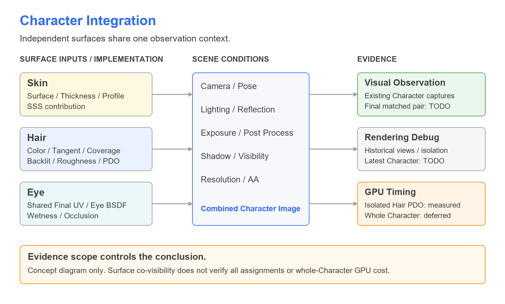

# Chapter 05 — Character Integration & Validation

> Public edition — 공개 검토를 통과한 자료와 기술 기록을 담았다. [Public Release Scope](Public_Release_Scope.md)

> Module : PBR Character / Material Integration / Look Development / Evidence-based Validation
> Document Status : Integration Record Complete / User Review
> Implementation Status : Existing Skin / Hair / Eye Implementation Records — Partial Character Validation / Open Issues
> Updated : 2026-11-03 (KST)
> Environment : Unreal Engine 5.8.3 / RTR_Advanced / Windows — historical Editor captures and preserved Standalone benchmark data
> Scope : Character Surface Responsibilities, Material Instance Contracts, Lighting, Visual / Rendering Debug Evidence and Isolated Hair PDO Measurement

[Chapter 01](Chapter01_ProductionPBRMasterMaterial.md)에서 공통 PBR 입력과 Instance 제어를 정리하고, [Chapter 02](Chapter02_ProductionSkinShader.md), [Chapter 03](Chapter03_ProductionHairShader.md), [Chapter 04](Chapter04_ProductionEyeMaterial.md)에서 Skin, Hair, Eye를 구현했다. 이 Chapter는 개별 구현을 Character 화면에서 함께 읽는 단계다. 얼굴에 드리운 Hair Shadow, 피부의 Scattering, 눈 주변의 반사와 접촉부가 서로 영향을 주므로, 각 Material의 Preview가 정상이라는 사실만으로 통합 품질을 판정할 수 없다.

이번 최종 작업 범위는 **PBR Character Chapter05 신규 작성**이다. 이전의 기존 문서 업데이트 의뢰 대신 이 Chapter에 통합 기록을 모은다. Benchmark Tool 자체의 상세 기술·검증 문서는 독립 [UniversalRenderingBenchmark](../Tools/UniversalRenderingBenchmark/README.md)에 보존하고, 여기에는 Character 판단에 필요한 내용만 연결한다. **Chapter06 — Mobile Material Conversion은 다음 작업으로 예약하며 이번에는 파일·Material·Level을 생성하거나 구현하지 않는다.**

문서 작성 완료와 전체 Character 검증 완료는 다르다. 현재 자료에는 Skin·Hair·Eye가 함께 보이는 실제 얼굴 화면, 개별 Material / Instance 기록, Hair Lighting 분리 실험과 격리 Hair PDO 실측이 있다. 그러나 Chapter02 Skin Parent가 최신 Female01에 동일하게 배정되었는지, Eye 보조 Surface가 최신 저장 상태에서 어떻게 배정되는지, 같은 조건의 최종 정면/사선 Render와 전체 Character GPU Benchmark는 확정하지 못했다. 이 차이를 숨기지 않고 Section 5.4의 판정과 Section 5.7의 TODO에 남긴다.

이번 작업은 기존 Screenshot·Export·JSON·CSV를 읽고 문서와 Figure를 작성한 것이다. Unreal에서 새 실험이나 Capture를 실행하지 않았으며 Production Material / Level, Engine Shader와 Rendering 설정을 변경·Apply·저장하지 않았다. Figure의 날짜는 원래 증거의 날짜이며 2026-11-03의 신규 Character Render를 뜻하지 않는다. 실제 측정값을 제외한 수식 설명은 계산·해석이며 가상 Render나 가짜 검증 자료를 사용하지 않는다.

---

## Contents

- [5.1 Character Integration Concept](#51-character-integration-concept)
- [5.2 Material Instance and Surface Integration](#52-material-instance-and-surface-integration)
- [5.3 Lighting and Look Development](#53-lighting-and-look-development)
- [5.4 Visual Validation and Evidence Boundaries](#54-visual-validation-and-evidence-boundaries)
- [5.5 Rendering Debugging Across Surfaces](#55-rendering-debugging-across-surfaces)
- [5.6 Optimization and Isolated Hair PDO Measurement](#56-optimization-and-isolated-hair-pdo-measurement)
- [5.7 Open Issues and Capture Plan](#57-open-issues-and-capture-plan)
- [5.8 Technical Decisions and Chapter06 Entry Conditions](#58-technical-decisions-and-chapter06-entry-conditions)
- [5.9 Figure Register and References](#59-figure-register-and-references)

---

## 5.1 Character Integration Concept

### Why a Character Needs a Shared Validation Context

Material은 Surface가 빛에 어떻게 반응할지 정의하지만, 최종 Pixel은 그 Surface만으로 결정되지 않는다. Head가 Hair에 빛을 가리고, Hair Card가 얼굴에 Shadow를 만들며, 눈가의 얇은 Surface가 뒤의 안구를 일부 가린다. Camera와 Exposure가 달라지면 같은 Roughness와 Scattering 설정도 다른 인상으로 보인다. 통합은 모든 기능을 하나의 Master Graph에 합치는 작업이 아니라, 서로 다른 Surface가 같은 Scene 조건에서 일관되게 작동하는지 확인하는 작업이다.

예를 들어 눈꺼풀 아래가 검게 보일 때 Skin의 SSS Strength를 올리는 것만으로 해결하려 하면, 원래 정상인 볼까지 더 붉고 부드러워질 수 있다. 검은 영역이 Hair의 Cast Shadow인지, Eye Occlusion Surface의 투과율인지, 안구 Texture나 Normal의 문제인지 먼저 분리해야 한다. 반대로 Hair를 밝게 보이게 하려고 Shadow를 끄면 피부와 모발 사이의 실제 차폐까지 잃는다. 개별 Material의 조절 범위와 Scene의 Visibility 책임을 구분하는 이유다.

```text
Mesh / UV / Texture Interpretation
    → Surface-specific Master and Material Instance
        ├─ Skin: Surface Inputs + Subsurface Profile Contribution
        ├─ Hair: Strand Tangent + Coverage + Hair BSDF + PDO
        └─ Eye: Shared Final UV + Eye BSDF + Auxiliary Surfaces
    → Shared Camera / Light / Exposure / Shadow / AA Conditions
    → Combined Character Image
    → Visual Observation + Debug Evidence + Measured GPU Data
    → Decision with an Explicit Validation Scope
```

Figure 5-1은 구현 책임과 증거의 관계를 보여준다. 각 Material이 하나의 BSDF로 합쳐진다는 의미가 아니며, 전체 Character 성능 측정을 완료했다는 의미도 아니다.

<p align="center">

</p>

**Figure 5-1. Character Integration Responsibilities and Evidence.** Skin / Hair / Eye의 독립 입력을 같은 Scene 조건에서 평가하는 개념도다. 아래의 Visual / Debug / Timing은 서로 다른 증거 경로이며, Timing의 현재 실측 범위는 격리 Hair PDO다. 실제 Render나 Asset 배정 검증 화면이 아니다.

### Three Different Completion Claims

| Claim | Required Evidence | Current Reading |
|---|---|---|
| Material Implementation | 실제 Graph, 입력 계약, Instance와 적용 기록이다. | Chapter01~04의 구현 기록을 재사용한다. 개별 미검증 항목은 그대로 유지한다. |
| Character Visual Integration | 동일 Character의 실제 화면과 Surface 간 경계·Shadow·반사를 확인한다. | 확보된 얼굴 화면과 Hair 분리 실험까지 기록한다. 최신 전체 Slot 감사와 통제된 최종 Render는 남아 있다. |
| Character Performance Validation | 대상 Scene·해상도·플랫폼·반복 측정·Noise 조건이 연결된 GPU 자료다. | 전체 Character는 미측정 / 보류다. 격리 Hair PDO만 별도 실측 근거가 있다. |

이 Chapter의 완료는 이 세 주장의 근거와 경계를 추적할 수 있는 문서를 작성했다는 뜻이다. `Production Ready`, 모든 거리·Motion의 안정성, 목표 FPS 달성으로 상태를 올리지 않는다.

---

## 5.2 Material Instance and Surface Integration

### Preserve Surface Responsibilities

공통 Master는 Texture·UV·Normal·ORM의 일관된 해석을 제공한다. Skin은 여기에 Scattering 입력이 필요하고, Hair는 일반 Surface Normal과 구별되는 Strand Tangent, Card Coverage와 Hair BSDF가 필요하다. Eye는 홍채의 Sampling 위치, Cornea와 Iris의 Normal 역할, Wetness와 Occlusion을 나누어야 한다. 따라서 공통 구조를 참조한다는 이유로 모두 같은 Shading Model이나 같은 Mask 의미를 사용하지 않는다.

특히 `Opacity`라는 이름이 비슷해도 계약은 다르다. Chapter02 Skin의 Opacity는 Subsurface Profile의 SSS contribution이고, Hair의 `Opacity Mask`는 Card 실루엣의 통과 여부다. Eye Occlusion의 `Transmittance Color`는 뒤쪽 안구를 얼마나 남길지 제어한다. Skin Opacity를 낮추어 Hair Card Shadow를 줄이거나, Occlusion의 검은 경계를 Hair Mask Threshold로 보정하는 것은 책임이 다른 입력을 혼동한 것이다.

| Surface | Recorded Implementation | Integration Responsibility | Evidence Boundary |
|---|---|---|---|
| Common PBR | `M_PBR_Master`와 대상별 Instance다. | UV / Base Color / Normal / ORM, Surface Controls와 Detail Normal의 기준선이다. | Chapter01 Sphere와 Shader Statistics를 Character GPU 결과로 옮기지 않는다. |
| Skin | `M_PBR_Skin` → `MI_Character_Head_Skin`, `SSP_Skin` 연결이다. | 얼굴 Surface와 Thickness-driven SSS contribution을 제어한다. | Chapter02의 Character Head 기록이다. Female01의 Skin Parent와 동일하다는 증거는 별도로 필요하다. |
| Scalp Hair | `M_Hair_Master` → `MI_Female01_hair`다. | Texture-free Color, Root/Tip Tint, Roughness Variation, Tangent, Coverage, Backlit, PDO를 유지한다. | 10/27 Backlit 및 10/28 Color의 저장·감사 기록이 있다. 최신 전체 Character 재검증과는 구분한다. |
| Eye Body | `M_Eye_Master` → `MI_Eye`다. | Radial Remapping → BumpOffset → Shared Final UV, Eye BSDF의 반사·홍채 반응을 담당한다. | 11/02 Graph / Instance 직접 관찰이다. 최신 저장·재시작 상태는 미확인이다. |
| Wetness / Occlusion | 별도 Material / Mesh의 책임이다. | 눈가의 좁은 반사와 접촉부 차폐를 독립적으로 조절한다. | Graph는 확인했으나 최신 실제 Mesh의 Instance Parent / Override 전체 감사는 남아 있다. |

### Actual Character Components and Historical Assignments

기존 10/28 Scene Baseline은 `/Game/_HairRCI_20261026/TestScene`의 Female01 Component와 Material 목록을 보존한다. 아래 표는 **그 시점의 배정**이며 11/02 또는 현재 저장 상태의 최종 Slot Register를 대신하지 않는다. 이 구분이 필요한 이유는 Eye 제작 중 보조 Surface의 배정과 Instance가 바뀔 수 있기 때문이다.

| Historical Component | Recorded Material | What Is Still Required |
|---|---|---|
| `Female01/head` | `/Game/ASF/Characters/Female01/Materials/MI_Female01_Skin`이다. | Parent, `SSP_Skin` 사용 여부, Override와 Chapter02 Skin 구조의 대응을 확인해야 한다. 이름만으로 같은 구현이라고 판단하지 않는다. |
| `Female01/hair` | `/Game/ASF/Characters/Female01/Materials/MI_Female01_hair`다. | 10/27~28 저장 기록과 연결된다. 최신 Instance 및 Level Override의 재확인은 후속이다. |
| `Female01/eyeEdge` | 당시 `MI_Eye_Glow`다. | 이 이름을 최신 Wetness Parent / Instance 확인값으로 사용하지 않는다. |
| `Female01/eyeshell` | 당시 `MI_Eye_AO`다. | 최신 Occlusion Graph와 실제 Instance 연결을 다시 확인해야 한다. |

별도 10/28 Eye Scene Audit에는 `eyeball → MI_Eye`, `eyeEdge → M_Eye_Wetness`, `eyeshell → M_Eye_Occlusion`이 기록돼 있다. 이 Snapshot에서 **eyeEdge와 eyeshell은 모두 `visible=False`**다. 같은 날짜라도 서로 다른 조사 상태의 배정을 하나로 합치지 않으며, 이 보조 Surface가 최신 화면에서 활성·저장됐다고 추정하지 않는다. 원본 조사 JSON을 그대로 보존했고, 11/02에는 최신 보조 Surface Visibility를 재검사하지 않았다.

Figure 5-2에서는 같은 화면에 Skin, Scalp Hair, Eyebrow / Lashes와 Eye가 보이는지, 모발이 눈 앞을 지나며 눈가·볼과 어떤 경계를 만드는지를 읽는다. 이 이미지에는 UI가 포함되어 있으며, 새로 만든 최종 Portfolio Render가 아니라 11/02의 실제 Editor 관찰이다.

<p align="center">
*Fig5_02 — 공개 사본에서 이미지 생략.*
</p>

**Figure 5-2. Existing Character Surface Integration View.** 2026-11-02의 `initial_1.png`를 원본 그대로 재사용했다. 사선 얼굴에서 Skin / Hair / Eye가 함께 보인다. Material Parent·모든 Slot·Exposure 고정·저장 상태는 이 화면만으로 입증되지 않으며, 통제된 최종 정면/사선 pair가 아니다.

### Instance Values Are Contextual Baselines

Instance 수치는 어떤 Master와 Texture·Mesh·Lighting에서 사용했는지와 함께 보관해야 한다. 같은 이름의 Roughness라도 Skin의 넓은 Surface, Hair의 섬유 반사, Cornea의 작은 Highlight는 역할이 다르다. 숫자를 서로 맞추는 것이 Character의 통일된 Look을 보장하지 않는다.

| Area / Source Date | Recorded Baseline | Meaning and Limit |
|---|---|---|
| Skin / Chapter02 | `Skin_SSS_Strength = 0.3`, `Thickness_MaskInfluence = 0.5`다. | 당시 선택한 기준이며 Female01의 현재 Override로 확정하지 않는다. Influence는 Texture 비용 제거용 Static Switch가 아니다. |
| Hair / 10/27 saved record | Master `Hair_Backlit = 1`, Female01 Override `0.1`; `Hair_Roughness = 0.35`, Scatter `0.1`, Specular `0.5`다. | Backlit 전달 수정 후 이 Hair / Light에서 채택한 값이다. Roughness의 Root/Tip/ID 변화는 유지한다. |
| Hair Color / 10/28 saved record | `BaseColor × Lerp(RootTint, TipTint, Root_Tex.R)`다. | `Root_Tex.R = 0`은 Root, `1`은 Tip이다. 별도 Color Texture를 다시 곱하지 않는다. 값 전체는 Chapter03 Section 3.14를 따른다. |
| Eye Body / 11/02 UI | Iris Radius `0.16`, Pupil Radius `0.055`, Iris Scale `1.1`, Pupil Scale `1.5`, Depth `0.03`, Concavity `0.1`이다. | 현재 UI 관찰의 기록이다. 기본값·추천값·저장값·물리적 홍채 깊이를 같은 것으로 해석하지 않는다. |
| Eye Roughness / 11/02 UI | Cornea `0.1`, Sclera `0.3`, Iris Normal Strength `1`이다. | Preview와 Graph의 수치다. 실제 Normal 효과가 분리 입증되었다는 뜻은 아니다. |
| Auxiliary Master / 11/02 UI | Wetness Roughness `0.1`, Coverage `0.35`, F0 `(0.2,0.2,0.2)`; Occlusion MaxStrength `0.65`다. | Master Graph 관찰이다. 실제 Mesh에 배정된 Instance Override로 대신 적지 않는다. |

Figure 5-3의 MI_Eye 화면은 Parent와 조절값을 읽기 위한 근거다. Sphere Preview의 결과를 실제 눈가의 Wetness·Occlusion·Skin 경계 검증으로 확대하지 않는다.

<p align="center">
*Fig5_03 — 공개 사본에서 이미지 생략.*
</p>

**Figure 5-3. Recorded Eye Material Instance and Preview.** Chapter04의 Figure 4-11을 동일한 Pixel로 재사용했다. 2026-11-02의 MI_Eye 값과 Sphere Preview를 보여주며, 실제 Character Mesh의 최신 배정·저장 완료를 입증하는 화면은 아니다. 원본은 `Captures/2026-11-02_EyeMaterial/instance_current.png`다.

### Safe Verification of a Future Integration Copy

후속 검사는 Production Level과 관련 Instance의 복제본에서 진행한다. Actor / Component / Slot Index, Mesh Path, 실제 Material Path와 Parent Chain을 먼저 기록하고, Instance Override와 상속값을 나눈다. Component의 Override Material이 Mesh의 기본 Material보다 우선할 수 있으므로 Content Browser의 Instance 이름만 확인하고 배정 감사를 끝내지 않는다.

그다음 복제본에서 한 변수씩 바꾸고 Camera·Light·Exposure·AA·Resolution을 유지한다. 새 Capture에는 변경한 변수와 복원 상태를 기록한다. 현재 문서의 빈칸을 채우기 위해 Production Asset을 수정하거나 과거 Slot 목록을 최신 값으로 바꾸어 쓰지 않는다.

---

## 5.3 Lighting and Look Development

### Separate Material Response from the Observation Conditions

Look Development는 Material의 값을 예쁘게 맞추는 과정과, 그 반응이 왜 나타나는지 확인하는 과정을 함께 가진다. Light 방향은 반사와 Shadow의 위치를 바꾸고, Light의 크기·반사 환경은 Highlight의 폭과 형태에 관여하며, Exposure는 결과가 화면에서 어느 밝기로 보이는지를 바꾼다. 이 조건을 동시에 바꾸면 Roughness나 Backlit 조절의 효과를 분리하기 어렵다.

따라서 통합의 기준 Camera·Light·Exposure를 먼저 정하고, 정면에서 Skin의 넓은 명암, 사선에서 Iris와 Cornea, 뒤·역광에서 Hair의 반응을 비교한다. 같은 밝기로 보이도록 매번 Exposure를 보정하면 Material의 과도한 반응이 가려질 수 있다. 색이 있는 Light 아래의 결과는 의도한 Look을 판단하는 자료이고, 중립 조건의 비교는 입력 오류를 찾는 자료다. 두 목적의 Capture를 구분한다.

### What the Existing Lighting Record Actually Contains

| Source | Recorded Conditions | Limits |
|---|---|---|
| Hair Backlit / 10/27 | UE 5.8.3, TestScene, Female01 Hair, 각 A/B 쌍의 같은 Camera / Light / 고정 Exposure, Head와 Hair Cast Shadow ON이다. Directional Light의 RT Shadow Enabled, Samples Per Pixel `8`을 유지했다. | 해당 정지 Hair 비교다. 최신 11/02 전체 얼굴 화면의 수치 조건으로 전용하지 않는다. |
| Hair Scene baseline / 10/28 | Directional Intensity `1.0`, Rotation `Pitch -33 / Yaw -43 / Roll 112.360672`; SkyLight Intensity `1.0`, ScreenPercentage `100`, AA Method `4`가 기록돼 있다. | 그 시점 JSON의 읽기값이다. Light 단위·최종 Exposure·현재 Viewport 크기의 완전한 통합 Capture 계약은 아니다. |
| Eye observation / 11/02 | 실제 Lit 얼굴 사선과 눈 Close-up, Graph / Instance / Texture 화면이 있다. | 같은 Camera의 Depth / Normal A/B, 최종 정면/사선 pair와 Light / Exposure 전체 기록은 없다. |
| Isolated Hair Benchmark / 11/03 | 고정 Camera와 1920×1080 Standalone 등 측정 조건이 따로 있다. | Character Lookdev Scene과 다른 격리 측정이다. Section 5.6의 조건만 따른다. |

10/28 기록에는 `r.RayTracing.Shadows = 0`과 Light별 `CastRayTracedShadow.ENABLED`가 함께 있다. 전역 CVar 하나만 보고 실제 Light의 Shadow 경로를 단정하지 않고, 당시 Light 속성·실제 A/B·검증 기록을 함께 읽는다. 이번 문서에서 현재 프로젝트의 Shadow 경로를 다시 실행 검증한 것은 아니다.

### Skin, Hair and Eye Must Be Judged Together

Skin에서는 볼과 코의 넓은 명암, Hairline과 눈 주위의 접촉 Shadow를 구분한다. Chapter02의 오래된 Head 비교는 불투명 Hair / Beard / Eyebrow Plane의 Shadow가 함께 있던 상태다. 그 Figure를 최종 Masked Hair 적용 후 Skin의 완성본으로 재사용하지 않는다. 최종 Hair / Facial Hair 배정 후 같은 Skin 기준에서 다시 비교해야 Scattering과 외부 차폐를 분리할 수 있다.

Hair에서는 몸통의 섬유 흐름·볼륨과 외곽의 가는 가닥, 정수리의 역광, 얼굴로 떨어지는 Shadow를 함께 본다. 강한 반사를 모두 제거하는 것이 목표는 아니다. 넓은 반사가 남는다는 이유만으로 Skin·Eye까지 포함한 Scene의 Shadow를 끄거나, Base Color를 지나치게 낮추어 반응을 가리지 않는다.

Eye에서는 공막의 넓은 반사와 Cornea의 작은 Highlight, 홍채의 방사형 무늬, 눈꺼풀 경계의 차폐를 나누어 본다. Figure 5-4는 실제 눈·주변 피부·눈썹·앞머리의 경계를 가까이 보여준다. 단일 이미지에서 어떤 어두운 Pixel이 Occlusion인지 실제 Shadow인지를 정량 분해할 수는 없지만, 다음 분리 검증의 관찰 위치를 정할 수 있다.

<p align="center">
*Fig5_04 — 공개 사본에서 이미지 생략.*
</p>

**Figure 5-4. Existing Eye and Surrounding Surface Observation.** 2026-11-02 사용자 첨부 원본을 수정 없이 재사용했다. 홍채·동공·눈꺼풀 경계와 앞을 지나는 Hair를 함께 관찰한다. Light / Exposure가 통제된 A/B나 물리적 굴절·Iris Normal 효과의 분리 검증이 아니다.

### Adopted Hair Lighting Decision

Chapter03 Section 3.13은 UE 5.8.3의 확인한 Substrate Hair 경로에서 Material Backlit 값이 전달되지 않던 문제를 수정한 기록이다. Engine의 전달 경로와 Master의 `Hair_Backlit → Substrate Hair BSDF → Front Material` 연결을 맞춘 뒤 Female01에 `0.1`을 적용했다. Master Default `1`은 공유 Instance의 기존 유효 반응을 유지하기 위한 기준이며, 모든 Hair에 `0.1`을 일괄 적용한 것이 아니다.

Figure 5-5의 양쪽은 **수정된 Engine과 저장된 원본 Material**을 사용한다. 왼쪽 Backlit `1`은 이전 유효 반응을 재현하는 대조이고, 오른쪽은 채택한 `0.1`이다. 왼쪽을 Engine 수정 전 Screenshot으로 다시 이름 붙이지 않는다.

<p align="center">
*Fig5_05 — 공개 사본에서 이미지 생략.*
</p>

**Figure 5-5. Saved Hair Backlit Comparison in the Existing Scene.** Chapter03 Figure 3-35의 실제 402 / 403 Capture를 그대로 재사용했다. 같은 조건에서 정수리·외곽의 과도한 밝기가 줄고 모발 몸통의 결은 남는지 확인한다. Head / Hair Shadow는 양쪽 모두 ON이다. 최신 Skin / Eye 통합 전체의 성능·품질 완료를 뜻하지 않는다.

이 선택은 해당 설치의 Engine Shader 수정에 의존한다. Material Asset만 다른 PC로 복사하면 동일한 Backlit 전달이 자동으로 보장되지 않는다. Engine 업데이트·복구·이전 시 Chapter03의 Patch와 Source Trace를 확인해야 한다. 이번 문서 작업은 Shader를 다시 수정하지 않았다.

---

## 5.4 Visual Validation and Evidence Boundaries

### Evidence Classification

`Existing Direct Test`는 과거 실제 Engine 조작·Capture·Export에 남은 검증을 뜻한다. `Observed Capture`는 이번에 파일을 직접 확인해 읽을 수 있는 시각적 관찰이다. `User Reported`는 사용자가 구현·개선을 확인한 기록이며, `Recomputed Raw`는 기존 CSV를 다시 계산한 결과다. 어느 것도 실행하지 않은 최신 Scene 검증을 대신하지 않는다.

| ID | Question | Existing Evidence / Result | Status and Limit |
|---|---|---|---|
| V01 | Skin / Hair / Eye가 하나의 얼굴 화면에 함께 보이는가? | 11/02 실제 사선 얼굴과 눈 Close-up을 확인했다. Figure 5-2 / 5-4다. | **Observed Capture.** 시각적 공존을 확인했다. 모든 Parent / Slot의 최신 배정 검증은 아니다. |
| V02 | Chapter02 Skin 구현이 최신 Female01 Skin과 동일한가? | 과거 Female01 `head → MI_Female01_Skin` 배정은 있으나 해당 Parent와 Profile 대응은 확정하지 못했다. | **Not Verified.** Chapter02 결과를 그대로 이식한 최종 Skin으로 표시하지 않는다. |
| V03 | Hair의 Color·Backlit 경로를 저장했는가? | 10/27 Backlit 및 10/28 Texture-free Color의 저장 후 Export / 감사 / 실제 화면이 있다. | **Existing Direct Test / Saved Record.** 최신 재시작·전 플랫폼 재현은 별도다. |
| V04 | Hair Backlit을 낮추어도 실제 차폐가 남는가? | 외부 Cube의 Cast Shadow OFF → ON → OFF에서 역광이 차폐·복귀했다. Figure 5-6이다. | **Existing Direct Test.** 당시 같은 Camera의 정지 실험 범위다. |
| V05 | Eye Master / MI 값과 UV Data Flow를 읽을 수 있는가? | 11/02 Graph, Instance, Texture와 보존한 Function 감사 자료가 있다. Figure 5-3과 Chapter04를 따른다. | **Observed Capture / Existing Audit.** 저장 상태와 물리적 굴절의 검증으로 확대하지 않는다. |
| V06 | Wetness / Occlusion의 최신 Character 배정과 효과가 분리 검증됐는가? | Master Graph와 사용자 개선 확인은 있다. 최신 Slot·Parent·Override 및 같은 조건의 OFF/ON pair는 없다. | **Partial / User Reported.** Graph 검증과 실제 배정 효과를 구분한다. |
| V07 | Rendering Debug 자료가 있는가? | 초기 남성 Character의 Shader Complexity / Quad Overdraw, Female01 Hair의 Shadow 분리 자료가 있다. | **Existing Debug Evidence.** 최신 Female01 전체 Debug / ProfileGPU 완료는 아니다. |
| V08 | 격리 Hair PDO OFF / ON 비용 차이가 있는가? | 보존된 GPU Raw에서 `+0.12080 ms`, NoiseFloor `0.05 ms`, RELIABLE / GREEN이다. | **Measured / Recomputed Raw.** Section 5.6의 Hair 단독 Scene만 해당한다. |
| V09 | 완성 Character Scene 전체가 목표 예산을 만족하는가? | 최신 Skin / Hair / Eye와 보조 Surface를 합친 GPU Benchmark는 없다. | **Not Measured / Deferred.** 전체 GPU Time·목표 FPS·최적화 완료 수치를 기입하지 않는다. |
| V10 | Motion / 거리 / AA / 다른 Light와 플랫폼에서 안정적인가? | 일부 정지 Hair 방향 비교 외에 일관된 전체 Matrix는 없다. | **Not Verified.** Final / Production Ready 판정과 Mobile 대응은 후속이다. |

### What the Current Screenshots Establish

확보한 화면은 개별 Shader의 결과가 Character의 다른 Surface와 만나는 위치를 보여준다. 실제 피부와 Hairline, 눈썹과 눈꺼풀, 앞머리와 눈의 겹침을 관찰할 수 있다는 점에서 Sphere Preview보다 통합 판단에 가깝다. Hair에서는 Backlit과 차폐를 분리한 실험까지 있어 단순 Beauty Screenshot보다 원인 추적의 근거가 강하다.

다만 서로 다른 날짜의 이미지를 같은 저장 상태의 Before / After처럼 배치하지 않았다. 10/27 Backlit 쌍 내부의 비교 조건은 해당 실험 기록을 따르고, 11/02 얼굴과 Eye 이미지는 비통제 관찰로 읽는다. 최신 정면/사선 pair, Light sweep, 거리·Motion Capture를 확보하기 전에는 이 화면들을 최종 통합 Lookdev의 전 조건 통과로 판정하지 않는다.

이번 작성에서 직접 확인한 범위는 로컬 문서·Figure·원본 Capture·배정 JSON·저장 후 Export와 Benchmark 자료다. 새 Engine 실행 검증이 필요한 항목은 Section 5.7의 산출물과 판정 조건으로 남겼다. 부족한 자료를 이유로 원리·구현·이미 확보한 결과의 기록을 비워 두지는 않는다.

---

## 5.5 Rendering Debugging Across Surfaces

### Follow the Data Before Changing the Appearance

통합 Debugging은 증상이 나타난 Surface와 원인을 만든 Surface가 다를 수 있다는 점에서 시작한다. 얼굴의 검은 영역을 보면 먼저 Light가 가려졌는지, Masked Card가 의도한 Coverage를 내는지, Skin 입력이 잘못 해석됐는지 순서대로 분리한다. 눈의 검은 띠는 Eye Occlusion의 투과율과 실제 눈꺼풀·속눈썹 Shadow를 나누어야 한다. Hair의 밝은 반응은 색상·Tangent·Roughness·Backlit과 Shadow를 한 번에 바꾸지 않는다.

| Symptom | Data / Responsibility to Inspect | Existing Finding | Remaining Check |
|---|---|---|---|
| 얼굴의 큰 검은 Shadow | Hair / Beard / Eyebrow의 Coverage와 Cast Shadow다. | Chapter02의 초기 비교는 불투명 Plane의 실제 차폐를 포함했다. | 최종 Facial Hair 적용 후 같은 Skin 기준으로 재검증한다. |
| Hair 역광의 과도한 밝기 | Backlit Parameter → BSDF → Engine 전달 경로다. | Chapter03에서 해당 경로를 수정하고 Female01 `0.1`을 채택했다. | 다른 설치·Light·Motion에서 재현하고 남은 넓은 반사를 별도로 판단한다. |
| Head 뒤쪽의 큰 어두운 형태 | Head와 외부 물체의 실제 Light Visibility다. | Head Shadow 분리와 외부 Blocker 실험이 차폐의 기여를 보여준다. | 모든 어두운 영역을 오류로 처리하지 않고 통합 Lighting 조건에서 읽는다. |
| 눈꺼풀 접촉부가 지나치게 검음 | Occlusion Mask와 Saturate 이후 MaxStrength, 실제 Shadow다. | Chapter04 Graph에서 `Saturate → ×0.65 → OneMinus → Transmittance`를 확인했다. | 실제 Instance·Slot과 같은 Camera의 OFF/ON을 확보한다. |
| Iris가 납작하거나 경계가 어긋남 | Shared Final UV, Center, Radius 순서, Normal Space다. | Chapter04에 Radial Remapping / BumpOffset 배선·수치 감사가 있다. | Depth sweep, 반지름 역전 보호, 중심·동일값 경계와 Normal 효과를 분리한다. |

### Actual Shadow Isolation Evidence

Figure 5-6에서는 Cube가 세 화면 모두 보인다. 바꾼 것은 Cube의 존재가 아니라 `Cast Shadow`다. 가운데에서 역광이 가려지고 오른쪽에서 다시 나타나는지 읽으면, Hair를 어둡게 만들기 위해 실제 Shadow 기능을 무시한 해결인지 구분할 수 있다. Backlit은 세 화면 모두 `0.1`, Hair / Head Shadow도 유지했다.

<p align="center">
*Fig5_06 — 공개 사본에서 이미지 생략.*
</p>

**Figure 5-6. Existing External Blocker Shadow Isolation.** Chapter03 Figure 3-36의 실제 303 / 304 / 305 Capture를 재사용했다. Cube Cast Shadow OFF → ON → OFF에서 Hair 정수리 역광의 차폐·복귀를 확인한 과거 실험이다. 최신 전체 Character의 Shadow Matrix를 통과했다는 의미는 아니다.

Eye Occlusion의 경우 `Mask = Saturate(Upper + Lower)`라면 `Transmittance = 1 − Mask × MaxStrength`다. `MaxStrength = 0.65`이며 Mask가 0–1일 때 계산상 최소 Transmittance는 `0.35`다. 이는 그 경로의 값 범위이지 최종 Pixel 밝기가 35% 이상이라는 보장은 아니다. 뒤의 Eye Color, 실제 Shadow와 다른 Surface의 합성이 남아 있기 때문이다. 이 구분이 없으면 수식은 정상인데 화면이 어둡다는 이유만으로 Master를 계속 바꾸게 된다. 실제 Graph는 Chapter04 Figure 4-3을 참조한다.

### Shader Complexity and Quad Overdraw Are Diagnostic Views

Shader Complexity는 Shader 작업량이 커 보이는 위치를 찾는 진단 자료이고, Quad Overdraw는 화면에서 겹치는 Geometry와 Quad 낭비를 살피는 자료다. Hair Card는 Alpha로 잘려 보이지 않는 부분과 여러 겹이 화면을 덮는 구간이 있어, 최종 실루엣의 가닥 수만 세어 비용을 판단하기 어렵다. 작은 Card·겹침·보조 투명 Surface는 View에 따라 다른 부담을 만들 수 있다.

Figure 5-7은 **Chapter03의 초기 남성 Character**에서 확보한 실제 Debug View다. Legend와 대상·시점을 보존해 기존 진단 자료로 재사용하며, 최신 Female01의 Shader Complexity가 낮다거나 전체 GPU 예산이 GREEN이라는 증거로 쓰지 않는다.

<p align="center">
*Fig5_07 — 공개 사본에서 이미지 생략.*
</p>

**Figure 5-7. Historical Shader Complexity and Quad Overdraw.** Chapter03 Figure 3-19를 원본 Figure 그대로 재사용했다. 왼쪽 Shader Complexity와 오른쪽 Quad Overdraw의 위치·Legend를 읽는 실제 과거 진단 자료다. 최신 Female01 / Eye 보조 Surface의 Debug Capture와 실제 GPU Timing은 미확보다.

녹색 Debug 화면은 특정 Pass의 ms나 목표 FPS 달성 판정이 아니다. Material Editor의 Instruction / Sampler 통계도 Compile 조건과 Shader 구조를 설명하는 자료이며 실제 Scene의 GPU Time과 같지 않다. 최신 통합 검증에서는 같은 Scene의 Lit 결과, Debug View와 GPU 자료를 각각 확보해 연결해야 한다. 이번에 ProfileGPU나 Buffer Visualization을 실행한 것처럼 빈 화면과 임의 수치를 채우지 않았다.

---

## 5.6 Optimization and Isolated Hair PDO Measurement

### Separate Tool Validation, Scene Measurement and Optimization Decisions

Benchmark Tool은 측정 실행·반복·Calibration·Report를 제공하는 도구다. Tool의 테스트가 통과한 사실은 선택한 Character Scene을 측정했다는 뜻이 아니다. 또한 A/B에 비용 차이가 있다는 사실만으로 품질 손실을 감수하고 기능을 끌지 결정할 수는 없다. 같은 조건의 Visual A/B와 실제 대상 Scene의 비용을 함께 읽어야 한다.

현재 [Report V1.1](../Tools/UniversalRenderingBenchmark/v1_1/docs/V1_1_Implementation_KO.md)은 Analyzer `0.4.0`의 결론·근거·A/B 설정·도움말·가독성 개선이다. 보존된 검증 문서는 통계·Confidence·Policy와 Native 측정 경로를 유지한 범위, 회귀 검사와 실제 Scalar Raw의 재분석을 설명한다. 이 Chapter는 Tool Architecture, Action별 전체 검증과 UI 검증용 가상 Scenario를 복제하지 않는다.

**실제 Hair PDO Report의 Analyzer는 `0.3.1`이다.** 설치된 V1.1 예제의 실제 재분석 대상은 Scalar이며, 해당 Hair Run을 V1.1에서 새로 실행·재분석한 자료로 이름 바꾸지 않는다. V1.1 Tool 상태와 보존된 Hair 실측 결과를 구분하여 참조한다. Tool의 상세 근거는 [Phase4 Implementation](../Tools/UniversalRenderingBenchmark/docs/Phase4_Implementation_KO.md), [V1.1 Implementation](../Tools/UniversalRenderingBenchmark/v1_1/docs/V1_1_Implementation_KO.md), [Report Interpretation Guide](../Tools/UniversalRenderingBenchmark/v1_1/docs/Benchmark_Report_Interpretation_Guide_KO.md)에 남긴다.

### Actual Isolated Hair Setup

이 측정은 Production에서 복사한 정적 Hair Mesh와 Benchmark용 Material Instance를 사용하는 **Hair 단독 Scene**이다. Skin / Eye / Wetness / Occlusion과 완성 Character의 전체 조합을 측정하지 않았다. 실제 대상·Preset·Run 조건은 [Manifest](../Tools/UniversalRenderingBenchmark/phase4/results/20261103T113641_URB4_HairPDO_6D992167/Manifest.json)와 [Actual Hair Analysis](../Tools/UniversalRenderingBenchmark/phase4/examples/ActualHairReport/Analysis.json)에 있다.

| Item | Preserved Measurement Condition |
|---|---|
| Run ID / Date | `20261103T113641_URB4_HairPDO_6D992167`; 2026-11-03 20:36:41–20:37:07 KST다. |
| Engine / Hardware | UE `5.8.3`, CL `58210709`; RTX 5080, Driver `617.42`, Ryzen 7 5800X, Windows다. |
| Rendering | D3D12 / SM6, `1920×1080`, ScreenPercentage `100%`다. VSync / MaxFPS 제한과 Dynamic Resolution은 비활성 상태다. |
| Scene / Camera | 정적 복제 Hair, 고정 Camera FOV `48`, NoPawn GameMode다. Character Lookdev Scene의 조건으로 대신 적지 않는다. |
| Changed Variable | MaterialSwap으로 `Use_HairPDO` OFF → ON을 비교한다. `PDO_Strength = 0.1`과 다른 입력은 동일하다. |
| Sampling | 각 Capture 전 Warmup `120` Frames, Capture `300` Frames, Variant별 `3` Runs다. A/A Calibration도 `6 × 300` Frames다. |
| Aggregation | 각 Run의 GPU Median을 구하고 그 3개 Median의 Median을 대표값으로 사용한다. Outlier를 임의 제거하지 않았다. |
| Restoration | 보존 Manifest에서 Source Stable과 Action / Camera / CVar / Resolution 복원이 기록돼 있다. 이번 작성에서 새 실행한 검증은 아니다. |

Figure 5-8은 대상의 범위를 보이기 위한 기존 Preview Run 화면이다. Raw를 생성한 대표 측정 Run의 동시 Screenshot으로 바꾸어 설명하지 않는다.

<p align="center">
*Fig5_08 — 공개 사본에서 이미지 생략.*
</p>

**Figure 5-8. Existing Isolated Hair Benchmark Preview.** 독립 Benchmark 폴더의 `Hair_Actual_Standalone.png`를 수정 없이 재사용했다. 검은 배경의 Hair 단독 Preview로, 전체 Character가 측정 대상이 아니었음을 보여준다. 별도 Preview Run 자료이며 대표값 Run과 동시 촬영한 최종 Character Render가 아니다.

### Measured GPU Result and Its Denominators

| Metric | Actual Result | Interpretation |
|---|---|---|
| PDO OFF GPU Time | **3.34795 ms** | 격리 Scene의 OFF 대표 GPU Time이다. Hair Pass 하나의 절대 시간으로 해석하지 않는다. |
| PDO ON GPU Time | **3.46875 ms** | 같은 격리 Scene의 ON 대표 GPU Time이다. |
| Delta GPU Time | **+0.12080 ms** | `ON − OFF`다. PDO를 켠 비교에서 추가된 Scene GPU 비용이다. |
| NoiseFloor | **0.05 ms** | 이번 측정 정책·Calibration으로 정한 판정 기준이다. 모든 Scene의 보편적 Noise가 아니다. |
| Measurement / Confidence | **PASS / RELIABLE** | 보존 자료에서 차이를 해석할 근거가 충분한 상태다. 모든 하드웨어·미래 실행의 보증이 아니다. |
| Performance Impact | **GREEN** | 추가 비용의 60FPS Budget 비율에 대한 해당 Tool Policy의 판정이다. 품질·전체 Character Ready 판정이 아니다. |
| 60FPS Budget Impact | **0.7248%** | `0.12080 / (1000 / 60) × 100`이다. 전체 `16.6667 ms` 예산을 분모로 쓴다. |
| Relative Increase over OFF | 약 **3.6082%** | `0.12080 / 3.34795 × 100`이다. 위 `0.7248%`와 분모가 다르다. |

OFF Run Median은 `3.34795 / 3.35365 / 3.34645 ms`, ON은 `3.46580 / 3.48555 / 3.46875 ms`다. 보존 분석의 A/A Calibration Range는 `0.03935 ms`, A / B의 Run Median Range는 각각 `0.00720 / 0.01975 ms`다. 같은 조건의 A/A 연결·반복 수·안정성 검사를 통과하고 Delta가 이번 NoiseFloor보다 커 기존 Policy에서 RELIABLE로 판정됐다. 이 등급이 통계적 유의성·신뢰구간을 증명하는 것은 아니며, 모든 View에서 일정한 PDO 단가로 사용하지 않는다.

이번 문서 작성 중에는 보존 Raw CSV `12`개의 SHA256을 Manifest와 대조하고 각 `300`개의 GPU Sample, Run Median과 대표값을 다시 계산해 기존 Analysis와 일치함을 확인했다. [Raw Recheck](Captures/2026-11-03_CharacterIntegration/benchmark_recheck.json)는 이 읽기·재계산 범위를 기록한다. **새 Unreal Benchmark Run은 실행하지 않았다.** 실제 [Hair Report](../Tools/UniversalRenderingBenchmark/phase4/examples/ActualHairReport/Report.html)와 Raw·Tool 상세 자료는 독립 폴더에 그대로 보존했다.

### What This Changes in the Character Plan

현재 자료는 이 격리 Scene에서 PDO의 비용 차이를 감지할 수 있었고, 추가 비용이 Tool의 GREEN 범위였다는 근거다. 따라서 효과의 유무·품질을 확인하지 않고 PDO를 우선 제거할 이유로 쓰지 않는다. 반대로 GREEN을 근거로 완성 Character에서도 항상 저렴하다고 확정하지 않는다. 화면 Coverage, Card 겹침, Camera 거리, Shadow와 다른 Material이 달라지면 결과도 달라질 수 있다.

현재 전체 Character GPU Time, Skin / Eye / Translucency의 비용 분해, 최종 Render 조건의 PDO A/B는 **Not Measured / Deferred**다. Preview FPS의 역수나 격리 Scene의 GPU Time으로 전체 Character FPS를 계산해 적지 않는다. 이 Chapter에서 수행한 Optimization은 비용 근거와 다음 판단 순서를 정리한 것이며, 새 Material 간소화나 전체 Scene 최적화 완료가 아니다.

---

## 5.7 Open Issues and Capture Plan

### Remaining Validation Work

아래 TODO는 자료가 없는 부분을 추측으로 채우는 대신, 다음 검증에서 무엇을 고정하고 어떤 증거를 남길지 정한 것이다. 기존 Chapter의 Open Issues를 중복 구현 목록으로 만들지 않고 통합 관점의 완료 조건으로 연결한다. 새 검증은 Production 복제본에서만 수행하고 원본에 대한 수정·저장으로 진행하지 않는다.

| ID / Priority | TODO and Current Source | Controlled Check / Required Evidence | Completion Condition |
|---|---|---|---|
| C05-01 / High | **Latest Material Assignment Audit.** 10/28 두 배정 Snapshot과 Chapter04 UI 기록이 있다. | 복제 Level의 Actor / Component / Slot Index / Mesh / 실제 Instance / Parent / Override / Profile / Visibility를 기록한다. 특히 `MI_Female01_Skin`과 Chapter02 Skin의 대응, Eye Body·Wetness·Occlusion을 확인한다. | 최신 저장 상태와 매칭되는 Slot Register와 읽을 수 있는 Details Capture가 있어야 한다. 누락·다른 Parent는 그대로 기록한다. |
| C05-02 / High | **Matched Final Character Renders.** Figure 5-2 / 5-4는 비통제 관찰이다. | 같은 복제 Scene의 정면 / 사선 / Hair 후면·역광을 촬영한다. Camera Transform / FOV, Light, Exposure, Resolution, AA와 Engine 의존성을 기록한다. | Skin·Hair·Eye와 보조 Surface가 같은 상태임을 추적할 수 있는 최종 화면과 조건표를 확보한다. |
| C05-03 / High | **Skin after Final Hair / Facial Hair.** Chapter02의 초기 불투명 Card 조건이 남아 있다. | 대상 Character에 존재하는 Hair / Eyebrow / Beard / Lashes의 최종 Masked Material 배정 후 Skin 기준값을 유지해 얼굴 Shadow·SSS를 확인한다. Skin Parent·Profile·Texture 설정을 함께 기록한다. | 실제 차폐와 Scattering을 구분하고 Profile / Strength / Influence 판정과 한계를 남긴다. |
| C05-04 / High | **Eye Auxiliary and Normal Isolation.** Chapter04 Section 4.11을 따른다. | 실제 Instance 확인 후 Wetness / Occlusion / Iris Normal을 각각 분리한다. 다른 Shadow와 Camera를 유지한 OFF/ON pair를 복제본에서 확보한다. | 각 변화가 어느 Surface·입력에서 발생했는지 보이는 Capture와 배정 근거가 있어야 한다. |
| C05-05 / High | **Eye Radius / Center / Depth Stability.** Chapter04 수식·배선 감사와 미검증 조건이다. | 중심 좌표·반지름 순서·동일값 경계·Normal Space를 확인하고, Scale 1/1 기준 Depth `0/.005/.01/.03/.05`를 고정 정면/사선에서 비교한다. | 잘못된 입력의 실패 여부와 허용 범위를 기록한다. 보호 로직을 구현하지 않았다면 구현 완료로 표시하지 않는다. |
| C05-06 / Medium | **Current Character Debug Views.** Figure 5-7은 과거 남성 Character다. | 최종 복제 Scene에서 Shader Complexity / Quad Overdraw와 필요한 Buffer View를 같은 Camera로 확보한다. Legend·Engine·View Mode를 보존한다. | 최신 Surface 배정과 연결된 Debug 화면이 있어야 한다. 색을 GPU ms로 치환하지 않는다. |
| C05-07 / Medium | **Motion / Distance / AA Matrix.** 현재 정지 화면 위주다. | Camera 이동·거리 변화·머리/눈 Motion에서 가는 Hair, Hairline, Iris 경계와 보조 투명 Surface를 관찰한다. 각 AA·품질 조건을 기록한다. | Flicker / Shimmer / Seam / Shadow 변화를 실제 Clip 또는 연속 Capture로 남긴다. |
| C05-08 / Deferred | **Whole Character GPU Benchmark.** 현재 Hair 단독 실측만 있다. | Tool 사용성 개선 후 최종 복제 Character Scene, 고정 해상도·Camera·Pose·Lighting, Warmup·A/A·반복 A/B로 측정한다. Raw / Manifest / Report와 복원을 보존한다. | 전체 Scene 대표 GPU Time과 불확실성·Budget 판정이 실제 Run에 연결돼야 한다. 지금 빈 수치를 채우지 않는다. |
| C05-09 / Before Mobile | **Saved Persistence and Engine Dependency.** Eye 11/02 기록은 시작/끝 `4 Unsaved`, 저장 재검증 미수행이다. | 사용자 저장 정책 아래 복제본의 저장·재시작을 확인한다. Backlit Engine Patch·Substrate / GBuffer / AA 상태와 Asset 기준선을 기록한다. | 이동 가능한 PC 기준선 또는 알려진 차이가 명시돼야 한다. 이번 문서에서 기존 Unsaved Asset을 임의 저장하지 않았다. |

전체 Character Benchmark는 이전 결정대로 사용성 개선 이후로 보류한다. 단순히 등급을 얻기 위해 Scene을 정적이라고 선언하거나 Production Actor에 Tag·Runner를 추가하지 않는다. 다음 측정이 진행되면 실제 Preset·대상·복원 기록과 함께 V09 상태를 갱신한다.

### Missing Figure / To Capture

| Planned Figure | Intended Evidence | Current Status |
|---|---|---|
| `Fig5_09.png` | 최신 Slot Register / 실제 Instance Parent와 Override 화면이다. | **Missing Figure / To Capture.** C05-01 이후 추가한다. |
| `Fig5_10.png` | 같은 저장 상태의 최종 정면 / 사선 Character Render pair다. | **Missing Figure / To Capture.** Figure 5-2를 통제된 pair로 다시 이름 붙이지 않는다. |
| `Fig5_11.png` | 최종 Hair / Facial Hair 아래의 Skin·Shadow 비교다. | **Missing Figure / To Capture.** C05-03과 연결한다. |
| `Fig5_12.png` | 최신 Character의 Debug View와 Legend다. | **Missing Figure / To Capture.** 과거 Figure 5-7과 구분한다. |
| `Fig5_13.png` | 전체 Character 실제 GPU Report와 측정 Scene이다. | **Deferred / Not Measured.** C05-08 실행 후에만 추가한다. |

이 이름은 후속 예약이다. 해당 파일을 생성하거나 존재하지 않는 이미지 링크를 삽입하지 않았다. Eye 단독의 Depth sweep 등은 Chapter04의 기존 Figure 13–17 예약을 유지하며, 같은 자료를 서로 다른 검증으로 중복 계수하지 않는다.

---

## 5.8 Technical Decisions and Chapter06 Entry Conditions

### Decisions Retained for the PC Character Baseline

| Decision | Reason | Boundary |
|---|---|---|
| Chapter05에 통합 기록을 모은다. | 개별 Material 원리와 Character 간 상호작용의 책임을 나누고 기존 Chapter01~04를 보호한다. | 기존 문서의 역사적 상태와 Open Issues를 완료로 덮어쓰지 않는다. |
| Hair Shading Model과 Roughness 기반 Highlight 제어를 유지한다. | Chapter03의 실제 비교·Backlit 전달 수정·Color 저장 결정을 따른다. | 별도 Anisotropic / Angel Ring 기능을 새 후속 구현으로 추가하지 않는다. |
| 실제 Shadow와 입력 전달을 분리한다. | Cube 차폐와 Head Shadow 실험이 서로 다른 원인을 보여준다. | Shadow OFF를 최종 해결로 채택하지 않는다. |
| Eye Body / Wetness / Occlusion의 책임을 유지한다. | UV 깊이 근사·반사·접촉부를 서로 다른 입력으로 진단할 수 있다. | Graph 확인을 최신 Instance 배정 완료로 확대하지 않는다. |
| Tool 상세 검증과 Character 기록을 분리한다. | UniversalRenderingBenchmark를 독립적으로 재사용하고 결과의 측정 대상을 명확히 한다. | V1.1 UI 검증용 가상 데이터와 격리 Hair 수치를 전체 Character 결과로 옮기지 않는다. |
| 전체 Character Benchmark를 보류한다. | 현재 Tool 사용성 개선 결정과 실제 자료 범위를 따른다. | Chapter05 작성 완료를 핑계로 미측정 항목을 통과로 바꾸지 않는다. |

### Chapter06 Is Reserved, Not Implemented

다음 Chapter의 이름은 **Chapter06 — Mobile Material Conversion**이다. 이번에는 문서·폴더·Mobile Material·Level을 만들지 않았으며, PC Material을 축약하거나 Project Rendering 설정을 변경하지 않았다. 아래 조건을 다음 작업의 시작점으로 예약한다.

1. **Traceable PC Baseline.** C05-01의 최신 Material 배정과 C05-09의 저장 상태·Engine 의존성을 확인한다. 동일 PC 기준선이 있어야 Mobile 변경 후 차이를 해석할 수 있다. 완전한 통합 재검증을 미루는 부분은 상태와 이유를 인계한다.
2. **Visual Reference and Known Issues.** C05-02의 같은 조건 정면/사선 기준 화면과 Skin / Hair / Eye의 남은 오류를 구분한다. PC에 이미 있던 문제를 Mobile Conversion 회귀로 오해하지 않도록 한다.
3. **Named Mobile Target.** 목표 기기·OS·Graphics API·Renderer / Feature Level, Resolution, 목표 FPS·품질 범위를 먼저 정한다. 현재 데스크톱 60FPS 해석을 Mobile 요구사항으로 자동 채택하지 않는다.
4. **Feature Support and Replacement Plan.** 해당 Target에서 Skin SSS, Substrate Eye / Hair, 보조 투명 Surface, PDO와 Shadow 경로의 지원·비용을 실제로 조사한다. 지원 여부를 지금 추측으로 확정하지 않고 원래 기능의 목적·대체안·품질 손실·실기기 검증 항목을 연결한다.
5. **Separate Copies and Measurement Route.** PC Production Asset을 보호할 Mobile 복제본과 실기기 Capture / GPU 측정 방법을 준비한다. 전체 PC Character GPU Benchmark는 C05-08의 보류 상태를 유지해 인계하며, 없으면 PC 대비 성능 개선률을 주장하지 않는다. Mobile 목표 Budget의 충족은 실기기에서 별도 검증한다.

이 조건은 Chapter06의 예약된 진입 기준이며 이번 작업의 구현 결과가 아니다. 현재 완료한 것은 실제 근거가 연결된 Chapter05 문서와 Figure·미검증 목록이다. 다음 단계는 이 PC 기준선을 확인하고 정해진 Mobile Target으로 기능별 변환을 설계하는 작업이다.

---

## 5.9 Figure Register and References

### Published Figures

| Figure | Content | Source / Evidence Scope |
|---|---|---|
| 5-1 / `Fig5_01.png` | Character Surface / Scene / Evidence 책임이다. | 새 Concept Diagram이다. SVG / Specification을 보존하며 실제 검증 화면이 아니다. |
| 5-2 / `Fig5_02.png` | Skin / Hair / Eye가 함께 보이는 사선 얼굴이다. | 11/02 `initial_1.png` 원본 복사다. 비통제 Editor 관찰이다. |
| 5-3 / `Fig5_03.png` | MI_Eye와 Sphere Preview다. | Chapter04 Figure 4-11의 동일 파일 복사다. 최신 Character Slot 확인은 아니다. |
| 5-4 / `Fig5_04.png` | Eye와 주변 Surface Close-up이다. | 11/02 사용자 첨부 원본 복사다. Controlled A/B가 아니다. |
| 5-5 / `Fig5_05.png` | Backlit 1 / 0.1 비교다. | Chapter03 Figure 3-35 재사용이다. 양쪽 모두 수정된 Engine / 저장된 원본 Material이다. |
| 5-6 / `Fig5_06.png` | 외부 Blocker Cast Shadow OFF / ON / OFF다. | Chapter03 Figure 3-36 재사용이다. 당시 정지 Hair 차폐 실험이다. |
| 5-7 / `Fig5_07.png` | Shader Complexity / Quad Overdraw다. | Chapter03 Figure 3-19 재사용이다. 초기 남성 Character이며 최신 Female01 결과가 아니다. |
| 5-8 / `Fig5_08.png` | Hair 단독 Benchmark Preview다. | 독립 Tool의 `phase4/evidence/Hair_Actual_Standalone.png` 원본 복사다. 별도 Preview Run이다. |

Figure는 `Figures/Chapter05/Fig5_XX.png`에 저장했다. 원본 Capture와 기존 Chapter Figure는 덮어쓰지 않았다. 5-2~5-8은 지정한 기존 파일의 Byte-identical Copy이며 새 Crop·리터칭·색상·밝기 보정이나 결과 합성을 하지 않았다. 이미 만들어진 Figure 3-35 / 3-36 / 3-19 / 4-11의 원래 편집 이력은 기존 provenance를 유지한다. Concept Diagram은 Caption과 Specification에 실제 측정과의 차이를 명시했다.

모든 원본 위치·SHA256·기존 provenance 연결과 Figure의 복사 관계는 Figure Provenance에 있다. Evidence Index는 작성 기준·증거 날짜·미검증 경계와 보존 대상 문서 목록을 기록한다. Documentation Verification은 링크·Figure·수치·기존 파일 보호 검사다. 문서 검사 통과를 Unreal 검증 통과로 해석하지 않는다.

### Local References and Reading Order

1. [ASF-000 Project Principles](../../00_Project/ASF/ASF-000_Project_Principles.md), [ASF-003 Documentation Standard](../../00_Project/ASF/ASF-003_Documentation_Standard.md), Figure Style Guide — Why / Data Flow / 실제 결과 / 측정 근거와 Figure 규칙이다. 이 Chapter의 Validation은 RTR의 Verification 흐름에 해당한다.
2. [Chapter01 — Production PBR Master Material](Chapter01_ProductionPBRMasterMaterial.md) — 공통 Surface와 Instance, Shader Statistics의 근거다.
3. [Chapter02 — Production Skin Shader](Chapter02_ProductionSkinShader.md) — Skin SSS / Thickness 입력과 초기 Head 비교, Hair 적용 후 재검증 조건이다.
4. [Chapter03 — Production Hair Shader](Chapter03_ProductionHairShader.md) — Hair 구조와 실제 진단, Section 3.13의 Backlit 저장·차폐, Section 3.14의 Texture-free Color 저장 결정이다. Backlit Verification, Saved Readback, Color Audit를 함께 읽는다.
5. [Chapter04 — Production Eye Material](Chapter04_ProductionEyeMaterial.md), Eye Evidence Index — 11/02 UI와 과거 감사, 저장 상태·UV·Normal·보조 Surface의 미검증 범위다.
6. [UniversalRenderingBenchmark Phase4](../Tools/UniversalRenderingBenchmark/docs/Phase4_Implementation_KO.md), [V1.1 Validation](../Tools/UniversalRenderingBenchmark/v1_1/docs/V1_1_Implementation_KO.md), [Actual Hair Report](../Tools/UniversalRenderingBenchmark/phase4/examples/ActualHairReport/Report.html) — 도구와 실제 Hair 측정의 독립 원본이다. 이 Chapter에서 상세 기술 문서를 이동하거나 변경하지 않았다.
7. RTR Advanced Validation — 기존 실습 검증 기록이다. 여기의 과거 결과를 최신 Eye / 전체 Character의 검증으로 옮기지 않는다.


---

[PBR Character Contents](README.md) · [Production Eye Material](Chapter04_ProductionEyeMaterial.md) · [Production Skin Shader](Chapter02_ProductionSkinShader.md) · [Production Hair Shader](Chapter03_ProductionHairShader.md) · [UniversalRenderingBenchmark](../Tools/UniversalRenderingBenchmark/README.md)
