# Chapter 06 — Mobile Shader Conversion

> Public edition — 공개 검토를 통과한 자료와 기술 기록을 담았다. [Public Release Scope](Public_Release_Scope.md)

> Module : PBR Character / Mobile Rendering / Material Conversion / Evidence-based Validation
> Document Status : Editor Preview Scope Complete / Sections 6.1–6.6 Documented / User Review
> Implementation Status : Mobile Basic PBR, Female01 Skin / Hair and Reused Eye Material Preview Recorded / Android Packaging, Device Quality and GPU Timing Not Tested
> Updated : 2026-11-18 (KST)
> Environment : Unreal Engine 5.8.3 / RTR_Advanced_Mobile / Android Vulkan High Preview / Mobile Forward
> Scope : Mobile Rendering Architecture, Project Setup, Configure Now Troubleshooting, Nanite Fallback Diagnosis, Opaque / Masked Basic PBR, Static Platform Stats, Mobile Skin Shader, Mobile Hair Shader, Mobile Eye Material Reuse and Chapter Closeout

[Chapter 01 — Production PBR Master Material](Chapter01_ProductionPBRMasterMaterial.md)의 공통 입력 계약을 Mobile Renderer로 옮겨, 같은 Musa Mesh와 Texture에서 어떤 기능을 그대로 유지할 수 있는지 조사한다. [Chapter 05 — Character Integration & Validation](Chapter05_CharacterIntegrationAndValidation.md)의 Desktop 통합 기록 다음 단계이며, **6.1 Mobile Rendering Architecture & Project Setup**과 **6.2 Mobile Basic PBR Conversion**에 이어, **6.3 Mobile Skin Shader**에서 Female01의 V3 통합을, **6.4 Mobile Hair Shader**에서 Hair Card의 Mobile Forward 구현과 별도 Angel Ring R&D를 기록한다. **6.5 Mobile Eye Material Reuse**는 기존 Eye Material의 재사용을, **6.6 Chapter Closeout**은 Editor Mobile Preview 범위의 완료를 정리한다. Android 패키징·실기기 화질·GPU Timing은 이번 Chapter의 완료 조건에서 제외한 별도 검증 범위이며 미검증이다.

이번 연구에서 Conversion은 처음부터 다른 Graph를 만드는 행위만을 뜻하지 않는다. 기존 입력과 Artist Controls를 유지한 복제본이 대상 Shader 경로에서 컴파일되고, 실제 Character의 Surface와 Alpha Cutout에 적용되는지 확인하는 것도 유효한 결과다. 기능이 정상인 단계에서 임의로 노드를 삭제하면 Renderer 차이와 Material 변경의 영향을 분리하기 어려워진다. 먼저 기능 기준선을 남기고 이후 단계에서 비용과 품질을 함께 판단한다.

### Evidence and Project Identity

| Evidence | Confirmed Scope | Boundary |
|---|---|---|
| User Record / 2026-11-04 | Configure Now 오류 및 해결 순서, Nanite Fallback 수치와 원본 Geometry 복원, 기존 Material 복제와 Musa 적용 과정이다. | 초기 오류 / Nanite 전후 Screenshot 원본은 이번 대화 조회에서 반환되지 않았다. 해당 부분은 사용자 제공 기록이며 신규 재현 실험이 아니다. |
| Original Attachments / 5 Images | Opaque Graph, Masked Graph / Mobile Details, Platform Stats, Musa Body, Mask 경계 원본을 직접 열어 확인했다. | 앞의 두 Graph와 마지막 세 증빙을 Figure로 보존한다. 검색 이미지나 생성한 Render로 대체하지 않는다. |
| Local Project Audit | Mobile 프로젝트 Config, Engine 기본값 / Source, Preview 저장 설정, Material 파일과 Parent 참조다. | 파일에 저장된 상태와 현재 Editor의 미저장 상태는 동일하다고 보장하지 않는다. Binary metadata는 Graph의 모든 연결을 검증하는 수단이 아니다. |
| Live Editor Observation | Android Vulkan High 표시와 의상 Mask 경계, Mobile Forward / HDR / Precision 및 Desktop Forward OFF를 직접 확인했다. | 이번 문서 작업은 Apply / Save, 재패키징, Benchmark를 실행하지 않았다. 기존 미저장 항목을 저장하지 않는다. |

문서 기준 폴더는 `local path withheld`다. 이 폴더는 Chapter / Figures / Captures / Reports / MasterMaterial을 관리하는 문서 공간이며, 실제 열린 UE 프로젝트는 `local path withheld`다. 원본 `RTR_Advanced` Desktop 프로젝트와 구분한다. 설치 Engine의 `Build.version` 및 Mobile 프로젝트 로그에서 **5.8.3 / CL 58210709**를 확인했다.

기존 Chapter01~05의 파일명, 상단 상태 기록, Contents, 상대 링크, `Figures/ChapterNN/FigN_XX.png`, 중앙 정렬 HTML 이미지와 `width="90%"`, English Figure Caption 관례를 계승한다. Section 6.1–6.2와 기존 Figure는 당시의 검증 기록이다. Section 6.3의 Figure는 6-9–6-20, Section 6.4의 Figure는 6-21–6-27, Section 6.5의 Figure는 6-28–6-29에 등록한다.

---

## Contents

- [6.1 Mobile Rendering Architecture & Project Setup](#61-mobile-rendering-architecture--project-setup)
- [6.2 Mobile Basic PBR Conversion](#62-mobile-basic-pbr-conversion)
- [6.3 Mobile Skin Shader](#63-mobile-skin-shader)
- [6.4 Mobile Hair Shader](#64-mobile-hair-shader)
- [6.5 Mobile Eye Material Reuse](#65-mobile-eye-material-reuse)
- [6.6 Chapter Closeout](#66-chapter-closeout)
- [Figure Register](#figure-register)
- [References](#references)

---

## 6.1 Mobile Rendering Architecture & Project Setup

### Research Target and Baseline Choice

UE 5.8.3은 기존 Desktop Material 제작 버전과 맞추기 위한 기준이다. Mobile 변환과 동시에 Engine 버전을 바꾸면 Shader 지원, Compiler, Shading 동작의 변화까지 섞이므로 같은 버전에서 차이를 조사한다. Android는 목표 Platform이고 Vulkan은 대상 Graphics API다. **Mobile Forward**는 Shading Path이며 **Android Vulkan High Preview**는 Editor에서 선택한 Preview Platform / Quality 조건이다. CPU Architecture인 ARM64나 Desktop Forward Shading은 이들과 다른 설정이다.

이번 연구의 우선 목표는 다수의 Dynamic Light를 사용하는 Scene Renderer의 최고 성능을 결정하는 일이 아니라, **Character Material Conversion의 기본 입력·기능·제약을 분리하여 이해하는 일**이다. 따라서 공통 Default Lit PBR을 Mobile Forward에서 먼저 검증하는 기준을 채택했다. Vulkan 전용 범위를 잡고 기본 PBR부터 Skin → Hair → Eye로 확장하면, 문제가 생겼을 때 공통 PBR 입력과 Surface 전용 표현을 나누어 조사할 수 있다. 이 선택은 본 프로젝트의 연구 순서이며 Mobile Deferred의 절대적 열등을 뜻하지 않는다. Epic의 현재 Mobile Rendering 자료도 지원 기기와 복잡한 Lighting에서는 Deferred가 유리할 수 있음을 설명한다. [R1], [R2]

`High`는 이 Preview의 Quality 조건이다. 특정 Android GPU 등급이나 실기기 FPS를 보장하는 표시는 아니다. 저장된 Editor 설정에는 `PreviewPlatformName=Android`, Shader Format `SF_VULKAN_ES31_ANDROID`, Feature Level `VULKAN_ES3_1_ANDROID_Preview`, `PreviewDeviceProfileName=Android_High`와 Active 상태가 확인된다. 실제 Viewport와 Material Preview에도 `Preview Platform: Android Vulkan High`가 표시되었다. 그러나 Windows GPU에서 실행하는 Preview가 Android Driver, Thermal Throttling, 메모리 대역폭, Texture Format 및 Device Profile의 실제 적용 결과를 대신하지는 않는다.

### Geometry, Material Evaluation and Lighting

Geometry 단계는 Vertex를 Transform하고 Triangle을 Rasterize하여 어느 Pixel / Sample에 어떤 Surface가 보이는지 정한다. Material Evaluation은 UV로 Texture를 읽고 Base Color, Normal, Roughness, Metallic 등의 속성을 준비한다. Lighting은 이 속성과 Light / View 방향, Shadow, 간접광 등을 사용하여 최종 Radiance를 계산한다. **Forward와 Deferred는 이 책임을 어떤 Pass와 저장 구조로 배치하는지가 다르다.** 둘 다 Geometry와 Lighting을 필요로 한다.

```text
Forward — logical flow
Mesh → Vertex Processing / Rasterization
     → Base Pass: Material Inputs + Relevant Light / Shadow Evaluation
     → Lit Scene Color → Later Passes / Tone Mapping

Deferred — logical flow
Mesh → Vertex Processing / Rasterization
     → Geometry / Base Pass: Material Inputs → GBuffer + Depth
     → Lighting Pass: Read Visible Surface Attributes + Evaluate Lights
     → Lit Scene Color → Later Passes / Tone Mapping
```

이 도식은 책임의 개념적 흐름이다. 실제 UE Frame에는 Depth / Shadow / Translucency 등 추가 Pass가 있으며 Forward를 항상 한 번의 Draw로 끝나는 알고리즘으로 해석하지 않는다. Deferred 역시 모든 광원에 대해 Scene Geometry 전체를 다시 그린다는 뜻이 아니다.

Forward의 Base Pass는 Surface 속성을 계산한 자리에서 관련 Lighting을 함께 평가한다. 일반적인 Deferred용 Material GBuffer 전체를 별도로 유지하지 않아 기본 Attachment 비용이 낮고, 단순한 조명·Precomputed Lighting 중심 Scene에서 좋은 기준이 될 수 있다. 반면 Material Shader가 Light / Shadow / Reflection 처리까지 포함하므로 선택 기능과 영향을 주는 Light가 늘면 Shader 복잡도와 Resource 사용이 증가할 수 있다. Light 수를 무제한으로 늘려도 같은 비용이 유지되는 구조가 아니다. [R1]

Deferred의 Geometry Pass는 보이는 Surface의 속성을 여러 Render Target인 **GBuffer**에 Packing한다. GBuffer는 최종 색을 저장한 한 장의 이미지가 아니라, Lighting이 나중에 읽을 Base Color, Normal, Roughness, Metallic 등 Material 정보를 담는 중간 데이터다. Depth와 화면 위치를 통해 Surface 위치를 재구성하거나 참조하고, Lighting Pass가 같은 속성에 여러 Light를 평가한다. Material별 Shader에서 Lighting 코드를 분리할 수 있어 Shader / Sampler / 상태 바인딩 부담을 줄일 여지가 있다. 그 대신 GBuffer 저장 공간, Packing 정밀도와 표현 가능한 속성, Attachment 제한, Lighting Pass 자체의 비용을 고려해야 한다. UE Mobile Deferred의 Translucency는 별도 Forward 처리를 사용하므로 모든 Surface가 같은 Deferred 경로로 바뀌는 것도 아니다. [R2]

### Tile-Based GPU, GBuffer and Bandwidth

Mobile GPU의 Tile-Based Rendering은 화면을 작은 Tile로 나누어 처리하고, Color / Depth 등의 Attachment를 가능한 동안 GPU 내부의 Tile Memory에 유지하여 외부 DRAM 왕복을 줄이는 Hardware 동작이다. **Tile-Based는 GPU Architecture이고 Forward / Deferred는 Rendering Algorithm**이므로 같은 분류 축이 아니다. Forward도 Tile-Based GPU에서 실행되며 Deferred도 Immediate-Mode GPU에서 실행된다. [R3]

Desktop식으로 Geometry Pass의 GBuffer를 외부 메모리에 전부 저장하고 Lighting Pass에서 다시 읽는다면, 해상도·Attachment 수·Format·Sample 수에 따라 큰 Bandwidth가 필요할 수 있다. 하지만 이 설명만으로 Mobile Deferred를 평가하면 중요한 최적화를 놓친다. Tile 안에서 만든 GBuffer를 바로 Lighting에 사용하고 버릴 수 있다면, 중간 데이터를 DRAM에 내보내고 다시 가져오는 비용을 크게 줄일 수 있기 때문이다.

Vulkan의 **Subpass**는 하나의 Render Pass 안에서 Attachment의 역할과 의존성을 나누는 논리 단계다. Geometry Subpass가 기록한 GBuffer를 Lighting Subpass의 Input Attachment로 읽는 구조는 이러한 Tile 내 재사용을 표현한다. GPU / Driver가 적절히 병합하고 Attachment와 Dependency 조건이 맞으면 GBuffer를 Tile Memory에 유지할 수 있다. 그러나 Subpass를 사용했다는 사실 자체가 모든 기기에서 병합이나 Frame Time 개선을 보장하지 않는다. Attachment 크기와 Tile 용량, Load / Store 동작, MSAA 구성, Synchronization과 Scheduling을 함께 봐야 한다. [R4]

Tile 저장 용량을 넘으면 Tile 크기를 줄이거나 중간 데이터를 외부 메모리로 내보내는 비용이 발생할 수 있다. 반대로 Bandwidth가 줄어도 연산이나 Scheduling이 병목이면 GPU 시간은 같은 비율로 줄지 않는다. Arm의 Subpass 분석도 Hardware 세대와 Driver, Dependency / Cache 동작에 따라 Trade-off가 달라진다고 설명한다. 따라서 **GBuffer 사용 = 항상 느림**, **Subpass 사용 = 항상 빠름**이라는 판단은 모두 피한다. 실제 Frame Time과 Bandwidth는 대상 기기에서 별도로 측정한다. [R3], [R5]

### Dynamic Lights and Application Trade-offs

| Comparison | Mobile Forward | Mobile Deferred | Project Decision |
|---|---|---|---|
| Material / Lighting Structure | Material 속성과 Lighting을 Base Pass에서 함께 처리한다. | Geometry Pass의 속성을 Lighting Pass가 재사용한다. | 먼저 공통 PBR 입력이 유지되는지 확인하기 위해 Forward를 기준으로 삼는다. |
| GBuffer / Bandwidth | 일반적인 Deferred Material GBuffer의 저장·재읽기 부담이 작다. 다른 Attachment / Shadow / Post Process 비용은 남는다. | GBuffer 비용이 있지만 Tile Memory / Subpass 활용 시 외부 Bandwidth 부담을 낮출 수 있다. | 이 프로젝트에서는 양쪽의 실기기 Bandwidth를 측정하지 않았다. |
| Dynamic Lights | Light와 Shadow 처리가 Material Shader에 포함되며 Light 겹침과 기능에 따라 비용이 달라진다. | 같은 Visible Surface 속성을 여러 Light가 사용할 수 있어 복잡한 Dynamic Lighting에 유리할 수 있다. | 이번 선택은 많은 Dynamic Light에서 Forward가 더 빠르다는 결과가 아니다. |
| Shader Complexity | 단순한 Scene에서는 낮은 기본 비용이 장점이다. 기능 추가 시 Material Shader 부담이 커질 수 있다. | Lighting 코드를 분리하여 Material Complexity를 줄일 여지가 있다. GBuffer 제약도 따른다. | Desktop Graph를 보존한 Baseline 이후 기능별 비용을 측정한다. |
| Anti-Aliasing / Transparency | MSAA를 활용하는 조건에 적합한 선택이다. Masked의 Coverage와 별도로 조합을 검증해야 한다. | UE Mobile Deferred는 MSAA를 지원하지 않으며 Translucency는 Forward 경로를 사용한다. | 저장된 AA 설정값만으로 실제 Coverage 품질이나 effective AA를 검증했다고 쓰지 않는다. |
| Suitable Cases | 단순한 조명, Precomputed Lighting 중심 구성, MSAA 요구, 폭넓은 기기 범위에서 검토한다. | 지원되는 Tile-Based 기기와 복잡한 Dynamic Lighting / Reflection 요구에서 적극 검토한다. | 목표 Device / Scene / 기능에 따라 선택을 재평가한다. |

여러 Light가 겹치는 상황에서는 Light Culling으로 영향을 줄 Surface / Tile / Cluster를 좁히는 구현도 비용에 중요하다. Forward라는 이름만으로 모든 Light를 모든 Pixel에서 평가한다고 단정하거나, Deferred라서 Light 수가 무료라고 해석하지 않는다. Shadow Map 생성, Light Volume / Screen Coverage, Overdraw, CPU 제출과 Texture 접근은 여전히 비용이다. 최근 모바일에서는 Deferred도 충분히 유리할 수 있으며, 현재 연구 결과만으로 Renderer 간 성능 순위를 확정할 수 없다. [R1], [R2]

### Verified Project Settings

다음 표는 **RTR_Advanced_Mobile의 실제 확인값**이다. `Project Override`와 `Inherited Default`를 구분한다. DefaultEngine.ini에 값이 없다는 이유만으로 OFF라고 해석하지 않았으며, 설치 Engine 기본값 / Source와 실제 UI를 함께 확인했다. 설정을 문서화하기 위해 값을 변경하지 않았다.

| Project Settings Path / Item | Verified Value | Evidence | Purpose, Alternative and Scope |
|---|---|---|---|
| Platforms → Android → Build → Support Vulkan | **ON** | Engine `BaseEngine.ini`의 `bSupportsVulkan=true` 상속 및 현재 UI 체크를 확인했다. Project override는 없다. | Android Vulkan RHI / Shader를 대상에 포함한다. Vulkan을 사용하지 않는 기기는 별도 지원 전략이 필요하다. 이번 Vulkan 연구의 선택이며 모든 Android에 대한 보편 권고가 아니다. |
| Platforms → Android → Build → Support OpenGL ES3.2 | **OFF** | Mobile `DefaultEngine.ini`의 `bBuildForES31=False`다. | GLES용 별도 Target을 제외하여 이번 비교 대상을 Vulkan으로 제한한다. GLES를 켜면 지원 범위가 넓어질 수 있으나 Compile / Cook / QA 조합이 늘어난다. Shader Format의 ES31 표기와 GLES 지원 체크는 구분한다. |
| Platforms → Android → Build → Support Vulkan Desktop [Experimental] | **OFF** | 실제 5.8.3 UI label이다. SM5 관련 Config key는 `bSupportsVulkanSM5=false`이며 Engine default 상속과 현재 UI OFF를 확인했다. | Android에서 Desktop Renderer를 쓰는 별도 실험 경로를 제외한다. 일반 Mobile Vulkan을 켜기 위해 함께 켜야 하는 옵션이 아니다. `Vulkan Desktop / SM5`로도 구분하던 항목이다. |
| Platforms → Android → Build → Support ARM64 [aka arm64-v8a] | **ON** | Engine `bBuildForArm64=true` 상속, Project override 없음이다. | Android CPU Binary Architecture를 정한다. Vulkan이나 Shading Path를 고르는 설정이 아니며, 이 값만으로 Shader 품질·성능은 보장되지 않는다. |
| Engine → Rendering → Mobile → Mobile Shading | **Forward Shading** | `r.Mobile.ShadingPath=0` Project Override 및 현재 UI다. | Character Material Conversion의 초기 기준이다. Deferred는 `1`이며 Lighting 요구와 대상 Hardware에 따라 재평가한다. 현재 UE 전체의 기본값이 항상 Forward라는 의미가 아니다. |
| Engine → Rendering → Forward Renderer → Forward Shading | **OFF** | `r.ForwardShading`의 Source default `0`, Project override 없음 및 현재 UI다. | Desktop Forward Renderer용 항목이다. Mobile Forward를 선택하기 위해 Desktop Forward를 켜지 않는다. Desktop 원본 Renderer를 바꾸는 작업도 수행하지 않았다. |
| Engine → Rendering → VR → Mobile HDR | **ON** | `r.MobileHDR` Source default `1`, Project override 없음 및 현재 UI다. | HDR / Linear Color 처리와 Tone Mapping 등을 유지하여 기존 PBR의 외관 비교 기준을 확보한다. OFF의 LDR 경로는 비용 절감 대안이지만 Color / Post Process 조건이 달라진다. 모든 프로젝트의 필수 권고는 아니다. |
| Engine → Rendering → Mobile → Float Precision Mode | **Use Half-precision** | `r.Mobile.FloatPrecisionMode=0` Source default, Project override 없음 및 현재 UI다. | 초기 Mobile 기준에서 상속된 정밀도를 유지했다. 명시적인 Shader `float` 등 예외까지 모두 Half로 강제한다는 뜻은 아니다. `Use Full-precision for MaterialExpressions only`, `Use Full-precision for every float`는 정밀도 문제를 진단할 대안이며 비용이 달라질 수 있다. 기기에서 오차를 검증한 결과로 Half를 최적 판정한 것은 아니다. |
| Engine → Rendering → Mobile → Local Light Setting (When using ForwardShading) | **Local Lights Enabled** | 현재 UI 관찰이다. | Mobile Forward에서 Local Light 지원을 사용할 수 있는 설정이다. Scene의 Light 개수·각 Shadow 지원·기기별 비용을 측정했다는 뜻은 아니다. |
| Engine → Rendering → Mobile → Clustered reflections / Ambient Occlusion / Screen Space Reflections (When using ForwardShading) | **All OFF** | 현재 UI 관찰이다. | 이번 Baseline의 실제 상태다. Graph의 ORM.R → Material AO 입력과 Renderer의 Ambient Occlusion 기능은 같은 설정이 아니다. OFF를 모든 Mobile 프로젝트에 대한 권고로 확대하지 않는다. |

Android 항목의 역할은 Epic의 Android Project Settings를, Rendering 및 Precision 항목의 역할은 Rendering Settings를 참고한다. UI label / Category는 버전에 따라 이동할 수 있으므로 위 경로와 Config key를 함께 남긴다. [R6], [R7]

<p align="center">
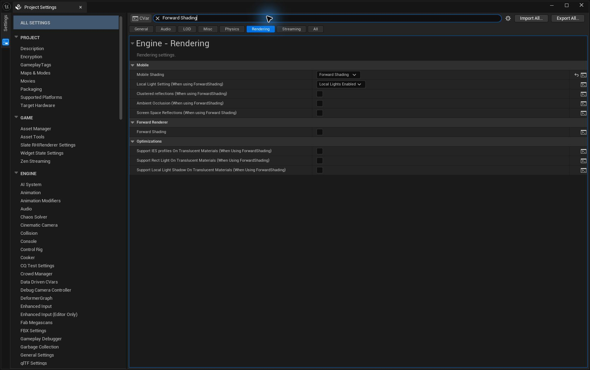
</p>

**Figure 6-1. Mobile Forward and Desktop Forward Settings.** 문서 작성 중 실제 Project Settings를 읽어 보관한 화면이다. Mobile Shading은 Forward Shading이며 별도 Forward Renderer의 Forward Shading은 OFF다. Local Lights Enabled와 Mobile Forward의 Reflections / AO / SSR OFF도 보인다. 설정 변경·성능 비교 화면이 아니다.

<p align="center">
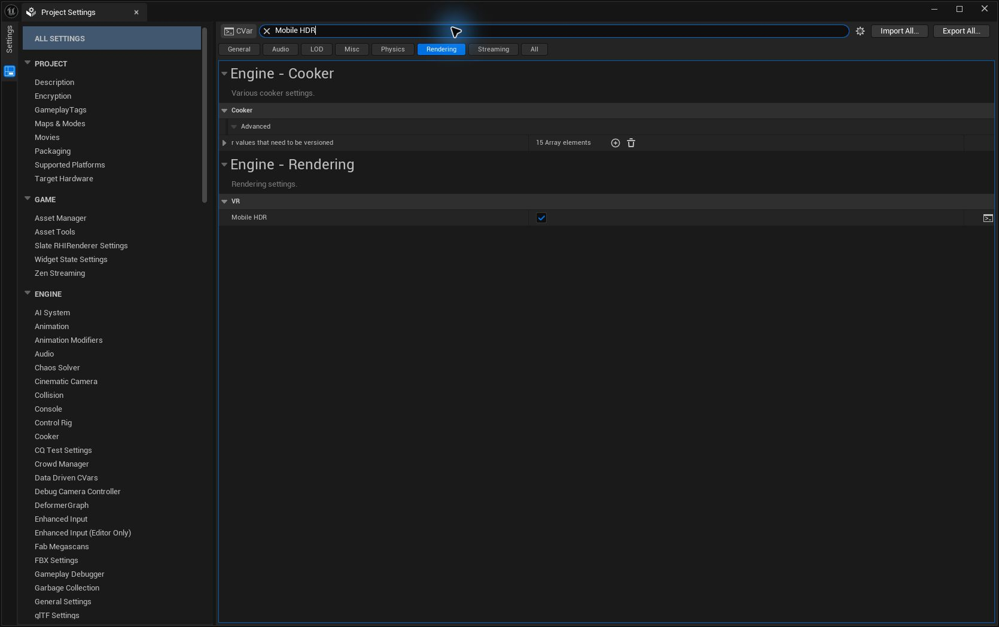
</p>

**Figure 6-2. Verified Mobile HDR Setting.** 현재 Project Settings의 Mobile HDR 체크를 확인했다. HDR을 유지한 Baseline의 근거이며, LDR 대비 GPU 시간이나 실제 Android Tone Mapping 품질을 비교한 자료는 아니다.

<p align="center">
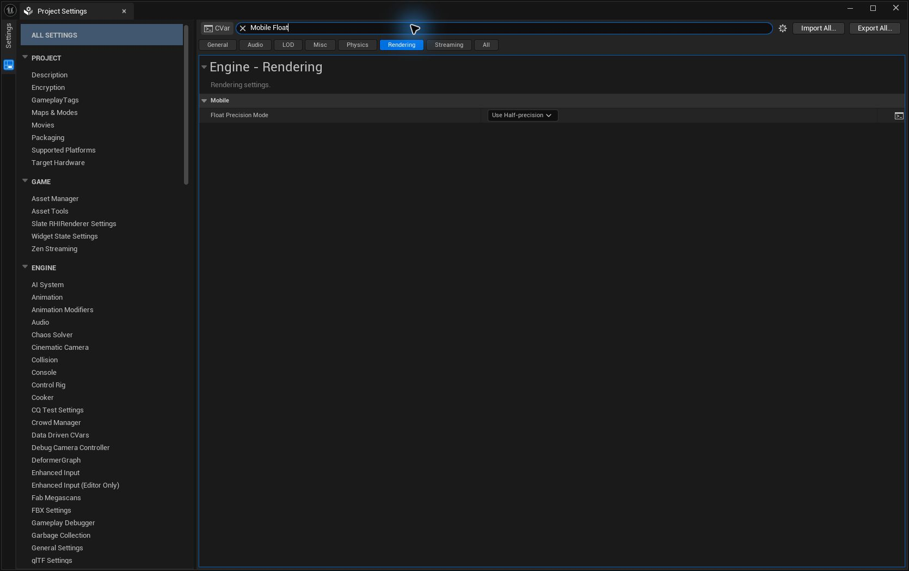
</p>

**Figure 6-3. Verified Project Float Precision Mode.** Project 수준의 Float Precision Mode는 Use Half-precision이다. Material Details의 Float Precision Mode = Default와 구분한다. Default는 Full Precision을 강제했다는 의미가 아니며, 정밀도가 필요한 연산은 실제 기기에서 별도 평가해야 한다.

Mobile 프로젝트의 Config에는 Desktop에서 이어진 `r.Substrate=True`, Ray Tracing / GI 관련 값도 남아 있다. 문서 작업에서 이를 일괄 OFF로 바꾸지 않았으며, 저장된 Desktop 기능 플래그를 Mobile Preview에서 해당 기능이 지원·실행됐다는 증거로 사용하지 않는다. `TargetedHardwareClass=Desktop`도 남아 있으므로 이 프로젝트를 모바일용 Template의 모든 설정을 자동 적용한 상태라고 설명하지 않는다. 실제 선택한 Mobile Shading Path와 Preview, 기능별 지원을 기준으로 읽는다.

Precision은 연산의 수치 표현 문제다. 좁은 범위의 색 계산에 충분한 정밀도가 큰 좌표·작은 차분·날카로운 Specular 계산에서도 항상 충분한 것은 아니다. 반대로 전체를 Full로 바꾸면 모든 기기에서 무료로 품질이 좋아진다고 보장할 수도 없다. 이번에는 Material Default와 Project Half를 유지하고, 문제가 나타나는 Surface에서 원인을 분리한 뒤 필요한 범위만 비교한다. [R7], [R8]

### Android Configuration Troubleshooting

사용자 제공 초기 작업 기록의 순서는 다음과 같다. **오류가 있던 상태를 이번 문서 작업에서 다시 만들지는 않았다.**

1. Project Settings의 Android 플랫폼에서 **Configure Now**를 진행했다.
2. **`Could not overwrite Project Properties file`** 오류가 나타났다.
3. 해당 프로젝트의 `Build/Android/project.properties` 파일이 없는 상황을 확인했다.
4. 같은 경로에 빈 `project.properties` 파일을 직접 생성했다.
5. Android 설정의 표시가 **`Platform files are writeable`**로 바뀌는 것을 확인했다.

현재 Mobile 프로젝트의 `Build/Android/project.properties`는 실제로 **0 bytes**이며 생성·수정 시각은 **2026-11-04 13:55:21 KST**다. 파일의 현재 존재와 크기는 로컬에서 재확인했지만, 이 사실만으로 당시 오류의 내부 원인까지 증명하지는 못한다. 누락 파일과 해결 동작 사이의 관찰된 관계를 기록하는 것이며, Permission / Source Control / Engine 설치 상태 중 하나가 확정 원인이라고 단정하지 않는다. 다른 프로젝트에서 기존 파일을 비우거나 덮어쓰는 일반 해결법으로 사용하지 않는다.

`Platform files are writeable`는 플랫폼 파일 준비 상태에 관한 확인이다. Android SDK / NDK / JDK 설치와 버전 적합성, Gradle Build, Package Signing, APK / AAB 생성, 기기 설치·실행의 성공을 뜻하지 않는다. **Shader Preview와 Packaging은 별도 검증 단계**다. Android SDK 경고는 실제 Build Toolchain 확인 대상이며, Google Play Services / AdMob / Icon 경고도 해당 서비스 설정이나 Packaging Asset 준비와 관련된다. 이 경고 자체를 PBR Shader Preview 실패나 Material Graph 오류의 원인으로 해석하지 않는다. 경고의 실제 문구·현재 상태를 확인하지 않은 부분은 해결 완료로 기록하지 않는다.

**TODO — Historical Configuration Evidence.** 당시 오류 Dialog, `project.properties` 부재, 생성 후 `Platform files are writeable` 화면의 원본을 추가 보관한다. 이번 `read_thread` 응답에는 마지막 5개 Turn과 Graph / Stats / 적용 결과 5장만 반환되었고 Older Cursor가 없었다. 따라서 초기 Screenshot을 직접 재검수했다고 쓰지 않으며, 현재 상태의 화면을 과거 오류 Screenshot으로 대체하지 않는다.

### Nanite Fallback Diagnosis and Geometry Recovery

Android Vulkan High Preview로 바꾼 뒤 Head가 저폴리곤처럼 보였다는 사용자 기록이 있다. 이때 먼저 Material의 Normal이나 Roughness를 바꾸는 대신 **Wireframe으로 실제 Triangle 밀도와 실루엣을 확인**했다. Surface Shading은 빛의 인상을 바꿀 수 있지만 실제 Wireframe의 Triangle 수를 늘리지는 못한다. Geometry가 달라졌다면 Mesh 선택 경로를 먼저 조사해야 한다.

Static Mesh Editor의 표시와 수치는 다음과 같이 기록되었다.

| Static Mesh Observation | Recorded Value | Meaning |
|---|---|---|
| Nanite State | **Nanite Enabled (Showing Fallback)** | Editor가 Nanite 원본 경로 대신 Fallback을 보여주는 상태였다. |
| Nanite Triangles | **34,052** | Nanite 쪽에 표시된 Triangle 수다. 현재 모바일 Draw Triangle 측정값으로 사용하지 않는다. |
| Fallback Triangles | **1,776** | 단순화된 Fallback Geometry의 Triangle 수다. |
| Fallback Vertices | **948** | Fallback Geometry의 Vertex 수다. |

Nanite는 고밀도 Geometry를 Cluster 등 별도 표현으로 처리하는 경로이고, Nanite를 사용할 수 없는 경로에는 Fallback Mesh가 사용된다. 이 Fallback은 원본 Geometry와 같은 밀도일 필요가 없다. 따라서 이번 Mobile Forward Preview에서 저밀도 Fallback이 보이면, 기존 Head가 갑자기 잘못 모델링된 것이 아니라 **지원 경로에 따라 다른 Geometry 표현이 선택된 상황**을 먼저 의심할 수 있다. 일반적인 거리별 수동 LOD 제작과 Nanite Fallback 선택도 구분해야 한다. [R9], [R10]

사용자는 대상 Static Mesh의 **Nanite Support를 OFF**로 바꾸고 **Static Mesh Editor를 재오픈**한 뒤 원본 Geometry가 복원된 것을 확인했다. 이 결과는 해당 Mesh와 Preview에서의 복원 기록이다. 새 Mesh LOD 제작, Retopology, 별도 Modeling을 수행한 것이 아니며, 이번 연구는 기존 **Musa 모델을 그대로 사용하여 Material 비교에 집중**한다. Nanite를 모든 프로젝트에서 일괄 비활성화하라는 일반 지침으로 확대하지 않는다.

**TODO — Historical Geometry Evidence.** Wireframe 비교, Nanite 수치 화면과 OFF / 재오픈 후 원본 Geometry의 Screenshot 원본을 확보해 연결한다. 수치는 이번 사용자 의뢰에 명시된 작업 기록이며, 이번 문서 작업에서 Mesh를 다시 ON/OFF하거나 Triangle 수를 독립 재측정한 값이 아니다. Head의 Geometry 복원을 Hair의 다른 렌더링 문제 해결로 확대하지 않는다. 6.1 작성 당시 미확인이었던 Hair의 지원 경로와 대체 표현, Shadow 문제의 후속 조사 결과는 [6.4 Mobile Hair Shader](#64-mobile-hair-shader)에 기록했다.

### Setup Validation Boundary

6.1의 확인 결과는 Mobile Forward / Vulkan Preview의 기준이 식별되고, 초기 설정 오류와 Geometry 선택 문제의 작업 과정이 추적 가능하게 정리되었다는 것이다. 이번 작업은 실제 Android 패키징이나 실행을 하지 않았다. 목표 Device Model / GPU / OS / Driver, 실제 Resolution / FPS 목표와 Thermal 조건도 아직 확정하지 않았으므로 권장 Device 성능이나 Compatibility 완료를 주장하지 않는다. Mobile Preview의 외관 확인은 다음 6.2의 기능 검증 근거이며, Android GPU 성능의 측정 결과는 아니다.

---


## 6.2 Mobile Basic PBR Conversion

### Conversion Goal and Evidence Boundary

Basic PBR Conversion의 목적은 기존 Desktop Material을 간단한 색 Material로 대체하는 것이 아니다. 같은 Musa Mesh와 Texture를 유지하면서, UV와 Texture Channel의 의미, Artist Control, Opaque / Masked의 Coverage 계약이 Mobile Renderer에서도 유지되는지 확인하는 것이다. 먼저 공통 Surface 입력을 안정적으로 옮겨야 이후 Skin / Hair / Eye의 전용 표현에서 발생하는 문제를 기본 Texture 연결 문제와 구분할 수 있다.

이번 구현은 기존 Desktop PBR의 Opaque와 Masked Master를 각각 복제하여 `M_Mobile_PBR_Master`, `M_Mobile_PBR_Masked`로 분리했다. 실제 저장된 경로는 `/Game/ASF/PBR/Mobile/`이다. Desktop Master를 직접 수정하는 대신 Mobile용 Parent를 별도로 두어, 이후 Mobile에 필요한 기능 선택과 비용 비교를 독립적으로 기록할 수 있게 했다. 이번 문서 작성 중에는 기존 Desktop / Mobile Master, Instance, Mesh와 Texture를 수정하거나 저장하지 않았다.

검증 근거는 세 가지로 구분한다. 첫째, 사용자가 제공한 실제 Graph / Details Capture는 연결과 표시된 설정을 보여준다. 둘째, Android Vulkan High Preview에서 Basic PBR와 옷자락 Mask가 정상이라는 사용자 관찰 및 Figure 6-6 / 6-7은 당시의 시각 확인 기록이다. 셋째, 이번에 읽은 저장 파일의 경로와 Parent metadata는 실제 에셋의 존재와 일부 Parent 관계를 보강한다. 정지 Screenshot만으로 모든 Texture Import 설정, 모든 Slot 배정, 최종 저장 상태와 Android Runtime을 확인했다고 확대하지 않는다.

### Master Duplication and Surface Responsibilities

| Source | Mobile Master | Surface Responsibility | Current Evidence |
|---|---|---|---|
| Desktop Opaque PBR Master | `M_Mobile_PBR_Master` | UV / Base Color / Normal / ORM과 Surface Control을 유지하는 기본 불투명 Surface다. | Figure 6-4의 Graph와 저장된 Mobile Master 파일을 확인했다. |
| Desktop Masked PBR Master | `M_Mobile_PBR_Masked` | 같은 PBR 입력에 Base Color Alpha를 이용한 Coverage 판정을 추가한다. | Figure 6-5의 Graph / Details와 Figure 6-7의 옷자락을 확인했다. |

Opaque는 해당 Surface의 Pixel을 불투명하게 처리한다. Masked는 Alpha의 값에 따라 Pixel을 남기거나 버려 Texture에 기록된 구멍과 가장자리를 표현한다. 두 Master를 분리하면 불투명 Surface의 책임과 Coverage가 필요한 Surface의 책임을 명확히 할 수 있다. Masked는 연속 투명도를 표현하는 Translucent와 다르며, Alpha가 중간값이라는 이유로 뒤의 Surface가 그 비율만큼 섞인다고 설명하지 않는다.

두 Master의 기본 Data Flow는 다음과 같다. Masked의 마지막 Coverage 경로를 제외하면 Texture의 의미와 조절 순서를 공통으로 유지한다.

```text
TexCoord[0] × UV_Tiling → BaseUV
    ├─ BaseColor_Tex RGB × BaseColor_Tint RGB → Base Color
    ├─ Normal_Tex → Base Normal
    └─ ORM_Tex
         ├─ R → Lerp(1, AO, AO_Strength)         → Ambient Occlusion
         ├─ G → Add(Roughness_Adjustment)
         │      → Saturate                     → Roughness
         └─ B                                  → Metallic

Base Normal + MF_DetailNormal
    → Static Switch: Use_DetailNormal
         ├─ False: Base Normal
         └─ True: Detail Normal Function Result
    → Normal

Masked only:
BaseColor_Tex Alpha → Opacity Mask
```

<p align="center">
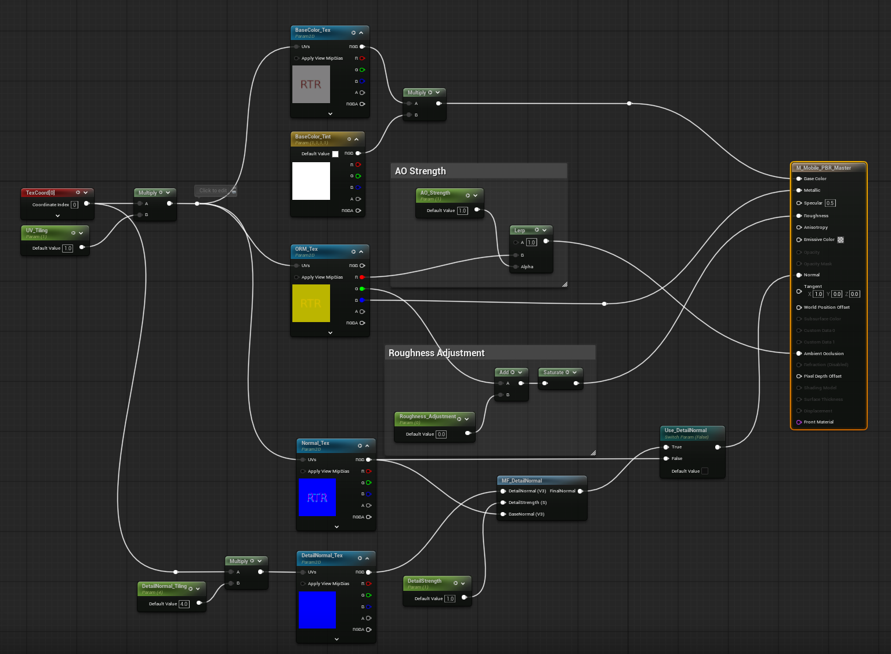
</p>

**Figure 6-4. Mobile Opaque PBR Master Data Flow.** `M_Mobile_PBR_Master`의 실제 Graph다. 공통 UV에서 Base Color / Normal / ORM으로 갈라지는 경로, Surface Control과 선택 가능한 Detail Normal을 읽는다. Graph의 존재는 Android Runtime의 정상 동작이나 GPU 비용을 입증하지 않는다.

### Shared UV and Base Color

첫 단계는 Mesh의 `TexCoord[0]`에 `UV_Tiling`을 곱해 공통 Sampling 좌표를 만드는 것이다. 이 좌표를 Base Color, Normal, ORM Texture에 전달하면 색상 무늬와 요철, Roughness / Metallic 영역의 위치 관계를 유지할 수 있다. Texture마다 별도 UV Scale을 적용하여 같은 옷의 색상과 반사 영역이 어긋나는 상태를 피하기 위한 구조다.

```text
BaseUV = TexCoord[0] × UV_Tiling
BaseColor = Sample(BaseColor_Tex, BaseUV).RGB × BaseColor_Tint.RGB
```

Musa는 기존 고유 UV와 Bake Texture를 그대로 사용한다. `UV_Tiling`이라는 공통 Control이 있다고 해서 Character의 Bake Texture를 반복 Texture처럼 임의로 재배치한 것은 아니다. 이번 비교에서는 같은 Mesh와 Texture를 유지하는 것이 중요하며, 별도 UV 제작·Texture Rebake를 Mobile Conversion의 완료 조건으로 섞지 않는다.

`BaseColor_Tint`는 Sample한 RGB에 곱해지는 Color Control이다. White는 원본 색을 유지하는 중립 입력이고, 다른 색은 원래 Texture에 포함된 Pattern을 유지한 채 전체 색 반응을 바꾼다. Tint는 원본에 없는 디테일을 생성하거나 잘못 연결된 Texture Channel을 복구하는 기능이 아니다. Base Color의 Color 해석과 아래 ORM의 수치 Data 해석도 구분해야 한다. 일반적인 입력 계약은 Base Color의 sRGB Color, ORM의 Linear Data, Normal의 Normal 전용 해석이며, 이번 정지 Capture만으로 모든 Texture Asset의 Import 설정을 다시 감사했다고 기록하지 않는다.

### ORM Packing and Surface Controls

ORM은 하나의 Texture Sample에서 서로 다른 의미의 세 Scalar를 읽는 구조다. 이 프로젝트의 Channel 계약은 `R = Ambient Occlusion`, `G = Roughness`, `B = Metallic`이다. Mobile이라는 이유로 Channel의 의미를 바꾸지 않았으므로 기존 Musa Texture를 같은 계약으로 연결할 수 있다.

| Input | Processing | Output and Meaning |
|---|---|---|
| `ORM.R` | `Lerp(1, ORM.R, AO_Strength)` | `Ambient Occlusion`이다. 1과 원래 AO 사이에서 Material AO의 기여를 조절한다. |
| `ORM.G` | `Saturate(ORM.G + Roughness_Adjustment)` | `Roughness`다. Texture의 공간적 차이를 유지하면서 Signed Offset을 더한다. |
| `ORM.B` | Channel 전달 | `Metallic`이다. AO나 Roughness의 조절값을 공유하지 않는다. |

AO의 식은 다음처럼 읽을 수 있다.

```text
AO_Out = (1 − AO_Strength) × 1 + AO_Strength × ORM.R
```

`AO_Strength = 0`이면 출력이 1이 되어 이 경로의 Material AO를 약화시키고, `1`이면 Texture AO를 그대로 사용한다. 권장 비교 구간 `0–1`에서의 의미다. Lerp Node 자체가 Alpha를 자동으로 이 구간에 제한하는 것은 아니므로, 실제 Slider 제한이나 별도 Clamp가 확인되지 않은 상태에서 모든 입력값이 보호된다고 설명하지 않는다. 또한 Material AO는 Scene의 모든 Shadow, SSAO, 접촉부 차폐를 제어하는 전역 조절값이 아니다. 어두운 영역이 AO Texture 때문인지 실제 Cast Shadow 때문인지는 별도의 분리 관찰이 필요하다.

Roughness는 Texture 값에 `Roughness_Adjustment`를 더한 뒤 `Saturate`로 최종 범위를 `0–1`에 제한한다.

```text
Roughness_Out = min(max(ORM.G + Roughness_Adjustment, 0), 1)
```

양의 Offset은 더 거친 반사 반응, 음의 Offset은 더 매끄러운 반응을 비교하기 위한 Control이다. 단, 범위를 넘어간 영역은 0이나 1로 모이므로 Offset을 크게 주면 Texture의 미세한 Roughness 차이가 사라질 수 있다. Saturate는 유효 범위를 지키는 역할이며 잘못된 Texture나 조명 조건을 자동으로 보정하는 기능은 아니다. Metallic은 ORM.B를 독립적으로 전달하여 금속과 비금속의 기존 분포를 유지한다.

### Base Normal and Optional Detail Normal

Normal Map은 RGB 색을 최종 Surface 색으로 사용하는 경로가 아니라, Mesh의 Tangent Space를 기준으로 Lighting에 사용할 방향을 제공하는 경로다. Normal Texture와 Sampler의 해석이 맞아야 하며, Tangent / Mesh Normal의 문제를 Base Color Tint로 보정하려 해서는 안 된다.

기존 `MF_DetailNormal`은 유지하되 `Use_DetailNormal` Static Switch의 기본값은 **OFF**다. OFF Variant는 Base Normal을 사용한다. ON Variant는 Function을 통해 합성한 Detail Normal 결과를 선택한다. 작은 반복 요철을 기본 Normal과 분리하는 기존 기능을 보존하면서, 이번 Basic PBR 기준선은 추가 Detail 없이 확인하려는 선택이다. Detail Normal이 불필요하다는 일반 결론이나 Function을 삭제했다는 의미는 아니다.

Static Switch는 Compile Time에 경로를 선택한다. 단순히 Detail Strength를 0으로 만드는 것과 달리, 선택되지 않은 Branch의 계산은 해당 Shader Variant에서 제거될 수 있다. 그러나 그 가능성만으로 이번 Capture의 Sampler 수나 Instruction 차이를 전부 Detail Normal 때문이라고 결론 내릴 수는 없다. 실제 Instance의 Static Override, Compile Target과 생성된 Shader가 함께 확인되어야 한다. 이번에는 Detail ON / OFF를 같은 조건에서 별도로 측정한 자료가 없으므로 그 비용 차이는 남은 검증 항목이다.

### Masked Coverage and Mobile Material Details

Masked Master는 `BaseColor_Tex`의 Alpha를 `Opacity Mask`에 연결한다. RGB는 Surface Color에, Alpha는 해당 Pixel의 Coverage 판정에 사용하는 별도 계약이다. 따라서 색상 Tint와 Alpha Cutout의 역할이 섞이지 않는다. 최종 경계는 Texture Alpha, Mip, Mask Clip Threshold, 화면의 Pixel 크기와 AA 조건의 영향을 받는다. 이번 Capture에서 경계가 정상이라는 사실을 모든 거리·움직임에서 안정적이라는 판정으로 확대하지 않는다. 확인하지 않은 Clip Threshold 수치도 새로 기입하지 않는다.

<p align="center">
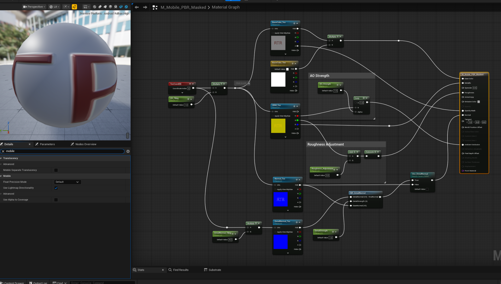
</p>

**Figure 6-5. Mobile Masked PBR Graph and Material Details.** `M_Mobile_PBR_Masked`의 실제 Graph / Details Capture다. Base Color Alpha에서 `Opacity Mask`로 이어지는 Coverage 경로와 Mobile 설정을 보여준다. 이 Mask는 연속 투명도나 Skin의 SSS contribution을 제어하는 입력이 아니다.

| Material Details Item | Recorded Value | Reason and Trade-off |
|---|---|---|
| `Float Precision Mode` | `Default` | Material별 강제 Override 없이 Project의 Mobile Precision 정책을 따른다. 이번 Project UI에서 확인한 정책은 `Use Half-precision`이다. `Default`를 모든 연산의 Full Precision 보장으로 읽지 않는다. 정밀도 문제가 관찰되면 문제 경로와 필요 범위를 분리하여 비교한다. |
| `Use Lightmap Directionality` | ON | Lightmap을 사용하는 경로에서 Directional 정보를 활용할 수 있도록 기존 선택을 유지한다. 체크가 ON이라는 사실은 이번 Musa Scene에 Lightmap을 Bake했거나 이를 실제 조명 근거로 검증했다는 뜻이 아니다. 사용하는 Lighting 경로에 따라 실제 기여가 달라진다. |
| `Use Alpha to Coverage` | OFF | 이번 Masked 기준선은 기존 Alpha Cutout 경로로 관찰했다. Alpha to Coverage는 MSAA의 Sample Coverage를 활용하는 별도 선택이며 AA·Target 지원과 함께 검토해야 한다. 이번에는 ON / OFF의 품질·비용 비교를 수행하지 않았다. |

위 표는 이번 Material의 확인된 선택이다. 모든 Mobile Material에 동일하게 적용해야 한다는 일반 권고로 제시하지 않는다. 특히 `Mobile High Quality BRDF`는 실제 UE 5.8.3 UI에서 해당 옵션을 확인하지 못했으므로 활성화하거나 적용했다고 기록하지 않는다. 보이지 않는 옵션을 다른 버전의 안내만으로 이번 구현 상태에 추가하지 않는다.

### Material Instance Migration and Saved Parent Evidence

사용자 작업은 기존 Material Instance를 복제하고 Mobile Master로 Parent를 변경한 뒤, 같은 Musa Mesh와 기존 Texture로 결과를 비교하는 흐름으로 진행했다. 구조와 대상별 값을 분리하면 Texture / Tint / Surface Control을 처음부터 수동 재구성할 필요를 줄일 수 있다. 다만 Parent를 바꾸어도 모든 Override가 자동으로 의도대로 유지된다고 가정해서는 안 된다. Parameter 이름·타입, Static Override, Texture와 Mesh Slot을 함께 확인해야 한다.

이번 저장 파일 조사에서 직접 확인한 Parent 근거는 다음과 같다. `.uasset`에 기록된 명시 Parent reference를 읽은 결과이며, 현재 Level의 모든 Material Slot과 열린 Editor의 미저장 상태를 전부 감사한 결과는 아니다.

| Saved Instance | Recorded Parent Reference | Interpretation |
|---|---|---|
| `/Game/ASF/Characters/Musa/Materials/MI_Character_Body` | `/Game/ASF/PBR/Mobile/M_Mobile_PBR_Masked` | 바디 / 의상의 Masked 적용을 뒷받침하는 저장 파일 근거다. |
| `/Game/ASF/Characters/Musa/Materials/MI_Character_Weapon` | `/Game/ASF/PBR/Mobile/M_Mobile_PBR_Master` | Opaque Mobile Master를 사용하는 실제 Instance 근거다. |

저장된 Turban / Bow Instance에는 기존 Desktop PBR Parent reference가 남아 있고 Head는 기존 Skin Parent를 참조한다. 그러므로 이번 Basic PBR 결과를 모든 Musa Surface의 Mobile 전환 완료로 표현하지 않는다. Head의 Geometry 복원은 Section 6.1의 문제 해결 기록이며, 전용 Skin Material의 Mobile Conversion 완료와는 구분한다.

### Visual Validation in Android Vulkan High Preview

Android Vulkan High Preview로 전환한 후 사용자는 Basic PBR의 Base Color, Normal, ORM, Opaque / Masked 및 옷자락 Alpha Cutout이 시각적으로 정상이라고 확인했다. 아래 두 Figure는 그때 첨부한 원본 이미지다. Figure 6-6는 넓은 바디 / 의상 영역, Figure 6-7은 하단 Coverage 경계를 보여준다.

<p align="center">
*Fig6_06 — 공개 사본에서 이미지 생략.*
</p>

**Figure 6-6. Musa Body and Clothing in the Recorded Mobile Preview.** 사용자 제공 실제 적용 화면이다. 상체에서 하단 의상까지 넓은 영역의 Texture와 Surface 반응을 관찰한다. Head 전체와 발끝을 포함하는 완전한 Full-body Capture는 아니며, 모든 Surface의 Mobile Conversion 완료를 입증하지 않는다.

<p align="center">
*Fig6_07 — 공개 사본에서 이미지 생략.*
</p>

**Figure 6-7. Clothing Hem Alpha Cutout Detail.** 사용자 제공 실제 옷자락 확대 화면이다. 의상 하단 Alpha 경계가 의도한 Cutout 형태로 남는지 확인한 자료다. 거리별 Mip, Motion / Temporal 안정성, Shadow Coverage와 Android 실기기 AA의 검증은 포함하지 않는다.

| Validation Item | Recorded Result | Limit |
|---|---|---|
| Base Color | 같은 Musa Texture를 사용한 Mobile Preview에서 정상으로 관찰했다. | Color Space / Exposure를 고정한 Desktop / Mobile pair의 정량 비교는 아니다. |
| Normal | 기존 Normal 경로를 유지한 결과를 정상으로 확인했다. | Normal OFF / ON의 분리 A/B와 전체 Texture Import 감사는 수행하지 않았다. |
| ORM | 기존 Channel 계약을 유지한 Surface 반응을 정상으로 확인했다. | AO / Roughness / Metallic을 각각 분리한 Debug View나 수치 검증은 수행하지 않았다. |
| Opaque / Masked | 기본 Surface와 의상 Cutout의 시각적 정상 작동을 확인했다. | 모든 Slot, 모든 거리와 Lighting 조건을 전수 검증한 것은 아니다. |
| Clothing Hem | 확대 화면에서 Mask 경계를 확인했다. | 이동, 축소, Mip 전환과 실기기 Coverage 안정성은 미검증이다. |

이 결과는 Basic PBR를 다음 Surface Conversion의 기준선으로 사용할 수 있다는 판단을 뒷받침한다. 개별 Channel의 인과관계를 완전히 분리한 실험이나 Desktop과 동일한 Appearance의 보장은 아니다. Android Vulkan Preview는 선택한 Mobile 경로의 기능과 Shader 제한을 조기에 확인하는 도구이며, Android GPU와 Driver에서 실행한 Device Test를 대신하지 않는다.

### Platform Stats and Interpretation

Figure 6-8은 **같은 `M_Mobile_PBR_Master`**를 서로 다른 DirectX Compile Target으로 표시한 Platform Stats다. 기존 Desktop Master와 복제 후 Mobile Master를 각각 측정한 전후 비교가 아니다. 두 열의 표시 이름도 Android Vulkan이 아니라 `DirectX SM6 High`, `DirectX Mobile High`이므로, 시각 검증에 사용한 Android Vulkan High Preview와 이 통계를 같은 측정 대상으로 혼동하지 않는다.

<p align="center">
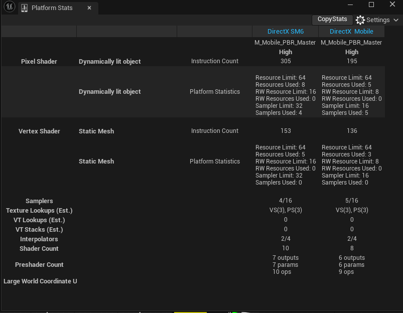
</p>

**Figure 6-8. Static Platform Stats for the Mobile Opaque PBR Master.** `M_Mobile_PBR_Master`의 DirectX SM6 High / DirectX Mobile High 정적 Compile 통계다. 표시된 Shader Instruction, Sampler, Lookup와 Shader 수를 비교한다. Android Vulkan Runtime, GPU Time 또는 Frame Rate Capture가 아니다.

| Metric | DirectX SM6 High | DirectX Mobile High |
|---|---:|---:|
| Pixel Shader Instructions | 305 | 195 |
| Vertex Shader Instructions | 153 | 136 |
| Samplers | 4/16 | 5/16 |
| Texture Lookups | VS(3), PS(3) | VS(3), PS(3) |
| Shader Count | 10 | 8 |
| Interpolators | 2/4 | 2/4 |

수치는 Capture에 표시된 값을 그대로 기록했다. Mobile Compile Target의 Pixel / Vertex Instruction과 Shader Count가 더 낮게 표시되는 한편, Sampler는 `4/16 → 5/16`으로 더 높다. 따라서 이 결과를 모든 Resource Cost가 일괄적으로 줄었다는 주장으로 요약해서는 안 된다. Sampler, Texture Lookup, Instruction, Interpolator는 서로 다른 Resource와 생성 코드의 특성을 설명하며 하나의 총비용 수치로 더할 수 없다. Sampler 개수만으로 추가 Texture 파일이 하나 더 연결되었다고 추정하지도 않는다.

`305 → 195`는 이 Capture의 Target별 정적 Shader Instruction 차이다. 이를 GPU 성능 향상률이나 Frame Time 감소율로 환산하지 않는다. 실제 시간은 생성된 Android Shader, GPU Architecture, Texture / Memory 접근, Register와 Occupancy, 화면에서 처리하는 Pixel 수, Overdraw, Draw와 Lighting 조건 등에도 영향을 받는다. 서로 다른 Shader Target의 Instruction 하나가 동일한 시간과 작업량을 뜻한다는 전제도 성립하지 않는다.

같은 이유로 이 표의 비교 조건은 제한적이다. Material 이름과 두 Target은 확인했지만, 고정된 Camera / Resolution / Lighting을 사용하는 Runtime pair, 반복 측정과 온도 / Clock 조건을 갖춘 실험은 없다. Capture만으로 모든 Instance의 Static Override 조합이나 Android Vulkan의 최종 생성 코드를 재현했다고 주장하지 않는다. **`M_Mobile_PBR_Masked`의 별도 Platform Stats는 아직 미측정**이며, Opaque의 수치를 Masked 비용으로 대신 사용하지 않는다. 의상의 Masked Overdraw나 GPU Time도 별도 측정해야 한다.

### Technical Decisions and Remaining Work

| Decision | Reason | Boundary |
|---|---|---|
| Separate Mobile Masters | Desktop 기준선을 보존하고 Mobile 기능 선택을 독립적으로 관리한다. | 문서 작성 중 기존 Desktop용 Material은 변경하지 않았다. |
| Preserve Existing Musa Mesh and Textures | Material 변화와 Geometry / Texture 제작 변수를 분리한다. | Mesh LOD 제작·Retopology·별도 모델링을 수행하지 않았다. |
| Keep Detail Normal Optional and Default OFF | 공통 PBR 입력부터 검증하고 추가 Detail Variant는 이후 비교한다. | Detail ON / OFF의 실제 품질·성능 결론은 아직 없다. |
| Keep Opaque and Masked Responsibilities Separate | 기본 Surface 입력과 Alpha Coverage를 명확히 관리한다. | Masked의 독립 Stats와 거리 / Motion 안정성은 남아 있다. |
| Use Preview as the Current Visual Baseline | Android 경로의 Material 호환성을 Editor에서 먼저 확인한다. | 실기기 Runtime·GPU Profiling·목표 FPS 달성 검증은 아니다. |

Section 6.2의 완료 범위는 공통 Data Flow와 확인한 설정, 실제 Preview 결과, 정적 Compile Stats 및 그 한계를 기록한 것이다. Basic PBR의 시각 확인을 Skin / Hair / Eye의 전용 Shading 지원이나 전체 Character Production Ready 판정으로 확장하지 않는다. 당시 남아 있던 Hair의 Shadow 및 Highlight 문제를 조사한 결과와 검증 한계는 [6.4 Mobile Hair Shader](#64-mobile-hair-shader)를 따른다.

- [ ] `M_Mobile_PBR_Masked`의 독립 Platform Stats를 같은 조건으로 확보한다.
- [ ] 실제 Instance의 Static Override와 사용 Texture, Mesh Slot의 최종 저장 상태를 정리한다.
- [ ] 필요 시 Normal / ORM 각 Channel과 Detail Normal을 분리한 A/B로 입력의 기여를 확인한다.
- [ ] 고정 Camera / Lighting / Exposure / Resolution으로 Desktop / Mobile Preview 비교 화면을 확보한다.
- [ ] 의상 Mask의 거리·Mip·Motion·AA·Shadow Coverage를 확인한다.
- [ ] 목표 Android 기기를 정하고 Vulkan Runtime과 실제 GPU 비용을 측정한다. 이 항목은 이번 Chapter의 완료 조건에서 제외한 별도 검증 범위다.
- [x] **6.3 Skin → 6.4 Hair → 6.5 Eye**의 구현·재사용과 Preview 결과를 아래에 기록하고, **6.6 Chapter Closeout**에서 Editor Preview 범위를 완료했다. Android 패키징·실기기 화질·GPU Timing은 이 완료 조건에 포함하지 않으며 미검증으로 유지한다.

## 6.3 Mobile Skin Shader

### Scope and Evidence

같은 얼굴에 같은 조명을 비춰도, 일반 머티리얼에서는 이마와 볼의 잔요철이 딱딱하게 보이거나 코 옆에서 밝은 면이 갑자기 끝날 수 있다. 피부에 들어간 빛은 안에서 짧게 이동한 뒤 주변으로 빠져나온다. 이 때문에 실제 피부는 밝은 볼의 잔요철이 덜 날카롭게 보이고, 코 옆의 명암 경계에 색이 남거나, 뒤에서 빛을 받은 귀 가장자리가 따뜻하게 보인다. 이번 작업은 Female01에서 이런 특징을 모바일 조명에 맞춰 표현한 것이다. 피부 안에서 빛이 퍼지는 현상을 **표면하 산란(SSS)**이라고 한다.

화면을 볼 때 빛을 세 가지로 나누면 이해하기 쉽다.

| 용어 | 화면에서 볼 부분 |
| --- | --- |
| **Diffuse(확산광)** | 주광을 받는 볼이나 이마의 넓은 밝기. 이번 보정이 들어가는 곳은 주광이 만드는 **직접 확산광**이다. |
| **Specular(정반사), GGX** | 코끝이나 이마의 반짝임. GGX는 거칠기와 표면 방향에 따라 하이라이트의 모양을 계산하는 엔진의 반사 모델이다. |
| **Sky / Indirect(환경광·간접광)** | 하늘이나 주변 환경에서 들어와 그늘에도 남는 빛. V3 피부 보정은 주광에 적용되므로 주광이 가려져도 이 빛은 장면에 남을 수 있다. |

검증 화면은 **Android Vulkan High Preview**에서 만들었다. Unreal Editor가 Android의 Vulkan용 렌더링 조건을 사용해 PC에서 미리 보여 주는 모드다. **Mobile Forward**는 이 프로젝트에서 사용하는 모바일 조명 계산 경로의 이름이다. 이 절의 외관과 동작은 프리뷰에서 확인한 범위이며 Android 패키징과 실기기 검증은 남아 있다. 문서의 `Production`은 프로젝트 안의 통합 에셋 이름으로 쓰인다.

<details>
<summary>프로젝트와 검증 자료</summary>

Female01 피부의 직접 확산광을 Android Vulkan High의 Mobile Forward 경로에서 부드럽게 만들되, 표면의 알베도·재질 속성, GGX 반사와 Sky / 간접광의 역할을 분리한다. 특히 외부 물체가 Key Light를 완전히 가렸을 때 피부 보정에서 해당 광원의 빛이 다시 생기지 않아야 한다. [Chapter 02](Chapter02_ProductionSkinShader.md)의 Desktop Subsurface Profile은 별도의 구현 기준이며 이 절은 Mobile Legacy Default Lit을 대상으로 한다.

**현재 결과**는 V3 엔진과 Female01용 Material에 직접 확산광 보정을 구현하고, 비교 레벨에서 Preview 반응을 검증한 단계다. `Production`은 Canonical 에셋의 이름과 통합 폴더를 가리킨다. Android 패키지와 실기기 출시 승인은 보류한다.

| Evidence | Identity and Use |
| --- | --- |
| Canonical saved state | `local path withheld`. `Content\ASF\Mobile\Skin\Production`에 저장된 Master·MI 패키지와 `Content\ASF\L_Female01_BrightSoft_Integration.umap`. 현재 값은 디스크 패키지를 기준으로 한다. |
| Canonical engine and launch | `local path withheld`, `local path withheld`. 비교 기준은 순정 UE 5.8.3, CL 58210709의 Mobile Base Pass다. |
| Production Preview evidence | `BrightSoft-Viewport-Comparison.png`, `Normal_Strength_AB.png` 및 각각의 캡처·측정 기록. 저장 시점과 캡처 설정이 다른 경우 분리해 해석한다. |
| R&D snapshots | `local path withheld`, `local path withheld` 및 별도 연구 아카이브. Slab, Cavity, Regional, BrightDiffuse, Spatial의 실패 원인과 선택 이유를 추적하는 자료다. |

Diffuse는 들어오는 광원 방향과 표면 Normal의 각도에 따라 표면에 퍼지는 빛이다. 단위 벡터의 내적 `N·L`이 1이면 표면이 빛을 정면으로 받고, 0이면 접선이며, 음수이면 광원이 표면 뒤쪽에 있다. Lambert 응답은 `max(N·L, 0)`에 따라 줄어든다. 피부에서는 짧은 거리를 이동한 빛 때문에 밝은 면의 요철 대비, 명암 경계의 색, 얇은 귀의 역광이 단순 Lambert와 다르게 보인다. Penner Lookup은 곡률과 입사각에 따른 그 평균 응답을 미리 계산해 두고 읽는다. Glossy highlight는 표면에서 반사되므로 이번 LUT에서는 GGX 응답과 독립적으로 다룬다. [Penner, SIGGRAPH 2011](https://advances.realtimerendering.com/s2011/) · [MJP, An Introduction to Real-Time Subsurface Scattering](https://therealmjp.github.io/posts/sss-intro/)

</details>

### Engine Integration and Lighting Boundary

이마의 반짝임과 볼의 명암이 같은 밝기처럼 보여도 엔진은 따로 계산한다. 아래에서는 코 옆에 생기는 명암과 얼굴 앞에 물체를 놓았을 때 생기는 그림자를 구분해, 피부 보정을 어느 단계에 넣었는지 설명한다.

#### Stock Mobile Forward Lighting

**Stock**은 이 프로젝트의 수정이 들어가기 전 Unreal이다. 머티리얼은 피부 고유색인 **Base Color(알베도)**, 반짝임이 얼마나 퍼지는지를 정하는 **Roughness(거칠기)**, 빛을 어느 쪽에서 받는지 계산하는 데 쓰는 **Normal(표면 방향)** 등을 알려 준다. 이 값을 받아 엔진이 조명 방향과 색, 세기, 그림자를 계산한다.

코끝에 아주 작은 화살표가 꽂혀 있다고 상상하면 그 화살표가 Normal이다. **Normal Map**은 모공이나 주름이 있는 것처럼 이 화살표를 픽셀마다 조금씩 기울인다. **N·L**은 그 화살표와 빛이 오는 방향을 비교한 숫자다. `1`이면 빛을 정면으로 받고, `0`이면 빛이 표면을 스치고, 음수면 표면이 빛을 등진다. 기본 확산광의 출발점인 **Lambert** 계산에서는 양수 범위에서 정면일수록 밝아지고 `0` 이하는 직접 확산광이 0이 된다.

| 명암이 생기는 이유 | 조명을 움직이거나 가리면 |
| --- | --- |
| **Form terminator(형태 명암 경계)** | 둥근 볼이 빛을 등지기 시작하는 선이다. 얼굴 앞에 아무것도 없어도 생기며 주광 방향을 바꾸면 볼 위를 이동한다. 피부 보정으로 이 부근을 부드럽게 만들 수 있다. |
| **Cast shadow(투사 그림자)** | 앞의 물체가 빛을 막아서 생긴다. 벽 뒤에서는 코끝이 주광 쪽을 향해도 주광을 받지 못한다. **CSM(Cascaded Shadow Maps)**은 이 장면에서 Directional Light의 그림자를 계산하는 방식이다. |

**Directional Light**는 태양처럼 장면 전체에 거의 같은 방향으로 들어오는 조명이다. 여기서는 얼굴의 주된 명암을 만드는 **Key Light(주광)**로 쓴다. 엔진의 **가시성**은 카메라에 보이는지 여부가 아니라 해당 픽셀에 주광이 얼마나 닿는지를 나타낸다. `0`이면 완전히 가려지고, 중간값이면 그림자 가장자리에서 일부만 닿는다.

<details>
<summary>순정 엔진의 조명 계산과 소스 위치</summary>

카메라에 보이는 피부 픽셀에서 Material Graph는 Base Color, Metallic, Roughness, Specular, Normal, AO, Emissive 등 표면 입력을 평가한다. 엔진은 이 값으로 Diffuse Color와 F0를 만들고, 라이트별로 빛의 방향·색·강도·그림자 가시성을 가져와 반사량을 결정한다. 예를 들어 비금속 피부의 Diffuse Color는 평상시 Base Color에 해당하고, 일반 금속 워크플로에서는 `BaseColor × (1 − Metallic)`이다. 같은 알베도라도 빛 방향과 표면 Normal의 관계가 바뀌면 형태 경계가 이동한다. 앞을 가린 물체가 있으면 CSM이 빛이 닿는 양을 다시 줄인다. **형태 경계는 표면 방향의 문제이고, Cast Shadow는 빛 경로 차폐의 문제**다.

UE 5.8.3의 Legacy Mobile Forward에서는 `MobileBasePassPixelShader.usf`의 `Main`이 `MobileLightingCommon.ush`의 `AccumulateDirectionalLighting`을 부르고, `DeferredLightingCommon.ush`의 `AccumulateDynamicLighting`이 기존 `GetShadowTerms`와 `IntegrateBxDF`를 사용한다. `GetDirectionalLightData`는 Mobile Directional Light의 방향, RGB, Diffuse/Specular Scale을 읽고 CSM을 샘플링한다. `DIRECTIONAL_LIGHT_CSM`이고 CSM이 활성화된 Mobile Forward 정책에서 그 값을 `DynamicShadowing`에 넣는다. 화면 Shadow Mask를 쓰는 permutation에는 기존 대체 분기가 있다. 이 경로는 `half4(1, 1, DynamicShadowing, DynamicShadowing)`으로 attenuation을 넘긴다. 이어서 `GetShadowTerms`가 기존 정책의 `Shadow.SurfaceShadow`를 산출한다. 아래에서 *가시성*은 이 최종 Surface Shadow 계수를 가리킨다.

`CapsuleLightIntegrate.ush`의 Area Light 구성은 `NoL`을 `saturate`한다. `ShadingModels.ush`의 `DefaultLitBxDF`는 `AreaLight.NoL > 0`에서 Diffuse와 GGX Specular를 계산한다. Lambert 설정에서는 Diffuse Color를 π로 나눈 후 `FalloffColor × Falloff × NoL`과 GGX의 `ComputeEnergyPreservation`을 곱한다. GGX Specular는 별도 항이다. `AccumulateDynamicLighting`은 Diffuse와 Specular에 각각 Light Scale을 곱한 뒤 둘 다 `MaskedLightColor × Shadow.SurfaceShadow`를 가중치로 누적한다. Stock의 별도 `Lighting.Transmission`은 `Shadow.TransmissionShadow`를 사용하는 경로이며, Default Lit의 Stock Transmission은 0이다. 간접광과 Sky는 같은 Base Pass 안에서도 별도 계산을 거친다. 근거는 Stock `MobileBasePassPixelShader.usf:1070–1075`, `MobileLightingCommon.ush:288–359`, `DeferredLightingCommon.ush:330–433`, `CapsuleLightIntegrate.ush:44–69,110`, `ShadingModels.ush:212–290`이다.

</details>

#### Why the Material Graph Was Insufficient

머티리얼에서만 처리하는 방법도 시험했다. 차이는 얼굴을 반쯤 가린 상황을 생각하면 드러난다.

- **Base Color에 보정값을 넣으면** 조명이 피부색을 다시 계산한다. 표면이 빛을 등진 곳은 기본 직접 확산광이 이미 0이어서, 피부색에 어떤 값을 곱해도 경계 너머에 산란 느낌을 살리기 어렵다. 같은 피부색이 환경광과 다른 조명에도 쓰인다.
- **Emissive(발광)에 보정값을 넣으면** 주광의 그림자 계산을 건너뛴다. 얼굴 앞에 가림막을 놓아도, 보정이 발광처럼 어두운 곳에 남을 수 있다. **Unlit**은 엔진 조명 없이 텍스처나 계산 결과를 확인할 때 유용하다.
- 기존 **Preintegrated Skin**이나 **Substrate Slab**도 시험했다. 피부 반응을 바꿀 수 있지만 기존 반사와 환경광 계산도 달라져, 같은 Default Lit 피부에서 직접 확산광만 비교하기 어려웠다.

그래서 엔진이 기본 직접 확산광을 계산한 **직후**, 주광의 색과 그림자를 반영하기 **직전**에 피부 보정값을 더했다. 보정이 들어간 볼도 가림막으로 주광을 완전히 막으면 그 주광 성분이 꺼진다. **Default Lit**은 Unreal의 기본 조명형 머티리얼이며, **Legacy**는 이 에셋이 사용하는 기존 머티리얼 경로를 가리킨다.

<details>
<summary>머티리얼 접근법별 실험 기록</summary>

| Approach | Lighting boundary and observed limitation |
|---|---|
| **Unlit + Emissive LUT** | signed `N·L`과 CurvatureV의 상관을 확인하는 디버그에는 유용했다. 머티리얼이 만든 RGB가 Emissive로 보이므로 Stock의 직접 GGX, Sky 및 주광 CSM 누적을 그대로 재사용할 수 없다. Default Lit 머티리얼을 뷰포트에서 Unlit 모드로 보는 시험은 재질·텍스처 디버그이며, Android Mobile Forward 조명의 검증과 분리한다. |
| **Default Lit Base Color × LUT** | Penner RGB는 그 자체로 형태 경계 너머까지 양의 응답을 가질 수 있는 **완성된 직접 확산 응답**이다. 이 응답을 알베도 쪽에 넣으면 Stock의 양의 `N·L`을 한 번 더 곱한다. `N·L ≤ 0`에서 결과가 0이 되며, Lambert로 나눠 보상하는 방식도 0을 복구할 수 없고 작은 양수에서 불안정하다. 같은 Base Color가 Sky, 간접광과 다른 광원에도 들어간다. |
| **Default Lit + Emissive residual** | Base Color와 GGX를 유지하면서 보정량을 더할 수 있지만, Emissive는 주광의 `Shadow.SurfaceShadow` 곱을 거치지 않는다. `LightColor`를 맞춰도 별도 오클루더가 만든 Cast Shadow의 어두운 내부에 산란광처럼 보이는 직접광이 남을 수 있다. |
| **Legacy Preintegrated Skin / Substrate Slab** | Legacy Preintegrated Skin은 기존 반사와 확산에 LUT Transmission을 추가하며 Subsurface Color가 간접광에도 관여한다. 전역 LUT를 양의 차분으로 교체한 시도는 음의 shoulder를 표현할 수 없고 같은 LUT를 쓰는 다른 재질에 영향을 준다. Slab Wrap은 같은 Slab 대조에서 형태가 부드러워졌지만 Sky-only 차이가 확인됐다. 모델이 달라 Legacy Default Lit의 동일 GGX 및 간접광을 비교 기준으로 유지하기 어렵다. |

결정은 **Stock Directional BxDF의 Diffuse가 나온 다음, 색과 가시성을 곱하기 직전**에 signed 보정량을 합산하는 것이다. 이 위치에서는 Penner가 형태 경계 안팎의 Diffuse를 늘리거나 줄일 수 있고, 가려진 직접광은 Stock의 가시성에 의해 꺼진다. Base Color와 Roughness 등의 표면 입력은 같은 경로에서 평가되고 GGX와 Sky/Indirect는 별도 경로를 따른다. 피부 Normal을 따로 조절한 A/B에서는 Stock GGX와 Diffuse도 함께 반응한다. **Skin residual만 변경한 A/B**가 Direct Diffuse 분리를 검증하는 대조다.

</details>

#### V3 Source Diff and Carrier Contract

**V3**는 이 프로젝트에서 쓰는 Unreal의 모바일 셰이더 수정본이다. 머티리얼이 피부의 어느 부위를 얼마나 보정할지 계산하고, V3 엔진은 그 값을 주광 계산 중 알맞은 지점에 반영한다. Figure 6-17은 표면 입력과 보정값이 엔진으로 들어가는 두 경로를, Figure 6-18은 실제 조명이 처리되는 순서를 보여 준다.

```text
머티리얼에서 피부 보정값 계산 → V3 엔진에 전달
엔진의 기본 직접 확산광 + 피부 보정값 → 주광 색·세기와 그림자 반영
엔진의 기본 GGX 하이라이트            → 주광 색·세기와 그림자 반영
```

**Residual(차이값, 보정량)**은 기본 조명에 더하거나 뺄 양이다. 예를 들어 한 색 채널의 기본 확산광이 `0.30`이고 피부 보정이 `+0.05`라면 `0.35`가 된다. `-0.05`면 `0.25`로 줄어든다. 그 뒤 주광이 완전히 가려져 가시성이 `0`이면 어느 경우든 그 주광의 결과는 `0`이다. 그림자 가장자리에서는 일부가 남는다. 이는 흐름을 설명하기 위한 예시이며 실제 피부 설정값은 아래 표에 있다.

Figure 6-17에 `ClearCoatBottomNormal`이라는 이름이 보인다. 이번 그래프에서는 **Carrier(전달 통로)**로 재사용했다. 보정량의 RGB를 엔진이 알아볼 수 있는 숫자로 포장해 이 핀에 보내면, V3가 풀어서 직접 확산광에 더한다. 이 연결을 보고 Clear Coat 반짝임을 조절하는 핀으로 해석하면 실제 작업과 어긋난다. **Compile gate**와 **permutation**은 각각 이 코드가 포함되는 조건과 그 조건으로 빌드된 셰이더 버전을 가리킨다. 따라서 같은 머티리얼이라도 Desktop이나 다른 모바일 조명 경로에서는 이 V3 보정이 작동하는지 별도로 확인해야 한다.

<p align="center">
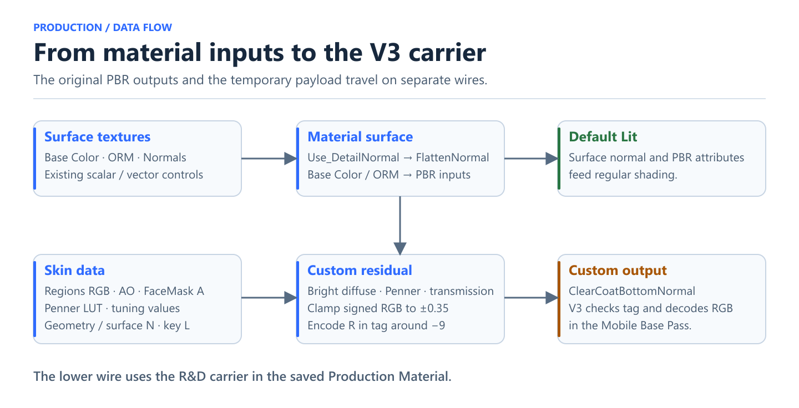
</p>

**Figure 6-17. Production Material and V3 Carrier.** PBR Surface와 Custom Output의 두 연결을 저장된 Master에서 확인해 그렸다. Carrier는 R&D에서 도입했고 Production 에셋에서 계속 사용한다.

<p align="center">
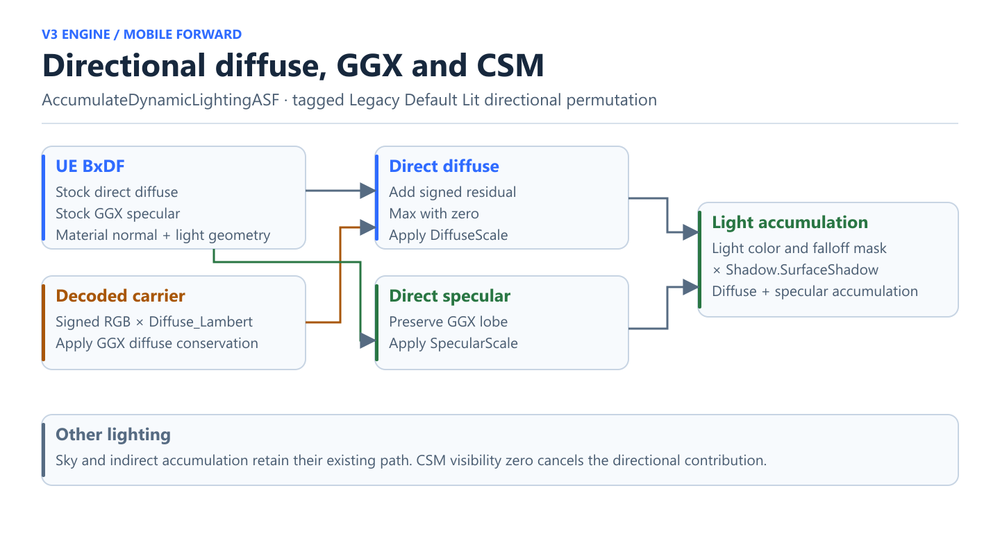
</p>

**Figure 6-18. V3 Directional Lighting and CSM.** 실제 V3 소스에 근거한 조명 경로도다. Diffuse에만 RGB residual이 더해지고, 기존 GGX와 함께 원래 Surface Shadow 가중치로 누적된다.

<details>
<summary>V3 소스 변경, 인코딩과 그림자 처리</summary>

| Local source | SHA-256 |
|---|---|
| `local path withheld` | `2491107d8587d55ee83293af92934de1803a9b0694b548ddbd0a7727cfa0e35b` |
| `local path withheld` | `3a84fd675f7fd8211654a4b16674f708a9c9c954418d8064235ce967280c5837` |

Stock과 V3의 `Engine/Build/Build.version`은 UE **5.8.3 CL 58210709**, Compatible CL 55116800이다. 두 `UnrealEditor.exe`의 SHA-256은 `5db233608a7d82102cc92cf9f591b8a9657ae16a5b7b09b131d00bbe0a4cc715`로 같다. 실행 파일 이름이나 버전만으로 V3를 구분할 수 없으므로 실행 경로와 셰이더 파일 해시를 확인한다. 비교한 `MobileLightingCommon.ush`, `DeferredLightingCommon.ush`, `ShadingModels.ush`, `SubstrateMobileForwardLighting.ush`, `SubstrateEvaluation.ush`, `SubstrateLightingCommon.ush`의 Stock/V3 해시는 각각 일치했다.

실제 Stock → V3 diff는 세 hunk에 264줄을 추가한다. Stock 파일에 hunk를 대입해 현재 V3와 바이트 단위로 대조했다. 첫 hunk는 `ASF_RD_MOBILE_SKIN_WRAP`과 `ASF_RD_MOBILE_SKIN_RESIDUAL`을 정의한다. 두 번째는 `FASFMobileSkinWrap`과 `AccumulateDynamicLightingASF` 및 `AccumulateDirectionalLightingASF`를 추가한다. 마지막 hunk는 `Main`의 Directional 호출 앞에 Carrier 디코딩과 분기 호출을 연결한다. 각 시작점은 Stock 8/123/1071줄과 V3 8/128/1306줄이다.


1. **Compile gate.** Mobile Forward, Solid, Default Lit, non-Substrate에서 V3 매크로가 켜진다. `NUM_MATERIAL_OUTPUTS_CLEARCOATBOTTOMNORMAL > 0`이어야 V3의 Directional 함수를 호출한다. 런타임에 `GBuffer.ShadingModelID == SHADINGMODELID_DEFAULT_LIT`인 픽셀만 Carrier를 해석한다. 프로젝트의 `r.Substrate=True` 설정 자체로 개별 머티리얼의 컴파일 분기를 판단할 수 없다. Desktop D3D SM6와 Mobile Deferred의 조명 경로도 별개다.
2. **Encode.** 저장된 Production Custom은 `#if ASF_RD_MOBILE_SKIN_RESIDUAL`에서 `MobileDirectionalLight.DirectionalLightDirectionAndShadowTransition.xyz`를 읽고, Pixel의 Normal과 Mask/LUT로 signed RGB 보정 `d`를 구한다. RGB를 `[-0.35, 0.35]`에 제한한 뒤 `float3(-9.0 - d.r / 0.35, d.g, d.b)`를 반환한다. `Amount ≤ 0`, 거의 0인 RGB, 혹은 매크로가 꺼진 경우 `0`을 반환한다. 이 값은 음수 표식이 들어 있는 부동소수점 데이터다.
3. **Transport and decode.** Custom의 `float3`가 `ClearCoatBottomNormal` Custom Output으로 연결되고 `Main`의 `ClearCoatBottomNormal0(MaterialParameters)`에서 읽힌다. 이 사용법은 R&D에서 도입한 임시 Carrier다. 현재 재질의 모델은 **Default Lit**이고, 저장되는 값은 Clear Coat 반사층의 방향 벡터가 아니다. `Controls.x ∈ [-10, -8]`이면 `bResidual=true`가 되고 `clamp(float3((-9.0 - Controls.x) * 0.35, Controls.yz), -0.35, 0.35)`로 RGB를 복원한다. 0은 예약 범위에 들지 않는다. 같은 V3 엔진에는 Wrap `[-5,-4]`와 기존 Penner `[-2,-1.5]`의 R&D Decoder도 남아 있다. Production이 보내는 범위는 residual 전용이다.
4. **Stock light and shadow.** `AccumulateDirectionalLightingASF`가 Stock과 같은 `GetDirectionalLightData`를 호출한다. CSM/화면 Shadow Mask와 `LightAttenuation` 처리를 보존하고, `AccumulateDynamicLightingASF`에서 `GetShadowTerms`와 Stock `IntegrateBxDF`로 기준 Diffuse와 Specular를 구한다. 잔차 합산은 일반 BxDF 분기의 `!REFERENCE_QUALITY`, `Shadow.SurfaceShadow > 0`, `bResidual`, non-radial, non-rect, non-inverse-squared, `SourceRadius == 0`, `SourceLength == 0`일 때 적용된다. 단위 falloff의 Punctual Directional을 전제로 한다.
5. **Add diffuse residual.** `N`은 이 Default Lit에서 `GBuffer.WorldNormal`, `V`는 `-CameraVector`다. `NoV = saturate(abs(dot(N,V)) + 1e-5)`, `R = max(GBuffer.Roughness, View.MinRoughness)`로 `ComputeGGXSpecEnergyTerms(R, NoV, GBuffer.SpecularColor)`를 구한다. 실제 합산은 아래와 같다.

   ```hlsl
   const float3 Residual =
       Diffuse_Lambert(GBuffer.DiffuseColor) *
       ASFSkin.DiffuseResidual *
       ComputeEnergyPreservation(Energy);
   Lighting.Diffuse = max(Lighting.Diffuse + Residual, 0.0);
   ```

   LUT 쪽 보정은 signed 응답 차이이므로 여기서 별도의 `NoL`을 곱하지 않는다. Diffuse Color/π와 Stock GGX 층의 Diffuse 감쇠를 적용하고, 합이 음수인 채널만 0에 제한한다. `TransmissionGain`과 `FaceTransmission`은 이미 Carrier의 RGB에 포함된 모양 보정이다. 이 때문에 귀 역광도 이 시점부터 **같은 Diffuse와 CSM 가시성**을 따른다.
6. **Accumulate.** 보정된 Diffuse에 `LightData.DiffuseScale`, 기존 GGX에 `LightData.SpecularScale`을 곱한다. 적용되는 permutation의 Light Function을 거친 `MaskedLightColor`에 `Shadow.SurfaceShadow`를 곱한 값을 `LightAccumulator_AddSplit`에 한 번 넘긴다. 잔차에는 별도 CSM 계수를 미리 곱하지 않는다. 로컬 라이트와 Sky/Indirect는 기존 분기에서 처리된다. 소스의 `Shadow.SurfaceShadow > 0` 조건은 산란으로 Cast Shadow 내부를 되살리는 길을 막고, 0보다 큰 penumbra에서는 기존 가시성만큼 조명이 남는다. 이 방식 자체는 주변 픽셀의 차폐를 읽거나 shadow 경계를 공간적으로 퍼뜨리지 않는다.

이 계약은 Material Custom, Custom Output의 생성 함수 이름과 표현 정밀도, Mobile Base Pass의 BxDF/Shadow 호출 구조, 컴파일 permutation을 함께 고정한다. 엔진 업데이트 시 기존 Lighting 함수와 V3 복제 함수가 달라질 수 있다. 예약 음수 범위와 출력 경로가 다른 재질·플랫폼에 우연히 겹치는지도 확인해야 한다. 과거 R&D의 `recheck_v3/shader_safety.json`은 한 CSM permutation에서 Baseline/Eye/Slab/Floor/Sky의 Stock/V3 전처리 소스를 정규화해 일치시킨 기록이다. 이 결과의 범위는 해당 재질과 permutation이다. 이식 시에는 CSM과 비-CSM, Legacy와 Substrate, 피부와 일반 재질, 대상 Android Cook을 함께 다시 확인한다.

</details>

### Production Material Graph and Saved Parameters

비교 레벨에서는 왼쪽이 BrightSoft를 적용한 Female01, 오른쪽이 기본 피부를 적용한 Female01이다. 오른쪽은 장면이 그대로인지 확인하는 기준으로 쓴다. 설정 하나의 효과를 볼 때는 왼쪽 얼굴을 같은 카메라·조명·노출로 두고 값을 바꾸기 전후를 비교한다.

**Master Material**은 배선과 기본값이 있는 원본 그래프다. **Material Instance(MI)**는 그 그래프를 공유하면서 노출된 값이나 텍스처를 바꿀 수 있는 작업용 에셋이다. MI에서 **Override**를 켜면 MI에 입력한 값이 적용되고, 끄면 Master 기본값을 가져온다. **Constant**로 만든 값은 Master에서 확인한다.

그래프를 열면 두 갈래로 보면 된다. **일반 표면 경로**는 기존 피부의 색·광택·요철을 담당한다. `BaseColor_Tex`는 피부색, `Normal_Tex`는 주름과 모공의 방향, `ORM_Tex`는 여러 흑백 재질 지도를 색 채널별로 담은 텍스처다. 이 그래프에서는 ORM의 R을 **AO(Ambient Occlusion)**에, G를 Roughness에 쓴다. AO는 접힌 틈이나 좁은 홈에 주변 빛이 덜 닿는 정도를 나타내는 데이터다. **피부 보정 경로**는 별도의 `RD_ProdRegions` 지도와 Penner 표를 읽고 주광의 확산광을 어느 부위에서 바꿀지 계산한다.

<details>
<summary>에셋 경로와 그래프 연결</summary>

Canonical 프로젝트의 Production 마스터는 `/Game/ASF/Mobile/Skin/Production/M_Female01_BrightSoft_Production`이다. 같은 폴더의 `MI_Female01_BrightSoft_Production`을 `/Game/ASF/L_Female01_BrightSoft_Integration`의 왼쪽 Female01 Head 슬롯 0에서 사용한다. 오른쪽은 일반 PBR 비교용 `/Game/ASF/Characters/Female01/Materials/MI_Female01_Skin1`이다. 비교 레벨에는 같은 Head 메시 두 개와 Directional Light, Sky Light가 있다. 원래 에셋과 비교용 에셋을 구분하면 테스트에서 변경한 변수가 무엇인지 추적할 수 있다.

마스터는 Opaque Default Lit이다. `BaseColor_Tex × BaseColor_Tint`는 Base Color, `saturate(ORM.G + Roughness_Adjustment)`는 Roughness, `lerp(1, ORM.R, AO_Strength)`는 Material Ambient Occlusion에 연결된다. BaseColor는 Color sampler와 sRGB를 쓰고, Normal은 Normal sampler와 linear 데이터, ORM은 Linear Color sampler와 linear 데이터를 쓴다. 별도의 `RD_ProdRegions`는 UV0의 Masks sampler로 읽는다. Emissive는 0이다. 일반 Surface 입력인 `BaseColor_Tex`, `Normal_Tex`, `ORM_Tex`, `BaseColor_Tint`, `UV_Tiling`, `Roughness_Adjustment`, `AO_Strength`를 편집 가능한 파라미터로 유지했다. `Use_DetailNormal`은 꺼진 상태를 기본으로 하며 필요할 때 `DetailNormal_Tex`, `DetailNormal_Tiling`, `DetailStrength`를 활성화한다. V3 보정은 이 Surface 경로와 병렬로 단일 Custom Output에 연결된다.

통합 초기에 실제 출력에서 역추적해 도달 가능한 노드만 남겼다. 별도 `Skin_SSS_Strength`, Thickness 조정, 예전 `Skin_SSS_LUT` 샘플·`Skin_Curvature_Tex` 브랜치와 비활성 정적 분기를 정리했다. 이후 표면 텍스처·스칼라·틴트 파라미터와 선택적 Detail Normal을 복원해 기존 Female01의 Material Instance 편집 흐름을 되살렸다. Production의 LUT 조회는 Custom 내부의 고정 Texture Object 한 개와 단일 RGB 샘플로 남았다. 실험용 UV spatial 브랜치나 SceneCapture2D 확산 패스는 이 마스터에서 실행되지 않는다.

</details>

### Custom Node Inputs

**Custom 노드**는 배선만으로 표현하기 어려운 계산을 코드로 묶은 머티리얼 노드다. 여기서 **HLSL**은 그 계산을 쓰는 셰이더 언어이고, **핀**은 노드의 입력과 출력 연결점이다. Figure 6-16에서 먼저 `Regions`, `FaceMask`, `PennerLUT` 연결을 찾으면 나머지 숫자 핀의 역할을 따라가기 쉽다.

코끝의 한 픽셀을 예로 들면, 그 점의 **UV**는 피부 텍스처 위에서 읽을 주소다. `RD_ProdRegions`에서 그 주소를 한 번 읽어 R·G·B는 `Regions`, A는 `FaceMask`로 나눈다. 각 채널은 독립된 흑백 작업 레이어처럼 생각하면 된다. `PennerLUT` 핀에는 별도의 텍스처가 들어간다. **LUT(Lookup Table)**는 미리 계산한 답을 모아 둔 표다. 이 노드가 빛의 각도와 굴곡을 보고 그 표에서 읽을 위치를 정한다.

| 외관에서 궁금한 부분 | 관련 입력 | 설정을 읽는 법 |
| --- | --- | --- |
| 볼과 코의 명암 전이 | `PennerLUT`, `Amount`, `NormalDetail`, `RadiusBias` | `Amount`가 양수면 Penner 보정 강도를 조절한다. `0` 이하면 이 Custom 노드의 밝은 면·역광 보정까지 함께 꺼진다. |
| 눈 아래나 콧구멍의 과보정 | `Regions.G`, `RegionInfluence`, `AO` | G는 위치별 허용도다. AO는 좁은 홈에서 보정이 과하게 올라오는 것을 줄이는 데도 쓰인다. |
| 밝은 볼의 잔요철 | `BrightMix`, `SoftStart`, `SoftEnd`, `InteriorShoulder` | `BrightMix`는 밝은 면의 요철 완화량이다. `SoftStart/End`는 어느 조명 각도부터 점진적으로 적용할지, `InteriorShoulder`는 별도의 완만한 명암 조정을 정한다. |
| 경계의 색과 밝기 | `Chroma`, `Shoulder` | `Chroma`는 보정의 RGB 차이가 얼마나 살아나는지를 정한다. `Shoulder`는 Penner가 기존보다 빛을 빼는 쪽의 강도를 줄인다. |
| 귀와 코·입가의 역광 | `Regions.B`, `TransmissionGain`, `FaceMask`, `FaceTransmission` | B는 주로 귀, A는 코·입가에 쓴다. 귀와 얼굴의 강도를 따로 조정한다. |

아래 기술 표의 `float`는 숫자 하나, `float3`는 숫자 세 개, `Texture2D`는 2D 텍스처를 뜻한다. 표는 문서 작성 때 확인한 디스크 저장본을 기준으로 한다. 예를 들어 `Amount`는 저장 MI에서 `1.0`, 이전 A/B 캡처에서 `1.2`였다. 같은 외관을 재현하려면 캡처 시점 설정을 사용한다.

<p align="center">
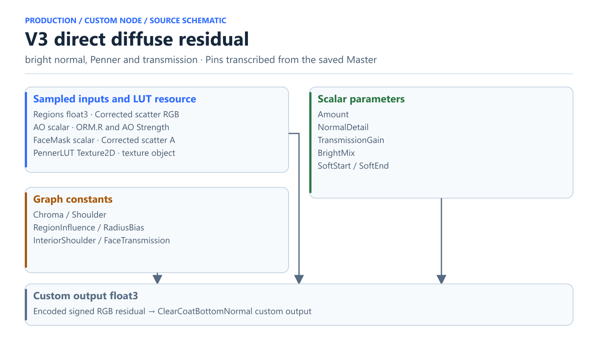
</p>

**Figure 6-16. Production Custom Node Pin Map.** Canonical 저장본과 Graph Audit에서 확인한 핀의 도식이다. 첨부 화면 `20261107-165920`은 대화 기록에 이미지 표식만 반환돼 원본을 확보하지 못했다. Figure 6-16과 6-17은 각각 Custom 배선과 전체 Surface 연결을 정리한 소스 기반 그림이다.

<details>
<summary>전체 핀, 저장값과 A/B 설정</summary>

노드 이름은 **`V3 direct diffuse residual: bright normal, Penner and transmission`**이다. 입력 핀이 받는 것은 현재 계산 중인 **한 픽셀**의 값이다. 예를 들어 캐릭터 UV0의 `(u,v)`에서 `RD_ProdRegions`를 한 번 읽으면 그 위치의 RGB 세 값이 `Regions`가 되고 같은 샘플의 A 값 하나가 `FaceMask`가 된다. ORM 텍스처도 그 픽셀의 R만 꺼내 AO 계산에 쓴다. 텍스처 전체를 스칼라로 바꾸는 과정은 없다. `PennerLUT`는 예외적으로 2D Texture Object와 Unreal이 생성하는 sampler를 전달한다. 실제 샘플링 위치는 Custom이 광원 방향과 Regions.R에서 계산한다.


| Custom pin | 타입 | 저장된 마스터의 공급원 | 저장된 마스터 기본값 / 현재 MI | 계산에서 하는 일 |
| --- | --- | --- | --- | --- |
| `Regions` | `float3` | `RD_ProdRegions` TextureSampleParameter2D의 RGB, UV0 | `T_Female01_BrightScatterRegions_Corrected` 상속 | R은 CurvatureV, G는 Diffusion 및 밝은 면 보정의 허용도, B는 귀 중심 Transmission 분포 |
| `AO` | `float` | Surface의 `lerp(1, ORM.R, AO_Strength)` 결과 | `AO_Strength=1`, 현재 MI Override On | 같은 AO를 `AOWeight`로 다시 매핑해 Penner와 밝은 면 보정에 적용 |
| `FaceMask` | `float` | 같은 `RD_ProdRegions` 샘플의 A | 텍스처 파라미터의 A | 얼굴 Transmission tail의 공간 범위를 지정 |
| `PennerLUT` | `Texture2D` | 고정 Texture Object `/Game/ASF/PBR/Textures/T_ASF_SkinSSS_Penner2011_R1to100mm_v1` | 고정, Linear Color, sRGB Off | signed N·L과 CurvatureV에서 256×256 RGB 응답을 한 번 샘플링 |
| `Amount` | `float` | Scalar Parameter `RD_ProdAmount` | 1.2 / **1.0** Override On | 양수에서는 Penner Diffusion의 이득을 조정. 0 이하에서는 Custom 전체를 우회 |
| `NormalDetail` | `float` | Scalar Parameter `RD_ProdNormalDetail` | 1.0 / **1.0** Override On | geometric normal과 Material WorldNormal 사이에서 Penner 및 Transmission 각도에 쓸 노멀을 선택 |
| `Chroma` | `float` | Constant `RD_ProdChroma` | 0.36 고정 | Delta의 R을 RGB에 공유한 응답과 원래 RGB Delta 사이를 보간 |
| `Shoulder` | `float` | Constant `RD_ProdShoulder` | 0.33 고정 | 음의 Penner Delta만 약화. 밝은 면 `InteriorShoulder`와 독립 |
| `RegionInfluence` | `float` | Constant `RD_ProdRegionInfluence` | 1.0 고정 | Penner의 마스크 영향 강도. 1이면 `Regions.G`가 그대로 가중치 |
| `TransmissionGain` | `float` | Scalar Parameter `RD_ProdTransmissionGain` | 0.10 / **0.20** Override On | `Regions.B`로 제한한 귀 중심 Transmission의 이득 |
| `RadiusBias` | `float` | Constant `RD_ProdRadiusBias` | 0.43 고정 | R의 로그 LUT 좌표에 더한다. 1로 포화되기 전에는 더 작은 반경 행으로 이동 |
| `BrightMix` | `float` | Scalar Parameter `RD_ProdBrightMix` | 0.60 / **0.60** Override On | 밝은 면 Diffuse 전용 노멀 보간량과 signed cosine 차이의 한도를 함께 조정 |
| `InteriorShoulder` | `float` | Constant `RD_ProdInteriorShoulder` | 0.055 고정 | 밝은 면의 완만한 별도 profile shoulder를 조정 |
| `FaceTransmission` | `float` | Constant `RD_ProdFaceTransmission` | 0.05 고정 | `FaceMask`로 제한한 얼굴 Transmission tail의 이득 |
| `SoftStart` | `float` | Scalar Parameter `RD_ProdSoftStart` | 0.08 / **0.08** 상속 | geometric N·L에서 밝은 면 cosine 보정이 켜지기 시작하는 지점 |
| `SoftEnd` | `float` | Scalar Parameter `RD_ProdSoftEnd` | 0.40 / **0.40** 상속 | geometric N·L에서 같은 가중치가 1에 도달하는 지점 |

Material Instance의 Override 체크박스가 꺼져 있으면 부모 마스터의 기본값을 상속한다. 현재 MI의 `Normal_Strength=0.5`도 이 방식이다. `InteriorShoulder=0.055`와 `FaceTransmission=0.05`는 마스터 그래프의 Constant이므로 MI에서 override할 수 없다. 이전 감사 로그에서 해당 이름의 MI 파라미터 조회가 `resolved=0`인 것은 상수 노드라는 뜻이며 HLSL에는 표의 값이 들어간다.

**저장본과 캡처 시점.** 현재 Canonical 마스터의 SHA-256은 `2DF3763D5E76030C3A268F70E61357B0F5314F4BA71A0FCE70A0D97489C64CFB`이며 그래프 감사 당시와 같다. 현재 MI의 SHA-256은 `FFFF8326F4E6CA2509972F0C62F351ED4AA96D726E87845F6FFE3C8BB07E259A`다. 현재 값은 이 패키지의 `DefaultValue`와 `ScalarParameterValues`를 읽어 확인했다. 당시 캡처의 MI SHA-256 `139AE9F256DE9CD89E451FF39EC9B748C25BC78653F3EBBE58D0C24A3129CF0B`에서는 Amount 1.2, TransmissionGain 0.10, NormalDetail 0.50, BrightMix 0.60, SoftStart 0.08, SoftEnd 0.40이 override였고 Normal_Strength 0.50은 상속이었다. 아래 Normal_Strength 비교 수치는 이 캡처 시점의 조명과 MI로 얻었다. 두 설정의 외관을 직접 비교할 새 캡처는 확보하지 않았다.

문서 검증 중 열린 Editor에는 Master·MI 두 탭의 `*`와 `2 Unsaved`가 표시됐다. 화면의 MI에서는 `RD_ProdRegions`도 Override On이었다. 위 표는 Canonical 디스크 저장본에 대한 것이며, 화면의 미저장 상태는 별도 관찰로 보존했다.

</details>

### Custom HLSL Walkthrough

코 옆 볼의 한 점을 따라가면 코드가 하는 일이 여섯 단계로 나뉜다.

1. **그 점이 빛을 어느 쪽에서 받는지 구한다.** 메시가 만드는 큰 형태의 방향과 Normal Map이 더한 잔요철의 방향을 섞는다. 이때 `NormalDetail`은 산란과 역광 계산이 모공이나 주름의 방향을 얼마나 따라갈지 정한다.
2. **Penner 표에서 피부 반응을 읽는다.** 표의 가로축은 빛이 그 점을 정면에서 비추는지, 스치는지, 뒤쪽에서 오는지 나타낸다. 세로축은 그 점이 볼처럼 완만하게 휘었는지, 콧방울처럼 좁은 반경으로 휘었는지를 나타낸다. 광원 방향이 바뀌면 같은 코의 점도 표에서 가로로 다른 위치를 읽는다. 이 표는 피부의 빛 번짐을 여러 폭의 퍼짐으로 근사해 미리 계산했다.
3. **기본 확산광과 비교해 더하거나 뺄 양을 구한다.** 경계 쪽에서는 약간의 따뜻한 빛을 더할 수 있고, 밝은 면에서는 일부를 덜어낼 수 있다. R·G·B가 다르게 반응하기 때문에 경계 색도 변한다. 눈 주변처럼 보호할 부위는 G와 AO로 보정을 줄인다.
4. **밝은 볼의 잔요철을 별도로 완화한다.** 모공까지 반영한 방향으로 계산한 확산광과 큰 형태 위주로 계산한 확산광을 비교하고, 차이만 더한다. `SoftStart=0.08`, `SoftEnd=0.40`은 이 효과가 서서히 들어오는 빛의 각도 범위이며 N·L 눈금으로 읽는다. `InteriorShoulder`는 별도로 넓은 명암을 조금 조절한다.
5. **귀와 얼굴의 따뜻한 역광을 더한다.** **Transmission**은 빛이 얇은 조직을 통과하는 듯한 효과다. 이 구현은 역광 각도와 B/A 마스크를 사용해 귀와 코·입가에 색을 더한다. B와 A를 나눠 두었기 때문에 귀만 밝히거나 입가의 반응만 줄일 수 있다.
6. **결과를 합쳐 엔진에 넘긴다.** Penner 차이, 밝은 면 조정, 귀와 얼굴의 역광을 합치고 너무 큰 값은 제한한다. V3가 이 값을 받아 주광의 직접 확산광에 적용한다. 외부 물체가 주광을 막으면 귀에 더한 역광도 그 그림자를 따른다.

<details>
<summary>단계별 HLSL 계산식</summary>

1. **Guard and Normals.** `ASF_RD_MOBILE_SKIN_RESIDUAL`이 활성인 permutation에서 실행된다. `Amount <= 0`이면 모든 항을 계산하기 전에 0을 반환한다. `Ng = normalize(Parameters.TangentToWorld[2])`는 노멀 텍스처를 적용하기 전 표면의 기하 기준 방향이다. `Nw = Parameters.WorldNormal`은 Material Normal을 반영한 방향이다. `Nd = normalize(lerp(Ng, Nw, saturate(NormalDetail)))`로 lookup용 방향을 만든다. Mobile Directional Light uniform의 `L`과 내적한 `X = clamp(dot(Nd,L), -1,1)`에서 1은 정면광, 0은 광선이 표면을 스치는 지점, 음수는 표면이 광원에서 돌아선 방향이다.
2. **Penner Lookup.** 6-Gaussian 확산 프로파일을 반원 위에서 적분하고 반경별·채널별로 정규화해 오프라인에서 만든 RGB 테이블을 조회한다. 가로 좌표 `u = X×0.5+0.5`는 signed cosine, 세로 좌표 `v = saturate(Regions.r + RadiusBias)`는 반경의 로그 좌표다. LUT 생성의 대응식은 `v = log(100 / Radius_mm) / log(100)`, `Radius_mm = 100 × 0.01^v`다. `(float2(u,v)×255+0.5)/256`을 사용해 양 끝을 256×256 LUT의 첫 texel과 마지막 texel 중심에 맞춘다. `Texture2DSampleLevel(..., UV, 0).rgb`로 Mip 0을 1회 읽는다. 오프라인 적분이나 Gaussian 계산은 픽셀 셰이더에서 반복되지 않는다.
3. **Signed Diffusion.** `Delta = LUT.rgb - saturate(X)`에서 각 RGB가 Lambert cosine보다 큰지 작은지를 구한다. 양수는 빛을 더하고 음수는 뺄 수 있는 응답이다. `Colored = lerp(Delta.rrr, Delta, saturate(Chroma))`는 더 넓게 퍼지는 R의 응답을 기준으로 채널 차이를 조절한다. `Diffusion = max(Colored,0) + min(Colored,0)×Shoulder`는 음의 성분만 0.33배로 줄인다. `AOWeight = lerp(1,smoothstep(0.44,0.91,AO),0.72)`와 `RegionWeight = lerp(1,Regions.g,saturate(RegionInfluence))`를 사용해 눈 주위와 폐색이 큰 곳에서 Diffusion을 억제한다. 이 단계에서 빛의 색이나 CSM은 적용되지 않는다.
4. **Bright Diffuse Residual.** 먼저 PBR cosine `PbrNoL = saturate(dot(Nw,L))`와 signed `GeomNoL = dot(Ng,L)`을 구한다. `m = saturate(BrightMix)`로 `Nb = normalize(lerp(Nw,Ng,m))`를 만든 뒤 `Softening = clamp(saturate(dot(Nb,L)) - PbrNoL, -0.22×m, 0.22×m)`으로 두 cosine의 차이만 취한다. `Start = clamp(SoftStart,0,0.999)`, `End = max(saturate(SoftEnd),Start+0.001)`, `SoftWeight = smoothstep(Start,End,GeomNoL)`이 해당 차이의 적용 범위를 정한다. 기본값은 geometric N·L 0.08 이하에서 0, 0.40 이상에서 1, 그 사이에서 부드럽게 변화한다. `SafeSkin = smoothstep(0.06,0.72,Regions.g)×AOWeight`로 눈 주변의 과보정을 억제한다. 별도 `ProfileShoulder = (0.64 - saturate(GeomNoL))×saturate(InteriorShoulder)`에 `smoothstep(0.23,0.58,GeomNoL)`를 곱한다. 최종 `BrightResidual`은 Softening과 ProfileShoulder의 가중 합에 `SafeSkin`을 곱한 스칼라이며 합산 시 RGB에 공통으로 들어간다.
5. **Ear and Face Transmission.** `FacingLight = lerp(0.50,1,saturate(dot(-L,Parameters.CameraVector)))`로 카메라에 대한 역광 가중치를 구한다. 귀 항은 `Back = smoothstep(-0.97,-0.56,X)×(1-smoothstep(-0.09,0.31,X))`에 `FacingLight×Regions.b×TransmissionGain×float3(1,0.39,0.20)`를 곱한다. 얼굴 항은 `FaceBack = smoothstep(-0.75,-0.28,X)×(1-smoothstep(0.06,0.48,X))`에 `FaceMask×FacingLight×FaceTransmission×float3(1,0.49,0.31)`를 곱한다. 두 항은 UV 마스크와 각도 기반의 국소 RGB 보정이다. 귀 중심 B와 코·입가 전용 A를 별도로 관리한다. 원본 B 제작에는 귀뿐 아니라 코 날개와 입술의 약한 가중치도 포함했다. 두 항에 Penner용 AOWeight나 RegionWeight를 직접 곱하지 않는다.
6. **Sum and Encode.** `Correction = clamp(Amount×Diffusion×RegionWeight×AOWeight + BrightResidual + Transmission + FaceTail, -0.35, 0.35)`가 이 노드의 RGB 응답이다. 절댓값이 가장 큰 채널도 `0.0001` 미만이면 0을 반환해 carrier를 비활성화한다. 나머지는 `float3(-9.0 - Correction.r/0.35, Correction.g, Correction.b)`로 인코딩한다. X의 예약 범위 `[-10,-8]`는 이 값의 payload 형식이 V3 residual임을 엔진에 알린다. `ClearCoatBottomNormal` 핀으로 넘긴 이 값은 엔진에서 `(-9-Controls.x)×0.35`를 통해 R로 복원되고 G/B는 그대로 읽힌다. `ASF_RD_MOBILE_SKIN_RESIDUAL`이 비활성인 permutation에서 Custom은 0을 반환한다.

</details>

### Normal Controls and Their Boundaries

이름에 Normal이 들어가도 조절하는 대상이 다르다. 예를 들어 이마 하이라이트 속 잔주름과 볼의 직접 확산광 잔요철이 **둘 다** 강하면 표면 Normal을 먼저 본다. 광택은 마음에 들고 밝은 볼에서만 잔요철이 강하면 BrightMix 쪽을 본다. 코 옆 명암 전이나 귀 역광에 잔요철이 따라오는 정도가 문제라면 NormalDetail이 해당한다.

| 설정 | 바뀌는 화면 | 함께 알아둘 점 |
| --- | --- | --- |
| `Normal_Strength` | 피부 표면의 잔요철과 그에 따른 확산광·하이라이트 | `1`은 원래 Normal Map, `0`은 Normal Map 요철을 평평하게 한 상태, `0.5`는 중간이다. 메시로 조형한 코와 볼의 형태는 남는다. Custom도 이 표면 방향을 입력으로 읽는다. |
| `RD_ProdNormalDetail` | Penner 명암 전이와 귀·얼굴 역광이 잔요철 방향을 따라가는 정도 | `0`은 메시의 큰 형태 방향, `1`은 현재 머티리얼 표면 방향을 사용한다. 머티리얼의 GGX 하이라이트를 직접 바꾸지 않는다. |
| `RD_ProdBrightMix`와 `SoftStart/End` | 주광을 받는 밝은 면과 중간톤의 확산광 요철 | `BrightMix=0`이면 이 요철 완화만 꺼진다. Penner, 별도 `InteriorShoulder`, 귀·얼굴 역광은 남는다. |

`FlattenNormal`은 Normal Map의 방향을 평평한 쪽으로 당기는 Unreal 노드다. 노드의 `Flatness`는 값이 클수록 평평해지므로 그래프에는 `1 - Normal_Strength`를 연결했다. Figure 6-15에서 위에서부터 전체 조명, 직접 확산광, 하이라이트만 분리한 화면을 볼 수 있다. [Normal Strength 비교](#midtone-range-and-surface-normal-strength)

<details>
<summary>Normal 조절값의 배선과 계산 범위</summary>

`Normal_Strength`는 tangent-space의 일반 Material Normal에 걸린다. 선택적 Detail Normal까지 합친 결과를 Unreal `FlattenNormal`에 넘기고 `Flatness = 1 - Normal_Strength`로 연결한다. 이 함수의 선형 보간 대상은 평평한 tangent-space 방향 `(0,0,1)`이다. 0은 기하 기준 방향, 1은 선택된 텍스처 노멀 전체, 0.5는 그 사이의 표현이다. 이 변경은 PBR diffuse의 기준 cosine과 GGX의 specular에 공통으로 전달되며 Custom이 참조하는 `Parameters.WorldNormal`에도 반영된다. 반면 `RD_ProdNormalDetail`은 이미 계산된 WorldNormal과 GeometricNormal을 Custom에서 다시 보간한다. Penner lookup과 귀·얼굴 Transmission의 각도에 관여하고 Material Normal 핀과 GGX는 건드리지 않는다.

`RD_ProdBrightMix`는 같은 WorldNormal을 읽되 Bright Diffuse Residual의 보간 강도와 ±clamp 한도를 결정한다. `SoftStart/End`는 그 차이를 어느 geometric N·L 범위에서 점진적으로 더할지 결정한다. `BrightMix=0`이면 Softening이 0이지만 Interior Shoulder, Penner, Transmission은 남는다. `SoftStart/End`만 이동해도 Softening이 충분히 존재하는 각도에서만 차이가 난다. 이 설정은 PBR normal 자체, GGX, Penner lookup 각도, 별도 Profile Shoulder의 gate를 바꾸지 않는다. 그래서 밝은 면부터 중간톤까지 범위를 옮기는 실험보다 Material Normal 전체를 0.5로 완화한 효과가 볼과 눈 밑에서 더 컸다.

</details>

### CurvatureV Texture Authoring

CurvatureV를 그리는 일은 **얼굴의 큰 굴곡이 어디에서 얼마나 급하게 휘는지** 흑백 데이터로 알려 주는 일이다. 완만한 이마와 볼에는 낮은 값, 좁게 둥근 콧방울과 입술 볼록면에는 상대적으로 높은 값을 준다. 빛의 방향은 실시간으로 바뀌므로 정면 조명의 밝고 어두운 모양을 따라 칠하면 광원을 돌렸을 때 맞지 않는다. 모공과 잔주름은 기존 Normal Map에 맡긴다.

#### Scale and Linear Radius Encoding

곡률을 이해하려면 얼굴의 한 부분에 작은 원과 큰 원을 대 보는 그림을 떠올리면 된다. 작은 원에 가까운 콧방울은 짧은 거리에서 방향이 크게 바뀐다. 큰 원에 가까운 볼은 천천히 휜다. 이 작업에서 R 채널의 값이 클수록 Penner 표에서 작은 반경에 해당하는 줄을 골라, 빛이 스치는 경계 근처에 산란 효과가 더 넓게 나타난다.

R의 값은 반경 자체가 아니라 `0–1`의 숫자로 바꾼 값이다. **10 mm가 0.50**, **50 mm가 약 0.15**, **1 mm가 1.00**이다. 로그 눈금이므로 중간 회색을 반경 범위의 산술 중간값인 약 50 mm로 읽으면 안 된다. 머리 크기가 바뀌면 UV가 같아도 실제 반경이 바뀐다. Unreal의 기본 길이 단위인 cm로 반경을 재었다면 LUT 기준인 mm로 바꾼다.

`RadiusBias`는 텍스처를 다시 그리지 않고 LUT에서 읽는 줄을 이동시키는 값이다. 저장 Master의 `+0.43`에서는 원본 R이 `0.57` 이상인 곳이 모두 LUT의 `1 mm` 줄을 읽는다. 이처럼 서로 다른 회색이 같은 줄에 몰리는 것을 **포화**라고 한다. 콧방울과 입술이 한꺼번에 같은 강도로 보이면 R 채널을 다시 그리기 전에 Bias를 `0`으로 둔 비교 화면도 본다.

<p align="center">
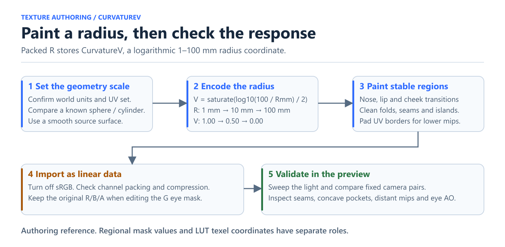
</p>

**Figure 6-19. CurvatureV Authoring Workflow.** 반경 인코딩과 수작업·검수 순서를 보여 주는 개념도다. 예시 반경과 V는 실제 LUT 계약에 따른다.

<details>
<summary>반경 변환식과 기준값</summary>

CurvatureV는 피부색이나 굴곡의 명암을 칠한 이미지와 역할이 다르다. Custom은 Region R에서 LUT의 세로축을 얻는다. 작은 볼록 반경에 대응하는 높은 V는 접선 근처의 산란 폭을 넓힌다. 텍스처에는 반경을 mm로 직접 저장하는 대신 로그로 인코딩한 무차원 값을 저장한다. LUT의 U는 signed `N·L`을 [0,1]로 옮긴 값이고 V는 radius 축이다.

```text
R_mm       = clamp(R_mm, 1, 100)
CurvatureV = log(100 / R_mm) / log(100)
R_mm       = 100 * 0.01^CurvatureV
LUT_V      = saturate(CurvatureV + RD_ProdRadiusBias)
```

| R (mm) | Texture V | 해석 |
| ---: | ---: | --- |
| 100 | 0.00000 | 범위에서 가장 완만한 곡면 |
| 50 | 0.15051 | 알려진 반경의 기준 구 |
| 31.6228 | 0.25000 | 저곡률 기준 단계 |
| 10 | 0.50000 | 로그축 중앙 |
| 3.16228 | 0.75000 | 고곡률 기준 단계 |
| 1 | 1.00000 | 범위에서 가장 날카로운 곡면 |

Unreal의 기본 cm 좌표에서 읽은 반경은 mm로 10배 변환한다. Blender는 scene unit과 평가된 object transform을 적용하고 모델의 실제 머리 폭이나 알려진 치수를 다시 잰다. 같은 UV라도 메시의 실제 크기가 달라지면 mm 반경이 달라진다. Custom의 `RadiusBias`는 V에 더하는 아트 조절이다. 예를 들어 +.43이면 포화 전 유효 LUT 반경이 약 0.138배가 되고 V≥.57에서는 1 mm 행에 포화된다. 수작업 검증에서는 먼저 bias 0에서 R을 평가하고, 채택한 bias에서 코·입술이 넓게 포화되는지 확인한다.

</details>

#### Bake and Manual Retouch

**Bake(베이크)**는 3D 메시에서 계산한 값을 UV 위의 2D 텍스처로 저장하는 작업이다. Female01처럼 볼·코·입술의 큰 구분이 목표라면 수작업 가이드도 가능하다. 기준이 필요한 부위는 반경을 아는 구나 베이크를 옆에 두고 맞추고, 나머지는 부위가 이어지는 방향으로 부드럽게 보정한다.

1. **최종 머리 크기와 UV로 시작한다.** Blender에서 모델의 실제 크기와 변환을 확인한다. 베이크할 때 눈, 속눈썹, 치아가 얼굴에 잘못 투영되지 않도록 분리한다. 양쪽 얼굴이 UV를 겹쳐 쓰면 같은 지점을 공유하므로, 좌우를 다르게 그려야 할 때는 따로 쓸 영역이 필요하다.
2. **완만한 면에서 시작해 좁은 볼록면으로 넘어간다.** 넓은 볼과 이마는 낮은 값으로 시작한다. 콧방울과 입술의 볼록한 부분을 조금씩 올린다. 콧구멍과 눈 밑처럼 안으로 파인 곳은 베이크 값이 높더라도 일단 조명에서 확인한다. 베이커의 숫자는 휘어진 정도를 담기 때문에 안으로 휜 홈도 높게 나올 수 있다. 필요한 곳은 R을 완화하거나 G로 산란을 줄인다.
3. **검은 점과 UV 경계를 확대한다.** 검은 값이 완만한 면을 뜻하는지, 베이크가 빠진 자리인지 주변과 비교한다. UV 조각 바깥에 여유 픽셀을 채우는 **Padding**은 멀리서 텍스처가 작아질 때 경계가 검게 번지는 현상을 줄인다. **Mip**은 먼 거리에서 사용하는 작은 텍스처 버전이다.
4. **색이 아닌 데이터로 가져온다.** Unreal에서 Masks 설정을 쓰고 `sRGB`를 끈다. R의 `0.50` 같은 값을 색 보정 없이 읽어야 하기 때문이다. A를 사용하는 파일은 `Compress Without Alpha`도 끈다. 원본뿐 아니라 Unreal Texture Editor의 압축·Mip 미리보기에서 채널을 확인한다.
5. **빛을 돌려 확인한다.** 먼저 Unlit에서 R만 표시해 점과 경계를 보고, 같은 카메라로 정면광·스치는 빛·반대편 광원·귀 역광을 각각 확인한다. `Amount` On/Off는 Custom 보정 전체의 비교다. 눈 밑만 확인할 때는 G 채널을 따로 비교한다. 외부 물체를 두어 가림막 뒤에 주광 성분이 남는지도 본다.

Figure 6-19는 작업 순서, Figure 6-20은 같은 얼굴을 두 방식으로 베이크한 연구 비교다. Figure 6-20의 검은 영역은 위 순서대로 주변과 비교하며 판별한다. Production의 R은 다음 절에서 실제 텍스처 채널을 대조한 기록으로 확인한다.

<p align="center">
*Fig6_20 — 공개 사본에서 이미지 생략.*
</p>

**Figure 6-20. R&D Curvature Bake Comparison.** 기존 edge RMS와 tensor의 실제 Blender 비교다. 같은 메시·카메라에서 값의 분포 차이를 본다. Production의 R을 교체한 기록과는 구분한다.

<details>
<summary>베이크 기준 메시와 채널 검수</summary>

1. **Mesh and UV**. 최종 스케일의 기준 메시와 Production이 읽는 UV 채널을 고른다. 베이크용 메시의 변환과 normal 방향, 중복 정점, 뒤집힌 면, 비정상 삼각형, hard edge를 확인한다. Projection을 쓸 경우 눈·치아·속눈썹·헤어가 얼굴 표면으로 투영되는 부분을 분리한다. Mirrored overlap에서 양쪽 얼굴에 다른 값이 필요하면 UV나 마스크 영역을 분리한다.
2. **Analytic Fixture**. Blender의 `ASF_Curvature_Tensor_Baker_Blender52.py`는 world scale을 mm에 맞추고 정점별 signed principal curvature `ASF_Tensor_K1/K2`, RMS `ASF_Tensor_Keff`, clamp 후 `ASF_Tensor_V`를 만든다. `VALIDATE`의 50 mm 구는 `k1=k2=.02 mm⁻¹`, `V≈.15051`이다. 열린 50 mm 원통의 옆면은 `(.02,0)`, `Keff=.02/√2`로 유효 반경 약 70.71 mm와 `V≈.07526`이다. 한 방향만 휘는 표면을 구와 같은 값으로 보정하면 이 bake의 RMS 정의와 달라진다. 원통의 열린 양 끝 링은 코드의 판정 범위에서 빠진다.
3. **Bake to UV**. `ASF_Tensor_V` 같은 선형 스칼라를 Emission으로 표시해 조명 없이 UV에 굽는다. Attribute 수치와 화면의 디스플레이 변환을 구분하고 저장 이미지에 감마나 톤매핑이 들어가는지 확인한다. Fixture의 대표 UV와 실제 얼굴의 코·볼을 샘플링해 기준값과 비교한다. R&D에서 CurvatureV 원본은 2048², 초기 지역 마스크는 이를 1024²에 축소했다. Production의 화면 크기, 눈 아래 경계와 mip에서 소실되는 세부를 함께 보고 목표 해상도를 정한다.
4. **Retouch by Region**. 큰 볼·이마처럼 완만한 곳을 낮은 V, 콧방울·입술처럼 강하게 휘는 볼록 부위를 상대적으로 높은 V로 시작한다. 알려진 반경의 색 견본을 옆에 두고 부위 사이를 보간한다. Tensor의 RMS는 부호를 접으므로 concave에도 높은 값이 생길 수 있다. Concave나 saddle에서는 부호를 확인한 뒤 낮은 응답이나 별도 G 억제를 선택한다. 콧구멍·눈 아래·입술의 검은 점은 미지원 삼각형, UV seam, projection miss, 작은 스케일의 노이즈와 실제 완만한 영역을 구분한다. 오류면 주변의 같은 표면 값을 이어 붙이고, 정상적인 낮은 V와 외형에 필요한 홈은 유지한다. 모공은 `Normal_Tex`가 담당하므로 CurvatureV는 저주파 형태를 중심으로 그린다.
5. **Seam and Channel QA**. UV island 양쪽의 대응 점을 비교하고 padding을 만들어 bilinear와 mip에 의한 검은 번짐을 줄인다. 선형 Masks로 가져오고 sRGB를 끈다. Alpha를 쓰는 RGBA에는 `Compress Without Alpha`를 끈다. 채널별 픽셀을 확인하고, Texture Editor에서 실제 mip·압축 preview와 임포트 원본을 비교한다. 포맷 손실의 허용치는 모바일 cook과 기기에서 확인한다.
6. **Lighting QA**. Unlit에서 R만 표시해 seam과 black dropout을 찾고, 고정 카메라에서 밝은 키·접선 키·반대 키·귀 역광을 바꿔 본다. Amount OFF/ON에서 코·볼의 form terminator가 광원과 함께 이동하는지, G를 껐을 때 눈 아래가 필요 이상으로 바뀌는지, 외부 캐스터가 있을 때 같은 CSM 가시성을 따르는지 확인한다. 정면의 한 장만으로 판단하면 albedo나 AO로 생긴 모양을 곡률 응답으로 혼동하기 쉽다.

Figure 6-19는 이 제작 순서를 정리한 작업 도식이다. Figure 6-20은 Blender 5.2.2의 1,090,985정점 Female01에서 기존 edge RMS와 tensor를 같은 orthographic 카메라 및 `Attribute Factor → Emission`으로 비교한 실제 R&D 컷이다. 눈·치아·헤어를 숨겼고, 두 방식 모두 검은 영역이 남아 있으므로 데이터가 0인 곳과 오류를 지역별로 판별해야 한다. 현재 Production R의 보존 근거는 기존 패킹과 채널 대조에 있다.

</details>

#### Scatter Regions, Corrected G and Alpha Preservation

이 프로젝트는 한 텍스처의 R·G·B·A에 서로 다른 네 장의 흑백 지도를 담는다. 합친 컬러 이미지만 보면 어느 쪽이 바뀌었는지 놓치기 쉬우므로 채널을 하나씩 본다.

| 채널 | 그림을 수정할 때 보는 부분 |
| --- | --- |
| **R — 굴곡** | Penner 표에서 읽는 반경이다. 이마, 볼, 콧방울 사이의 큰 형태를 정리한다. |
| **G — 보정 허용도** | 눈 아래, 콧구멍, 입술 주변에서 직접 확산광 보정을 얼마나 허용할지 정한다. 눈 밑에서 G를 급하게 끊으면 검은 테두리처럼 보일 수 있다. |
| **B — 귀 역광** | 주로 귀 가장자리에서 따뜻한 역광이 올라올 위치를 정한다. |
| **A — 얼굴 역광** | 콧방울과 입술 등 얼굴에서 역광을 더할 위치를 정하는 별도 마스크다. |

눈 밑 수정본은 G를 바꾼 RGB PNG였다. 이 PNG에는 기존 얼굴 역광을 담은 A가 없었기 때문에 원본 RGBA에서 **G만 교체**했다. Figure 6-13을 볼 때는 눈 밑에서 G의 경계가 어떻게 이어지는지 확인한다. 수정 뒤에도 눈 아래가 어둡다면 같은 조명에서 G 보정을 껐다 켜 보고, 코나 눈꺼풀의 실제 메시가 만드는 그림자도 따로 확인한다.

<p align="center">
*Fig6_13 — 공개 사본에서 이미지 생략.*
</p>

**Figure 6-13. Production Eye Mask G Correction.** 원본 TGA의 G와 사용자 보정 G를 합성한 Production 소스의 G를 같은 크기로 표시했다. 두 이미지의 R/B/A는 원본 픽셀과 일치한다. [채널 대조](Reports/2026-11-08_MobileSkinProduction/ScatterRegionsChannelVerification.json)

<details>
<summary>채널 교체와 픽셀 대조 기록</summary>

| 채널 | R&D/Production 의미 |
| --- | --- |
| R | 초기 `T_RD_Female01_ScatterRegions`는 감사된 `T_Skin_CurvatureV`의 R 축소본을 사용했다. Production `RD_ProdRegions`의 R도 Penner radius 행을 고르는 CurvatureV다. |
| G | 눈 아래·콧구멍·입술의 diffuse 보정량을 지역별로 억제한다. Production에서는 Penner의 Region weight와 bright residual의 SafeSkin에 사용한다. G가 잘못된 위치에서 급격히 꺼지면 보정 항이 불연속이 되어 눈 아래 검은 경계처럼 보일 수 있다. 사용자가 G를 수정해 이 패턴을 정리했다. |
| B | 초기 지역 마스크는 귀와 선택적 얇은 부위, 두께 소스를 조합했다. Production BrightScatterRegions 계열에서는 주로 귀 역광용 transmission 마스크로 쓴다. 단위가 없는 상대값이다. |
| A | BrightScatterRegions부터 콧방울과 입술의 얼굴 transmission을 분리한다. 초기 R&D `T_RD_Female01_ScatterRegions`에는 RGB만 있었다. |

사용자가 저장한 수정 PNG는 **RGB**였다. PNG를 그대로 RGBA 원본 대신 쓰면 얼굴 transmission의 A가 원본과 달라진다. 기존 import/TGA의 R·B·A를 유지하고 수정 PNG의 G만 같은 좌표에 복사했다. `ScatterRegionsChannelVerification.json`에는 G 변경 407,384 texel, 원본 PNG와 TGA의 BGRA 차이 0, 최종 G와 수정본 G의 일치, 최종 R/B/A와 원본 R/B/A의 일치가 기록됐다. 이 값은 원본 이미지의 픽셀 대조이며 압축 후 GPU 오차는 별도 항목이다. Canonical Master와 MI 패키지에서 `/Game/ASF/Mobile/Skin/Production/T_Female01_BrightScatterRegions_Corrected` 참조를 확인했다. Figure 6-13은 원본과 사용자 수정 G를 비교한다. 눈 아래의 시각 결과는 같은 카메라·조명·표면 파라미터에서 확인하고, 실제 geometry self shadow는 G 수정과 별개로 진단한다.

`chapter06_brightsoft_production/Evidence/AuthoringRun.log`의 텍스처 저장 검증은 1024×1024, sRGB OFF, Masks, alpha 제거 OFF와 Texture Source 재읽기의 픽셀 일치를 기록한다. G를 교체한 결과는 그 PNG를 전체 재질에 덮어쓴 결과와 구분한다.


현재 아트디렉션에서 필요한 것은 코·볼의 전이 위치와 눈·입·귀 주변의 안정적인 지역 제어다. 저주파 radius guide를 수작업으로 그리고 오류와 seam을 교정하는 방식은 이 범위에서 현실적이다. 실제 mm 반경이 필요한 기준부는 fixture나 bake로 고정하고, 수작업 부분은 아트 보정으로 기록한다. 같은 head의 표정·LOD, 다른 UV의 캐릭터, 목표 기기 mip·압축에서의 재현은 추가 검증 범위다.

</details>

### Viewer and Reproduction

1. `local path withheld`로 Canonical 프로젝트를 연다. `/Game/ASF/L_Female01_BrightSoft_Integration`과 Viewport의 **Android Vulkan High**를 확인한다. `r.Mobile.ShadingPath=0`은 Mobile Forward 설정이다. 사용자 설정 파일에는 Preview 값이 `None`으로 저장된 상태도 확인되므로 실행 시 선택된 Preview를 확인한다. 프로젝트의 `r.Substrate=True`와 이 Material의 Legacy Default Lit permutation을 구분한다.
2. 왼쪽 Female01 Head는 `MI_Female01_BrightSoft_Production`, 오른쪽은 `/Game/ASF/Characters/Female01/Materials/MI_Female01_Skin1`을 기준으로 비교한다. 왼쪽과 오른쪽의 절대 픽셀값에는 화면 위치와 조명 조건 차이가 섞일 수 있다. 기능 A/B는 **같은 쪽, 같은 ROI, 같은 카메라·조명·노출**에서 하나의 입력만 바꾸고, 오른쪽은 변경과 무관한 프레임 안정성 대조로 사용한다.
3. Lit은 Directional Diffuse와 Specular를 모두 활성화한다. Direct Diffuse를 분리하려면 Sky와 Directional Specular를 0으로 두고 Diffuse Scale을 1로 둔다. GGX를 보려면 Sky와 Directional Diffuse를 0으로 두고 Specular Scale을 1로 둔다. 피부의 Penner 또는 Transmission 변화는 왼쪽에서만 비교한다. `Normal_Strength`를 바꾸면 두 분리 화면에서 모두 변화할 수 있다.
4. CSM 테스트는 화면의 그림자처럼 보이는 부분만 보는 것에서 한 단계 더 나아간다. 외부 Opaque caster의 깊은 차폐부를 골라 Key off와 비교하고, 귀 역광은 Caster 유무를 따로 비교한다. 얼굴 Self Shadow만 분리하는 진단과 외부 차폐 테스트의 결론을 각각 기록한다. 테스트 뒤 기존 Level의 저장 조건으로 복귀한다.

### Production Preview A/B

<p align="center">
*Fig6_14 — 공개 사본에서 이미지 생략.*
</p>

**Figure 6-14. BrightSoft Integration Preview.** Production 통합 시점에 기록한 실제 Android Vulkan High 비교 시트다. 기존 Beauty와 Production Beauty, 직접 Diffuse, 직접 Specular 및 동적 그림자 토글을 함께 보관한다. 이후 Normal Strength sweep 및 현재 디스크 MI 값과 구분한다.

#### Midtone Range and Surface Normal Strength

`SoftStart` / `SoftEnd`로 밝은 면 보정의 범위를 중간톤까지 넓히는 실험은 조명 방향에 따라 볼의 일부가 약하게 부드러워졌지만 전체 개선은 작았다. 이 실험의 비교 컷은 `local path withheld`의 `A_Original.png`, `B_Midtone.png`, `A_Specular.png`, `B_Specular.png`다. 각도에 따라 residual을 더하는 이 경로는 GGX에 들어가는 Normal을 유지한다. 사용자가 얼굴 전체의 Normal 강도를 수동으로 낮췄을 때 더 자연스럽다고 판단했고, 공통 `FlattenNormal`로 이를 재현했다. 두 실험은 서로 다른 제어와 분석 조건이므로 변화량을 직접 비율 비교하지 않는다.

<p align="center">
*Fig6_15 — 공개 사본에서 이미지 생략.*
</p>

**Figure 6-15. Surface Normal Strength Sweep.** 고정 1158 × 942 Editor Viewport에서 `1.0 / 0.7 / 0.5 / 0.0`을 비교한 실제 캡처 시트다. 위부터 Lit, Direct Diffuse, Direct GGX다. 이 캡처의 실험값은 당시 A/B 설정이다.

| Direct Diffuse ROI | 1.0 RMS | 0.7 RMS | 0.5 RMS | 0.0 RMS | 1.0 → 0.5 감소 |
| --- | ---: | ---: | ---: | ---: | ---: |
| Forehead | 1.3306 | 1.2289 | 1.1770 | 1.1727 | 11.5% |
| Bright cheek | 1.7555 | 1.6558 | 1.5763 | 1.5439 | 10.2% |
| Midtone cheek | 4.1730 | 2.9857 | 2.1775 | 0.9469 | 47.8% |
| Under-eye | 5.1653 | 4.3335 | 3.6985 | 2.6105 | 28.4% |
| Right PBR cheek, control | 3.2911 | 3.2842 | 3.2843 | 3.2882 | 0.2% |

RMS는 8-bit 화면 Luma에서 Gaussian High-pass(반경 1.6 px, ROI 경계 3 px 제외)를 적용한 뒤 계산한 미세 대비 지표다. 이마나 볼의 톤 전체가 같은 비율로 어두워졌다는 뜻은 아니다. Specular-only 이마 RMS도 `1.6199 → 0.9188`로 변해 공통 표면 Normal 변경이 GGX에 도달함을 뒷받침한다. 오른쪽 PBR 대조의 차이는 작았다. 같은 sweep의 CSM On/Off는 평균 RGB 절대차가 ROI별 `0.080–0.121` 코드로 반복 캡처 수준에 머물러, 그 장면만으로 CSM 외부 차폐 반응을 판정할 수 없다. 별도 Caster가 있는 R&D 차폐 검증은 Figure 6-12와 함께 해석한다. [Normal Strength 측정 원본](Reports/2026-11-08_MobileSkinProduction/Normal_Strength_Metrics.json)

`0`은 표면의 Normal Map 요철이 거의 사라지는 점검값이고, `1`은 기존 미세 대비와 하이라이트가 가장 강한 비교 기준이다. `0.5`를 기본으로 두어 중간톤 볼과 눈 아래를 완화하면서 얼굴 형태와 미세 질감을 남겼다. `BrightMix=.6`, `SoftStart=.08`, `SoftEnd=.40`은 비교 설정에 남아 있다. `Normal_Strength=.5`를 고정한 `BrightMix` On/Off의 추가 판정과 두 Threshold의 상수화는 후속 검토다.

### R&D Evolution and Evidence

#### Offline Penner LUT and Material Prototypes

Lambert는 광원 방향과 표면 노멀의 내적에서 양의 값만 남기므로 접선 근처에서 직접 확산광이 빠르게 꺼진다. 반경이 작은 볼록 표면에서는 접선 뒤의 점도 밝은 이웃에서 들어온 산란의 영향을 받을 수 있다. Penner 방식은 이 효과를 곡면의 국소 단면으로 근사한다. MJP의 구현 설명으로 runtime curvature의 제약을 검토했고, LUT는 Penner Appendix A의 clamped cosine과 normalized half-ring에 따라 생성했다. [SSS LUT Research](Reports/2026-11-05_PreintegratedSSS/SSS_LUT_Research.md)

1. `x=N·L`에서 `θ=acos(x)`를 구하고 `α∈[−π/2,π/2]`를 순회한다. 이웃까지의 현 길이는 `d=2R|sin(α/2)|`다.
2. Skin profile은 원본 분산 단위 mm²를 가진 Gaussian 6개의 채널별 가중 합이다. 생성기는 Appendix 호환을 위해 분산에 1.414를 곱하고, RGB 각각 `max(0,cos(θ+α))`의 가중 합을 profile 가중치 합으로 나눈다.
3. 256² endpoint grid를 float64 midpoint 8,192스텝으로 적분한다. 16,384스텝 대조의 최대 절대 오차는 약 2.53×10⁻⁷, 별도 quadrature 표본 45개의 최대 오차는 약 2.02×10⁻⁶이었다. 이 값은 수치 적분 오차다. Unreal은 선형 RGB8 LUT를 읽고 RGB16과 float32는 참조로 보관한다. [SSS LUT Validation](Reports/2026-11-05_PreintegratedSSS/SSS_LUT_Validation.md)

LUT의 RGB는 해당 각도와 반경에서의 **전체 diffuse 응답**이다. 접선 뒤에 보이는 값은 form terminator 쪽 반응이다. 이 표에는 현재 장면의 재질색, 광원색, CSM 차폐, 간접광이 들어 있지 않다. Unlit Material의 Emissive와 Unlit Viewport는 LUT 응답을 장면 직접광에서 분리해 색·각도·UV 방향을 검사하는 디버그 대조로 남겼다. `ddx`/`ddy`로 runtime curvature를 구하는 시도는 보간 노멀·투영·삼각형 경계의 불연속에 민감했다. 얼굴에서 삼각형 자국이 드러나면서 UV에 저장한 CurvatureV로 전환했다.

Default Lit에서 BaseColor 보정은 기존 광원과 간접광이 모두 읽는 albedo를 바꾸며 stock Lambert도 다시 통과한다. Emissive 차분은 해당 방향광의 CSM 가시성을 받지 않아 외부 차폐 안에 밝은 항이 남았다. 순정 Legacy Preintegrated Skin, Subsurface/Profile, Substrate 단일 Slab Wrap은 두께·색 변화를 보여줬으나 얼굴 착색과 곡면 경계 반응을 독립적으로 맞추기 어려웠다. 전역 Preintegrated LUT의 양의 차분 대조는 차폐 조건을 지켰으나 음의 차분 표현에 제약이 있고 다른 Preintegrated Skin 머티리얼도 같은 테이블을 읽는다. 이 결과들이 방향광의 직접 Diffuse 한 항을 바꾸는 V3 실험의 기준이 됐다.

#### V3, Cavity and Regional Control

| R&D 단계 | 관찰 및 채택 판단 |
| --- | --- |
| V1과 V2 | V1에서 공용 조명 include를 수정하자 에디터 초기 셰이더 재빌드 범위가 커졌다. V2는 격리 엔진의 Mobile Base Pass 파일 한 개로 범위를 좁혔다. Penner Edge는 전체 diffuse 교체에서 생긴 밝은 볼 디테일 손실을 줄였으나, 각도 창이 좁아 Beauty 차이도 작았다. |
| V3 Exact LUT와 CavityLUT | V3는 stock BxDF 이후 signed residual을 합성한다. Exact LUT에서 코·볼 전이가 더 잘 보였지만 일부 볼과 목까지 밝아졌다. CavityLUT는 ORM AO로 홈의 보정량을 억제했다. 반대 키의 눈 아래 밝은 패치가 남았다. Head Cast Shadow를 끈 진단에서 눈 아래 경계와 콧구멍 명암이 함께 바뀌었다. 얼굴 자체와 외부 캐스터의 차폐가 같은 CSM 가시성에 담기는 현재 구조의 한계다. |
| Regional LUT와 Wrap | Female01의 G 마스크로 눈 아래·콧구멍·입 주변의 직접 확산 보정을 약화했다. 반대 키 근접 컷의 눈 아래 Y′ 변화량은 PBR 대비 CavityLUT +15.47, Regional LUT +1.42였다. 코 곡면은 Regional LUT +7.95였다. Wrap의 눈 아래는 +1.38, 코는 +6.31이었다. LUT의 코 전이와 밝은 면의 형태를 우선해 Wrap은 비교용으로 남겼다. 수치는 R&D 프리뷰의 톤매핑된 8비트 ROI다. |
| Ear and Face Transmission | 역광에서 귀 가장자리의 색 변화를 확인하고, 귀 중심의 B와 콧방울·입술 전용 A를 분리했다. 얼굴 항은 제한된 역광 각도에서 약하게 사용하며, 이 신호도 기존 CSM 가시성으로 누적된다. R&D Bright Soft 정면의 공통 외부 차폐 내부 56,364픽셀에서 `Cast−Off`가 0이었다. 귀 역광 차폐 47,116픽셀에서는 PBR과 후보 모두 최대 1 RGB 코드 차이였다. |

같은 조명에서 Beauty, Direct Diffuse only, Direct Specular only, Sky-only를 각각 비교했다. 초기 Regional LUT가 섞는 노멀은 Penner용이라, 밝은 피부에서 stock Lambert의 미세한 Normal 대비가 강하게 남았다. 후속 Bright Soft는 밝은 면에서 기하 방향에 가까운 확산 노멀을 사용한 값과 표면 노멀을 사용한 값의 차를 직접 Diffuse에 보탰다. 같은 R&D 캡처에서 Regional LUT 대비 Diffuse only의 고주파 RMS는 이마 2.066→1.749, 밝은 볼 2.658→2.109였다. 같은 조건의 Specular only와 Sky-only는 PBR 대비 최대 1코드 차이였다. 이 결과는 당시 Diffuse 보정의 분리 검증이다. 현재 Production의 `Normal_Strength`는 표면 노멀 자체를 조절하므로 값 변경 시 GGX도 함께 달라진다.

RGB별 normal prefilter 폭을 달리하면 색에 따른 세부 확산을 표현할 여지가 생긴다. R/G/B의 `N·L`이 다르면 LUT 조회 위치가 세 개 필요하다. 현재 Production HLSL은 혼합한 하나의 Penner normal로 RGB를 한 번 조회하고, `Chroma`로 차분의 채널 간 차이를 조절한다. 해석 커널, UV에서 평균한 tangent/object normal, 사전 필터링 알베도 비율은 비용이나 밝은 면 변화에 비해 Beauty 이득이 작았다. 밝은 면의 각도 창을 중간톤으로 확장한 실험도 변화가 작았고, 최종 선택은 전체 표면 `Normal_Strength=0.5`였다.

#### UV-Space Approximation and Screen-Space Diffusion

`MI_RD_SpatialSurfaceLite`는 **R&D**에서 선택한 UV 공간 근사다. Female01의 위치·기하 노멀을 512² UV에 놓고 실제 메시 거리, 피부 영역, 노멀 방향으로 주변부를 가중했다. 최종 RGBA의 RGB는 평균 이웃 노멀과 중앙 노멀의 차를, A는 코·입술에서 추가 보정을 제한하는 가중치를 담는다. 현재 광원에서 이웃의 clamped-cosine 응답을 근사한 뒤 signed residual을 보탠다. 이 계산에서 읽는 이웃 정보는 오프라인 데이터다. 결과는 기존 Bright Soft에 비해 Diffuse only의 이마·볼에 낮은 주파수 명암을 더했으나 Beauty의 차이는 작았다. 9탭 UV gather 및 2텍스처 모멘트도 비교했고, 한 장짜리 근사가 R&D 후보로 남았다. Canonical Production Master에서는 이 공간 근사를 제거했다.

<p align="center">
*Fig6_09 — 공개 사본에서 이미지 생략.*
</p>

**Figure 6-9. R&D Spatial Beauty Comparison.** 같은 Female01과 조명에서 PBR, Regional LUT, Bright Soft와 Spatial Surface Lite를 비교한 원본 `Fig6_08_Spatial_Beauty.png`를 재사용했다.

<p align="center">
*Fig6_10 — 공개 사본에서 이미지 생략.*
</p>

**Figure 6-10. R&D Lighting Layers at 1:1.** 원본 `Fig6_09_Spatial_Layers_1to1.png`의 Diffuse와 GGX를 통해 저주파 변화와 하이라이트 보존을 따로 본다.

화면 공간 실험에서는 별도 `SceneCapture2D`에서 Sky와 Directional Specular를 끄고, CSM이 반영된 선형 HDR 직접 Diffuse와 깊이를 RGBA16F로 얻었다. 메시를 같은 카메라에 투영해 피부 마스크·기하 노멀·깊이 가이드를 만들었다. 피부 마스크, 노멀 내적, 깊이차, 원본 직접광을 이용해 실루엣과 차폐 경계에서 샘플을 제한했다. GPU에서 가로와 세로 각각 5탭 Gaussian을 적용하고, `HDR Beauty + (FilteredDiffuse − OriginalDiffuse) × Mix`로 합성했다. Beauty에 있던 GGX와 간접광은 합성의 바탕에 남는다. Full·Half·Quarter 비교에서 Half의 46% 혼합은 전량 필터보다 피부 결을 더 남겼고 Quarter는 경계에서 Full과의 차이가 커졌다. 이 비교는 고정 카메라의 원리 검증이다.

<p align="center">
*Fig6_11 — 공개 사본에서 이미지 생략.*
</p>

**Figure 6-11. R&D Screen-Space Resolution and Mix.** 원본 `Fig6_10_Spatial_Resolution.png`에 정리된 Full, Half, Quarter 및 혼합 비교다. 캡처의 표시 변환은 원본 기록을 따른다.

<p align="center">
*Fig6_12 — 공개 사본에서 이미지 생략.*
</p>

**Figure 6-12. R&D Ear Transmission and External CSM.** 귀의 투과와 외부 차폐를 비교한 원본 `Fig6_11_Spatial_CSM_Transmission.png`를 재사용했다.

실험은 장면 캡처 두 번과 전체 화면 필터·합성 세 번을 사용했다. 기록의 바이트 접근량은 포맷, 크기, 탭의 캐시 없는 산술 추정이다. 실제 Mobile Forward 통합에는 분리 Diffuse의 Base Pass 출력, 렌더 대상과 RDG 패스 연결, 식별 마스크, 깊이·해상도 처리, 움직임과 실루엣 검증이 필요하다. 정적 DXIL 비교와 실기기 검증 범위는 아래 Cost and Acceptance Boundaries에 모았다. 원본과 조건은 `05_Chapter06_Decision_Validation.md`, `09_BrightDiffuse_Original_Captures.zip`, `12_SpatialDiffusion_Evidence.zip`에 보존했다.

### Troubleshooting and Reproduction Limits

| Symptom | Check and recovery |
|---|---|
| **MI의 V3 값이 무반응** | `.uproject` 더블클릭은 연결된 설치 엔진을 열 수 있다. 실행 경로를 `local path withheld`로 확인하고 `local path withheld`로 Canonical 프로젝트를 연다. V3에서 **Android Vulkan High**를 활성화해야 Mobile Base Pass를 시험할 수 있다. Windows 호스트가 D3D12 SM6여도 `LoadEditorShaderPlatformPreview: VULKAN_ES3_1_ANDROID_Preview Android`가 따로 기록되어야 한다. Stock과 V3의 Amount 비교는 `local path withheld`의 R&D 증거다. |
| **오래된 긴 경로에서 시작 중 DDC crash** | `local path withheld`에 `.codex\...\UE_5.8_Lab\Engine\Binaries\Win64\` 캐시 경로가 119자를 초과했다고 기록됐다. `FileSystemCacheStore.cpp:3073`에서 중단했다. 짧은 `local path withheld` 실행 경로를 사용한다. Canonical 프로젝트 위치는 `local path withheld`다. |
| **PC D3D12 RTPSO 생성 실패** | R&D `chapter06_rt_recovery_20261107\testscene-rt-debug.log:2164–2169`에서 `CHS_…`(Closest Hit)의 `MaterialExpressionMainDirectionalLightDirection` 및 `MaterialExpressionMainDirectionalLightIlluminance`를 해석하지 못해 `D3D12RayTracing.cpp:1172`에서 종료됐다. 선언은 `MaterialTemplate.ush`, Forward Selected Directional을 가져오는 정의는 `BasePassCommonFunctions.ush`에서 확인된다. Canonical launcher의 `-dx12 -noraytracing -DisablePython`은 Windows D3D12 호스트를 쓰되 이번 모바일 미리보기에 필요 없는 RTPSO 경로와 Python 자동 실행을 피한다. Production Custom의 Mobile Directional Uniform 경로와 과거 PC RT 실패 경로는 분리해서 기록한다. |
| **SoftStart/SoftEnd 추가 중 Preview Material compile 실패** | Canonical `Saved\Crashes\UECC-Windows-F35C57674CC91CD4AEAF86AC19656B82_0000\Preview.log:2959–2970`에서 `/Engine/Transient.M_Female01_BrightSoft_Production`의 `use of undeclared identifier 'SoftStart'/'SoftEnd'`를 확인했다. 01:18 KST의 생성 함수는 HLSL 본문에서 두 이름을 읽지만 Custom의 인수 목록에 빠져 있었다. 이 실패 덤프의 `OutputHash.txt`는 `0000000000000000`이다. 01:41 KST에 다시 읽은 Canonical Master의 `Graph-Verify.log:1608–1609`는 두 입력과 대응하는 `RD_ProdSoftStart`/`RD_ProdSoftEnd`의 연결을 확인했다. 이어 `NormalStrengthPreview.log:2471–2552`에 이 Master/MI를 사용한 Android High Preview의 유효 shader map이 기록됐다. |
| **Python 자동화가 시작되거나 취소된 세션** | Python 자동 실행은 R&D 캡처와 단계별 실험에 사용했다. 진행창에서 취소한 경우 이후 단계의 캡처·적용·저장이 완료됐다고 가정할 수 없다. 실행 로그, 대상 맵, MI 값과 기존 저장본을 개별 확인한다. 수동 프리뷰는 `-DisablePython`이 있는 Canonical launcher로 재현한다. |
| **MI에서 값이 보이지만 조절 결과가 다름** | Override 체크가 꺼져 있으면 부모의 기본값을 상속한다. 동일 카메라와 광원에서 실제 얼굴 슬롯이 가리키는 MI, 부모, 유효값을 함께 확인한다. Skin Amount 대조의 0은 Custom의 조기 반환이고, `Normal_Strength` 0은 표면 Normal 자체를 편평하게 한다. |
| **눈 아래에 검은 자국 또는 이상 산란** | Regions G의 눈 영역과 UV 정렬을 확인한다. 이 문제는 G 보정 뒤 개선을 확인한 사례이며 CurvatureV R과 귀 B를 별도로 검토한다. 색 텍스처와 수치용 Mask/LUT의 sRGB를 구분하고, normal 샘플의 Normal Map 형식과 마스크 압축·Alpha 보존 여부를 각각 확인한다. |
| **Preview 통계를 기기 비용으로 읽음** | Windows의 Android Vulkan High Preview에서 보존한 DXIL은 특정 CSM permutation의 정적 명령 줄, sample/gather call site, sampler binding을 보여 준다. 같은 부모의 MI들은 셰이더 permutation을 공유할 수 있으며 런타임에 실제로 실행한 연산 수나 GPU 시간은 이 표에서 알 수 없다. Android ASTC Cook, Android SPIR-V, 실기기 GPU 실행 시간은 현재 Production에서 미검증이다. |

현재 실행 명령은 `local path withheld`에서 확인했다. 로드된 맵은 `/Game/ASF/L_Female01_BrightSoft_Integration`이며 launcher는 `VULKAN_ES3_1_ANDROID_Preview`와 `Android_High`를 설정한다. 과거 `local path withheld`의 `Android_ASTC`는 R&D Stock 스냅샷의 `M_RD_Profile_Auto`를 대상으로 했고 `Invalid target platform specified (Android_ASTC)`에서 중단됐다.

### Cost and Acceptance Boundaries

다음은 과거 R&D의 **동일 Mobile Forward CSM Base Pass / FLocalVertexFactory**에서 Windows D3D 호스트가 Android Vulkan High Preview용으로 생성한 DXIL 집계다. 정적 sample 호출 위치와 Sampler 슬롯은 서로 다른 양이다. 네 후보의 CSM gather 위치는 각각 4개였다. 자료는 R&D Decision Validation의 두 비교표와 `local path withheld`에 있다.

| R&D Candidate | DXIL Instruction Lines | Static Sample Sites | Sampler Slots |
| --- | ---: | ---: | ---: |
| PBR | 683 | 5 | 5 |
| Regional LUT | 969 | 8 | 7 |
| Bright Soft LUT | 1030 | 8 | 7 |
| Spatial Surface Lite | 1149 | 9 | 8 |

이 수치는 과거 동일 Permutation 간의 정적 복잡도를 설명한다. 현재 Canonical Production 패키지의 최종 통계와 GPU 시간이 별도로 확인돼야 한다. DXIL 명령 줄 수, Vulkan SPIR-V, 드라이버가 생성한 GPU 코드, 화면에서 실제로 실행한 샘플 횟수는 서로 다른 계층의 결과다. Turnkey의 성공 종료 코드는 Android 대상이나 기기가 실제 검증됐음을 뜻하지 않는다. **Android ASTC Cook / 패키지, SPIR-V, 기기별 렌더링·GPU 시간·대역폭·온도 안정성은 미검증**이다. [Epic Android Vulkan Renderer](https://dev.epicgames.com/documentation/en-us/unreal-engine/using-the-android-vulkan-mobile-renderer-in-unreal-engine) · [Epic Mobile Performance and Optimization](https://dev.epicgames.com/documentation/en-us/unreal-engine/performance-and-optimization-for-mobile-in-unreal-engine)

### Decision, Limits and Next Steps

| Decision | Rationale and Remaining Work |
| --- | --- |
| Keep BrightSoft with the V3 directional residual | 곡면의 RGB 응답과 밝은 면 Diffuse, 얇은 귀의 투과 근사를 하나의 직접광 보정으로 묶고 기존 CSM 누적과 공존시켰다. 고정 테스트의 얼굴 자체 그림자와 콧방울·입술의 미세한 투과 표현은 개선 여지가 있다. |
| Keep `Normal_Strength=.5` as the parent default | 얼굴 중간톤·눈 아래의 대비 완화가 가장 뚜렷했다. GGX 변화도 함께 확인했으므로 다른 피부 재질과 Roughness 조건에서 하이라이트를 재평가한다. |
| Keep UV guidance and mask authoring explicit | Curvature의 mm 단위, linear 값, 접힌 부위와 UV seam, G 마스크 상속이 외형을 바꾼다. 다른 얼굴·UV·LOD·Skinned pose에 같은 숫자를 그대로 일반화하기 전에 Bake와 mip 안정성을 확인한다. |
| Keep Spatial Diffusion in R&D | Screen-space 결과는 이웃의 조명을 실제로 사용한다. Renderer에 Direct Diffuse 전용 데이터를 연결하는 구조, Depth/Normal 거부 조건, Pass·해상도·대역폭 및 Motion 검증이 필요하다. |
| Version the V3 contract | 엔진 업데이트마다 Shader source hash·Permutation·변경 범위를 확인하고 Carrier 충돌/정밀도/플랫폼별 fallback을 회귀 테스트한다. 정식 출력 채널과 모바일 컴파일 계약을 마련할 수 있다. |
| Gate Android production approval separately | 동일 Map/Camera에서 APK의 Vulkan 실행, CSM 거리·Cascade 전환과 외부 차폐, Specular/SSS A/B, 색공간·ASTC/mip 품질을 확인한다. 대상 GPU의 Base Pass 시간과 프레임 시간, 온도·클록, 반복 오차를 기록한다. |

현 단계에서 Female01의 Mobile Skin 구현 및 Preview 검증을 마친다. 사용자가 확인한 개선은 유지하고, 얼굴 그림자와 국부 산란 품질 및 Android 실기기 승인에는 위 검증이 남아 있다.

### Skin Evidence Index

| Source | Role |
| --- | --- |
| V3 engine source diff | 순정과 실제 V3 파일 사이의 패치. 해시와 적용 범위는 위 엔진 설명을 따른다. |
| Production Custom HLSL · Saved Material Readback | Canonical Master에서 추출한 Custom 코드와 패키지 해시·현재 MI override 근거. |
| [Penner LUT Research](Reports/2026-11-05_PreintegratedSSS/SSS_LUT_Research.md) · Generator · [Numerical Validation](Reports/2026-11-05_PreintegratedSSS/SSS_LUT_Validation.md) | 6-Gaussian 적분, LUT 좌표와 생성/검증 근거. |
| `local path withheld`, `local path withheld` | 초기 순정 후보, V3 이전 실패, 조건별 정량 근거. 과거 후보의 채택 문구는 당시 실험의 상태다. |
| `local path withheld` | `05_Chapter06_Decision_Validation.md`, `03_Original_Captures.zip`, `09_BrightDiffuse_Original_Captures.zip`, `12_SpatialDiffusion_Evidence.zip` 및 Spatial 원본 시트. |
| `local path withheld` | `RTR-Mobile-Consolidation.md`, `RTR-BrightSoft-RD-Archive.zip`, `RTR-BrightSoft-Rollback.zip`. Canonical 통합과 이전 R&D의 이관 기록. |
| `chapter06_brightsoft_production\Evidence`, `chapter06_normal_strength\Evidence` under the Codex project workspace | 통합과 Normal sweep의 Preview 캡처·로그·ROI 원자료. [Figure provenance](Reports/2026-11-08_MobileSkinProduction/Figure_Provenance.md)에서 Figure별 출처를 확인한다. |
| [Repository Decision Log](../../00_Project/Project_Management/DecisionLog.md) | 공통 저장소 운영과 공개 경계. 위 Skin 결정표는 Chapter 06의 실험 단위 기록이다. |

---

## 6.4 Mobile Hair Shader

### Implementation Scope and Baseline

Female01의 기존 Desktop Hair Card Mesh와 Texture를 재사용해 Mobile Forward에서 Strand Coverage, Root/Tip 색, 방향성 Highlight와 Shadow 연동을 검증했다. Hair Card의 입력 계약과 Desktop에서의 PDO 평가 과정은 [Chapter 03 — Production Hair Shader](Chapter03_ProductionHairShader.md)를 참조한다. 이 절의 검증 환경은 **Unreal Engine 5.8.3 / Android Vulkan High Preview / Mobile Forward**, 대상 Level은 `/Game/ASF/L_Female01_BrightSoft_Integration`이다.

| Variant | Purpose and Outcome |
|---|---|
| Built-in Hair Shading Model | 이 프로젝트의 Mobile Forward Preview에서 동작하지 않아 구현 후보에서 제외했다. |
| Default Lit + Masked Baseline | 같은 Female01 Card에서 Coverage와 기본 조명 외형을 비교했다. 원하는 방향성 Highlight를 만들기 위해 Custom Specular를 추가했다. |
| `M_Mobile_Hair_Production` | Default Lit / Masked / Two Sided의 Surface에 Single-Lobe Kajiya-Kay를 Emissive로 더한다. 저장된 Master에는 Custom Specular의 CSM 차폐 분기가 있다. |
| `M_Mobile_Hair_AngelRing_RD` | Production에서 파생한 별도 Master다. Virtual Tangent 및 Angel Band 실험을 담는다. |

Figure 6-21은 Production Parent를 사용하던 시점의 전체 외형이다. Hair Cast Shadow가 켜져 있고 외부 Cube가 숨겨진 상태에서 Card의 Coverage, Root/Tip 색과 방향성 Highlight를 확인할 수 있다.

<p align="center">
*Fig6_21 — 공개 사본에서 이미지 생략.*
</p>

**Figure 6-21. Female01 Mobile Hair Production Baseline.** `01_HairCastShadow_ON.png`의 원본 화면이다. Directional Light의 CSM Distance는 1,000cm다. 이 Capture는 Production에 Custom CSM Visibility를 이식하기 전 외형 기록이다. 이후 분기의 시각 검증 범위는 Figure 6-25와 적용 이력에 기록한다.

---

### Production Material Graph

**Card Surface와 방향성 Highlight는 서로 다른 경로로 출력한다.** Card가 남는 영역은 `Opacity Mask`로, Card 색과 중첩부의 어두움은 `Base Color`로 처리한다. Highlight는 Hair의 Tangent와 Light/View 방향에서 계산해 `Emissive Color`로 더한다. Figure 6-22와 아래 표는 저장된 에셋 및 읽기 전용 Graph Audit을 바탕으로 연결을 정리한 것이다.

<p align="center">
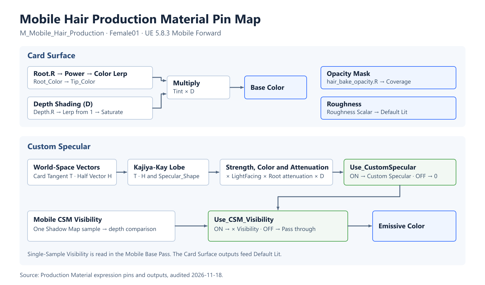
</p>

**Figure 6-22. Mobile Hair Production Material Pin Map.** `M_Mobile_Hair_Production`의 실제 입출력 배선을 전사한 도식이다. Surface와 Custom Specular, 마지막 CSM Switch의 관계를 보여준다. Graph Audit

| Stage | Verified Data Flow |
|---|---|
| Strand Coverage | `hair_bake_opacity.R` → `Opacity Mask`. 동일한 Desktop Card와 UV를 재사용한다. |
| Root/Tip Color | `hair_bake_root.R`의 **Root는 Black(0), Tip은 White(1)**이다. `Power(Root.R, LootTipValue)`를 Alpha로 써서 `Lerp(Root_Color.RGB, Tip_Color.RGB, Alpha)`를 계산한다. Color는 Vector Parameter로 제어한다. `LootTipValue`는 Graph에 저장된 표기다. |
| Depth Shading | `D = saturate(lerp(1, hair_bake_depth.R, DepthShade_Strength))`. 이 계수를 Root/Tip Color에 곱해 `Base Color`를 만들고, 아래에서 조립한 Custom Specular에도 곱한다. `Roughness`는 Default Lit의 Roughness 입력에 독립적으로 연결된다. |
| Single-Lobe Shape | Tangent Space의 Card Tangent를 World Space로 변환하고 정규화해 `T`로 쓴다. `L`은 `ResolvedView.DirectionalLightDirection.xyz`를 정규화한 방향, `V`는 `CameraVectorWS`, Half Vector `H`는 `normalize(L + V)`다. `d = dot(H, T)`를 얻고 `pow(sqrt(saturate(1 - d²)), Specular_Shape)`로 Lobe를 만든다. `Specular_Shape`가 커지면 Highlight 폭이 좁아진다. |
| Specular Color, Strength and Attenuation | `Lobe × Specular_Strength × Specular_Color.RGB`에 `LightFacing`, `Root Specular Attenuation`, `D`를 순서대로 곱한다. Production `LightFacing`은 Card의 `PixelNormalWS · L`을 Multiply와 Add로 재매핑한 뒤 Saturate한다. Root 감쇠는 `saturate(1 - pow(1 - Root.R, RootSpec_Power) × RootSpec_Strength)`다. 따라서 Tip으로 갈수록 Root 감쇠가 약해진다. |
| Emissive and CSM | `Use_CustomSpecular`가 위 결과 또는 `0`을 선택한다. `Use_CSM_Visibility`는 ON에서 이 출력에 실제 Mobile CSM Visibility를 곱하고 OFF에서 그대로 통과시킨다. 마지막 Switch 출력이 `Emissive Color`에 들어간다. |

PDO는 Mobile 기준선에서 연결하지 않았다. 이번에 필요한 중첩부의 명암은 Depth Shading에서 얻었으며, Pixel Depth를 변경하는 경로의 Coverage·Shadow 반응과 실기기 비용은 검증 범위에 남아 있다. 별도 Root AO 입력도 두지 않았다. 현재 Depth Shading이 중첩부를, Root Specular Attenuation이 Root의 광택을 각각 처리한다. Root AO를 더하면 이 구간이 추가로 어두워지므로 별도 품질 이득이 확인될 때 검토한다.

---

### Cast Shadow Recovery and CSM Quality

Directional Light의 Movable CSM Distance를 **20,000 → 1,000cm**로 줄이자 같은 Camera와 Light에서 Hair→Head Cast Shadow와 Hair 내부 Shadow가 다시 보였다. Hair의 Cast Shadow, Receive CSM Shadows 및 Material의 Opacity Mask는 이미 활성 상태였다. 넓은 거리 구간을 제한된 Cascade에 나눠 담던 상태에서 가까운 영역에 더 높은 Shadow 정밀도를 배분한 것으로 해석한다. Distance만 바꾼 비교에서 복원을 확인했고, Shadow Texel의 월드 크기와 Bias의 기여는 따로 측정하지 않았다.

Figure 6-23은 복원된 1,000cm 조건에서 Hair Component의 Cast Shadow만 바꾼 대조군이다. 이마와 관자놀이가 밝아지는 변화와 Hair 내부 일부에 남는 어두운 영역을 구분한다.

<p align="center">
*Fig6_23 — 공개 사본에서 이미지 생략.*
</p>

**Figure 6-23. Hair-to-Head Cast Shadow Control.** 동일 Camera·Light 및 1,000cm CSM에서 Hair Cast Shadow만 ON/OFF했다. ON에서 이마와 관자놀이에 Hair 그림자가 보인다. Hair 내부의 별도 확대에서도 겹친 Card 일부가 밝아졌고 넓은 어두운 띠는 일부 남았다. [Cast Shadow Results](Reports/2026-11-18_MobileHair/Evidence_and_Provenance.md#cast-shadow-and-csm)

Cast Shadow 복원 후 **1,000 → 500cm**는 근접 품질 비교로 진행했다. Figure 6-24의 `E3`는 Cascade Distribution Exponent 3, `2048`은 `r.Shadow.MaxCSMResolution` 상한이다. `500cm`는 이 Character 검증 Level의 근접 조건이다. 이마의 경계가 더 선명해진 대신 Directional CSM Coverage는 10m에서 5m로 줄어든다.

<p align="center">
*Fig6_24 — 공개 사본에서 이미지 생략.*
</p>

**Figure 6-24. Near-field CSM Quality Comparison.** 같은 이마 영역을 잘라 기본 `1000 / E3 / 2048`, Distance `500`, Distribution `E4`, CSM 상한 `4096`을 비교했다. 각 비교는 기준에서 한 항목만 바꿨다. `500cm`에서 경계가 선명해졌고 `4096`에서는 가는 그림자가 더 분리됐다.

| CSM Check | Observation and Trade-off |
|---|---|
| Requested and allocated cascades | Light에서 4개를 요청했고 Runtime 상한과 Shadow Dump에서 2개가 확인됐다. `2048` 상한 조건에서 실제 아틀라스는 **4096 × 2048 / 16 MiB**, `4096` 비교에서는 **8192 × 4096 / 64 MiB**였다. 이는 이 Preview의 활성 아틀라스 할당값이다. |
| Distance and Distribution | 별도 품질 비교 당시에는 `1,000cm / E7 / 2048`을 열린 Editor 세션에 채택했다. `500cm / E3 / 2048`과 비슷한 근접 경계 개선을 보이며 전체 거리를 유지했다. 가까운 Cascade에 정밀도를 더 배분하면 먼 Cascade의 정밀도가 낮아질 수 있다. 해당 세션 기록에서 Level 저장은 확인되지 않았다. |
| Stock Filtering | 당시 Mobile Base Pass Shader Dump의 `MOBILE_SHADOW_QUALITY=2`는 실행 엔진의 `Manual3x3PCF` 분기였다. 이 경로는 Shadow Filter Sharpen을 사용하지 않아 0으로 유지했다. Bias와 Slope Bias는 각각 0.5로 유지했다. |

---

### Custom Specular Shadow Visibility

기본 Direct Lighting에서 외부 Cube의 그림자가 보이더라도, Emissive에 추가한 Kajiya-Kay Highlight는 밝게 남을 수 있었다. Mobile Base Pass에서 기본 조명의 Shadow가 적용된 뒤 Material Emissive가 별도로 합산되기 때문이다. `LightFacing`은 Card가 Light를 향한 정도를 나타낸다. Cube가 빛을 막았는지는 Receiver와 Light 사이의 차폐를 추가로 확인해야 한다.

1. **Shadow Map**에는 Directional Light에서 본 Caster의 깊이가 저장된다. 현재 Pixel의 Scene Depth로 Cascade를 고른 뒤, Screen-to-Shadow Matrix로 좌표를 바꿔 해당 Shadow Texture를 한 번 읽는다.
2. **Visibility**는 Shadow Map에서 읽은 깊이와 Receiver Depth를 비교해 얻은 결과다. 현재 Custom Node는 깊이 차이에 Transition Scale을 적용하고 `saturate`로 제한한다. `1`은 빛이 닿는 상태, `0`은 차폐된 상태다.
3. `Use_CSM_Visibility` ON에서 이 값을 이미 조립된 Custom Specular에 곱한다. Mobile Base Pass Pixel Shader 경로에서만 실제 CSM 리소스를 조회하며, Cascade 범위 밖이나 조회 분기 바깥에서는 `1`을 반환한다.

<p align="center">
*Fig6_25 — 공개 사본에서 이미지 생략.*
</p>

**Figure 6-25. External Occluder and Custom Specular Visibility.** Production 복제 Material에서 Camera·Light·Cube A 위치를 고정했다. OFF에서 차폐 영역에 남은 Highlight가 ON에서 줄었다. 별도 대조에서 Cube를 옮기거나 Cube의 Cast Shadow를 끄자 Highlight가 다시 보였다.

| Verification Stage | Evidence |
|---|---|
| Replicated Material | `M_Mobile_Hair_Production_CSM_Test`와 동일 파라미터의 OFF/ON Instance로 검증했다. 외부 Cube 차폐에 따라 결괏값이 바뀌었고, Visibility Debug에서 Hair Cast Shadow를 끄면 Root 및 Card 중첩부의 차폐가 줄었다. 이 단계에서는 원본 Master와 Instance를 보존했다. |
| Production Integration | 이후 실제 `M_Mobile_Hair_Production`에 이식해 Hair에서 OFF/ON 반응을 확인했다는 작업 기록이 있다. 저장된 Master를 다시 조회해 `Use_CustomSpecular` 뒤에 Single-Sample Visibility를 곱하는 Switch와 Emissive 출력 배선을 확인했다. 원본 이식 단계의 별도 OFF/ON 원본 Capture는 확보하지 못했다. Figure 6-25는 복제 검증을 보여준다. |
| Current Hair Slot | Camera Orbit 기록에서 Female01 Hair Slot 0의 `MI_Female01_hair`는 `M_Mobile_Hair_AngelRing_RD`를 Parent로 사용했다. 현재 저장된 Instance에서도 R&D Parent 참조가 확인된다. Production 기준선은 위 Production Master와 해당 시점의 검증 기록이다. |

Custom Visibility는 단일 Shadow Texture 조회와 깊이 비교를 사용한다. Stock Mobile CSM의 다중 Sample Filtering과 경계 품질은 별개다. 외부 Cube를 0.25cm 옮긴 정지 비교에서 얇은 가닥의 차폐 경계가 달라졌으나 연속 움직임의 시간적 깜빡임은 판정하지 않았다.

---

### Angel Ring R&D

#### Virtual Tangent Experiment

Production의 실제 Card Tangent로 Single-Lobe Kajiya-Kay를 구하면 Highlight가 각 Card의 방향을 따른다. 머리 볼륨을 도는 띠를 더 강하게 연출하기 위해 머리 기준의 가상 형상으로부터 **Virtual Tangent**를 만드는 `Use_AngelRing` 방식을 시험했다. 측면에서는 원하는 띠에 가까웠지만, 위에서 보면 가르마 옆을 따라 Highlight가 길게 뻗었다. `Angel_DepthShift = 0 / 0.23`은 이 단계에서 Depth 값으로 Tangent 기반 반사 위치를 조정한 비교다. 저장 Graph의 보정항은 `(Depth.R - 0.5) × Angel_DepthShift`를 `H · T`에 더한다. 이때의 상단 실루엣 한계가 직접 Band를 형성하는 후속 실험으로 이어졌다.

#### Direct Angel Band

`Use_AngelBand` 분기는 가상 Normal과 **Band Axis**의 내적을 이용해 띠를 직접 만든다. 머리의 가상 볼륨에서 얻은 Normal은 매끄러운 띠의 모양을 정한다. Band Axis는 머리에 고정된 축과 `H = normalize(L + V)`를 `Angel_AxisTilt`로 보간한 뒤 Normalize한다. `Angel_BandCenter`는 내적 공간에서 띠 중심을, `Angel_BandWidth`는 중심에서 벗어났을 때 마스크가 0으로 내려가는 폭을 제어한다.

`d = dot(VirtualNormalWS, BandAxisWS)`일 때 Band Mask는 `1 - saturate(abs(d - Angel_BandCenter) / max(Angel_BandWidth, 0.001))`로 계산된다. 이 값이 `Use_AngelBand` 분기의 형태를 만든다. 분기를 끄면 기존 Kajiya-Kay Lobe를 선택한다.

#### Card-facing Attenuation

어두운 Hair 쪽에 밝은 띠가 남을 때 이전 `SmoothStep(0, 0.25)`의 Value에는 **`Band Axis · Light Direction`**이 들어가 있었다. 문제 영역에서 해당 값은 양수였고 실제 Card의 `PixelNormalWS · Light Direction`은 음수였다. CSM이 그 위치를 비차폐로 판단한 가닥에는 밝기가 남았다. 입력을 **`PixelNormalWS · Light Direction`**으로 교체하자 광원에서 돌아선 Card의 띠가 줄고 광원 쪽 Highlight가 유지됐다.

| Signal | Role |
|---|---|
| Virtual Normal · Band Axis | Hair 표면에서 띠가 나타날 위치와 폭을 만든다. |
| `SmoothStep(0, 0.25, PixelNormalWS · L)` | 실제 Hair Card가 Light를 향한 정도로 Band Mask를 감쇠한다. |
| Mobile CSM Visibility | 실제 Caster에 의해 막힌 광량을 최종 Custom Specular에서 줄인다. |

<p align="center">
*Fig6_26 — 공개 사본에서 이미지 생략.*
</p>

**Figure 6-26. Angel Band Attenuation Before and After.** `AngelBand_Android_Vulkan_High.png`를 사용했다. 동일 Camera·Light·노출 설정에서 `SmoothStep` 입력만 바꿨다. 아래 진단행은 Band Axis dot, Virtual Normal dot, Card Normal dot 및 CSM Visibility를 따로 보여준다.

#### Camera Orbit and R&D Decision

Light와 Female01을 고정하고 Hair를 중심으로 `−28° → 중앙 → +28°`의 같은 Camera 위치를 세 값에 반복 적용했다. Screen에서 보이는 밝기와 Hair 표면 위에서 띠의 중심이 움직이는 정도를 따로 읽었다.

| `Angel_AxisTilt` | Band Position | Visible Contribution |
|---|---|---|
| `0` | 머리에 고정된 축을 사용해 띠가 표면의 같은 상단 구간에 머문다. | Camera가 바라보는 쪽에 따라 밝은 띠의 노출 면적이 달라진다. |
| `0.5` | Half Vector를 섞어 광원 쪽 옆머리 중간에서 띠의 이동이 보인다. | 해당 조명과 구도에서 띠의 위치와 강도를 가장 안정적으로 읽을 수 있었다. |
| `1` | Half Vector를 전부 사용해 옆머리 하단까지 더 크게 이동한다. | 차폐되거나 Light에서 돌아선 면이 강조되는 각도에서는 띠의 일부만 남는다. |

<p align="center">
*Fig6_27 — 공개 사본에서 이미지 생략.*
</p>

**Figure 6-27. Angel Band Camera Orbit and Brightness Contribution.** `AngelBand_Camera_Orbit_Comparison.png`를 사용했다. 위쪽은 Lit Preview, 아래쪽 청록색은 같은 Camera에서 `Specular_Strength = 0`인 기준 Frame보다 밝아진 영역이다. 청록색에는 Card LightFacing과 CSM 감쇠가 반영되어 있다.

`0.5`를 현재 Female01의 조명과 구도에서 R&D 기준값으로 채택했다. 고정 축과 Half Vector의 보간이 위치 이동폭을 조절하고, Card의 방향과 CSM은 이동한 띠가 화면에 남는 밝기를 바꾼다. 이 결과를 Angel Ring R&D의 현재 마무리 지점으로 삼는다. Camera 반응의 독립 제어, 다른 Hairstyle에서의 축과 가상 볼륨 조정, 실기기 성능 검증은 후속 R&D에 둔다.

---

### Validation Boundary

여기까지 확인한 범위는 Android Vulkan High **Editor Preview**에서의 외형, Cast Shadow 및 Custom Specular 차폐 반응이다. **Android Cook, 실기기 화질, GPU Timing은 미검증**이다. Desktop RHI의 Instruction/Sampler 수치는 Mobile CSM 코드가 빠지는 경로의 통계다. 정확한 Android Vulkan Shader 비용과 GPU Frame Time은 대상 Device에서 따로 확인해야 한다.

---

## 6.5 Mobile Eye Material Reuse

### Reuse Decision and Preview Evidence

Mobile Eye는 기존 Desktop Eye Material인 `MI_Eye`와 Parent `M_Eye_Master`를 재사용한다. 현재 Female01과 구도에서 별도 Mobile Eye Material을 제작해야 할 정도의 외형 문제는 관찰되지 않아 기존 표현을 유지하기로 결정했다. Figure 6-28과 Figure 6-29는 Android Vulkan High Preview에서 관찰한 실제 외형과 Parent 연결을 뒷받침한다. 이번에는 별도의 Mobile 전용 Eye Master나 새로운 Shading 경로를 추가하지 않았다.

Eye의 Surface 구성과 Texture / Mask 계약, 홍채 크기와 깊이 근사의 원리는 [Chapter 04 — Production Eye Material](Chapter04_ProductionEyeMaterial.md)에 유지한다. 특히 [4.9 Scale and Parallax Integration](Chapter04_ProductionEyeMaterial.md#49-scale-and-parallax-integration)은 UV 처리 순서와 입력의 역할을 설명한다. 여기서는 같은 Graph를 다시 설명하기보다 Mobile Preview에서 기존 표현을 유지한 선택과 확인 범위를 기록한다.

Figure 6-28은 Female01의 대표적인 Character Preview다. 양쪽 홍채와 동공을 읽을 수 있고, 이 화면에서 눈꺼풀 주변에 두드러진 검은 덩어리나 안구가 떠 보이는 이상은 관찰되지 않았다.

<p align="center">
*Fig6_28 — 공개 사본에서 이미지 생략.*
</p>

**Figure 6-28. Representative Female01 Mobile Eye Preview.** Android Vulkan High Preview의 실제 Character 화면이다. 홍채·동공과 눈꺼풀 인접부의 현재 외형을 보여주며, 하단 Preview Platform 표시를 함께 보존했다.

Figure 6-29에서는 `MI_Eye`의 Parent가 기존 `M_Eye_Master`인 것을 확인한다. Sphere Preview의 홍채 디테일과 각막 반사는 Material의 현재 표시 결과이며, 실제 안구 Mesh에서 모든 입력의 효과를 분리한 시험은 아니다.

<p align="center">
*Fig6_29 — 공개 사본에서 이미지 생략.*
</p>

**Figure 6-29. Reused Eye Material Iris Detail, Corneal Reflection and Parent.** `MI_Eye`의 Sphere Preview에서 홍채 디테일과 각막 반사를 확인하고, Android Vulkan High 표시와 `M_Eye_Master` Parent 연결을 보존한 실제 Material Instance Editor 화면이다.

두 Capture는 이미 열려 있던 화면을 기록했다. Parameter, Preview Platform과 Camera를 변경하거나 Asset을 저장하지 않았다. 현재 Instance 값을 Chapter 04의 과거 수치와 동일하다고 간주하지 않으며, 과거의 배선 감사와 이번 Mobile 외형 관찰을 구분한다.

### Evidence Scope and Remaining Limits

| Check | Recorded Scope |
|---|---|
| Reuse decision | 기존 Eye 표현을 유지한다는 사용자 확인과 `MI_Eye`의 `M_Eye_Master` Parent 연결을 기록했다. |
| Mobile Preview appearance | Android Vulkan High에서 Character의 양쪽 눈 외형과 Material Instance Sphere의 홍채 디테일·각막 반사를 관찰했다. |
| Fixed-condition Desktop / Mobile A/B | **미검증.** 같은 Camera·Light·Exposure의 Desktop / Mobile 대조를 이번 작업에서 수행하지 않았다. |
| Oblique Iris Parallax | **미검증.** 사선 시점에서의 Iris Parallax를 분리 확인한 Capture나 Depth A/B를 이번에 확보하지 않았다. |
| Eye Wetness / Eye Occlusion | **개별 동작 미검증.** 현재 Character 외형을 각 보조 Surface의 독립 효과나 OFF/ON 비교 결과로 해석하지 않는다. |

Normal 효과의 독립 비교, 극단적인 Scale 입력과 모든 시점의 안정성 등 기존 기술적 한계는 [4.11 Visual Validation, Decisions and Open Issues](Chapter04_ProductionEyeMaterial.md#411-visual-validation-decisions-and-open-issues)에 유지한다. 이번 재사용 확인을 모든 플랫폼의 Native Eye 기능 검증으로 확대하지 않는다. [Mobile Eye Evidence and Provenance](Reports/2026-11-18_MobileEye/Evidence_and_Provenance.md)에서 Capture와 확인 범위를 추적한다.

---

## 6.6 Chapter Closeout

Chapter 06은 **UE 5.8.3의 Android Vulkan High Editor Preview 기준으로 모바일 Material 전환을 마무리했다.** 공통 PBR에서 Skin·Hair·Eye로 확장하면서, 재사용할 입력과 별도 구현이 필요한 표현을 구분하고 실제 관찰과 선택의 근거를 기록했다.

| Section | Recorded Result |
|---|---|
| 6.1 Rendering Architecture and Setup | Mobile Forward와 Android Vulkan High Preview의 기준, 초기 설정 및 Geometry 문제를 정리했다. |
| 6.2 Basic PBR Conversion | 기존 입력과 Opaque / Masked의 역할을 유지한 전환 및 Preview 결과를 기록했다. |
| 6.3 Mobile Skin Shader | Female01의 V3 직접 확산광 보정과 Material 통합, Preview 비교를 기록했다. |
| 6.4 Mobile Hair Shader | Production 기준선의 Custom Specular, Cast Shadow와 CSM 차폐를 정리했다. Angel Ring은 별도 R&D로 구분해 현재 선택과 한계를 기록했다. |
| 6.5 Mobile Eye Material Reuse | 기존 Eye Material을 재사용하고 Android Vulkan High Preview의 외형과 Parent 연결을 확인했다. |

완료 기준은 이 프로젝트의 Editor Preview에서 Material 전환·재사용과 외형을 확인하고, 구현 결정 및 검증 한계를 문서와 Figure로 보존한 것이다. 각 Section의 미확보 과거 증거와 세부 R&D 한계는 해당 기록에 유지한다. Eye의 고정 조건 Desktop / Mobile A/B, 사선 Iris Parallax와 Wetness / Occlusion의 개별 동작도 미검증으로 남긴다.

**Android 패키징, 실기기 화질과 GPU Timing은 이번 Chapter의 완료 조건에서 제외한 별도 검증 범위다.** 이번 작업에서 실행하거나 측정하지 않았으며, Preview 완료를 실기기 성능이나 배포 승인으로 해석하지 않는다. 이후 대상 기기와 실행 조건이 정해지면 기존 문서의 입력·구현·증거를 기준으로 별도 검증한다.

---

## Figure Register

Figure 6-1–6-3은 Section 6.1 작성 당시 실제 Project Settings에서 확보한 설정 화면이고, Figure 6-4–6-8은 당시 사용자 첨부 원본이다. Figure 6-9–6-20은 Section 6.3의 Skin R&D / Production 비교 및 소스 기반 도식이다. Figure 6-21–6-27은 Section 6.4의 Mobile Hair 외형, Material 배선 도식, Shadow 비교 및 Angel Ring R&D다. Figure 6-28–6-29는 Section 6.5의 기존 Eye Material 재사용과 Android Vulkan High Preview 관찰이다.

| Figure | File | Evidence and Role |
|---|---|---|
| 6-1 | `Figures/Chapter06/Fig6_01.png` | 실제 Project Settings의 Mobile Forward 및 Desktop Forward Shading OFF. Section 6.1의 설정 근거다. |
| 6-2 | `Figures/Chapter06/Fig6_02.png` | 실제 Project Settings의 Mobile HDR ON. Section 6.1의 설정 근거다. |
| 6-3 | `Figures/Chapter06/Fig6_03.png` | 실제 Project Settings의 Mobile Float Precision `Use Half-precision`. Section 6.1의 설정 근거다. |
| 6-4 | `Figures/Chapter06/Fig6_04.png` | 첨부 `image(20261104-054512).png` 원본. Mobile Opaque Master Graph와 기본 PBR Data Flow의 근거다. |
| 6-5 | `Figures/Chapter06/Fig6_05.png` | 첨부 `image(20261104-054915).png` 원본. Mobile Masked Graph / Details와 Alpha 경로의 근거다. |
| 6-6 | `Figures/Chapter06/Fig6_06.png` | 2026-11-04 14시경 첨부 `image(20261104-055529).png` 원본. Musa Body / Clothing의 넓은 Surface 관찰 자료다. |
| 6-7 | `Figures/Chapter06/Fig6_07.png` | 같은 시점 첨부 `image(20261104-055536).png` 원본. 의상 하단 Mask 경계의 Cutout 관찰 자료다. |
| 6-8 | `Figures/Chapter06/Fig6_08.png` | 같은 시점 첨부 `image(20261104-055452).png` 원본. 같은 Mobile Opaque Master의 DirectX Target별 정적 통계다. |
| 6-9 | `Figures/Chapter06/Fig6_09.png` | R&D Spatial Beauty |
| 6-10 | `Figures/Chapter06/Fig6_10.png` | R&D Spatial Layers at 1:1 |
| 6-11 | `Figures/Chapter06/Fig6_11.png` | R&D Screen-Space Resolution |
| 6-12 | `Figures/Chapter06/Fig6_12.png` | R&D CSM and Transmission |
| 6-13 | `Figures/Chapter06/Fig6_13.png` | Production Eye Mask Correction |
| 6-14 | `Figures/Chapter06/Fig6_14.png` | Production Integration Preview |
| 6-15 | `Figures/Chapter06/Fig6_15.png` | Production Normal Strength Sweep |
| 6-16 | `Figures/Chapter06/Fig6_16.png` | Production Custom Pin Map |
| 6-17 | `Figures/Chapter06/Fig6_17.png` | Production Material and Carrier |
| 6-18 | `Figures/Chapter06/Fig6_18.png` | V3 Lighting and CSM |
| 6-19 | `Figures/Chapter06/Fig6_19.png` | CurvatureV Authoring Workflow |
| 6-20 | `Figures/Chapter06/Fig6_20.png` | R&D Curvature Bake Comparison |
| 6-21 | `Figures/Chapter06/Fig6_21.png` | Female01 Mobile Hair Production Baseline |
| 6-22 | `Figures/Chapter06/Fig6_22.png` | Mobile Hair Production Material Pin Map |
| 6-23 | `Figures/Chapter06/Fig6_23.png` | Hair-to-Head Cast Shadow Control |
| 6-24 | `Figures/Chapter06/Fig6_24.png` | Near-field CSM Quality Comparison |
| 6-25 | `Figures/Chapter06/Fig6_25.png` | External Occluder and Custom Specular Visibility |
| 6-26 | `Figures/Chapter06/Fig6_26.png` | Angel Band Attenuation Before and After |
| 6-27 | `Figures/Chapter06/Fig6_27.png` | Angel Band Camera Orbit and Brightness Contribution |
| 6-28 | `Figures/Chapter06/Fig6_28.png` | Representative Female01 Mobile Eye Preview |
| 6-29 | `Figures/Chapter06/Fig6_29.png` | Reused Eye Material Iris Detail, Corneal Reflection and Parent |

[Figure 6-9–6-20 Provenance](Reports/2026-11-08_MobileSkinProduction/Figure_Provenance.md)에서 원본 경로, 재사용 범위 및 이미지 해시를 확인한다.

[Figure 6-21–6-27 Provenance](Reports/2026-11-18_MobileHair/Evidence_and_Provenance.md#figure-provenance)에서 Mobile Hair Figure의 원본, 도식과 Capture의 구분 및 이미지 해시를 확인한다.

[Figure 6-28–6-29 Provenance](Reports/2026-11-18_MobileEye/Evidence_and_Provenance.md)에서 Mobile Eye Capture의 출처와 관찰 범위, 이미지 해시를 확인한다.

[Chapter 01 — Production PBR Master Material](Chapter01_ProductionPBRMasterMaterial.md)은 공통 입력 계약과 Artist Control의 기존 구현을 설명한다. [Chapter 05 — Character Integration & Validation](Chapter05_CharacterIntegrationAndValidation.md)은 Desktop 통합의 근거와 남은 검증을 보존한다. 그 문서의 과거 상태를 이번 Mobile Runtime의 측정 결과로 옮기지 않는다.

첨부 원본 5장은 Pixel 편집·Crop·Annotation 없이 복사했다. Figure 6-1–6-3은 실제 UI Capture를 PNG로 보관한 것이며 UI의 일부를 다시 그린 이미지가 아니다. 기존 Chapter01~05 Figure는 재명명하거나 덮어쓰지 않았다. 초기 Configure Now 및 Nanite 전후 원본의 누락은 Section 6.1의 TODO로 유지한다.

---

## References

### Official Technical Sources

아래 자료는 Rendering 원리와 기능의 근거다. 본 프로젝트의 실제 설정값과 완료 판정은 로컬 파일·현재 UI·사용자 첨부를 우선한다. 일반 문서에 옵션이 나열되어 있어도 실제 5.8.3 UI에서 확인하지 못한 옵션을 적용 상태로 추가하지 않는다. 공식 문서는 2026-11-04에 확인했다.

- [R1 — Epic: Rendering and Shading Modes](https://dev.epicgames.com/documentation/en-us/unreal-engine/mobile-rendering-and-shading-modes-for-unreal-engine): Mobile Forward / Deferred의 구조와 선택 조건이다.
- [R2 — Epic: Mobile Deferred Shading Mode](https://dev.epicgames.com/documentation/en-us/unreal-engine/using-the-mobile-deferred-shading-mode-in-unreal-engine): GBuffer / Lighting 분리와 Mobile Deferred의 장점·제약이다.
- [R3 — Khronos: Tile-Based Rendering Best Practices](https://docs.vulkan.org/guide/latest/tile_based_rendering_best_practices.html): Tile Memory와 Attachment / Bandwidth의 관계다.
- [R4 — Khronos: Subpasses Sample](https://docs.vulkan.org/samples/latest/samples/performance/subpasses/README.html): Geometry / Lighting Subpass의 GBuffer 재사용과 병합 조건이다.
- [R5 — Arm: Vulkan Subpasses — The Good, the Bad, and the Ugly](https://developer.arm.com/community/arm-community-blogs/b/mobile-graphics-and-gaming-blog/posts/vulkan-subpasses-the-good-the-bad-and-the-ugly): Bandwidth 감소와 GPU 시간 개선을 구분하는 Hardware / Driver Trade-off다.
- [R6 — Epic: Android Project Settings](https://dev.epicgames.com/documentation/en-us/unreal-engine/android-settings-in-the-unreal-engine-project-settings): Vulkan, Desktop / SM5, GLES와 ARM64 설정의 역할이다.
- [R7 — Epic: Rendering Project Settings](https://dev.epicgames.com/documentation/en-us/unreal-engine/rendering-settings-in-the-unreal-engine-project-settings): Mobile Precision 및 별도 Desktop Forward 설정이다.
- [R8 — Epic: Performance Guidelines for Mobile Devices](https://dev.epicgames.com/documentation/en-us/unreal-engine/performance-guidelines-for-mobile-devices-in-unreal-engine): HDR / LDR 선택과 Mobile Material의 기능별 Trade-off다.
- [R9 — Epic: Nanite Technical Details](https://dev.epicgames.com/documentation/unreal-engine/nanite-technical-details): Nanite Fallback의 역할과 단순화 Geometry다.
- [R10 — Epic: Nanite Virtualized Geometry](https://dev.epicgames.com/documentation/en-us/unreal-engine/nanite-virtualized-geometry-in-unreal-engine): Nanite 지원 경로와 Geometry 처리 개요다.

### Local Audit Sources

`Mobile Project Root`는 `local path withheld`, `Engine Root`는 `local path withheld`이다. 다음은 이 Root 기준의 실제 조사 위치이며 외부 Config나 Engine Source를 문서 작업 중 수정하지 않았다.

| Root | Source | Audit Purpose |
|---|---|---|
| Mobile Project | `Config/DefaultEngine.ini` | Mobile Shading Project Override, GLES OFF 및 남아 있는 Desktop 설정을 확인했다. |
| Mobile Project | `Saved/Config/WindowsEditor/EditorPerProjectUserSettings.ini` | Android Vulkan High / Android_High Preview 선택을 확인했다. |
| Mobile Project | `Build/Android/project.properties` | 빈 파일의 현재 존재·0 bytes 및 시각을 확인했다. |
| Mobile Project | `Content/ASF/PBR/Mobile/M_Mobile_PBR_Master.uasset`, `M_Mobile_PBR_Masked.uasset` | Mobile Master 파일 존재와 식별 가능한 Parameter / Function 이름을 확인했다. |
| Mobile Project | `Content/ASF/Characters/Musa/Materials/MI_Character_Body.uasset`, `MI_Character_Weapon.uasset` | 명시적인 Mobile Parent reference를 확인했다. |
| Engine | `Engine/Build/Build.version` | UE 5.8.3 / CL 58210709를 확인했다. |
| Engine | `Engine/Config/BaseEngine.ini` | Android ARM64 / Vulkan / Desktop Vulkan의 상속 기본값을 확인했다. |
| Engine | `Engine/Source/Runtime/Core/Private/HAL/ConsoleManager.cpp` | Mobile HDR / Float Precision CVar default를 확인했다. |
| Engine | `Engine/Source/Runtime/RenderCore/Private/RenderUtils.cpp` | Desktop Forward Shading의 default를 확인했다. |
| Engine | `Engine/Source/Runtime/Engine/Classes/Engine/RendererSettings.h` | Mobile Shading / Precision의 실제 DisplayName, enum과 ToolTip을 확인했다. |
| Mobile Project | `Content/ASF/PBR/Mobile/M_Mobile_Hair_Production.uasset` | Production Surface, Custom Specular, CSM Switch의 실제 배선을 확인했다. Material Graph Audit |
| Mobile Project | `M_Mobile_Hair_AngelRing_RD.uasset`, `MI_Female01_hair.uasset` | Angel Band의 Axis·Mask·Card-facing 연결과 저장된 Instance의 R&D Parent를 대조했다. [Hair Material and Assignment](Reports/2026-11-18_MobileHair/Evidence_and_Provenance.md#material-and-assignment) |
| Mobile Preview Test Records | Hair Shadow Diagnosis, CSM Integration and Tuning, Angel Ring Attenuation and Camera Orbit | 복원, 품질 비교, 차폐 연동 및 시점 이동의 조건과 관찰을 정리했다. [Mobile Hair Evidence and Provenance](Reports/2026-11-18_MobileHair/Evidence_and_Provenance.md) |
| V3 Engine / Mobile Hair audit | `MobileBasePassPixelShader.usf`, `MobileLightingCommon.ush`, `Mobile_CSM_Visibility.hlsl` | Stock Direct Lighting과 Material Emissive, Stock PCF와 Custom Single-Sample Visibility의 역할을 비교했다. Custom HLSL |
| RTR Advanced | [Chapter 03 — Production Hair Shader](Chapter03_ProductionHairShader.md) | Desktop Hair Card의 Coverage, Texture 입력과 PDO 평가를 참조했다. |

[R1]: https://dev.epicgames.com/documentation/en-us/unreal-engine/mobile-rendering-and-shading-modes-for-unreal-engine
[R2]: https://dev.epicgames.com/documentation/en-us/unreal-engine/using-the-mobile-deferred-shading-mode-in-unreal-engine
[R3]: https://docs.vulkan.org/guide/latest/tile_based_rendering_best_practices.html
[R4]: https://docs.vulkan.org/samples/latest/samples/performance/subpasses/README.html
[R5]: https://developer.arm.com/community/arm-community-blogs/b/mobile-graphics-and-gaming-blog/posts/vulkan-subpasses-the-good-the-bad-and-the-ugly
[R6]: https://dev.epicgames.com/documentation/en-us/unreal-engine/android-settings-in-the-unreal-engine-project-settings
[R7]: https://dev.epicgames.com/documentation/en-us/unreal-engine/rendering-settings-in-the-unreal-engine-project-settings
[R8]: https://dev.epicgames.com/documentation/en-us/unreal-engine/performance-guidelines-for-mobile-devices-in-unreal-engine
[R9]: https://dev.epicgames.com/documentation/unreal-engine/nanite-technical-details
[R10]: https://dev.epicgames.com/documentation/en-us/unreal-engine/nanite-virtualized-geometry-in-unreal-engine

---

[PBR Character Contents](README.md) · [Production PBR Master Material](Chapter01_ProductionPBRMasterMaterial.md) · [Production Skin Shader](Chapter02_ProductionSkinShader.md) · [Production Hair Shader](Chapter03_ProductionHairShader.md) · [Production Eye Material](Chapter04_ProductionEyeMaterial.md) · [Character Integration & Validation](Chapter05_CharacterIntegrationAndValidation.md)
