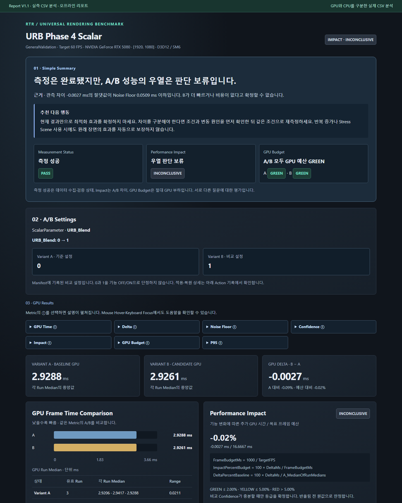
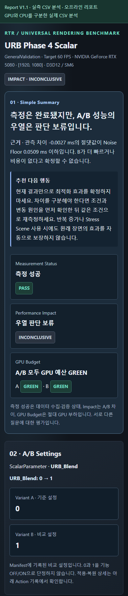

# Benchmark Report Interpretation Guide

> Version: V1.1 · Updated: 2026-11-03 KST
> Scope: RTR Universal Rendering Benchmark Tool V1의 결과 해석
> Example: Scalar Run `20261103T114935_URB4_Scalar_30CCDBF0`

## Read the Conclusion First

Report는 같은 Scene에서 A와 B를 측정한 결과를 보여준다. 처음에는 **결론 → 근거 → 추천 다음 행동 → A/B 설정**을 읽는다. 측정이 정상적으로 끝났는지와 어느 쪽이 더 빠른지를 구별하면, 서로 다른 상태가 함께 표시되는 이유를 이해할 수 있다.

이번 Scalar 결과의 결론은 **측정은 성공했지만, A/B 성능 차이를 확정할 수 없다**는 것이다. `URB_Blend`를 A=`0`에서 B=`1`로 바꾸었을 때 GPU Delta의 절댓값이 Noise Floor보다 작았다. 현재 숫자만으로 B를 더 빠르다고 채택하거나 최적화가 필요하다고 결론 내리지 않는다. 시각적 품질과 목적에 따라 설정을 선택하고, 차이를 구별할 필요가 있으면 같은 조건에서 다시 측정한다.

아래 Desktop 화면에서는 결론과 세 가지 독립 상태를 먼저 확인한다. 원본 숫자·상태·판정 규칙을 유지한 V1.1 표시 예제이며, 새 Unreal 측정 결과가 아니다.



*Scalar Report Desktop — 실제 Scalar Run의 결론, 근거, 추천 행동과 A/B 설정을 확인하는 화면이다.*

## Separate the Statuses

| Field | 답하는 질문 | 이번 Scalar 결과 |
|---|---|---|
| Measurement Status | 측정 자료와 검증 상태가 정상인가? | `PASS`: 자료 검증을 통과했다. 성능 개선을 뜻하지 않는다. |
| Performance Impact | B가 A보다 GPU 시간을 얼마나 바꾸었는가? | `INCONCLUSIVE`: 차이를 확정할 수 없다. |
| Confidence | 이 A/B 차이를 해석할 조건을 충족했는가? | `INCONCLUSIVE`: Delta가 Noise Floor 이하이다. |
| GPU Frame Budget A / B | 각 상태의 전체 GPU 시간이 목표 예산 안인가? | 둘 다 `GREEN`: 각 GPU 대표값이 예산의 70% 이하이다. |

따라서 **`PASS + INCONCLUSIVE + GREEN`은 모순이 아니다.** 자료는 정상이고 GPU Budget에는 여유가 있지만, A/B 차이는 이번 측정의 변동과 구별되지 않는다. `INCONCLUSIVE`를 “차이가 없다”로 읽지 않는다. `GREEN`을 전체 시스템의 목표 FPS 보장이나 시각 품질 점수로 읽지 않는다.

## Read the Actual Scalar Numbers

| Item | Report 표시값 | 읽는 방법 |
|---|---:|---|
| Action | `ScalarParameter` | `URB_Blend`: A=`0`, B=`1`이다. |
| GPU A | `2.9288 ms` | A Capture별 Median의 Median이다. |
| GPU B | `2.9261 ms` | B Capture별 Median의 Median이다. |
| Delta B−A | `−0.0027 ms` | 음수로 관측됐지만 개선 확정 조건을 충족하지 않았다. |
| Noise Floor | `0.0509 ms` | 이번 비교에서 차이 판정에 사용하는 변동 기준이다. |
| Target FPS / Budget | `60 / 16.6667 ms` | `1000 / TargetFPS`이며 측정 속도 제한이 아니다. |
| GPU Budget A / B | `17.57% / 17.56%` | 각 상태의 전체 GPU 시간과 Budget의 비율이다. |

숫자는 표시할 때 반올림한다. Analysis의 정확한 값은 B=`2.92615 ms`, Delta=`−0.00265 ms`이며 판정은 반올림 전 값으로 수행한다. 이번 자료의 A/A Range=`0.0509 ms`, A Range=`0.0211 ms`, B Range=`0.0321 ms`이므로 `max(0.0509, 0.0211, 0.0321, 0.05)=0.0509 ms`가 Noise Floor다. `abs(−0.00265) ≤ 0.0509`이므로 `IMPROVED`로 표시하지 않는다.

이번 Run은 같은 실행의 A/A 6 Capture와 A/B 6 Capture를 포함한다. A/B는 Variant별 3회, Capture당 300프레임이며 매 Capture 전 Warmup은 120프레임이다. A/A 연결은 `VALID`이고 환경은 일치한다. GPU 판정을 보류한 직접 이유는 `DELTA_WITHIN_NOISE_FLOOR`다. A/A 부재나 자료 실패가 이 예제의 원인은 아니다.

## Choose the Next Action

| Display | 추천 다음 행동 |
|---|---|
| `INCONCLUSIVE` + 작은 Delta | 성능 우열을 확정하지 않는다. 차이를 알아야 할 때 환경 부하·Clock·온도와 반복 변동을 확인하고 같은 조건 A/A·A/B를 다시 수집한다. 반복을 늘려도 차이가 반드시 구별되지는 않는다. |
| `INCONCLUSIVE` + A/A 부재·조건 불일치·반복 부족 | 상세 사유에 맞게 같은 A 상태·Camera·해상도·Scene 조건의 Calibration과 필요한 반복을 준비한다. 설정·Asset 준비를 모두 끝낸 뒤 측정한다. |
| `RELIABLE` + `IMPROVED` | 해당 Scene·설정에서 B의 GPU 시간 감소가 정책 조건을 통과했다. 화면 품질·기능 의도를 확인하고 별도 반복으로 재현성을 확인한다. |
| `RELIABLE` + Impact `GREEN / YELLOW / RED` | B의 추가 GPU 비용을 예산과 비교한다. 색상과 실제 ms를 함께 읽고 품질·목표 예산에 따라 유지·조정·추가 분석을 선택한다. `RED` 자체가 기능 제거 지시는 아니다. |
| GPU Budget `YELLOW / RED` | B뿐 아니라 A도 확인한다. Scene 전체의 GPU 여유가 적거나 예산을 넘으므로 전체 GPU 부하와 CPU/Frame 상황을 함께 조사한다. |
| `WARNING` | 경고의 영향을 먼저 확인한다. 유효한 Metric·등급은 해당 사유와 함께 해석하고, 보류된 판정이나 `PASS`와 구별한다. |
| `FAIL / CANCELLED / UNSUPPORTED` 또는 GPU `UNAVAILABLE` | 실행·복원·자료·Metric 사유부터 확인한다. 정상 GPU 비교 결과로 채택하거나 누락값을 0ms로 읽지 않는다. |
| A/A 단독 | 같은 A 상태의 반복 안정성 진단으로 읽는다. A/B 기능 비용이나 B의 Budget 결과로 사용하지 않는다. |

Stress Scene을 사용한다면 다른 조건의 새 실험으로 구별한다. 같은 Camera·해상도·화면 점유율·설정의 결과끼리 비교하고, 합성 장면이나 격리 Hair 결과를 실제 Character Scene 전체 또는 Material의 고정 비용으로 일반화하지 않는다.

## Use Metrics and Technical Details

주요 Metric의 도움말을 읽고, 반복 변동이나 이상값을 조사할 때만 상세 영역을 펼친다. 도움말을 마우스로 볼 수 없는 환경에서는 Report의 용어 설명을 펼쳐 확인한다.

| Metric | 의미와 주의점 |
|---|---|
| GPU Time | Scene 전체 GPU Frame Time이다. 낮을수록 적은 GPU 시간이지만 작은 차이는 Noise와 함께 판단한다. 특정 Material 또는 GPU Pass만의 절대 비용이 아니다. |
| Median / Representative | 각 Capture의 중앙값을 구한 뒤 그 중앙값들의 Median을 A/B 대표값으로 사용한다. |
| Mean / Pooled | Mean은 산술평균이다. Pooled 통계는 Variant의 모든 유효 Sample을 합쳐 계산하며 대표값과 다를 수 있다. |
| P95 | 오름차순 N개 Sample의 `ceil(0.95×N)`번째 값이다. 긴 프레임 쪽의 분포를 볼 때 사용한다. Pooled P95와 Capture별 P95의 Median을 구별한다. |
| Range / Relative Spread | Capture Median의 최댓값−최솟값과 `100×Range/Median`이다. 단일 프레임의 Min–Max 범위와 다르다. |
| Noise Floor / Confidence | 기본 Noise Floor는 `max(RangeAA, RangeA, RangeB, 0.05ms)`다. 유효한 같은 조건 A/A, 반복 수·안정성 등의 검사를 통과하고 `abs(Delta)>NoiseFloor`일 때 `RELIABLE`이다. |
| Baseline % / Budget % | 각각 A의 GPU 대표값과 목표 Frame Budget을 분모로 사용한다. 같은 Delta라도 두 %는 다르다. |

초기 RTR 정책은 A/B 최소 3회, A/A 최소 6회, 그룹별 Relative Spread 상한 5%다. 신뢰할 수 있는 양의 Impact는 Budget의 2% 이하 `GREEN`, 2% 초과~5% 이하 `YELLOW`, 5% 초과 `RED`다. GPU Budget은 70% 이하 `GREEN`, 70% 초과~100% 이하 `YELLOW`, 100% 초과 `RED`다. 실제 적용값과 버전은 해당 Report의 Policy를 우선한다. 이 기준은 조정 가능한 RTR 정책이며, 장비 공식 오차·Confidence Interval·p-value·통계적 유의성 검정이 아니다.

## Read CPU and Frame Data Carefully

Frame Time·Game Thread Time·Render Thread Time은 GPU 결과를 보완하는 진단 자료다. CPU·GPU는 겹쳐 실행될 수 있으므로 시간을 합산해 전체 Frame Time이나 FPS를 계산하지 않는다. GPU의 Impact·Budget 색상 정책도 CPU에 적용하지 않는다. GPU가 누락돼도 CPU 값으로 GPU를 대체하지 않는다.

이번 Scalar Run의 CPU/Frame 세 Metric은 모두 `INCONCLUSIVE`다. 반복 Median 변동과 A/A 변동이 안정성 조건을 통과하지 못했고 Delta도 해당 Noise Floor 이하이다. Frame·Render Thread의 음수 Delta를 CPU 개선의 증거로 채택하지 않는다. GPU Budget이 `GREEN`이어도 이 보조 자료만으로 시스템 전체의 60FPS 달성을 보장할 수 없다.

## Preserve Evidence and Compare Reports

Sources·Raw CSV·Summary.csv·Analysis.json·Manifest·정책과 해시는 수치의 근거다. 상세 정보가 접혀 있어도 증거가 삭제된 것은 아니다. 원본 링크를 유지하려면 **Report가 들어 있는 결과 폴더 전체**를 복사한다. HTML은 외부 서버·CDN 없이 오프라인으로 열 수 있다.

V1.1은 기존 V1 Report를 덮어쓰지 않는 버전 있는 표시 개선이다. 동일 Raw를 V1.1으로 다시 표시한 결과는 새 측정으로 세지 않는다. 이전 Report와 새 Report에서 RunID·A/B 설정·통계·Confidence·Impact·Budget·Source 해시가 같은지 확인하면 표시 변경과 측정 변경을 구별할 수 있다. 측정 도중이나 분석 후 Raw·Manifest를 편집하여 판정을 바꾸지 않는다.

좁은 화면에서도 결론과 상태를 먼저 읽고, 긴 표는 가로로 이동하며 상세 값을 확인한다. 아래 화면은 같은 실측 자료의 반응형 표시 확인이며, Desktop과 독립된 성능 측정이 아니다.



*Scalar Report Narrow View — 폭 390px에서 같은 Scalar 결과를 읽는 화면이다. 상세 통계의 긴 표는 별도 스크롤 영역을 사용한다.*

## Open and Reproduce

Actual Scalar Report에서 이 가이드의 실측 샘플을 연다. 새 측정 결과는 도구의 `v1_1/Analyze.pyw`로 Run 폴더를 선택해 분석한다. 개발·재현 시 `v1_1` 폴더에서 다음처럼 실행할 수 있다. 경로는 큰따옴표로 감싸고 `<새 분석 보관 폴더>`는 원하는 새 위치로 바꾼다.

```text
Analyze.cmd "local path withheld" --output-root "<새 분석 보관 폴더>" --open
```

설치·Preset·Capture 절차는 V1 User Guide를, 계산 계약은 Master Specification을 따른다. 구현·실측 근거는 Phase 3 Implementation과 Phase 4 Implementation을 확인한다. 이 Reference 사본은 V1 당시 내용을 보존하며 V1.1 실행 위치는 위 안내를 따른다.
